> Produced locally with the case-frame version of New-ViDiffReport.ps1 (PR #29), comparing this pull request against #33 so only its own changes appear. Compared in the 32-bit LabVIEW 2026, which lacks some IG HTTP and JSONtext VIs, so those show as grey "?" nodes; the CI report has the same diagrams with all icons.

## VI diff report

4 modified, 4 added, 0 deleted. Generated by LabVIEW's VI comparison; position and size changes are not shown.

### `src/MCP Server/Generate Unique Server ID.vi` (modified)

**1. Block Diagram objects**

- **1A** wiring changes

| Before | After |
|---|---|
|  |  |

**2. VI Attribute - Documentation (VI Properties)**

- **2A** description text : changed from "Generates a unique id for the server. Increments if the id already exists. Timeouts after 10k ids." to "Generates a unique id for the server. Increments if the id already exists. Timeouts after 10k ids.

The candidates are server id in + 1, + 2, ...; the first candidate that is not yet an attribute name of Variant is returned (the first server gets 1). The name tested is the candidate itself: until PR D the loop tested the candidate minus one but returned the candidate, so every server started after the first got the id of the first one."

Whole block diagram and front panel

| Before | After |
|---|---|
| 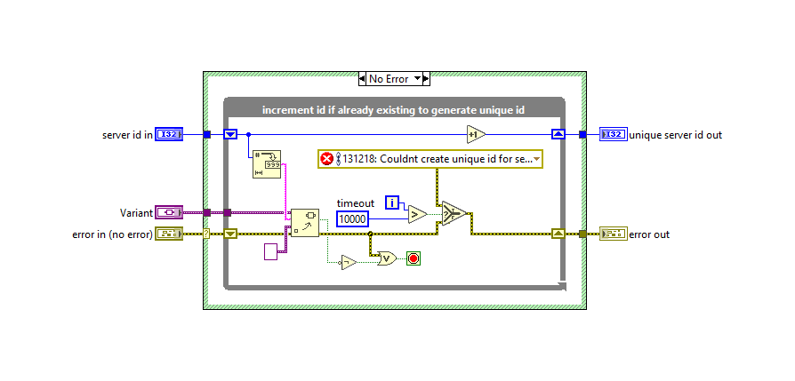 |  |

| Before | After |
|---|---|
| 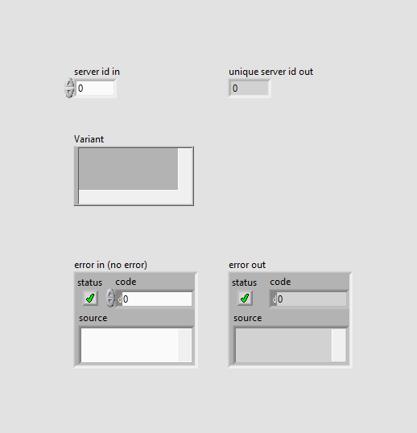 |  |

All case frames (1 hidden frames)

| Frame | Picture |
|---|---|
| Whole diagram, visible frames: Case structure 1: No Error |  |
| Case structure 1: Error .. | 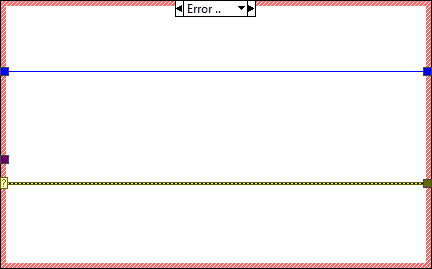 |

### `src/MCP Server/Process HTTP Request.vi` (modified)

**1. Block Diagram objects**

- **1A** String Constant "Header" - added at (496,-123)
- **1B** SubVI "Get Request.vi" - added at (551,-106)
- **1C** SubVI "MCP Server.lvlib:Check Client Access.vi" - added at (585,-106)
- **1D** SubVI "Get Host.vi" - added at (585,-106)
- **1E** SubVI "Get Client URI.vi" - added at (585,-106)
- **1F** SubVI "Request Header.vi" - added at (585,-106)
- **1G** SubVI "Set Header.vi" - added at (1454,-256)
- **1H** wiring changes

| Before | After |
|---|---|
| 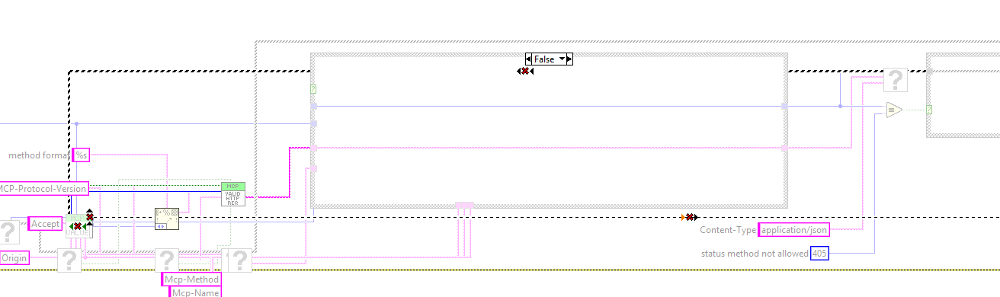 | 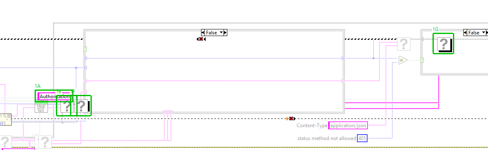 |

**2. VI Attribute - Documentation (VI Properties)**

- **2A** description text : changed from "Answers one HTTP request on the MCP endpoint following the MCP Streamable HTTP transport rules, and stores the response in the Processing object.

1. Reads the HTTP method and the Origin and MCP-Protocol-Version request headers and passes them to Validate HTTP Request.vi. Also reads the Mcp-Method and Mcp-Name headers (MCP 2026-07-28).
2. Rejected request (405, 403 or 400): the MCP server is NOT called. The response carries the status code and the JSON-RPC error payload from Validate HTTP Request.vi with Content-Type application/json. A 405 additionally carries the header Allow: POST.
3. Accepted request: the request body, one message or a batch of messages, is passed with the three MCP headers to Handle MCP Request.vi, which decides the era (legacy or modern) per request, makes the modern header checks and answers; its errors are cleared. Its status code is used: 202 with an empty body for a notification, 200 with Content-Type application/json, or 400/404 for a refused modern request.

error out reports only errors of the first two header reads. It is informational: a response is always set." to "Answers one HTTP request on the MCP endpoint following the MCP Streamable HTTP transport rules, and stores the response in the Processing object.

1. ACCESS: reads the client host (Get Request, Get Client URI, Get Host: the name from a reverse DNS lookup of the client address) and the Authorization header, and passes them to Check Client Access.vi with the access settings Start.vi stored for this server. A client that is not allowed gets 403, a missing or wrong bearer token 401 with WWW-Authenticate: Bearer. These checks win over every later one.
2. Reads the HTTP method and the Origin and MCP-Protocol-Version request headers and passes them to Validate HTTP Request.vi. Also reads the Mcp-Method and Mcp-Name headers (MCP 2026-07-28).
3. Rejected request (403, 401, 405 or 400): the MCP server is NOT called. The response carries the status code and the JSON-RPC error payload with Content-Type application/json. A 405 additionally carries the header Allow: POST.
4. Accepted request: Prepare Request Dispatch.vi answers a legacy notifications/cancelled itself and decides whether a tools/call is streamed (Start Streamed Request.vi). Otherwise the request body, one message or a batch of messages, is passed with the three MCP headers to Handle MCP Request.vi, which decides the era (legacy or modern) per request, makes the modern header checks and answers; its errors are cleared. Its status code is used: 202 with an empty body for a notification, 200 with Content-Type application/json, or 400/404 for a refused modern request.

error out reports only errors of the first two header reads. It is informational: a response is always set."

Whole block diagram and front panel

| Before | After |
|---|---|
| 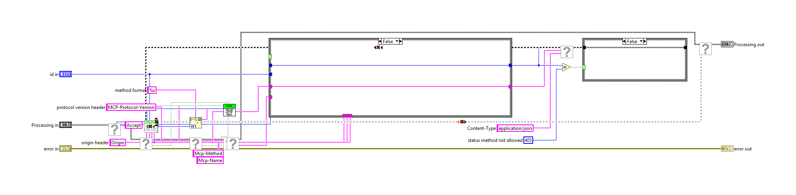 | 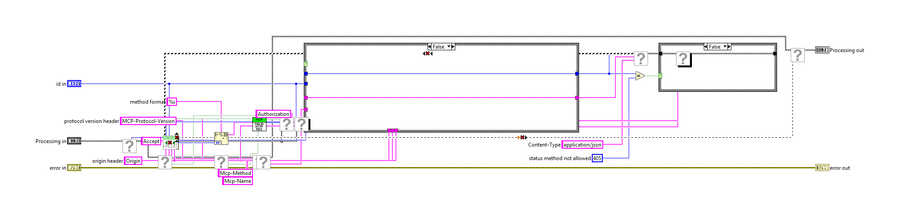 |

| Before | After |
|---|---|
| 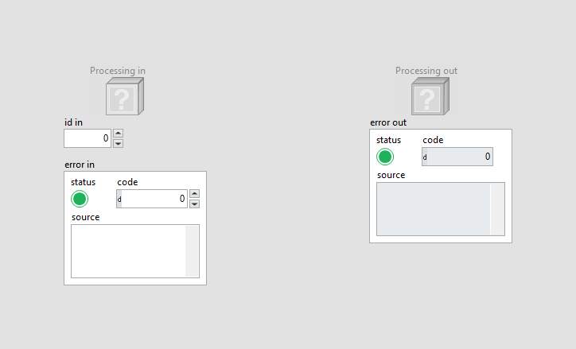 |  |

All case frames (2 hidden frames)

| Frame | Picture |
|---|---|
| Whole diagram, visible frames: Case structure 1: False; Case structure 2: False | 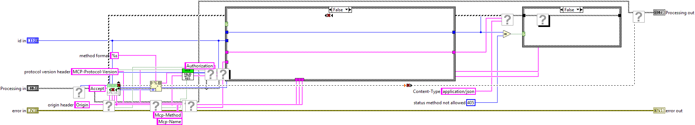 |
| Case structure 1: True | 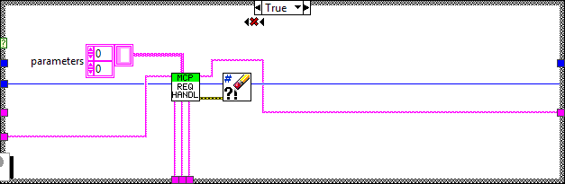 |
| Case structure 2: True | 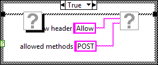 |

### `src/MCP Server/Start.vi` (modified)

**1. Block Diagram objects**

- **1A** Front Panel Terminal "Access token" - added at (369,479)
- **1B** Front Panel Terminal "Allowed clients" - added at (371,477)
- **1C** SubVI "MCP Server.lvlib:Server Access Settings.vi" - added at (409,427)
- **1D** wiring changes

| Before | After |
|---|---|
| 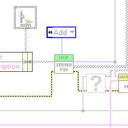 | 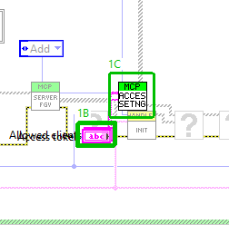 |

**2. Front Panel - Panel**

- **2A** Connector Pane  - control/indicator assignment : changed

| Before | After |
|---|---|
| 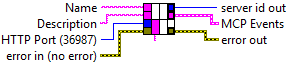 | 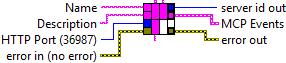 |

**3. Front Panel objects**

- **3A** Array "Allowed clients" - added at (62,-35)

| Before | After |
|---|---|
| 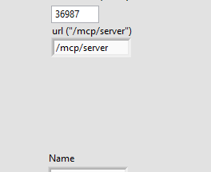 | 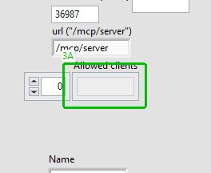 |

**4. Front Panel objects**

- **4A** String "Access token" - added at (137,-133)

| Before | After |
|---|---|
| 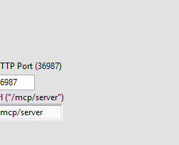 | 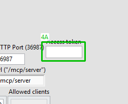 |

**5. VI Attribute - Documentation (VI Properties)**

- **5A** description text : changed from "Creates a new MCP server. The URL will be:
http://localhost:3687/mcp/server
Server name and description will be passed on to the client and the LLM. Be aware that these cost you tokes. For detailled descriptions of the server (e.g. software manual) use resources instead. 
This VI returns user events for different events that can happen inside the server. Make sure to listen to the error event to catch any runtime errors. Use the onRpc event to receive every request that is sent from a client to the server.

Your MCP Client config (e.g. claude_desktop_config.json) should look like this:
{
  "mcpServers": {
    "My Cool Server Display-Name": {
      "command": "npx",
      "args": [
        "mcp-remote",
        "http://127.0.0.1:36987/mcp/server"
      ],
      "env": {
        "YOUR_API_KEY": "<YOUR_SECRET_KEY>",
        "MY_PARAM": "Your custom Parameter"
      }
    }
  }
}" to "Creates a new MCP server. The URL will be:
http://localhost:3687/mcp/server
Server name and description will be passed on to the client and the LLM. Be aware that these cost you tokes. For detailled descriptions of the server (e.g. software manual) use resources instead. 
This VI returns user events for different events that can happen inside the server. Make sure to listen to the error event to catch any runtime errors. Use the onRpc event to receive every request that is sent from a client to the server.

Your MCP Client config (e.g. claude_desktop_config.json) should look like this:
{
  "mcpServers": {
    "My Cool Server Display-Name": {
      "command": "npx",
      "args": [
        "mcp-remote",
        "http://127.0.0.1:36987/mcp/server"
      ],
      "env": {
        "YOUR_API_KEY": "<YOUR_SECRET_KEY>",
        "MY_PARAM": "Your custom Parameter"
      }
    }
  }
}

ACCESS CONTROL (Allowed clients, Access token): the IG HTTP Server listens on all network interfaces, so a server is reachable from the network unless a firewall prevents it. Allowed clients filters by client host name as reported by reverse DNS; empty (the default) means this computer only (a loopback literal, localhost, or this computer's own name, short or FQDN), "*" means any client. Client names from reverse DNS can be spoofed on a local network, so the list is a best-effort filter, not security: a server reachable beyond this computer needs Access token, which makes every request carry Authorization: Bearer <token>. Refused clients get HTTP 403, a missing or wrong token HTTP 401.
Note: the default now refuses every client that does not report as this computer. This is a deliberate behaviour change; earlier versions served any client. A client on another computer (also mcp-remote run there) needs an entry in Allowed clients, or "*", and should use Access token."

Whole block diagram and front panel

| Before | After |
|---|---|
| 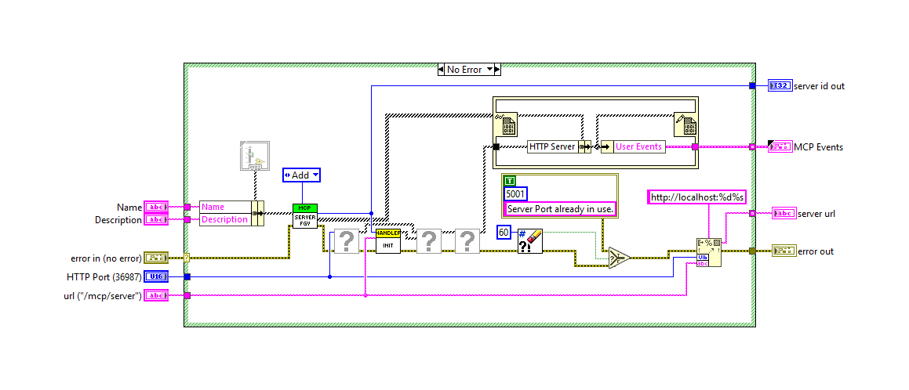 | 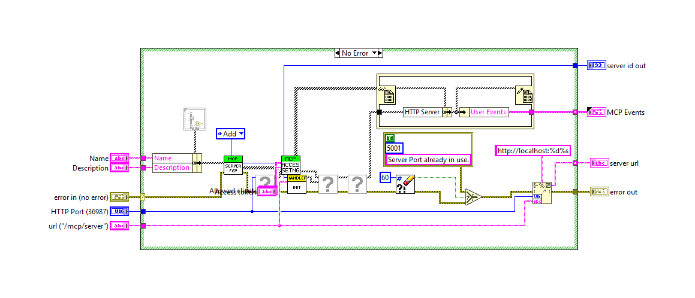 |

| Before | After |
|---|---|
|  | 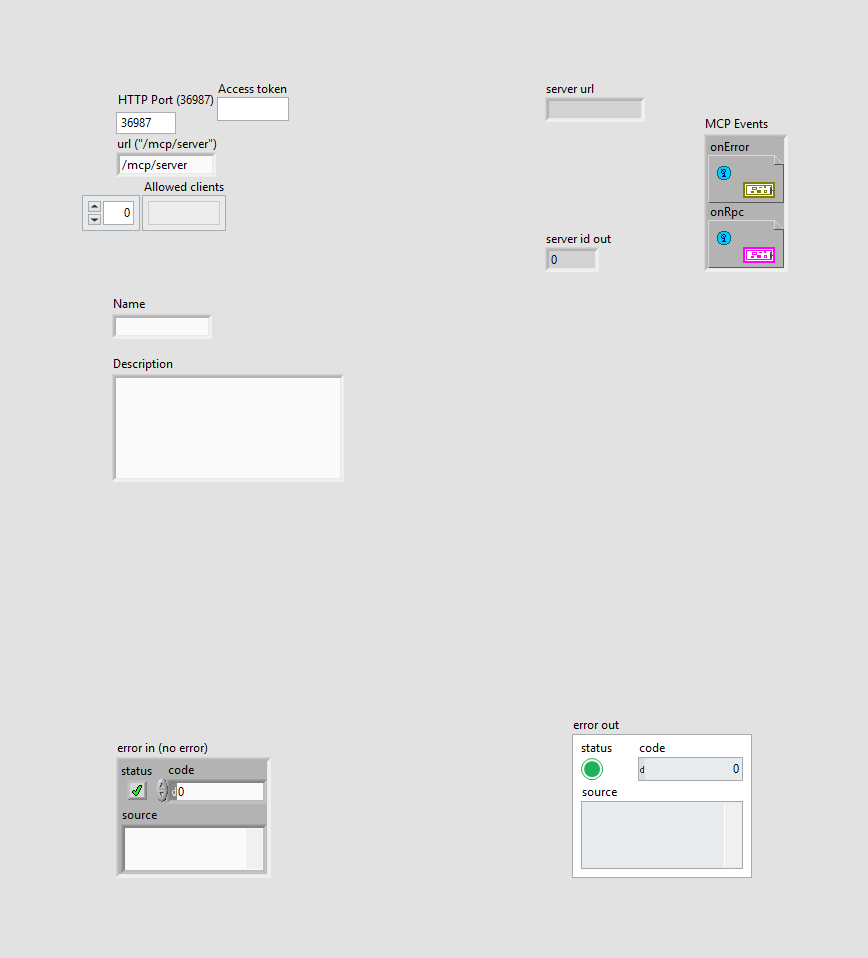 |

All case frames (1 hidden frames)

| Frame | Picture |
|---|---|
| Whole diagram, visible frames: Case structure 1: No Error | 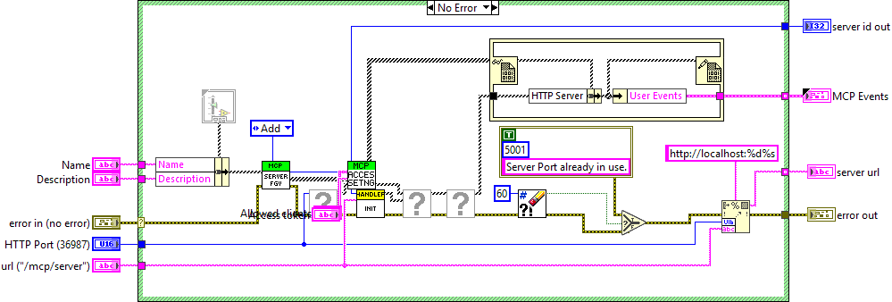 |
| Case structure 1: Error .. | 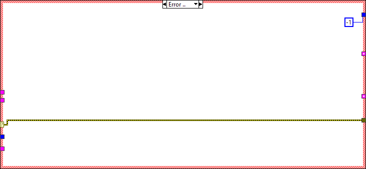 |

### `tests/Test_MCP_Server.vi` (modified)

**1. Block Diagram objects**

- **1A** SubVI "MCP Server tests.lvlib:test access allowed clients.vi" - added at (4766,296)
- **1B** SubVI "MCP Server tests.lvlib:test access bearer token.vi" - added at (4862,296)
- **1C** wiring changes

| Before | After |
|---|---|
| 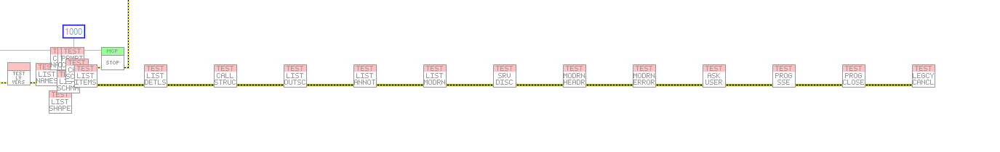 | 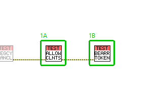 |

Whole block diagram and front panel

| Before | After |
|---|---|
|  | 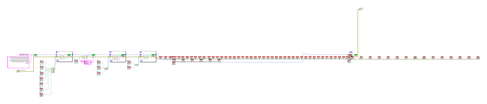 |

| Before | After |
|---|---|
|  |  |

### `src/MCP Server/Check Client Access.vi` (added)

Block diagram (case structures show their visible frame only):

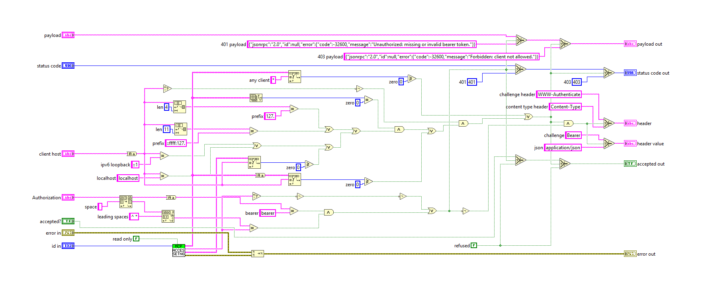

Front panel

### `src/MCP Server/Server Access Settings.vi` (added)

Block diagram (case structures show their visible frame only):

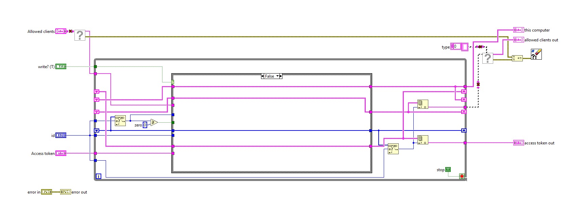

Front panel

All case frames (1 hidden frames)

| Frame | Picture |
|---|---|
| Whole diagram, visible frames: Case structure 1: False | 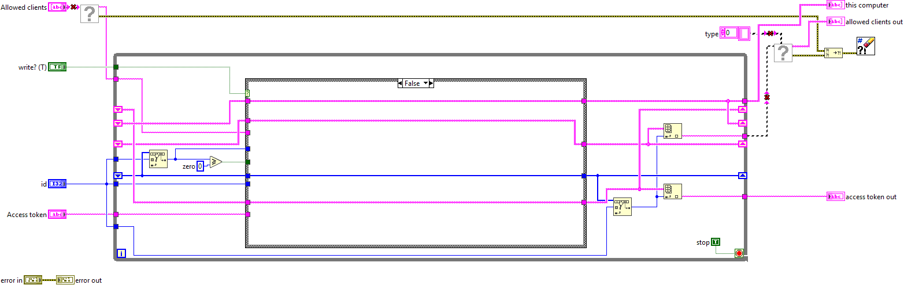 |
| Case structure 1: True |  |

### `tests/test access allowed clients.vi` (added)

Block diagram (case structures show their visible frame only):

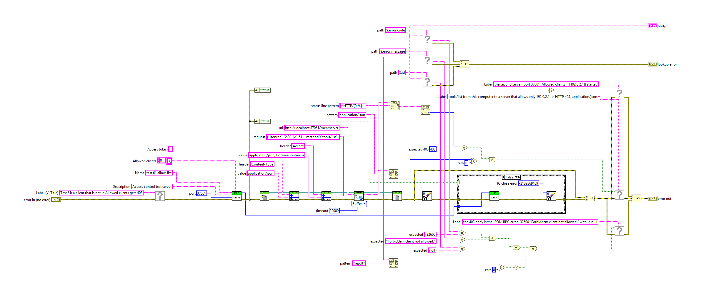

Front panel

All case frames (1 hidden frames)

| Frame | Picture |
|---|---|
| Whole diagram, visible frames: Case structure 1: False | 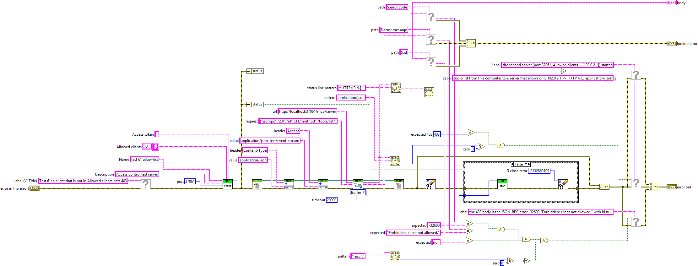 |
| Case structure 1: True |  |

### `tests/test access bearer token.vi` (added)

Block diagram (case structures show their visible frame only):

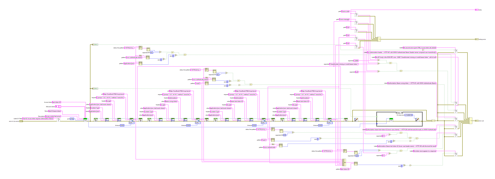

Front panel

All case frames (1 hidden frames)

| Frame | Picture |
|---|---|
| Whole diagram, visible frames: Case structure 1: False | 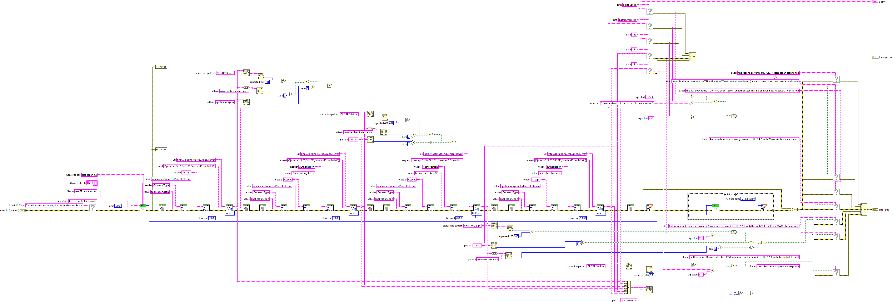 |
| Case structure 1: True |  |

