> Produced locally with the case-frame version of New-ViDiffReport.ps1 (PR #29), comparing this pull request against #31 so only its own changes appear. Compared in the 32-bit LabVIEW 2026, where some JSONtext calls show as grey "?" nodes because that installation lacks them; the CI report has the same diagrams with all icons.

## VI diff report

3 modified, 22 added, 0 deleted. Generated by LabVIEW's VI comparison; position and size changes are not shown.

### `src/MCP Server/Handle MCP Request.vi` (modified)

**1. Block Diagram objects**

- **1A** Front Panel Terminal "stream" - added at (-477,192)
- **1B** String Constant "base64 prefix" - deleted at (-434,1378)
- **1C** String Constant "path" - deleted at (-267,706)
- **1D** Match Pattern  - deleted at (-234,1371)
- **1E** String Constant "base64 suffix" - deleted at (-210,1421)
- **1F** Numeric Constant "JSON Array" - deleted at (-190,956)
- **1G** String Constant "path" - deleted at (-168,536)
- **1H** String Constant "path" - data value : changed from "<tt>"$.params.uri"</tt>" to "<tt>"$.elicitation"</tt>"
- **1I** Equal?  - deleted at (-89,950)
- **1J** Match Pattern  - deleted at (-89,1386)
- **1K** SubVI "Find Item.vi" - deleted at (-86,731)
- **1L** SubVI "MCP Server.lvlib:Validate MCP Request.vi" - added at (-68,628)
- **1M** Array Constant "named methods" - deleted at (-61,1299)
- **1N** Array Constant "modern methods" - deleted at (-60,1675)
- **1O** String Constant "path" - data value : changed from "<tt>"$.elicitation"</tt>" to "<tt>"$.params._meta.progressToken"</tt>"
- **1P** SubVI "Clear Errors.vi" - added at (60,628)
- **1Q** Search 1D Array  - deleted at (90,1306)
- **1R** Search 1D Array  - deleted at (90,1682)
- **1S** Equal?  - deleted at (94,113)
- **1T** Greater Or Equal?  - deleted at (101,1391)
- **1U** Greater Or Equal?  - deleted at (101,1434)
- **1V** SubVI "Base64 or Base64URL Decode.vi" - deleted at (104,1355)
- **1W** String Constant "string type" - deleted at (142,827)
- **1X** String Constant "string type" - deleted at (142,903)
- **1Y** And  - deleted at (198,1397)
- **1Z** SubVI "From JSON Text.vim" - deleted at (203,852)
- **127** Not  - deleted at (207,115)
- **128** Numeric Constant "zero" - deleted at (208,1325)
- **129** Numeric Constant "zero" - deleted at (208,1701)
- **130** Greater Or Equal?  - deleted at (231,1317)
- **131** Greater Or Equal?  - deleted at (231,1693)
- **132** Select  - deleted at (356,1391)
- **133** And  - deleted at (359,-60)
- **134** Not  - deleted at (368,1695)
- **135** String Constant "null" - data type name : changed from "<tt>message</tt>" to "<tt>null</tt>"
- **136** String Constant "null" - data value : changed from "<tt>"Method not found"</tt>" to "<tt>"null"</tt>"
- **137** String Constant "no stream" - data type name : changed from "<tt>message</tt>" to "<tt>no stream</tt>"
- **138** String Constant "no stream" - data value : changed from "<tt>"Invalid params: params._meta io.modelcontextprotocol/clientCapabilities is required"</tt>" to "<tt>"null"</tt>"
- **139** Not Equal?  - deleted at (500,1340)
- **140** And  - deleted at (506,1691)
- **141** SubVI "From JSON Text.vim" - deleted at (514,607)
- **142** And  - deleted at (520,-56)
- **143** Not  - deleted at (528,1113)
- **144** Numeric Constant "status 400" - deleted at (535,475)
- **145** Numeric Constant "status 404" - deleted at (535,512)
- **146** String Constant "ctx f" - data type name : changed from "<tt>initialize</tt>" to "<tt>ctx f</tt>"
- **147** String Constant "ctx f" - data value : changed from "<tt>"initialize"</tt>" to "<tt>","progressToken":"</tt>"
- **148** String Constant "ctx g" - data type name : changed from "<tt>string type</tt>" to "<tt>ctx g</tt>"
- **149** String Constant "ctx g" - data value : changed from "<tt>""</tt>" to "<tt>","stream":"</tt>"
- **150** String Constant "message" - deleted at (802,1052)
- **151** Search 1D Array  - deleted at (849,1278)
- **152** Select  - deleted at (854,498)
- **153** And  - deleted at (858,-52)
- **154** Or  - deleted at (859,1687)
- **155** String Constant "code" - deleted at (871,882)
- **156** String Constant "code" - deleted at (871,913)
- **157** Numeric Constant "status 400" - deleted at (889,444)
- **158** String Constant "ctx e" - data type name : changed from "<tt>message</tt>" to "<tt>ctx e</tt>"
- **159** String Constant "ctx e" - data value : changed from "<tt>"Header mismatch: the Mcp-Name header does not match params.name (params.uri for resources/read)"</tt>" to "<tt>","id":"</tt>"
- **160** String Constant "message" - deleted at (1002,989)
- **161** Concatenate Strings  - number of terminals : changed from "<tt>8</tt>" to "<tt>14</tt>"
- **162** Search 1D Array  - deleted at (1108,843)
- **163** Select  - deleted at (1112,488)
- **164** Select  - deleted at (1114,1088)
- **165** Or  - deleted at (1117,1683)
- **166** Not Equal?  - deleted at (1126,1349)
- **167** Numeric Constant "zero" - deleted at (1127,1385)
- **168** Numeric Constant "status 400" - deleted at (1146,413)
- **169** Greater Or Equal?  - deleted at (1150,1377)
- **170** String Constant "message" - deleted at (1343,1029)
- **171** Select  - deleted at (1450,478)
- **172** Select  - deleted at (1452,1057)
- **173** Or  - deleted at (1455,1679)
- **174** Not  - deleted at (1464,778)
- **175** Numeric Constant "zero" - deleted at (1465,740)
- **176** String Constant "code" - deleted at (1467,807)
- **177** Not  - deleted at (1479,1379)
- **178** Numeric Constant "status 400" - deleted at (1485,382)
- **179** Greater Or Equal?  - deleted at (1488,732)
- **180** Select  - deleted at (1613,468)
- **181** Select  - deleted at (1615,812)
- **182** Select  - deleted at (1615,1034)
- **183** Or  - deleted at (1619,730)
- **184** Or  - deleted at (1619,1675)
- **185** Not Equal?  - deleted at (1628,1303)
- **186** Numeric Constant "status 400" - deleted at (1650,351)
- **187** Select  - deleted at (1778,458)
- **188** Select  - deleted at (1780,994)
- **189** Or  - deleted at (1783,1671)
- **190** And  - deleted at (1790,717)
- **191** String Constant "code" - deleted at (1795,746)
- **192** Numeric Constant "status 400" - deleted at (1813,320)
- **193** SubVI - VI missing
- **194** Select  - deleted at (1898,448)
- **195** Select  - deleted at (1899,751)
- **196** And  - deleted at (1900,1889)
- **197** Or  - deleted at (2028,1885)
- **198** String Constant "code" - deleted at (2032,736)
- **199** Select  - deleted at (2142,741)
- **1100** String Constant "code" - deleted at (2276,726)
- **1101** Select  - deleted at (2380,731)
- **1102** SubVI "Set Item.vi" - number of terminals : changed from "<tt>12</tt>" to "<tt>11</tt>"
- **1103** SubVI - VI missing
- **1104** Merge Errors  - number of terminals : changed from "<tt>32</tt>" to "<tt>24</tt>"
- **1105** SubVI "Set Item.vi" - deleted at (3677,1193)
- **1106** SubVI "To JSON Text.vim" - deleted at (3687,1239)
- **1107** String Constant "no data" - deleted at (3716,1730)
- **1108** String Constant "data a" - deleted at (3906,1638)
- **1109** String Constant "data b" - deleted at (3949,1669)
- **1110** Select  - deleted at (3965,1854)
- **1111** SubVI "To JSON Text.vim" - deleted at (3977,779)
- **1112** SubVI "To JSON Text.vim" - deleted at (3981,731)
- **1113** SubVI "To JSON Text.vim" - deleted at (3981,827)
- **1114** String Constant "batch refused" - deleted at (4847,493)
- **1115** Select  - deleted at (4921,1712)
- **1116** String Constant "data c" - deleted at (4969,1655)
- **1117** Concatenate Strings  - deleted at (5233,1607)
- **1118** Select  - deleted at (5235,1685)
- **1119** String Constant "e a" - deleted at (5302,1026)
- **1120** Select  - deleted at (5306,1623)
- **1121** String Constant "e b" - deleted at (5325,1121)
- **1122** String Constant "e c" - deleted at (5346,1166)
- **1123** Select  - deleted at (5369,1558)
- **1124** Select  - deleted at (5369,2181)
- **1125** String Constant "e d" - deleted at (5537,1208)
- **1126** Concatenate Strings  - deleted at (5566,1153)
- **1127** Select  - deleted at (5638,1162)
- **1128** wiring changes

| Before | After |
|---|---|
| 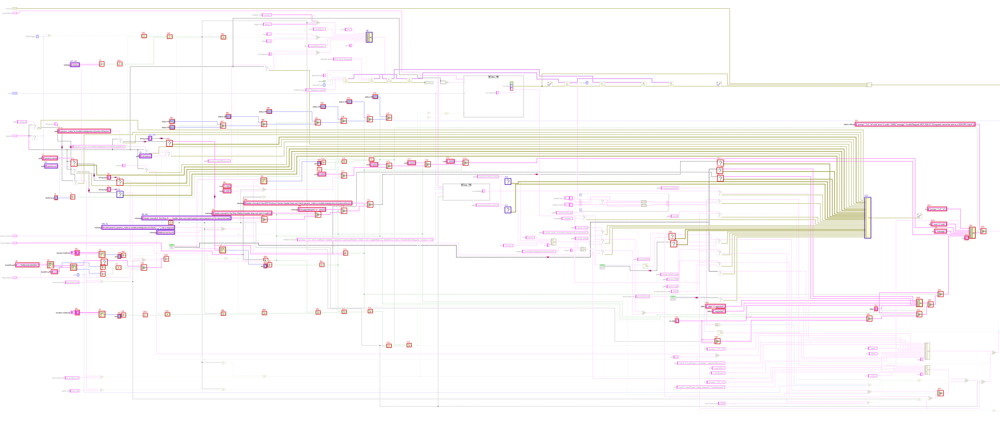 | 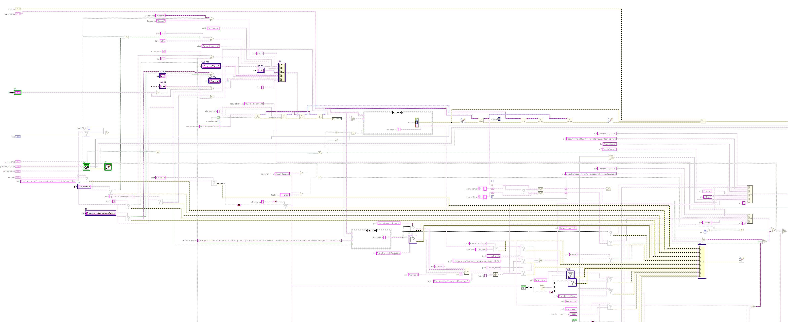 |

**2. Front Panel - Panel**

- **2A** Connector Pane  - control/indicator assignment : changed

| Before | After |
|---|---|
|  | 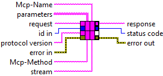 |

**3. Front Panel objects**

- **3A** String "stream" - added at (16,574)

| Before | After |
|---|---|
| 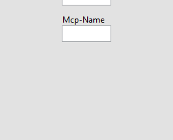 | 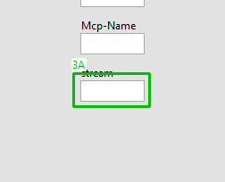 |

**4. VI Attribute - Documentation (VI Properties)**

- **4A** description text : changed from "Handles the body of one HTTP POST in either MCP era and returns the HTTP status code and the response body. Replaces the direct call of Handle Server Request Batch.vi in Process HTTP Request.vi.

ERA, per request, without session state: a JSON object whose params._meta carries io.modelcontextprotocol/protocolVersion is MODERN (MCP 2026-07-28), unless its method is initialize. Everything else is LEGACY and is passed to Handle Server Request Batch.vi unchanged, so legacy answers stay exactly as they were.

MODERN requests are checked first, in this order, and refused without being handled:
- MCP-Protocol-Version header missing or different from the _meta protocolVersion: 400, -32020 (header mismatch).
- protocolVersion not one of the modern versions of Supported Protocol Versions.vi: 400, -32022 with data.supported and data.requested.
- Mcp-Method header missing or different from method: 400, -32020.
- tools/call and prompts/get: Mcp-Name must equal params.name; resources/read: params.uri. A value =?base64?...?= is decoded first. Missing or different: 400, -32020.
- io.modelcontextprotocol/clientCapabilities missing in params._meta: 400, -32602.
- A method the modern era does not have (it has server/discover, tools/list, tools/call, prompts/list, prompts/get, resources/list, resources/read and resources/templates/list; no ping, logging/setLevel or notifications/initialized): 404, -32601. Notifications (no id) are answered with 202 as before.
A JSON array (batch) that comes with modern headers (an Mcp-Method header, or a modern MCP-Protocol-Version) is refused with 400, -32600.

MODERN results: server/discover is answered here (supportedVersions = all versions, capabilities and serverInfo as initialize reports them). Every other result is handled as before and then gets "resultType":"complete" and _meta io.modelcontextprotocol/serverInfo; the methods named in Cache Hints.vi also get ttlMs and cacheScope. resources/read errors -32002 (resource not found) become -32602.

ELICITATION: while a request is handled, its context ({"era","elicitation","inputResponses"}) is the only element of the named queue "MCP Request Context" (size 1, which also serialises request handling), and questions that Ask User.vi registers are collected from the named queue "MCP Input Requests". When a modern tools/call registered questions, the result is {"resultType":"input_required","inputRequests":{...}} instead of the tool result (no requestState: the retry carries the original params with inputResponses).

serverInfo is taken from initialize.vi (called with a synthetic initialize request), so name and version always match what initialize reports." to "Handles the body of one HTTP POST in either MCP era and returns the HTTP status code and the response body. Replaces the direct call of Handle Server Request Batch.vi in Process HTTP Request.vi.

ERA, per request, without session state: a JSON object whose params._meta carries io.modelcontextprotocol/protocolVersion is MODERN (MCP 2026-07-28), unless its method is initialize. Everything else is LEGACY and is passed to Handle Server Request Batch.vi unchanged, so legacy answers stay exactly as they were.

MODERN requests are checked first (by Validate MCP Request.vi), in this order, and refused without being handled:
- MCP-Protocol-Version header missing or different from the _meta protocolVersion: 400, -32020 (header mismatch).
- protocolVersion not one of the modern versions of Supported Protocol Versions.vi: 400, -32022 with data.supported and data.requested.
- Mcp-Method header missing or different from method: 400, -32020.
- tools/call and prompts/get: Mcp-Name must equal params.name; resources/read: params.uri. A value =?base64?...?= is decoded first. Missing or different: 400, -32020.
- io.modelcontextprotocol/clientCapabilities missing in params._meta: 400, -32602.
- A method the modern era does not have (it has server/discover, tools/list, tools/call, prompts/list, prompts/get, resources/list, resources/read and resources/templates/list; no ping, logging/setLevel or notifications/initialized): 404, -32601. Notifications (no id) are answered with 202 as before.
A JSON array (batch) that comes with modern headers (an Mcp-Method header, or a modern MCP-Protocol-Version) is refused with 400, -32600.

MODERN results: server/discover is answered here (supportedVersions = all versions, capabilities and serverInfo as initialize reports them). Every other result is handled as before and then gets "resultType":"complete" and _meta io.modelcontextprotocol/serverInfo; the methods named in Cache Hints.vi also get ttlMs and cacheScope. resources/read errors -32002 (resource not found) become -32602.

REQUEST CONTEXT: while a request is handled, its context ({"era","elicitation","inputResponses","id","progressToken","stream"}) is the only element of the named queue "MCP Request Context" (size 1, which also serialises request handling), and questions that Ask User.vi registers are collected from the named queue "MCP Input Requests". When a modern tools/call registered questions, the result is {"resultType":"input_required","inputRequests":{...}} instead of the tool result (no requestState: the retry carries the original params with inputResponses).

serverInfo is taken from initialize.vi (called with a synthetic initialize request), so name and version always match what initialize reports.

STREAMING: stream is empty for a normal request. For a streamed tools/call Run Streamed Request.vi passes the stream object {"events":..,"cancelled":..} (the queues of the MCP SSE Response, as numbers); it goes into the request context, where Report Progress.vi and Cancel Requested.vi find it. id and progressToken in the context are the JSON text of the request id and of params._meta.progressToken."

Whole block diagram and front panel

| Before | After |
|---|---|
| 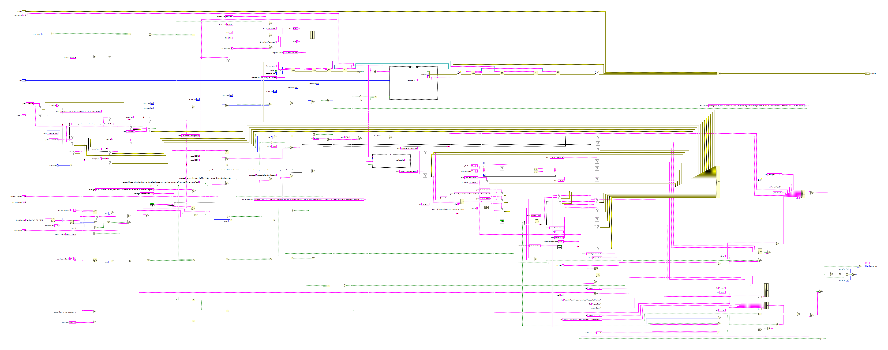 | 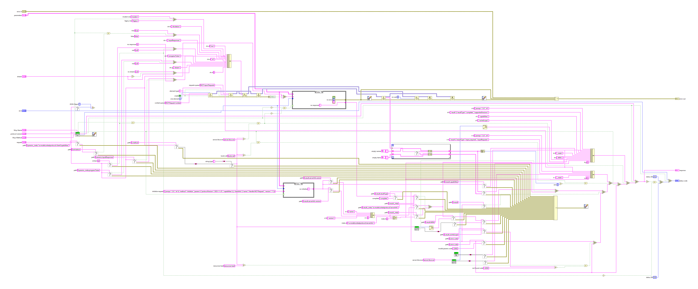 |

| Before | After |
|---|---|
|  | 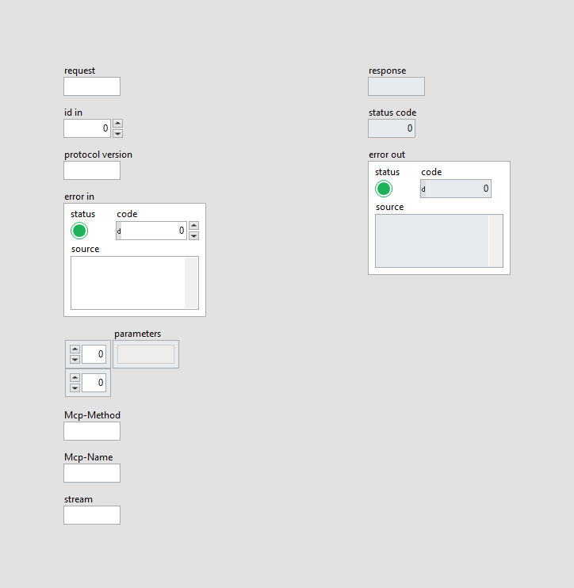 |

All case frames (2 hidden frames)

| Frame | Picture |
|---|---|
| Whole diagram, visible frames: Case structure 1: False; Case structure 2: False | 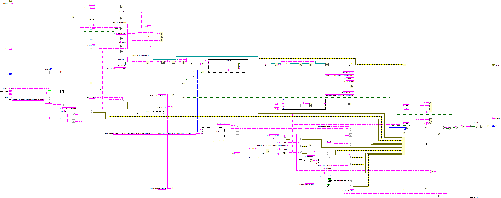 |
| Case structure 1: True | 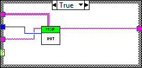 |
| Case structure 2: True | 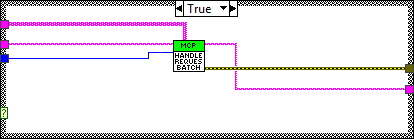 |

### `src/MCP Server/Process HTTP Request.vi` (modified)

**1. Block Diagram objects**

- **1A** String Constant "Header" - added at (235,-61)
- **1B** SubVI "Select Value.vim" - added at (285,-64)
- **1C** SubVI "MCP Server.lvlib:Prepare Request Dispatch.vi" - added at (289,-64)
- **1D** SubVI "MCP Server.lvlib:Start Streamed Request.vi" - added at (289,-64)
- **1E** SubVI "MCP Server.lvlib:MCP SSE Response.lvclass:Create MCP SSE Response.vi" - added at (289,-64)
- **1F** SubVI "Request Header.vi" - added at (289,-64)
- **1G** wiring changes

| Before | After |
|---|---|
| 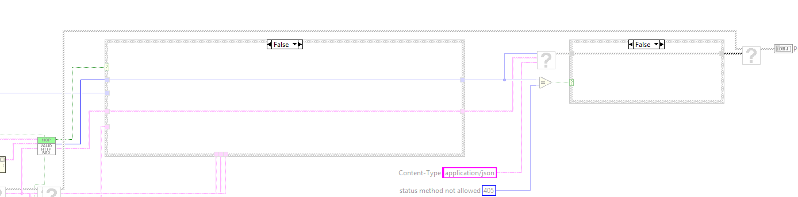 | 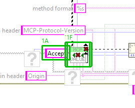 |

**2. Front Panel - Panel**

- **2A** LabVIEW Object "Processing in" - required, recommended, optional settings : changed from "<tt>required</tt>" to "<tt>optional</tt>"

| Before | After |
|---|---|
|  | 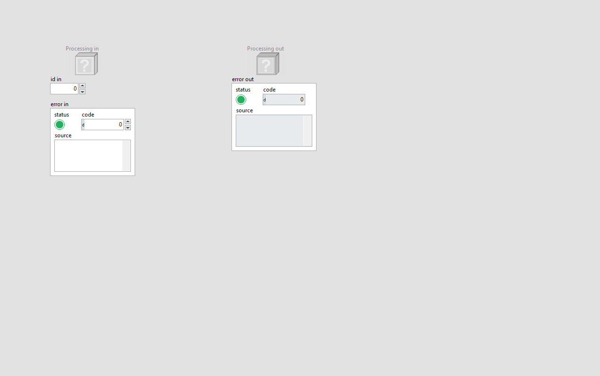 |

**3. VI Attribute - Execution (VI Properties)**

- **3A** Automatic Error Handling

Whole block diagram and front panel

| Before | After |
|---|---|
|  |  |

| Before | After |
|---|---|
|  |  |

All case frames (2 hidden frames)

| Frame | Picture |
|---|---|
| Whole diagram, visible frames: Case structure 1: False; Case structure 2: False |  |
| Case structure 1: True |  |
| Case structure 2: True |  |

### `tests/Test_MCP_Server.vi` (modified)

**1. Block Diagram objects**

- **1A** SubVI "MCP Server tests.lvlib:Add Fixture Progress Tool.vi" - added at (2094,323)
- **1B** wiring changes

| Before | After |
|---|---|
|  |  |

**2. Block Diagram objects**

- **2A** SubVI "MCP Server tests.lvlib:test progress notifications.vi" - added at (4478,296)
- **2B** SubVI "MCP Server tests.lvlib:test progress cancel by close.vi" - added at (4574,296)
- **2C** SubVI "MCP Server tests.lvlib:test progress legacy cancel.vi" - added at (4670,296)
- **2D** wiring changes

| Before | After |
|---|---|
|  |  |

Whole block diagram and front panel

| Before | After |
|---|---|
| 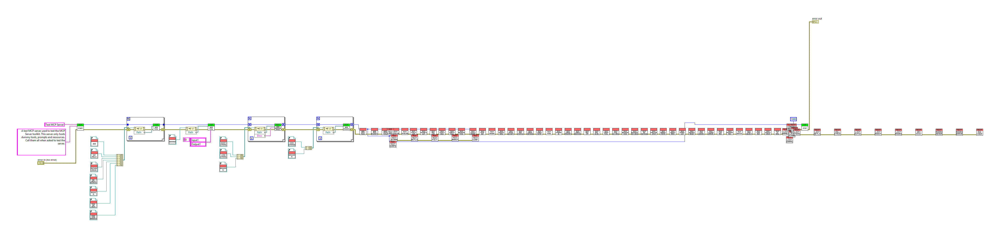 | 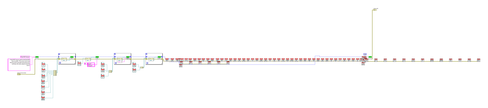 |

| Before | After |
|---|---|
|  |  |

### `src/MCP Server/Cancel Requested.vi` (added)

Block diagram (case structures show their visible frame only):

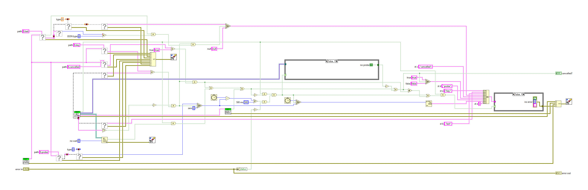

Front panel

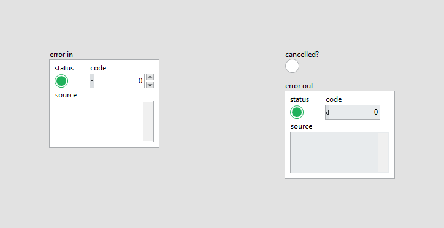

All case frames (2 hidden frames)

| Frame | Picture |
|---|---|
| Whole diagram, visible frames: Case structure 1: False; Case structure 2: False | 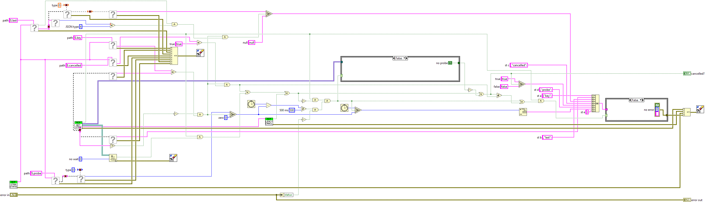 |
| Case structure 1: True |  |
| Case structure 2: True | 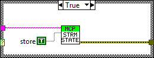 |

### `src/MCP Server/Get Request Stream.vi` (added)

Block diagram (case structures show their visible frame only):

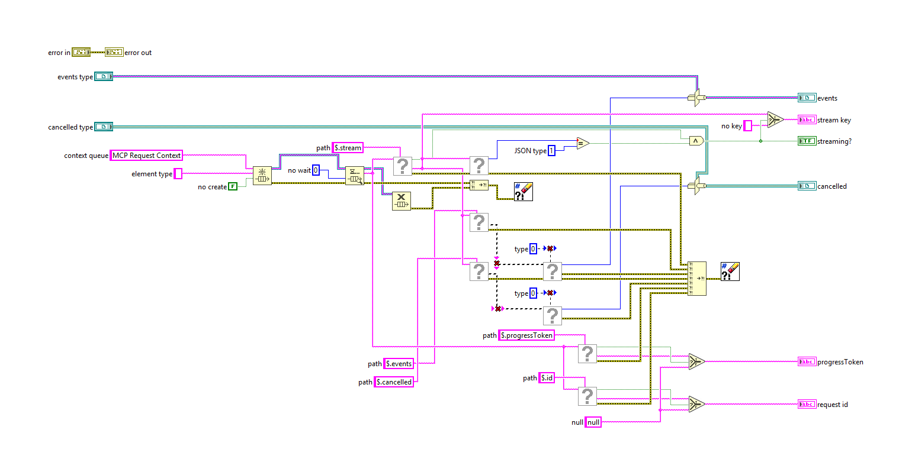

Front panel

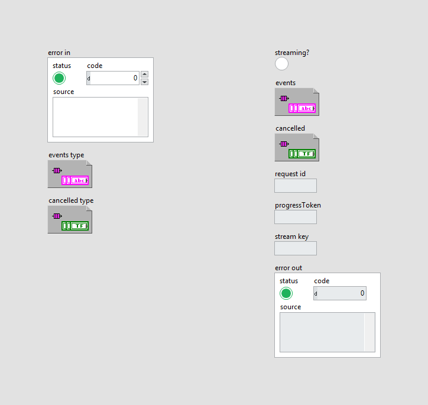

### `src/MCP Server/Legacy Cancellations.vi` (added)

Block diagram (case structures show their visible frame only):

Front panel

### `src/MCP Server/MCP SSE Response/Abort Stream.vi` (added)

Block diagram (case structures show their visible frame only):

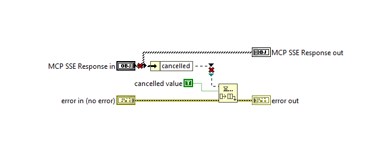

Front panel

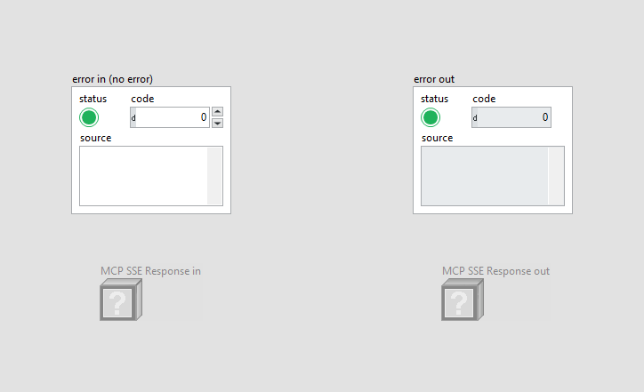

### `src/MCP Server/MCP SSE Response/Create MCP SSE Response.vi` (added)

Block diagram (case structures show their visible frame only):

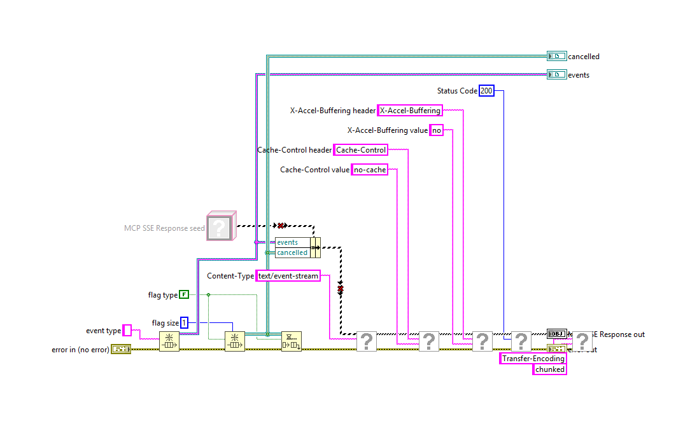

Front panel

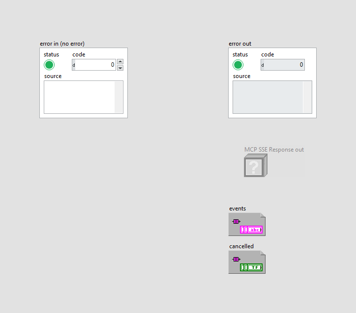

### `src/MCP Server/MCP SSE Response/Get Queues.vi` (added)

Block diagram (case structures show their visible frame only):

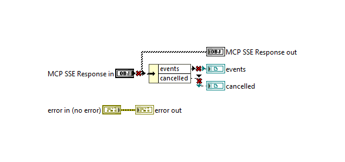

Front panel

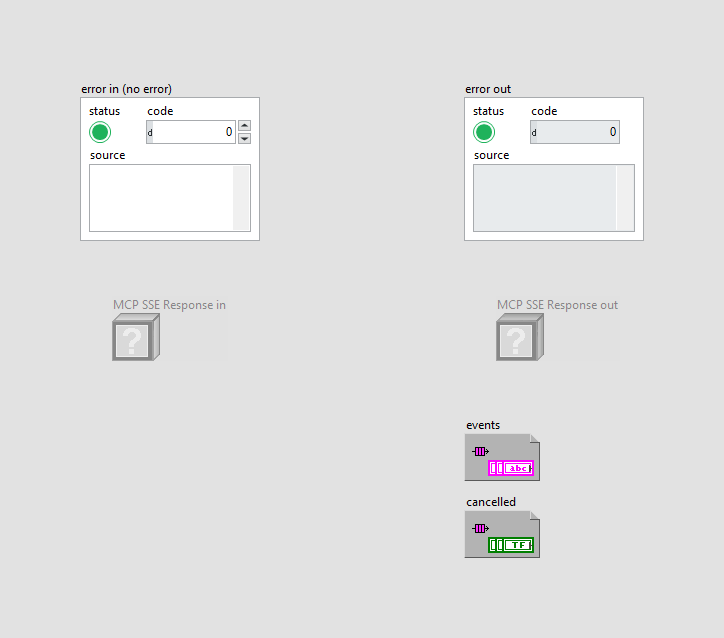

### `src/MCP Server/MCP SSE Response/Next Segment.vi` (added)

Block diagram (case structures show their visible frame only):

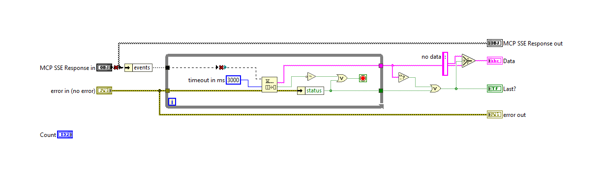

Front panel

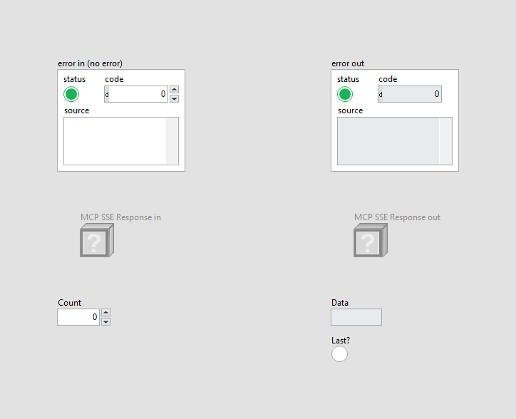

### `src/MCP Server/MCP SSE Response/Stream Length.vi` (added)

Block diagram (case structures show their visible frame only):

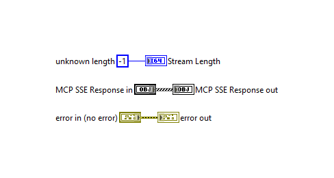

Front panel

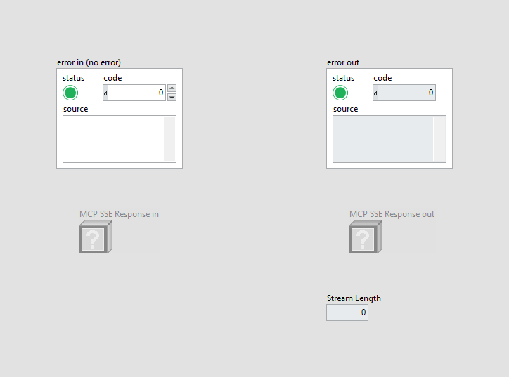

### `src/MCP Server/Prepare Request Dispatch.vi` (added)

Block diagram (case structures show their visible frame only):

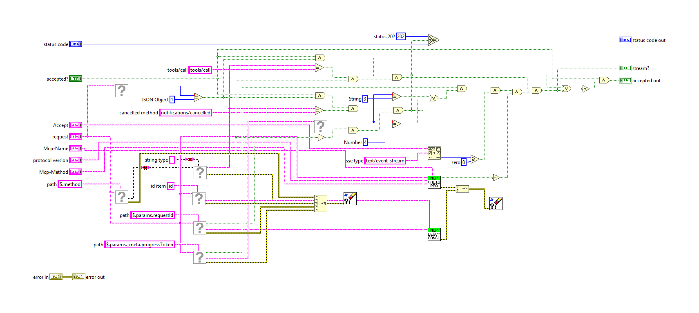

Front panel

### `src/MCP Server/Report Progress.vi` (added)

Block diagram (case structures show their visible frame only):

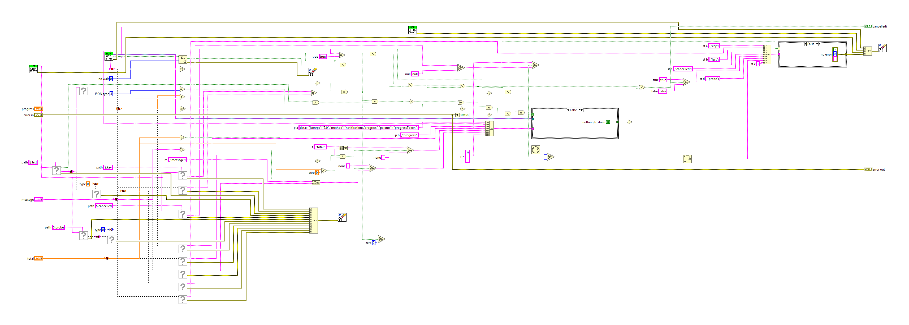

Front panel

All case frames (2 hidden frames)

| Frame | Picture |
|---|---|
| Whole diagram, visible frames: Case structure 1: False; Case structure 2: False | 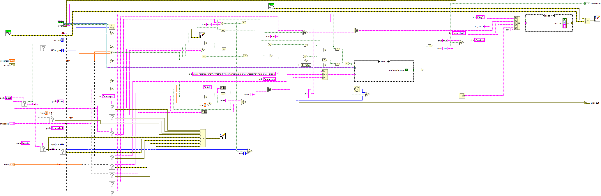 |
| Case structure 1: True | 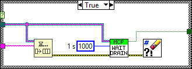 |
| Case structure 2: True |  |

### `src/MCP Server/Run Streamed Request.vi` (added)

Block diagram (case structures show their visible frame only):

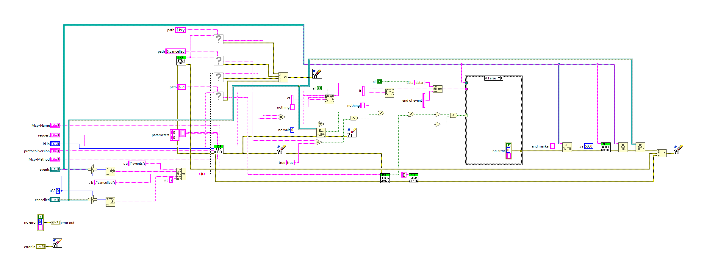

Front panel

All case frames (1 hidden frames)

| Frame | Picture |
|---|---|
| Whole diagram, visible frames: Case structure 1: False | 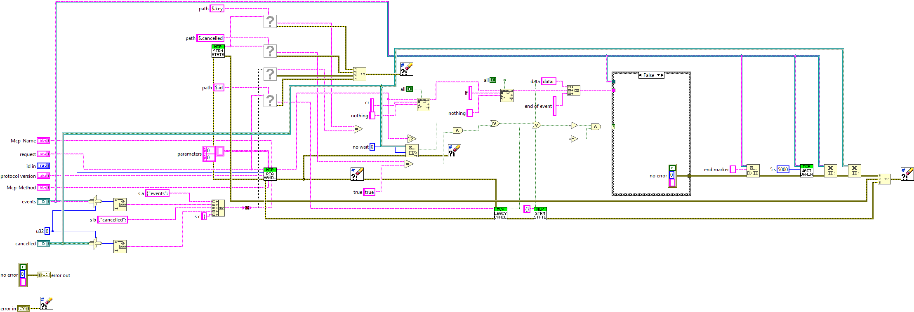 |
| Case structure 1: True |  |

### `src/MCP Server/Select Value.vim` (added)

Block diagram (case structures show their visible frame only):

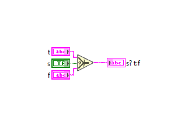

Front panel

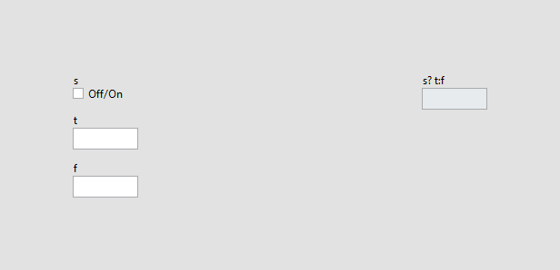

### `src/MCP Server/Start Streamed Request.vi` (added)

Block diagram (case structures show their visible frame only):

Front panel

All case frames (2 hidden frames)

| Frame | Picture |
|---|---|
| Whole diagram, visible frames: Case structure 2: False; Case structure 1: False |  |
| Case structure 1: True |  |
| Case structure 2: True | 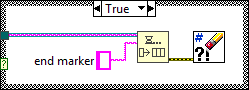 |

### `src/MCP Server/Stream State.vi` (added)

Block diagram (case structures show their visible frame only):

Front panel

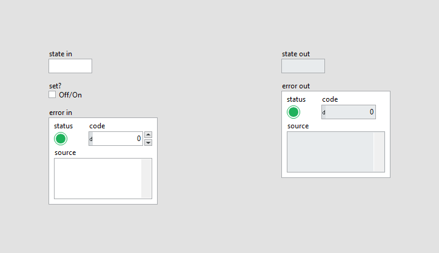

### `src/MCP Server/Validate MCP Request.vi` (added)

Block diagram (case structures show their visible frame only):

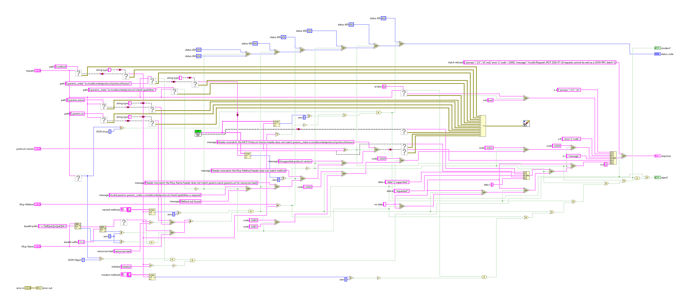

Front panel

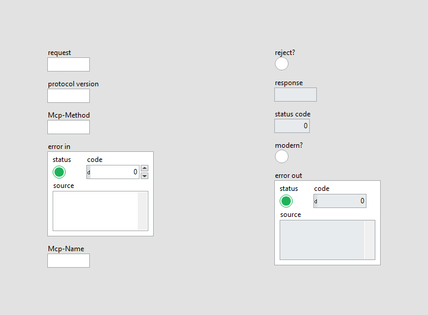

### `src/MCP Server/Wait For Stream Drain.vi` (added)

Block diagram (case structures show their visible frame only):

Front panel

All case frames (1 hidden frames)

| Frame | Picture |
|---|---|
| Whole diagram, visible frames: Case structure 1: False | 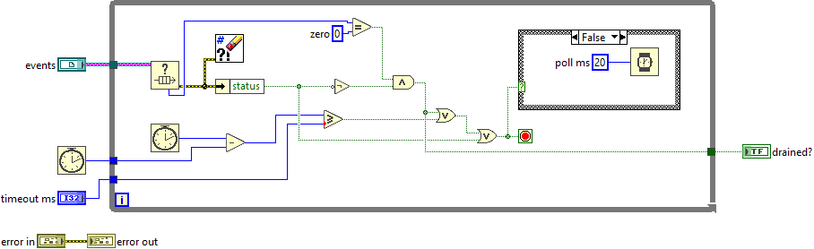 |
| Case structure 1: True |  |

### `tests/Add Fixture Progress Tool.vi` (added)

Block diagram (case structures show their visible frame only):

Front panel

### `tests/Progress Fixture Record.vi` (added)

Block diagram (case structures show their visible frame only):

Front panel

### `tests/fake tool progress.vi` (added)

Block diagram (case structures show their visible frame only):

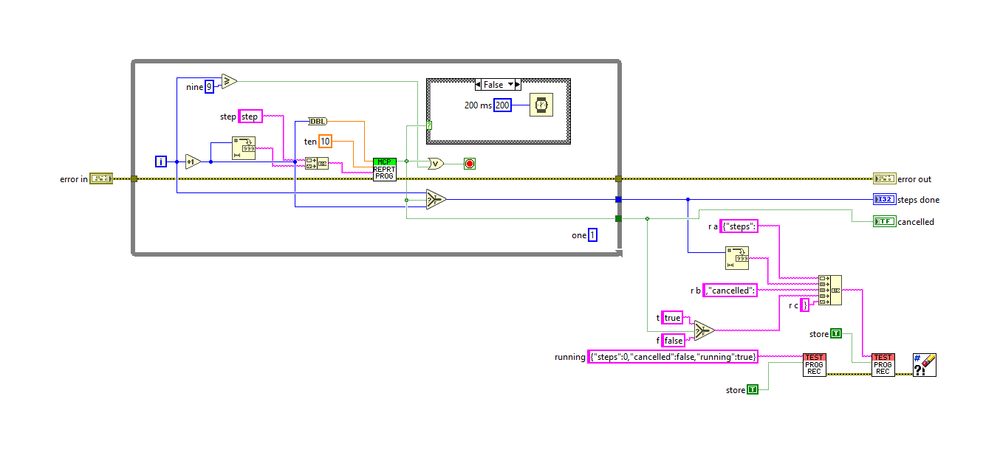

Front panel

All case frames (1 hidden frames)

| Frame | Picture |
|---|---|
| Whole diagram, visible frames: Case structure 1: False |  |
| Case structure 1: True |  |

### `tests/test progress cancel by close.vi` (added)

Block diagram (case structures show their visible frame only):

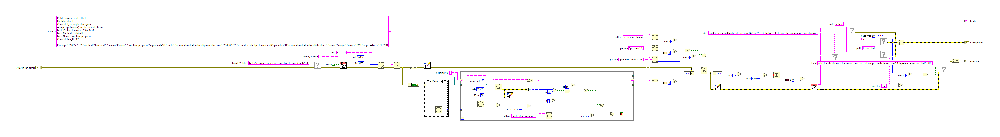

Front panel

All case frames (1 hidden frames)

| Frame | Picture |
|---|---|
| Whole diagram, visible frames: Case structure 1: False | 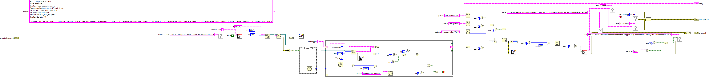 |
| Case structure 1: True | 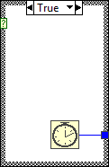 |

### `tests/test progress legacy cancel.vi` (added)

Block diagram (case structures show their visible frame only):

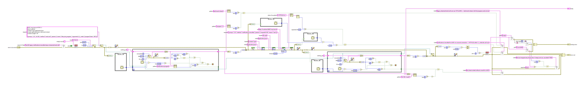

Front panel

All case frames (4 hidden frames)

| Frame | Picture |
|---|---|
| Whole diagram, visible frames: Case structure 1: False; Case structure 2: False; Case structure 3: False; Case structure 4: False |  |
| Case structure 1: True |  |
| Case structure 2: True |  |
| Case structure 3: True |  |
| Case structure 4: True |  |

### `tests/test progress notifications.vi` (added)

Block diagram (case structures show their visible frame only):

Front panel

