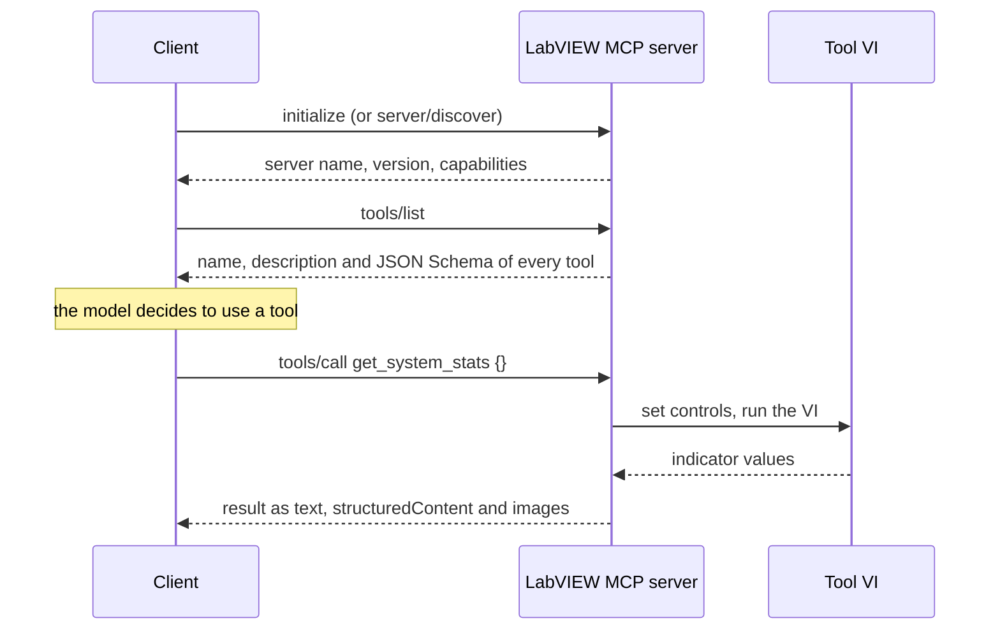

# Technical details

This page explains what happens between the AI client and your VIs: the parts of
the Model Context Protocol (MCP) the toolkit implements, how VIs are described
to the model, and how progress, cancellation, questions to the user and access
control work on the wire. For how to *use* the toolkit, see the
[readme](../readme.md).

## MCP in a nutshell

The [Model Context Protocol](https://modelcontextprotocol.io) is an open
standard that lets AI applications use external programs. Its three roles are:

- **Host / client:** the AI application, such as Claude Desktop or Claude Code.
  It keeps the conversation with the model and talks to one or more servers.
- **Server:** a program that offers capabilities. Here that is your LabVIEW
  application, running `Start.vi`.
- **Model:** the LLM. It never talks to the server itself. It tells the client
  which tool to call with which arguments, and the client makes the call.

A server offers three kinds of things:

| Kind | Chosen by | In this toolkit |
|---|---|---|
| **Tools** | the model, during the conversation | a VI; its controls are the inputs, its indicators the result |
| **Prompts** | the user, from a menu | a VI with string inputs and one string output that produces message text |
| **Resources** | the user (or the client) | a file whose content is attached to the conversation |

A typical session:



### Messages and transport

Every message is a [JSON-RPC 2.0](https://www.jsonrpc.org/specification)
object. A request carries `method`, `params` and an `id`. The answer carries the
same `id` and either a `result` or an `error`. A notification has no `id` and
gets no answer.

The transport is MCP's **Streamable HTTP**. The client sends every message as
an HTTP `POST` to the server's URL (default
`http://127.0.0.1:36987/mcp/server`):

- A request is answered with `200` and a JSON body, or, when the client accepts
  `text/event-stream` and the call streams, with a Server-Sent Events stream
  (see [Progress and cancellation](#progress-and-cancellation)).
- A notification is answered with `202` and an empty body.
- `GET` is refused with `405` (`Allow: POST`): the server does not open a
  stream of its own.

Clients that only start servers as local programs (stdio), such as Claude
Desktop, reach the HTTP endpoint through the `mcp-remote` proxy.

### Methods the server answers

| Method | What it returns |
|---|---|
| `initialize` | protocol version, capabilities and server info (MCP 2025-11-25 and older) |
| `server/discover` | supported versions, capabilities and server info (MCP 2026-07-28) |
| `ping` | an empty result |
| `tools/list`, `tools/call` | the tools, and the result of a call |
| `prompts/list`, `prompts/get` | the prompts, and the text of one prompt with its arguments filled in |
| `resources/list`, `resources/read`, `resources/templates/list` | the files, and the content of one |
| `notifications/initialized`, `notifications/cancelled` | accepted with `202` |

An unknown method is answered with error `-32601` (method not found), malformed
JSON with `-32700`, a request without a method with `-32600`.

## Protocol versions

The server speaks both eras of MCP on the same endpoint and decides per
request:

- **MCP 2026-07-28** (stateless): a request whose `params._meta` carries
  `io.modelcontextprotocol/protocolVersion`.
  - Such a request must also carry `io.modelcontextprotocol/clientCapabilities`
    and the headers `MCP-Protocol-Version`, `Mcp-Method` and, for `tools/call`,
    `prompts/get` and `resources/read`, `Mcp-Name`.
  - Results carry `resultType` and `_meta.io.modelcontextprotocol/serverInfo`.
    Lists and `resources/read` also carry the caching hints `ttlMs` and
    `cacheScope`.
  - `server/discover` returns the supported versions, capabilities and server
    info.
- **MCP 2025-11-25, 2025-06-18, 2025-03-26 and 2024-11-05**: clients that start
  with `initialize`. A client that asks for a version the server does not know
  is answered with 2025-11-25, the newest of these (up to v3.0.0 it was
  2025-06-18).

An unsupported `MCP-Protocol-Version` header is answered with HTTP `400` and
error `-32022`, listing every supported version.

## How a VI becomes a tool

`Add Tool.vi` reads the VI's connector pane and description once, when the tool
is added. `tools/list` then returns for each tool:

- `name`: the VI's file name, made a valid MCP name (see below).
- `title` and `annotations`, when they are wired into `Add Tool.vi`.
- `description`: the VI's description.
- `inputSchema`: a JSON Schema object with one property per control on the
  connector pane. `error in` is left out (the `Ignored` input of
  `Add Tool.vi`, default `["error in"]`, matches by exact label).
- `outputSchema`: the same for the indicators.

On `tools/call` the arguments are converted with JSONtext into the controls'
own types, the VI is run, and the indicator values are flattened to JSON.

### Data types

| LabVIEW type | JSON Schema | Value in `tools/call` |
|---|---|---|
| I8 … U64 | `integer` with `minimum`/`maximum` of the representation | number |
| SGL, DBL, EXT (also with unit) | `number` | number |
| Boolean | `boolean` | `true`/`false` |
| String | `string` | string |
| Path | `string` | path as text, e.g. `C:\\data\\log.csv` |
| Timestamp | `string` with `format: date-time` | ISO 8601, e.g. `2026-10-17T12:34:56Z` |
| Enum | `string` with `enum` of the item names | item name (a number is an error) |
| Cluster | `object` with `properties` named by the element labels | object; a member left out keeps the control's value |
| Array, any number of dimensions | nested `array` with `items` | nested arrays |
| Other types (variant, waveform, complex, fixed point, ring, map, set, refnum, class, picture) | `{}` (any value) | not supported as inputs yet |

What else goes into the schema:

- `description`: the control's description, and the description of every
  cluster element at any depth (inside clusters and arrays).
- Numerics with a unit get `Unit: <unit>.` appended to their description.
- `minimum`/`maximum` from the control's Data Entry limits when they are set to
  coerce, combined with the range of the integer representation.
- `default`: the control's default value for inputs that are not *Required* on
  the connector pane (left out when it would be longer than 1024 characters).
- `required`: the inputs marked *Required* on the connector pane.

### Names

Tool and prompt names and the names of inputs, outputs and prompt arguments
are lowercased, and every character other than `a-z`, `0-9`, `_` and `-`
becomes `_` (`Wert (mm)` becomes `wert__mm_`). `Add Tool.vi` and
`Add Prompt.vi` return error 5010 and do not register the tool or prompt when a
converted name is empty, longer than 64 characters, or the same as another one
in that tool or prompt. The VI's controls keep their labels.

### Results

Outputs of any type are flattened to JSON (timestamps as ISO 8601, enums as
item names):

- The result's `text` content block holds all outputs as one JSON object, for
  older clients.
- `structuredContent` holds the same object without picture outputs, matching
  `outputSchema`.
- Picture outputs are returned as separate `image` content (PNG, base64).

### Title, annotations and errors

`title` is a display name; without one, clients show the tool name.
`annotations` (`Tool Annotations.ctl`) carries `readOnlyHint`,
`destructiveHint`, `idempotentHint` and `openWorldHint`. Each hint is *not set*,
*true* or *false*, and only hints that are set are sent. MCP's defaults for
unset hints are: not read-only, destructive, not idempotent, open world.

A call with missing required arguments, or with an argument that does not fit
its control's type, returns a normal result with `isError: true` and a message
the model can act on. The model sees `error out` of the tool VI like any other
output. Unknown tools and malformed requests are JSON-RPC errors. A tool VI
with a broken run arrow is answered with error `1003`.

## Asking the user (elicitation)

MCP 2026-07-28 is stateless: the server cannot hold a call open while the user
thinks. Instead, the server answers the call with the question, and the client
repeats the call with the answer. The tool VI therefore runs twice.

1. The tool calls `Confirm With User.vi` or `Ask User.vi` with a `key`. No
   answer for that key exists yet, so the VI returns *pending*. The tool must
   end without side effects.
2. The server answers the `tools/call` with a result that asks for input
   instead of a tool result. It holds the `message` and, for `Ask User.vi`,
   the `requestedSchema` (a flat JSON Schema with string, number, Boolean or
   enum fields).
3. The client shows the question, then repeats the `tools/call` with the
   user's answer attached under the same key.
4. The tool runs again. This time the VI finds the answer and returns *accept*
   with `content` (the entered values as JSON text), *decline* or *cancel*.

This needs a client that speaks MCP 2026-07-28 and declares the `elicitation`
capability. For any other client the VI returns *not supported* without
sending anything. Keys must be unique within one tool, since a tool can ask
several questions, one per round trip.

## Progress and cancellation

A `tools/call` streams when the client sends `_meta.progressToken` and an
`Accept` header that includes `text/event-stream`. The answer is then a
Server-Sent Events stream: one `notifications/progress` event (with the
progress token, `progress`, `total` and `message`) for every
`Report Progress.vi` call, then the result as the final event. A call that
does not stream gets a plain JSON answer, and both `Report Progress.vi` and
`Cancel Requested.vi` do nothing and return FALSE.

Cancelling works in two ways:

- MCP 2026-07-28 clients cancel by closing the stream. A closed stream is
  noticed when an event is not taken within about one second, so the next
  `Report Progress.vi` call returns `cancelled?` TRUE.
- Older clients send `notifications/cancelled` with the request id. It only
  reaches a streamed call: a non-streamed call blocks other requests until it
  ends.

Either way, the next `Report Progress.vi` or `Cancel Requested.vi` call
returns TRUE, and it is the tool's job to stop.

## Access control

The IG HTTP Server listens on **all network interfaces**, so every request is
checked, in this order:

1. **Allowed clients** (`Start.vi`).
   - Empty (default): only this computer. This is decided by the connection's
     own local address: only connections to `127.x` (that is, over loopback)
     are served. A remote client cannot produce such a connection. A program on
     this computer that connects through the computer's LAN address is refused
     too.
   - `*`: any client.
   - Other entries: client host names as the server sees them through reverse
     DNS, or IP addresses. Whoever controls a client's address can choose its
     reverse-DNS name, so host-name entries are a convenience, not protection.

   A client that is not allowed gets `403`.
2. **Access token** (`Start.vi`). When set, every request needs
   `Authorization: Bearer <token>`. Missing or wrong: `401` with
   `WWW-Authenticate: Bearer`.
3. **Origin.** A request that carries an `Origin` header is only served when it
   is a page on `localhost`, `127.0.0.1` or `[::1]`, as protection against DNS
   rebinding. This holds even with `*`, so browser-based clients on other
   computers are refused.

The server speaks plain HTTP without TLS. The token travels unencrypted, so
beyond a trusted network put the server behind a TLS reverse proxy or an SSH
tunnel.

The handler answers only its own path: `/mcp/server`, optionally with a
trailing slash, query or fragment. Any other path, such as `/mcp/serverABC`,
gets IG's `404`.

## Talking to a server by hand

Anything that can send HTTP can test a server. With curl, against a running
example:

```bash
U=http://127.0.0.1:36987/mcp/server
H1='Content-Type: application/json'; H2='Accept: application/json, text/event-stream'

curl -s -X POST $U -H "$H1" -H "$H2" -d '{"jsonrpc":"2.0","id":1,"method":"initialize","params":{"protocolVersion":"2025-06-18","capabilities":{},"clientInfo":{"name":"curl","version":"1.0"}}}'
curl -s -X POST $U -H "$H1" -H "$H2" -d '{"jsonrpc":"2.0","id":2,"method":"tools/list","params":{}}'
curl -s -X POST $U -H "$H1" -H "$H2" -d '{"jsonrpc":"2.0","id":3,"method":"tools/call","params":{"name":"get_system_stats","arguments":{}}}'
```

Add `-H "Authorization: Bearer <token>"` when the server has a token. For a
full check of a running server, `tools/test/Test-McpServer.ps1` in this
repository runs the protocol tests the CI uses.
