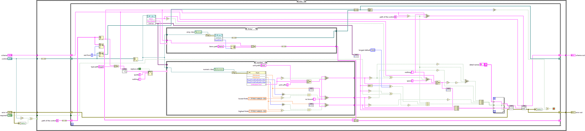
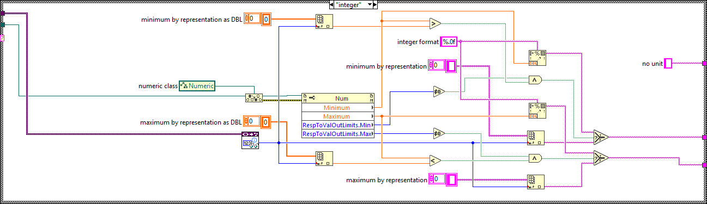
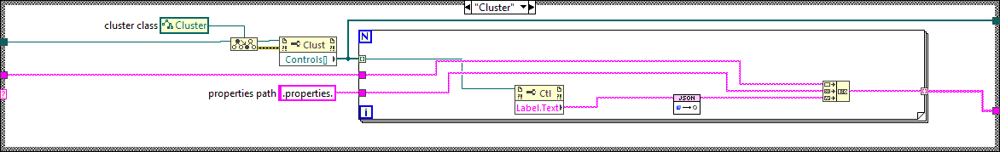

# Every case frame of the VIs changed in pull request 27

Rendered with LabVIEW's documentation printer (Print.VI To HTML), one picture per frame. The CI diff report shows each case structure only on its visible frame.

## `Add Control Details To Schema.vi` (added)

| Frame | Picture |
|---|---|
| Whole diagram (outer case: False; element case: "Array"; bounds case: "number") |  |
| Outer case: True (error in, or invalid control reference), passes the schema through |  |
| Bounds case: Default (no numeric schema type), no bound, no unit |  |
| Bounds case: "integer" |  |
| Element case: Default, no child controls |  |
| Element case: "Cluster" |  |

`Get Connector Pane Info.vi` and `Test_MCP_Server.vi` changed only on their visible frames; the test VIs have no case structures.
