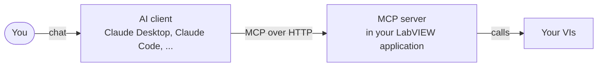
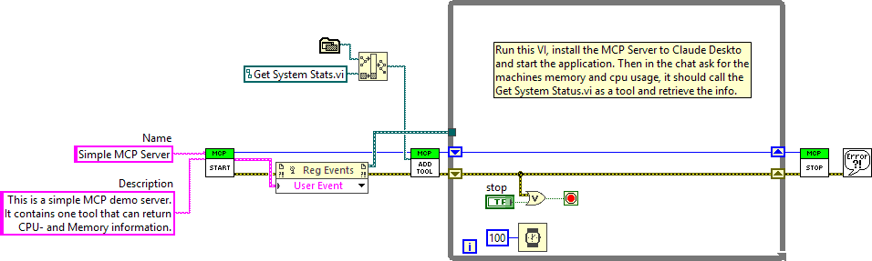
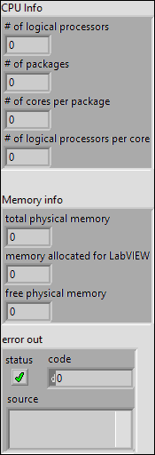
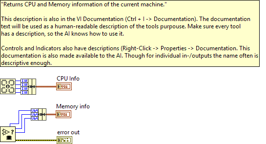
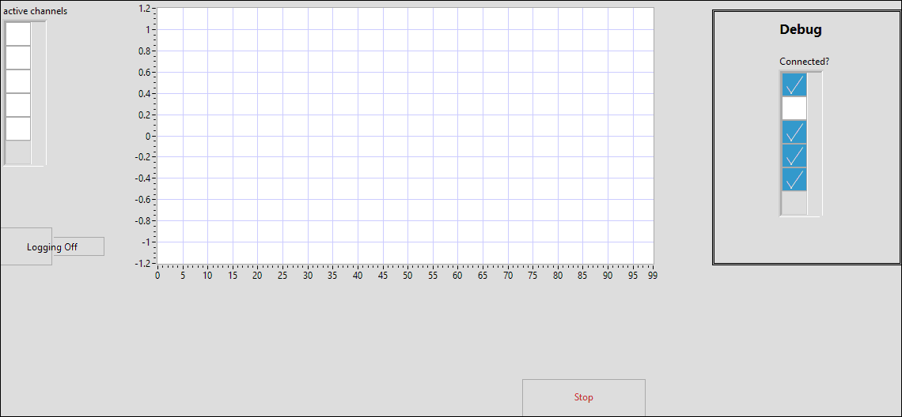
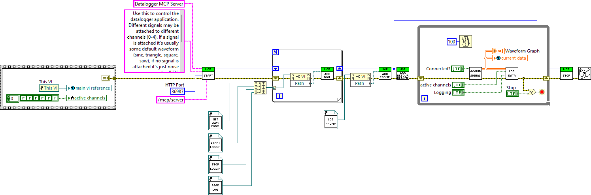
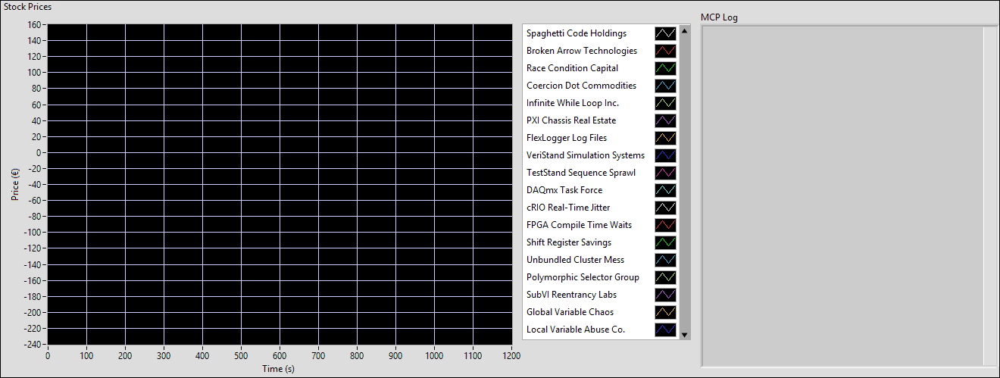
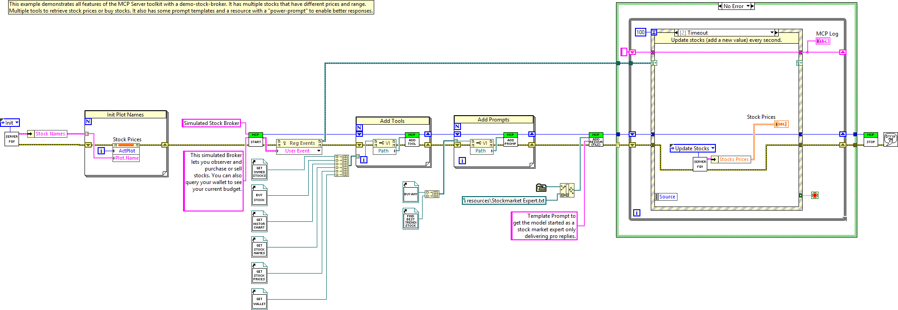

# 🧰 LabVIEW MCP Server Toolkit

Let an AI assistant such as Claude or ChatGPT use your LabVIEW application.

You pick the VIs the assistant may call, and the toolkit turns them into an
[MCP](https://modelcontextprotocol.io) server. You can then ask in plain
language, for example "check which channels of my datalogger carry a signal and
log only those", and the assistant calls your VIs to do it.



---

## ✨ What you can do

- **Expose any VI as a tool.** The VI's name, description and connector pane
  tell the assistant what the tool does and what to pass in. You don't write a
  separate schema.
- **Return rich results.** Numbers, strings, clusters, arrays and pictures. A
  graph rendered as a picture lets the assistant look at your signal.
- **Offer prompt templates and documents.** The user can pick them from the
  client's menu instead of typing them out.
- **Run long jobs.** A tool can show progress while it runs, and it stops
  cleanly when the user cancels.
- **Ask the user before acting.** A tool can ask "Move the stage to 120 mm?"
  in the chat and wait for the answer.
- **Control who can connect.** Only your own computer by default, with an
  access token for anything else.

## 🚀 Quick start

1. **Install** the toolkit with VIPM (search for *LabVIEW MCP Server SDK*).
   It needs LabVIEW 2020 or newer, 64-bit, and VIPM installs its dependencies
   with it.
2. **Run an example.** Open
   `<LabVIEW>\examples\MCP Server\examples\Simple MCP Server\main.vi` and run it.
   The server is now listening on `http://127.0.0.1:36987/mcp/server`.
3. **Connect Claude Desktop.** Install [Node.js](https://nodejs.org), then add
   the server to Claude Desktop's configuration file
   (*Settings → Developer → Edit Config*):

   ```json
   {
     "mcpServers": {
       "labview": {
         "command": "npx",
         "args": ["mcp-remote", "http://127.0.0.1:36987/mcp/server"]
       }
     }
   }
   ```

   Quit Claude Desktop completely (including its icon in the taskbar) and start
   it again. It reads the list of tools only at startup.
4. **Ask** something like "How much memory does my machine have?" Claude
   calls `get_system_stats` and answers with the values your VI returned.

## 🔧 How it works: a VI is a tool

The Simple example registers a single tool. `Start.vi` opens the server,
`Add Tool.vi` adds a VI as a tool, and the loop keeps the server running
until you press Stop:



The tool itself is an ordinary VI:

| Front panel | Block diagram |
|---|---|
|  |  |

The assistant learns everything about the tool from the VI:

| What the assistant sees | Where it comes from |
|---|---|
| Tool name `get_system_stats` | The VI's file name |
| What the tool does | The VI's description (*File → VI Properties → Documentation*) |
| Inputs and what they mean | The controls on the connector pane and their descriptions |
| The result | The indicators on the connector pane, returned as JSON |

Write the descriptions with the assistant in mind. Say what a value means,
give its unit and its allowed range, and say what the tool does *not* do. The
description is all the assistant has to go on.

## 🏗️ Building your own server

Your top-level VI follows the same pattern as the examples:

1. Call `Start.vi` with a name and a description for the server.
2. Call `Add Tool.vi` once per tool VI, and `Add Prompt.vi` /
   `Add Resource (File).vi` for prompts and documents.
3. Keep the VI running in a loop while the server should be reachable.
4. Call `Stop.vi` when you are done. It closes the port again.

Everything is on the **MCP Server** palette:

| VI | What it is for |
|---|---|
| `Start.vi` | Starts a server. Inputs: name, description, port (default 36987), URL path (default `/mcp/server`), access token, allowed clients. |
| `Add Tool.vi` | Makes a VI available as a tool. Optional: a display `title` and `annotations` (see below). |
| `Add Prompt.vi` | Adds a prompt template: a VI with string inputs and one string output. |
| `Add Resource (File).vi` | Adds a file (for example a text file of instructions) the user can attach to the chat. |
| `Stop.vi` | Stops the server and frees the port. |
| **Advanced** sub-palette | `Report Progress.vi`, `Cancel Requested.vi`, `Confirm With User.vi`, `Ask User.vi`: used *inside* tool VIs, see below. |

### Inputs and outputs

Tool inputs can be numbers, Booleans, strings, paths, timestamps, enums, and
clusters and arrays of these. The assistant is told the type, the allowed range
and the default of every input, so it knows what to send. Mark an input
*Required* on the connector pane if the tool cannot run without it.

Outputs can be of any type. Picture indicators are sent to the assistant as
images. The full list of types is in [Technical details](docs/technical-details.md#data-types).

Inputs are named after the control labels, lowercased and with spaces and
special characters turned into `_`. `Wert (mm)` becomes `wert__mm_`.
`Add Tool.vi` reports error 5010 when two inputs end up with the same name.

### Telling the client which tools are safe

Clients use this information to decide when to ask the user before running a
tool. Wire it into `Add Tool.vi`:

- `title`: the name the client shows, such as "Move Stage".
- `annotations`: whether the tool only reads (*read-only*), whether it can
  destroy something (*destructive*), and whether calling it twice does the same
  as calling it once (*idempotent*). Leave a hint *not set* if you are unsure.
  Mark tools that move hardware or delete data as destructive.

### Errors

If a tool VI returns an error, the assistant sees its code and message and can
react, for example by retrying with other values. The same happens when it
leaves out a required input or sends a value of the wrong type.

## 💬 Prompts and resources

Most servers only need tools. Two more things can make a server easier to use:

- **Prompts** are templates the user picks from the client's menu (the **+**
  button in Claude Desktop). A prompt is a VI with string inputs and one string
  output. The client asks the user for the inputs and puts the resulting text
  into the message field. The Datalogger example ships a prompt that runs its
  whole demo.
- **Resources** are files the user can attach to a conversation, such as
  instructions or a data sheet. Add them with `Add Resource (File).vi`.

## ⏳ Long-running tools: progress and cancel

For a tool that takes a while, such as a sweep, a calibration or a long
measurement, call `Report Progress.vi` inside its loop:

- Wire the current step to `progress`, the number of steps to `total`, and a
  short text such as "Measuring point 12 of 40" to `message`.
- Stop the loop when `cancelled?` is TRUE. That happens when the user cancels
  the request in the client. Clean up and return.
- In a loop that does not report progress, call `Cancel Requested.vi` to check
  for a cancel.

Clients that support progress show it while the tool runs. With other clients,
both VIs do nothing and `cancelled?` stays FALSE, so the same tool works
everywhere.

## 🙋 Asking the user during a tool call

A tool can ask the user to confirm something, or to fill in a small form, before
it acts:

- `Confirm With User.vi` asks a yes/no question, such as "Move the stage to
  120 mm?".
- `Ask User.vi` asks for a few values, such as a serial number and an operator
  name.

Write the tool in two parts, because it runs twice:

1. **First run:** the VI returns *pending* (`pending?` on
   `Confirm With User.vi`). End the tool right away, **without doing
   anything**. The client then shows the question to the user.
2. **Second run:** the client calls the tool again with the user's answer.
   Now the VI returns it: `Confirm With User.vi` sets `confirmed?`, and
   `Ask User.vi` returns *accept* with the values the user entered, or
   *decline* or *cancel*. Do the real work only here.

Give each question a key that is unique within the tool. If the client cannot
ask questions, the VI returns *not supported* (`not supported?` on
`Confirm With User.vi`); decide whether the tool then refuses or uses a safe
default. Never use this to ask for passwords.

## 🔌 Connecting clients

The server speaks MCP over HTTP at `http://127.0.0.1:36987/mcp/server`. You
can change the port and the path on `Start.vi`.

**Claude Desktop** and other clients that start servers as a local program
connect through `mcp-remote`, which needs [Node.js](https://nodejs.org):

```json
{
  "mcpServers": {
    "labview": {
      "command": "npx",
      "args": ["mcp-remote", "http://127.0.0.1:36987/mcp/server"]
    }
  }
}
```

**Claude Code** connects directly:

```
claude mcp add --transport http labview http://127.0.0.1:36987/mcp/server
```

Other clients with HTTP support (often called *Streamable HTTP*) take the URL
directly. You can run several servers side by side on different ports and add
each of them to the client.

## 🔒 Who can connect

Out of the box, **only programs on the same computer** can use the server.
Requests from other computers are refused. Nothing needs to be set up for that.

### Using the server from another computer

Do two things on `Start.vi`:

1. **Allow the clients.** Wire `Allowed clients` with `*` (any computer), or
   with the IP addresses or host names of the computers that may connect.
2. **Set an access token.** This is a password that every client has to send.
   Without a token, anyone who can reach the computer can call your tools.

**Get a token.** The token is a secret you make up yourself. It has no
account behind it. Use a long random string, for example generated in
PowerShell:

```powershell
$b = New-Object byte[] 32; [Security.Cryptography.RandomNumberGenerator]::Create().GetBytes($b); [Convert]::ToBase64String($b)
```

Wire it to the `Access token` input of `Start.vi`. Don't hard-code it in a VI
you share; read it from a configuration file or an environment variable.

**Give the token to the client.** The client sends it as an
`Authorization: Bearer <token>` header with every request.

Claude Desktop (through `mcp-remote`):

```json
{
  "mcpServers": {
    "labview": {
      "command": "npx",
      "args": [
        "mcp-remote",
        "http://192.168.1.20:36987/mcp/server",
        "--allow-http",
        "--header",
        "Authorization:${AUTH_HEADER}"
      ],
      "env": { "AUTH_HEADER": "Bearer <your token>" }
    }
  }
}
```

Keep `Authorization:${AUTH_HEADER}` without a space, and put the space inside
the variable. Some clients on Windows split arguments at spaces. `--allow-http`
lets `mcp-remote` connect to a computer other than this one without HTTPS.

Claude Code:

```
claude mcp add --transport http labview http://192.168.1.20:36987/mcp/server --header "Authorization: Bearer <your token>"
```

A client without the token, or with a wrong one, gets *401 Unauthorized*. A
computer that is not allowed gets *403 Forbidden*.

The connection is not encrypted, so the token can be read on the network. Use
the server on networks you trust, or put it behind an SSH tunnel or an HTTPS
reverse proxy.

> **Changed after v3.0.0:** up to v3.0.0, any computer could connect. Now only
> this computer can, until you allow others. A program on this computer that
> connects through the computer's network address instead of `127.0.0.1` also
> counts as another computer.

## 📦 Examples

The examples are installed under `<LabVIEW>\examples\MCP Server\examples`.

### Simple MCP Server

One tool, `Get System Stats.vi`, that returns CPU and memory information. Start
here to see the minimum a server needs (pictures [above](#-how-it-works-a-vi-is-a-tool)).

### Datalogger MCP Server

A simulated five-channel datalogger. Some channels carry a signal, the others
only noise. Use the *Connected?* switches on the front panel to change which.
The assistant fetches pictures of the waveforms, decides which channels are
connected, logs only those and checks the log file afterwards.





Try:

> Check my datalogger through MCP. Which channels are connected? Identify the
> channels that have not just noise on them, then log the connected channels
> for a moment, then stop and read the log file and check if the logging was
> successful.

The same text is registered as a prompt, so in Claude Desktop you can also pick
it from the **+** menu.

### Full Featured MCP Server

A simulated stock broker that uses every kind of building block: tools to look
up prices, show a history chart and buy stocks; prompts such as "find the best
trending stock"; and a resource that makes the assistant act as a stock market
expert. The MCP log on the front panel shows every request the client sends.





## 🩺 Troubleshooting

- **The client does not list my tools.** Restart the client completely; most
  read the tool list only at startup. Check that the server VI is running.
- **A tool reports "not executable".** The tool VI has a broken run arrow.
  Open it and fix it.
- **Error 5001 from `Start.vi`.** The port is already in use, often by another
  server you started earlier. Stop that one, or pick another port.
- **Error 5010 from `Add Tool.vi`.** Two inputs of that tool end up with the
  same name, or a name is empty or longer than 64 characters.
- **403 from another computer.** Add it to `Allowed clients` (see
  [Who can connect](#-who-can-connect)).
- **401.** The token is missing or wrong on the client side.

## 📚 More

- [Technical details](docs/technical-details.md): how MCP works, protocol
  versions, how VIs are translated into tool descriptions, and how progress,
  cancel and questions to the user work on the wire.
- Dependencies: [IG HTTP Server Toolkit](https://www.vipm.io/package/illuminatedg_lib_ig_http_server/)
  and [JKI JSONtext](https://www.vipm.io/package/jdp_science_jsontext/),
  installed by VIPM.
- This toolkit was built for [G-AI](https://github.com/JanGoebel/G-AI), which
  generates LabVIEW code with LLMs.

## License

MIT. Feel free to use and modify it.
