## VI diff report

4 modified, 21 added, 0 deleted. Generated by LabVIEW's VI comparison; position and size changes are not shown.

### `src/MCP Server/Handle MCP Request.vi` (modified)

**1. Block Diagram objects**

- **1A** Front Panel Terminal "stream" - added at (38,387)
- **1B** wiring changes

| Before | After |
|---|---|
| 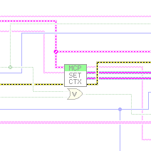 | 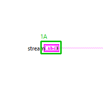 |

**2. Front Panel - Panel**

- **2A** Connector Pane  - control/indicator assignment : changed

| Before | After |
|---|---|
| 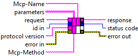 | 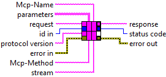 |

**3. Front Panel objects**

- **3A** String "stream" - added at (40,419)

| Before | After |
|---|---|
| 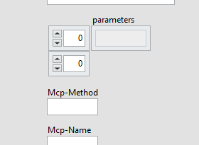 |  |

**4. VI Attribute - Documentation (VI Properties)**

- **4A** description text : changed from "Handles the body of one HTTP POST in either MCP era and returns the HTTP status code and the response body. Replaces the direct call of Handle Server Request Batch.vi in Process HTTP Request.vi.

ERA, per request, without session state: a JSON object whose params._meta carries io.modelcontextprotocol/protocolVersion is MODERN (MCP 2026-07-28), unless its method is initialize. Everything else is LEGACY and is passed to Handle Server Request Batch.vi unchanged, so legacy answers stay exactly as they were.

MODERN requests are checked first, in this order, and refused without being handled:
- MCP-Protocol-Version header missing or different from the _meta protocolVersion: 400, -32020 (header mismatch).
- protocolVersion not one of the modern versions of Supported Protocol Versions.vi: 400, -32022 with data.supported and data.requested.
- Mcp-Method header missing or different from method: 400, -32020.
- tools/call and prompts/get: Mcp-Name must equal params.name; resources/read: params.uri. A value =?base64?...?= is decoded first. Missing or different: 400, -32020.
- io.modelcontextprotocol/clientCapabilities missing in params._meta: 400, -32602.
- A method the modern era does not have (it has server/discover, tools/list, tools/call, prompts/list, prompts/get, resources/list, resources/read and resources/templates/list; no ping, logging/setLevel or notifications/initialized): 404, -32601. Notifications (no id) are answered with 202 as before.
A JSON array (batch) that comes with modern headers (an Mcp-Method header, or a modern MCP-Protocol-Version) is refused with 400, -32600.

MODERN results: server/discover is answered here (supportedVersions = all versions, capabilities and serverInfo as initialize reports them). Every other result is handled as before and then gets "resultType":"complete" and _meta io.modelcontextprotocol/serverInfo; the methods named in Cache Hints.vi also get ttlMs and cacheScope. resources/read errors -32002 (resource not found) become -32602.

ELICITATION: while a request is handled, its context ({"era","elicitation","inputResponses"}) is the only element of the named queue "MCP Request Context" (size 1, which also serialises request handling), and questions that Ask User.vi registers are collected from the named queue "MCP Input Requests". When a modern tools/call registered questions, the result is {"resultType":"input_required","inputRequests":{...}} instead of the tool result (no requestState: the retry carries the original params with inputResponses).

serverInfo is taken from initialize.vi (called with a synthetic initialize request), so name and version always match what initialize reports." to "Handles the body of one HTTP POST in either MCP era and returns the HTTP status code and the response body. Replaces the direct call of Handle Server Request Batch.vi in Process HTTP Request.vi.

ERA, per request, without session state: a JSON object whose params._meta carries io.modelcontextprotocol/protocolVersion is MODERN (MCP 2026-07-28), unless its method is initialize. Everything else is LEGACY and is passed to Handle Server Request Batch.vi unchanged, so legacy answers stay exactly as they were.

MODERN requests are checked first, in this order, and refused without being handled:
- MCP-Protocol-Version header missing or different from the _meta protocolVersion: 400, -32020 (header mismatch).
- protocolVersion not one of the modern versions of Supported Protocol Versions.vi: 400, -32022 with data.supported and data.requested.
- Mcp-Method header missing or different from method: 400, -32020.
- tools/call and prompts/get: Mcp-Name must equal params.name; resources/read: params.uri. A value =?base64?...?= is decoded first. Missing or different: 400, -32020.
- io.modelcontextprotocol/clientCapabilities missing in params._meta: 400, -32602.
- A method the modern era does not have (it has server/discover, tools/list, tools/call, prompts/list, prompts/get, resources/list, resources/read and resources/templates/list; no ping, logging/setLevel or notifications/initialized): 404, -32601. Notifications (no id) are answered with 202 as before.
A JSON array (batch) that comes with modern headers (an Mcp-Method header, or a modern MCP-Protocol-Version) is refused with 400, -32600.

MODERN results: server/discover is answered here (supportedVersions = all versions, capabilities and serverInfo as initialize reports them). Every other result is handled as before and then gets "resultType":"complete" and _meta io.modelcontextprotocol/serverInfo; the methods named in Cache Hints.vi also get ttlMs and cacheScope. resources/read errors -32002 (resource not found) become -32602.

REQUEST CONTEXT: while a request is handled, its context ({"era","elicitation","inputResponses","id","progressToken","stream"}) is the only element of the named queue "MCP Request Context" (size 1, which also serialises request handling), and questions that Ask User.vi registers are collected from the named queue "MCP Input Requests". When a modern tools/call registered questions, the result is {"resultType":"input_required","inputRequests":{...}} instead of the tool result (no requestState: the retry carries the original params with inputResponses).

serverInfo is taken from initialize.vi (called with a synthetic initialize request), so name and version always match what initialize reports.

STREAMING: stream is empty for a normal request. For a streamed tools/call Run Streamed Request.vi passes the stream object {"events":..,"cancelled":..} (the queues of the MCP SSE Response, as numbers); it goes into the request context, where Report Progress.vi and Cancel Requested.vi find it. id and progressToken in the context are the JSON text of the request id and of params._meta.progressToken."

Whole block diagram and front panel

| Before | After |
|---|---|
| 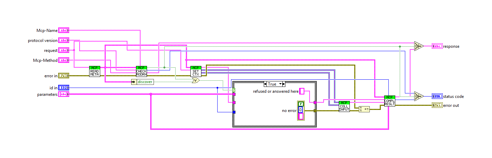 | 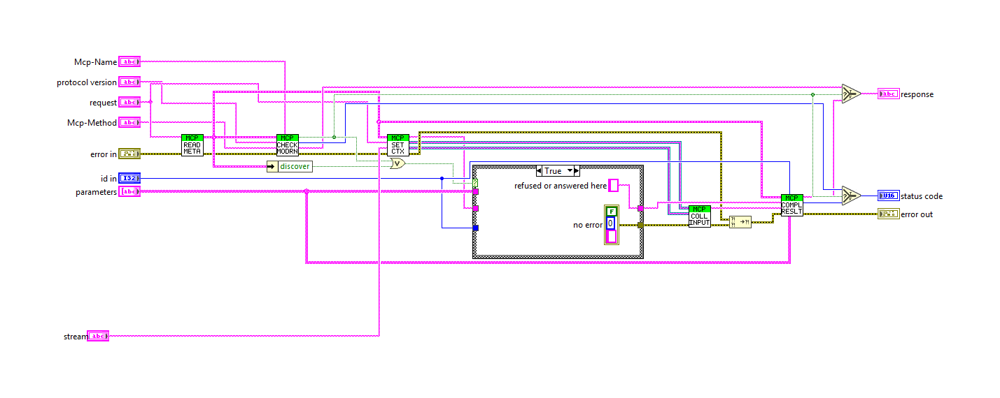 |

| Before | After |
|---|---|
|  | 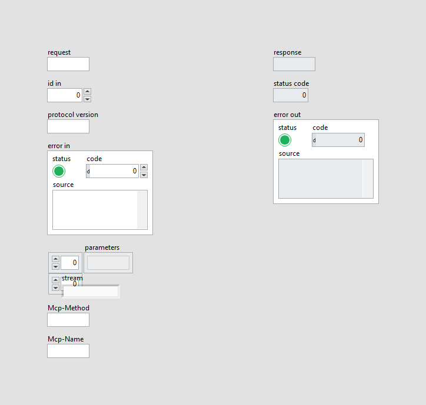 |

All case frames (1 hidden frames)

| Frame | Picture |
|---|---|
| Whole diagram, visible frames: Case structure 1: True | 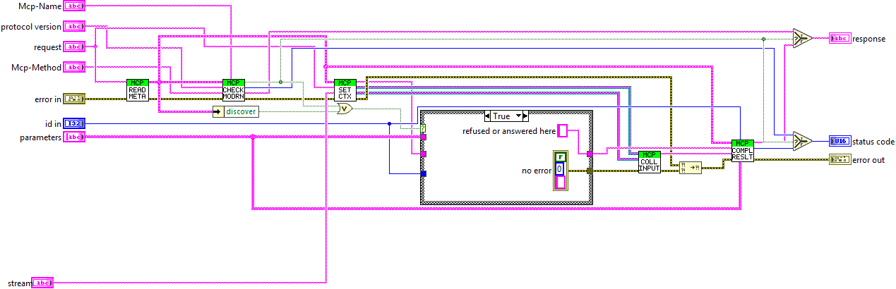 |
| Case structure 1: False |  |

### `src/MCP Server/Process HTTP Request.vi` (modified)

**1. Block Diagram objects**

- **1A** String Constant "Header" - added at (235,-61)
- **1B** SubVI "Select Value.vim" - added at (285,-64)
- **1C** SubVI "MCP Server.lvlib:Prepare Request Dispatch.vi" - added at (289,-64)
- **1D** SubVI "MCP Server.lvlib:Start Streamed Request.vi" - added at (289,-64)
- **1E** SubVI "MCP Server.lvlib:MCP SSE Response.lvclass:Create MCP SSE Response.vi" - added at (289,-64)
- **1F** SubVI "HTTP Server.lvlib:Processing.lvclass:Request Header.vi" - added at (289,-64)
- **1G** wiring changes

| Before | After |
|---|---|
| 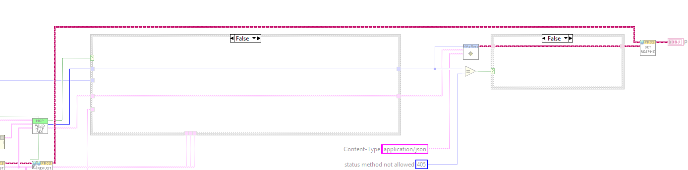 | 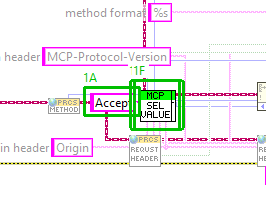 |

**2. Front Panel - Panel**

- **2A** LabVIEW Object "Processing in" - required, recommended, optional settings : changed from "<tt>required</tt>" to "<tt>optional</tt>"

| Before | After |
|---|---|
| 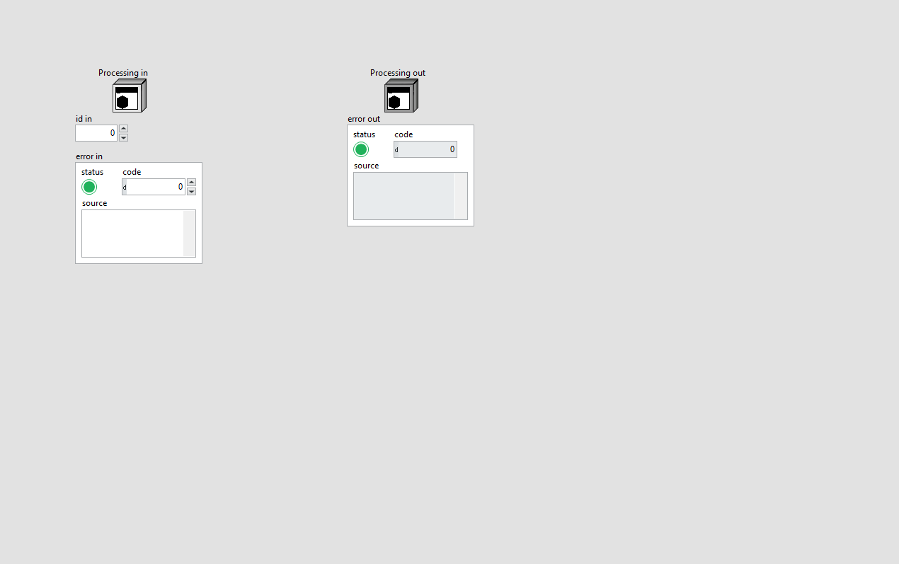 |  |

**3. VI Attribute - Execution (VI Properties)**

- **3A** Automatic Error Handling

Whole block diagram and front panel

| Before | After |
|---|---|
| 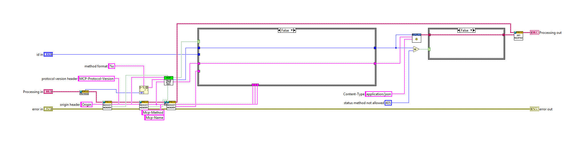 | 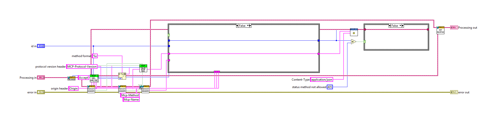 |

| Before | After |
|---|---|
|  |  |

All case frames (2 hidden frames)

| Frame | Picture |
|---|---|
| Whole diagram, visible frames: Case structure 1: False; Case structure 2: False | 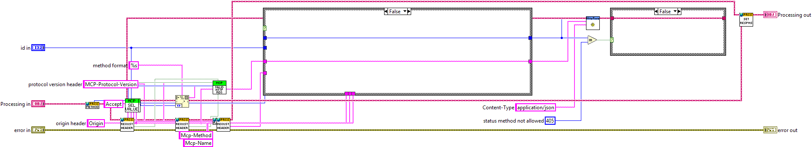 |
| Case structure 1: True | 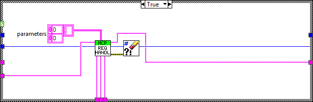 |
| Case structure 2: True | 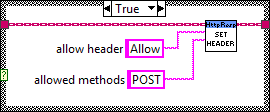 |

### `src/MCP Server/Set MCP Request Context.vi` (modified)

**1. Block Diagram objects**

- **1A** Front Panel Terminal "stream" - added at (294,510)
- **1B** Unbundle By Name  - number of elements : changed from "<tt>3</tt>" to "<tt>4</tt>"
- **1C** Unbundle By Name  - element 3 added : "id"
- **1D** String Constant "$Path or Item Name" - added at (519,725)
- **1E** SubVI "JSONtext.lvlib:Find Item.vi" - added at (700,760)
- **1F** Empty String/Path?  - added at (700,900)
- **1G** String Constant "f" - added at (855,738)
- **1H** String Constant "t" - added at (855,895)
- **1I** Select  - added at (900,760)
- **1J** SubVI "Clear Errors.vi" - added at (900,840)
- **1K** Select  - added at (900,900)
- **1L** String Constant "string" - added at (991,516)
- **1M** String Constant "string" - added at (1033,532)
- **1N** String Constant "string" - added at (1059,500)
- **1O** Concatenate Strings  - number of terminals : changed from "<tt>8</tt>" to "<tt>14</tt>"
- **1P** wiring changes

| Before | After |
|---|---|
|  | 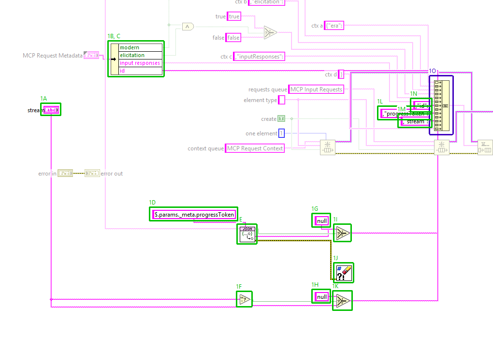 |

**2. Front Panel - Panel**

- **2A** Connector Pane  - control/indicator assignment : changed

| Before | After |
|---|---|
|  |  |

**3. Front Panel objects**

- **3A** String "stream" - added at (40,349)

| Before | After |
|---|---|
| 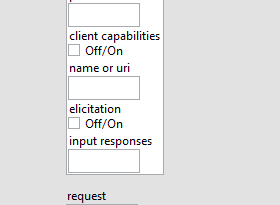 |  |

**4. VI Attribute - Documentation (VI Properties)**

- **4A** description text : changed from "Publishes the context of the request about to be handled, so that Ask User.vi can read it while a tool runs: {"era","elicitation","inputResponses"} becomes the only element of the named queue "MCP Request Context". The queue has size 1, which also serialises request handling: the enqueue waits while another request still holds the context. Questions left over in the named queue "MCP Input Requests" are discarded.

era is "modern" or "legacy"; elicitation is true only for a modern request whose clientCapabilities carry elicitation.

Both queue references stay open and go to Collect MCP Input Requests.vi, which takes the context out again and releases them. request out is request, passed on only once the context is in place, so that the request handler that consumes it runs after this.

Queue errors do not stop the request and are discarded, as before the split. error in is passed through unchanged." to "Publishes the context of the request about to be handled, so that Ask User.vi can read it while a tool runs: {"era","elicitation","inputResponses","id","progressToken","stream"} becomes the only element of the named queue "MCP Request Context". The queue has size 1, which also serialises request handling: the enqueue waits while another request still holds the context. Questions left over in the named queue "MCP Input Requests" are discarded.

era is "modern" or "legacy"; elicitation is true only for a modern request whose clientCapabilities carry elicitation. id is the id of MCP Request Metadata (the JSON text of the request id, null when missing). progressToken is params._meta.progressToken of the request as JSON text, null when missing. stream is the stream input, null when it is empty. Report Progress.vi and Cancel Requested.vi read id, progressToken and stream from the context.

Both queue references stay open and go to Collect MCP Input Requests.vi, which takes the context out again and releases them. request out is request, passed on only once the context is in place, so that the request handler that consumes it runs after this.

Queue errors do not stop the request and are discarded, as before the split; so is the error of looking up progressToken. error in is passed through unchanged."

Whole block diagram and front panel

| Before | After |
|---|---|
|  | 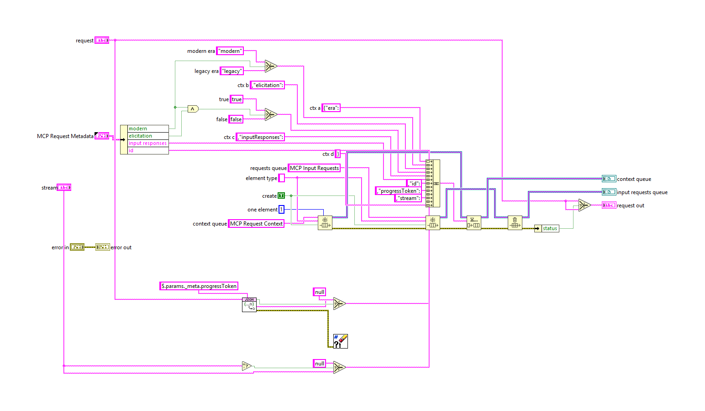 |

| Before | After |
|---|---|
| 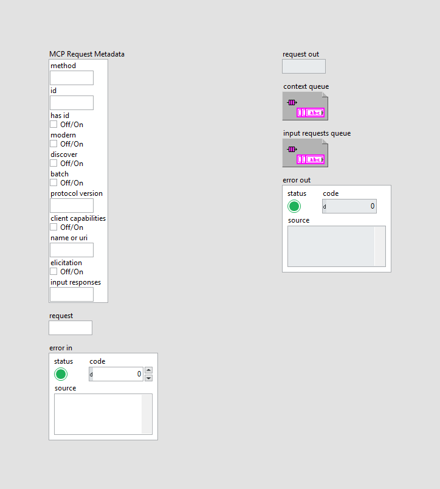 |  |

### `tests/Test_MCP_Server.vi` (modified)

**1. Block Diagram objects**

- **1A** SubVI "MCP Server tests.lvlib:Add Fixture Progress Tool.vi" - added at (2094,323)
- **1B** wiring changes

| Before | After |
|---|---|
| 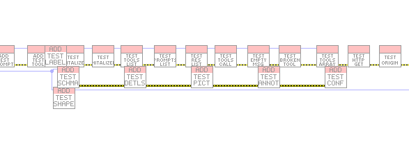 |  |

**2. Block Diagram objects**

- **2A** SubVI "MCP Server tests.lvlib:test progress notifications.vi" - added at (4478,296)
- **2B** SubVI "MCP Server tests.lvlib:test progress cancel by close.vi" - added at (4574,296)
- **2C** SubVI "MCP Server tests.lvlib:test progress legacy cancel.vi" - added at (4670,296)
- **2D** wiring changes

| Before | After |
|---|---|
| 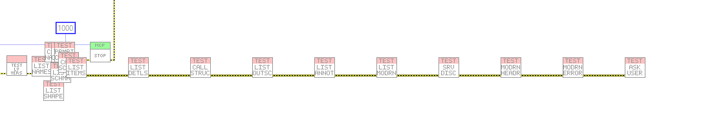 | 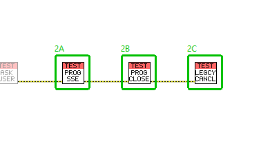 |

Whole block diagram and front panel

| Before | After |
|---|---|
|  |  |

| Before | After |
|---|---|
|  |  |

### `src/MCP Server/Cancel Requested.vi` (added)

Block diagram (case structures show their visible frame only):

Front panel

All case frames (2 hidden frames)

| Frame | Picture |
|---|---|
| Whole diagram, visible frames: Case structure 1: False; Case structure 2: False | 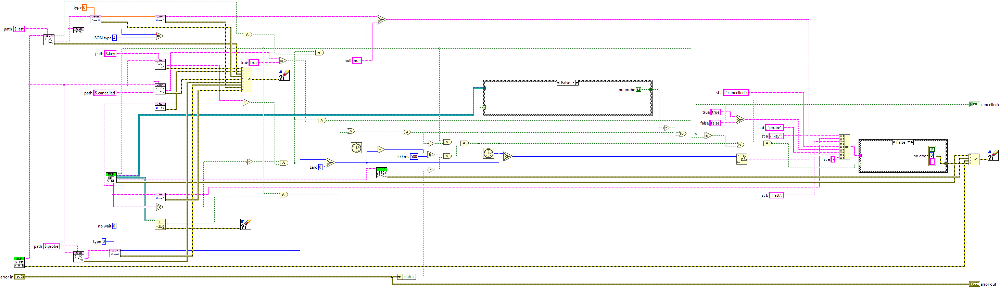 |
| Case structure 1: True | 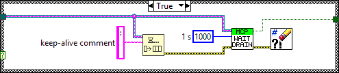 |
| Case structure 2: True |  |

### `src/MCP Server/Get Request Stream.vi` (added)

Block diagram (case structures show their visible frame only):

Front panel

### `src/MCP Server/Legacy Cancellations.vi` (added)

Block diagram (case structures show their visible frame only):

Front panel

### `src/MCP Server/MCP SSE Response/Abort Stream.vi` (added)

Block diagram (case structures show their visible frame only):

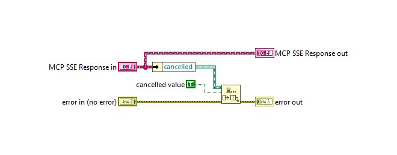

Front panel

### `src/MCP Server/MCP SSE Response/Create MCP SSE Response.vi` (added)

Block diagram (case structures show their visible frame only):

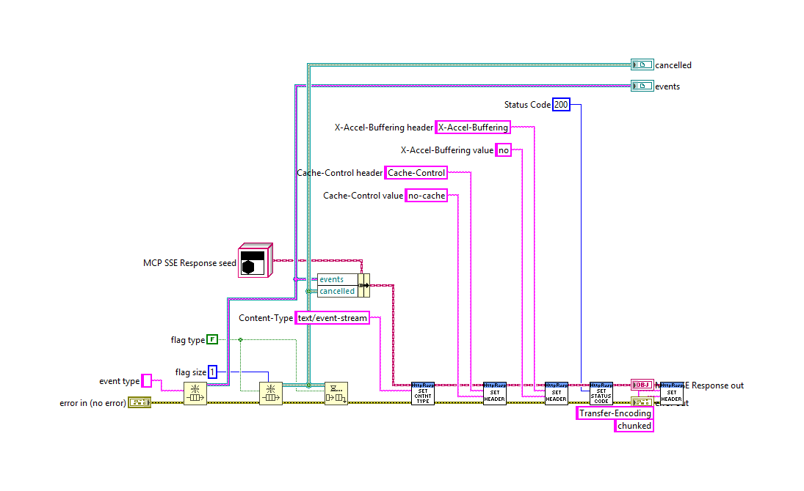

Front panel

### `src/MCP Server/MCP SSE Response/Get Queues.vi` (added)

Block diagram (case structures show their visible frame only):

Front panel

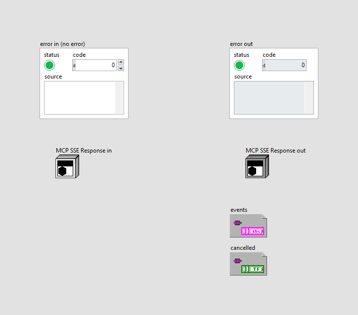

### `src/MCP Server/MCP SSE Response/Next Segment.vi` (added)

Block diagram (case structures show their visible frame only):

Front panel

### `src/MCP Server/MCP SSE Response/Stream Length.vi` (added)

Block diagram (case structures show their visible frame only):

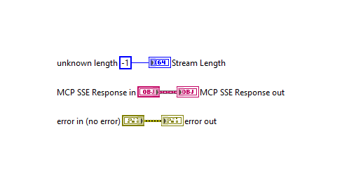

Front panel

### `src/MCP Server/Prepare Request Dispatch.vi` (added)

Block diagram (case structures show their visible frame only):

Front panel

### `src/MCP Server/Report Progress.vi` (added)

Block diagram (case structures show their visible frame only):

Front panel

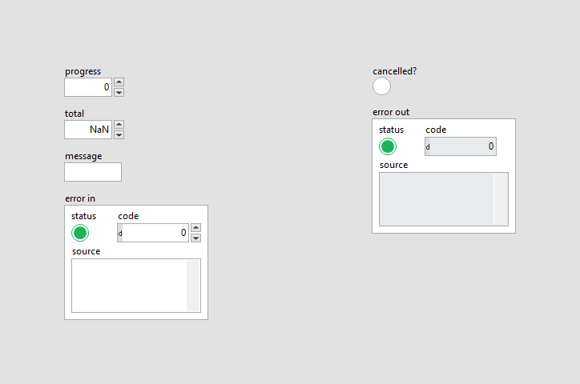

All case frames (2 hidden frames)

| Frame | Picture |
|---|---|
| Whole diagram, visible frames: Case structure 1: False; Case structure 2: False |  |
| Case structure 1: True |  |
| Case structure 2: True |  |

### `src/MCP Server/Run Streamed Request.vi` (added)

Block diagram (case structures show their visible frame only):

Front panel

All case frames (1 hidden frames)

| Frame | Picture |
|---|---|
| Whole diagram, visible frames: Case structure 1: False | 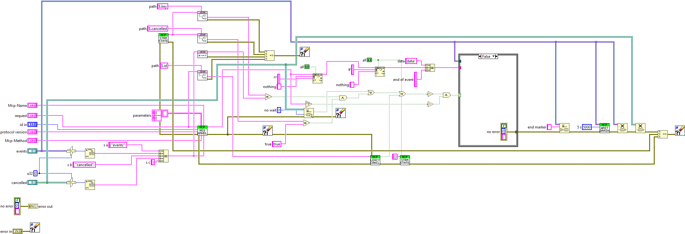 |
| Case structure 1: True |  |

### `src/MCP Server/Select Value.vim` (added)

Block diagram (case structures show their visible frame only):

Front panel

### `src/MCP Server/Start Streamed Request.vi` (added)

Block diagram (case structures show their visible frame only):

Front panel

All case frames (2 hidden frames)

| Frame | Picture |
|---|---|
| Whole diagram, visible frames: Case structure 2: False; Case structure 1: False |  |
| Case structure 1: True | 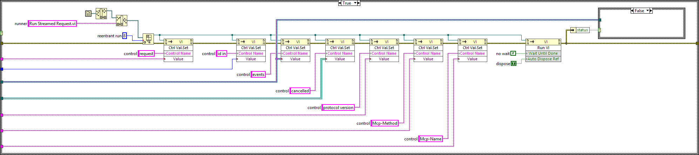 |
| Case structure 2: True |  |

### `src/MCP Server/Stream State.vi` (added)

Block diagram (case structures show their visible frame only):

Front panel

### `src/MCP Server/Wait For Stream Drain.vi` (added)

Block diagram (case structures show their visible frame only):

Front panel

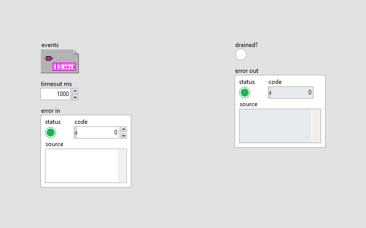

All case frames (1 hidden frames)

| Frame | Picture |
|---|---|
| Whole diagram, visible frames: Case structure 1: False |  |
| Case structure 1: True | 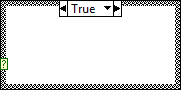 |

### `tests/Add Fixture Progress Tool.vi` (added)

Block diagram (case structures show their visible frame only):

Front panel

### `tests/Progress Fixture Record.vi` (added)

Block diagram (case structures show their visible frame only):

Front panel

### `tests/fake tool progress.vi` (added)

Block diagram (case structures show their visible frame only):

Front panel

All case frames (1 hidden frames)

| Frame | Picture |
|---|---|
| Whole diagram, visible frames: Case structure 1: False |  |
| Case structure 1: True |  |

### `tests/test progress cancel by close.vi` (added)

Block diagram (case structures show their visible frame only):

Front panel

All case frames (1 hidden frames)

| Frame | Picture |
|---|---|
| Whole diagram, visible frames: Case structure 1: False |  |
| Case structure 1: True |  |

### `tests/test progress legacy cancel.vi` (added)

Block diagram (case structures show their visible frame only):

Front panel

All case frames (4 hidden frames)

| Frame | Picture |
|---|---|
| Whole diagram, visible frames: Case structure 1: False; Case structure 2: False; Case structure 3: False; Case structure 4: False |  |
| Case structure 1: True |  |
| Case structure 2: True |  |
| Case structure 3: True |  |
| Case structure 4: True |  |

### `tests/test progress notifications.vi` (added)

Block diagram (case structures show their visible frame only):

Front panel

