## VI diff report

21 modified, 55 added, 0 deleted. Generated by LabVIEW's VI comparison; position and size changes are not shown.

### `examples/Datalogger MCP Server/Datalogger Main.vi` (modified)

**1. Block Diagram objects**

- **1A** SubVI "Add Readme Resource.vi" - added at (858,341)
- **1B** wiring changes

| Before | After |
|---|---|
| 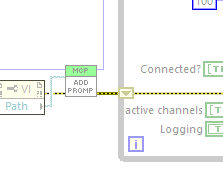 | 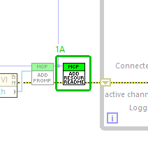 |

**2. Front Panel - Waveform Graph**

- **2A** Waveform Graph "Waveform Graph" - data value : changed from "<tt>[]</tt>" to "<tt>[715.186E-3, 888.985E-3, 669.887E-3, 737.840E-3, 723.124E-3, 607.486E-3, 556.754E-3, 444.187E-3, 302.727E-3, 294.553E-3, 5.910E-3, 219.482E-3, 141.272E-3, -71.630E-3, 40.844E-3, -320.827E-3, -178.925E-3, -487.200E-3, -299.779E-3, -378.834E-3, -552.919E-3, -660.387E-3, -525.812E-3, -945.855E-3, -627.378E-3, -995.316E-3, -739.459E-3, -1.013E+0, -1.028E+0, -810.925E-3, -836.410E-3, -816.533E-3, -811.688E-3, -1.066E+0, -1.075E+0, -944.975E-3, -903.748E-3, -871.138E-3, -775.670E-3, -954.463E-3, -947.276E-3, -775.112E-3, -600.866E-3, -573.216E-3, -368.901E-3, -428.241E-3, -470.613E-3, -331.758E-3, -332.008E-3, -69.562E-3, 126.537E-3, -109.448E-3, 232.848E-3, 93.422E-3, 127.844E-3, 216.067E-3, 259.946E-3, 645.132E-3, 727.369E-3, 593.624E-3, 688.355E-3, 743.130E-3, 945.151E-3, 682.800E-3, 860.160E-3, 1.024E+0, 1.120E+0, 997.211E-3, 926.412E-3, 878.434E-3, 848.509E-3, 1.153E+0, 808.453E-3, 784.909E-3, 748.432E-3, 904.436E-3, 1.045E+0, 636.137E-3, 953.227E-3, 634.347E-3, 625.654E-3, 465.416E-3, 571.200E-3, ...]</tt>"

| Before | After |
|---|---|
| 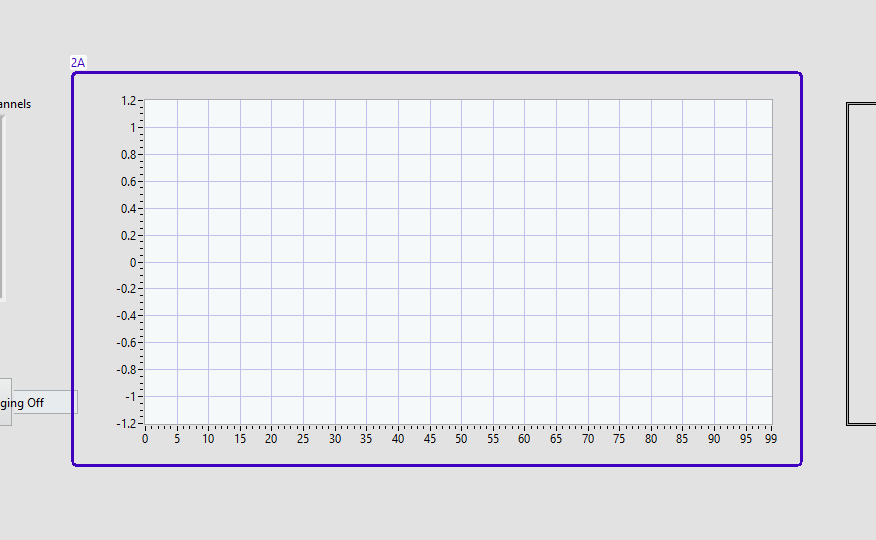 | 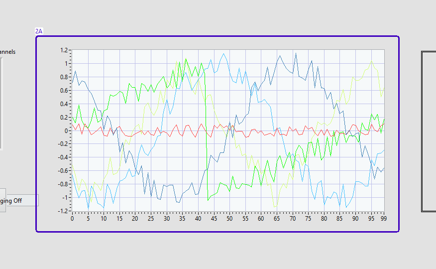 |

Whole block diagram and front panel

| Before | After |
|---|---|
| 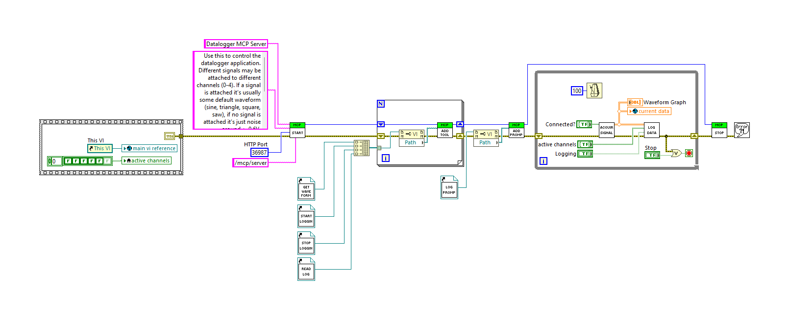 | 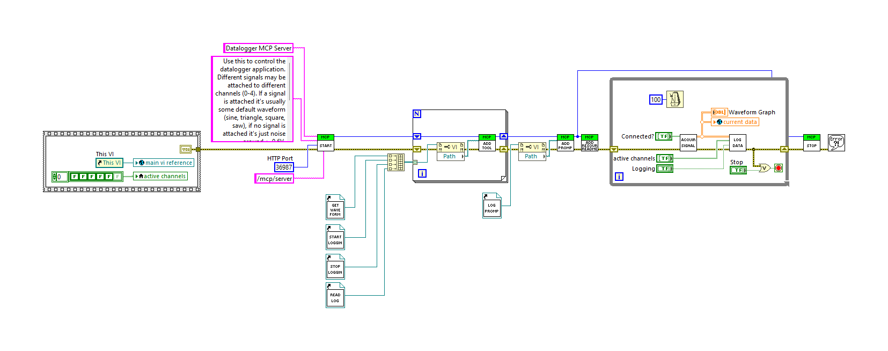 |

| Before | After |
|---|---|
| 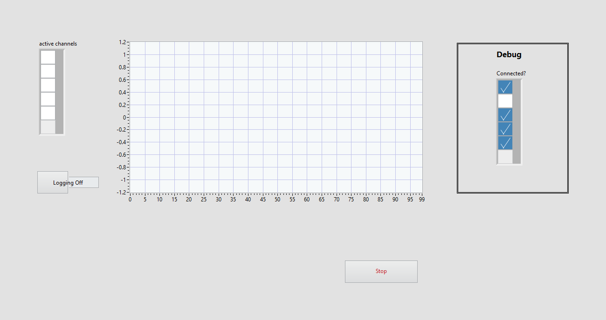 | 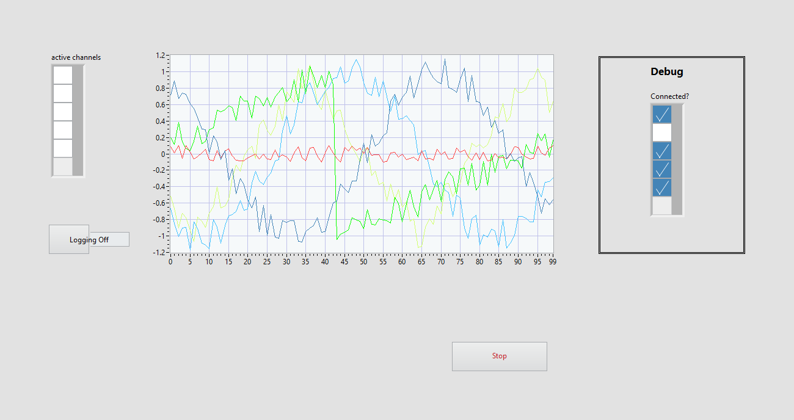 |

### `examples/Datalogger MCP Server/prompts/Log Prompt.vi` (modified)

**2. VI Attribute - Documentation (VI Properties)**

- **2A** description text : changed from "" to "Returns a prompt that asks the model to check the datalogger: find out which channels carry a real signal and not just noise, log those channels for a moment, stop the logging and read the log file to check that logging worked. The prompt states the maximum number of channels given in channelcount."

Whole block diagram and front panel

| Before | After |
|---|---|
|  | 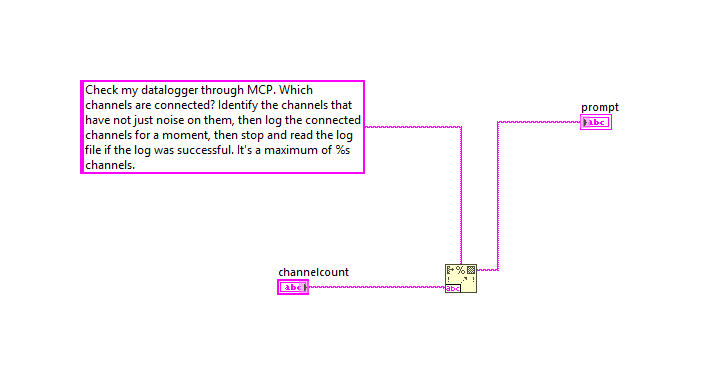 |

| Before | After |
|---|---|
|  | 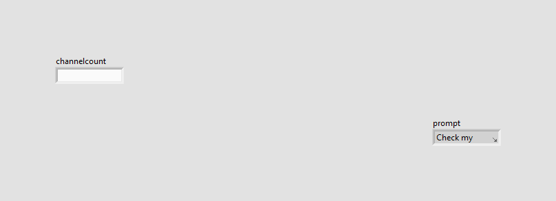 |

### `examples/Datalogger MCP Server/tools/Get Waveform.vi` (modified)

No functional differences found (cosmetic changes only).

Whole block diagram and front panel

| Before | After |
|---|---|
|  | 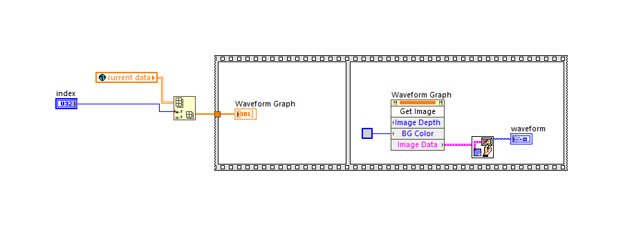 |

| Before | After |
|---|---|
| 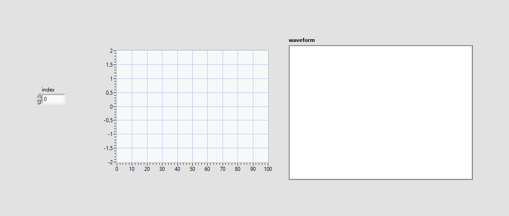 |  |

### `examples/Datalogger MCP Server/tools/Read Log.vi` (modified)

No functional differences found (cosmetic changes only).

Whole block diagram and front panel

| Before | After |
|---|---|
|  | 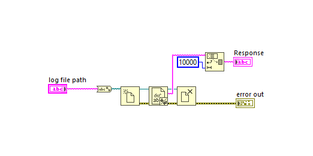 |

| Before | After |
|---|---|
|  | 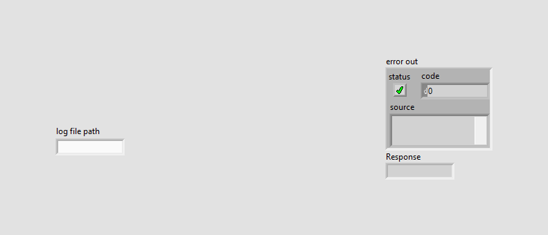 |

### `examples/Datalogger MCP Server/tools/Start Logging.vi` (modified)

No functional differences found (cosmetic changes only).

Whole block diagram and front panel

| Before | After |
|---|---|
| 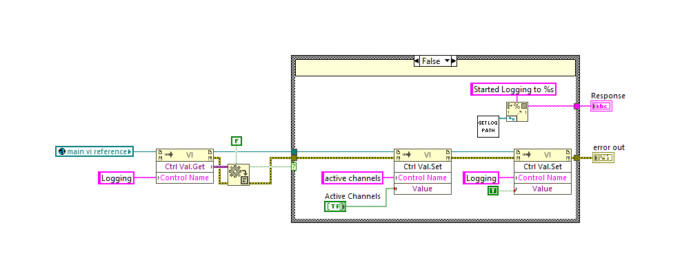 |  |

| Before | After |
|---|---|
|  | 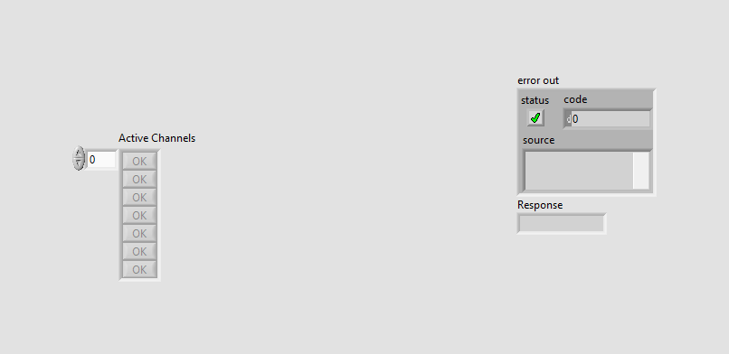 |

### `examples/Full Featured MCP Server/Buy Any.vi` (modified)

No functional differences found (cosmetic changes only).

Whole block diagram and front panel

| Before | After |
|---|---|
| 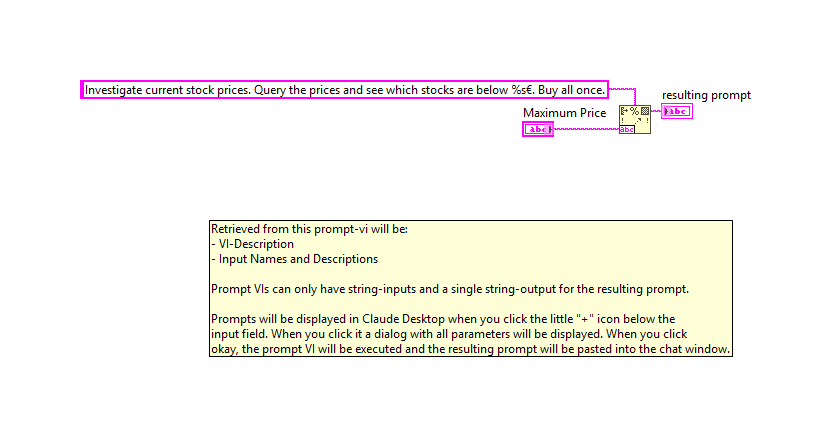 |  |

| Before | After |
|---|---|
|  | 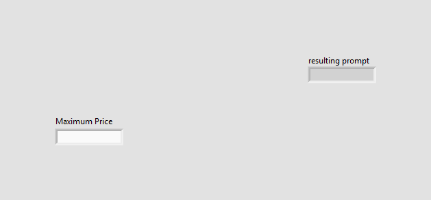 |

### `examples/Full Featured MCP Server/Buy Stock.vi` (modified)

**2. VI Attribute - Documentation (VI Properties)**

- **2A** description text : changed from "" to "Buys the stock with the given name and returns a confirmation text with the purchase price. Returns the text Error if the purchase failed."

Whole block diagram and front panel

| Before | After |
|---|---|
|  | 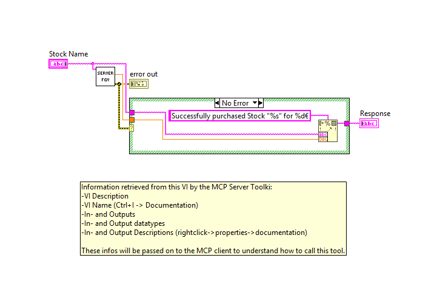 |

| Before | After |
|---|---|
|  | 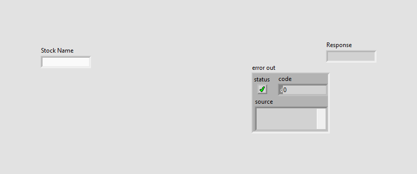 |

### `examples/Full Featured MCP Server/Find Best Trending Stock.vi` (modified)

No functional differences found (cosmetic changes only).

Whole block diagram and front panel

| Before | After |
|---|---|
|  | 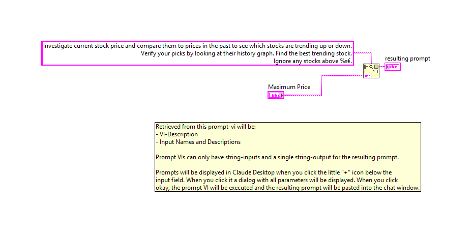 |

| Before | After |
|---|---|
|  | 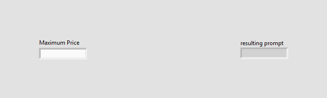 |

### `examples/Full Featured MCP Server/Get History Chart.vi` (modified)

No functional differences found (cosmetic changes only).

Whole block diagram and front panel

| Before | After |
|---|---|
|  | 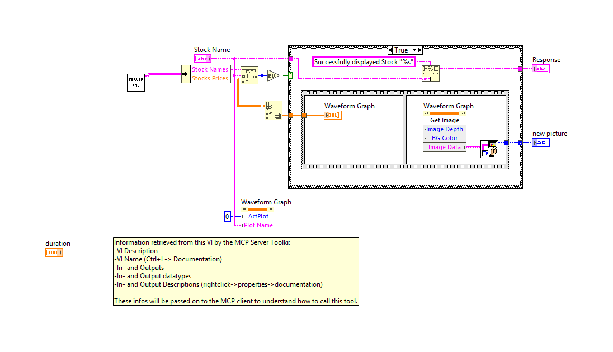 |

| Before | After |
|---|---|
| 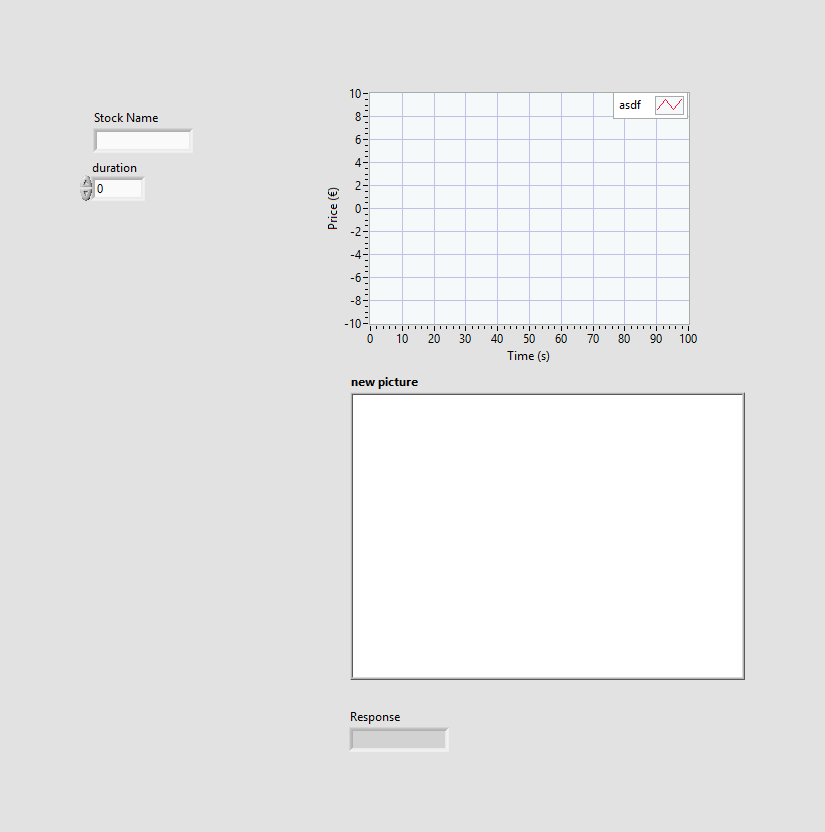 |  |

### `src/MCP Server/Handle Server Request.vi` (modified)

**1. Block Diagram objects**

- **1A** Case Structure  - number of cases : changed from "<tt>11</tt>" to "<tt>13</tt>"
- **1B** Diagram Identifier  - selector value(s) : changed from "<tt> Default   "initialize"   "notifications/initialized"   "tools/list"   "tools/call"   "resources/list"   "resources/read"   "prompts/list"   "prompts/get"   "shutdown"   "exit" </tt>" to "<tt> Default   "initialize"   "notifications/initialized"   "tools/list"   "tools/call"   "resources/templates/list"   "ping"   "resources/list"   "resources/read"   "prompts/list"   "prompts/get"   "shutdown"   "exit" </tt>"

| Before | After |
|---|---|
|  | 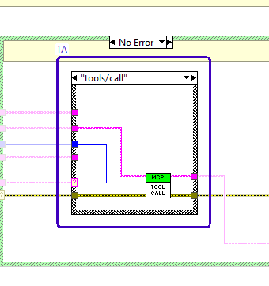 |

**2. Block Diagram objects**

- **2A** Case Structure  - case added : [ "resources/templates/list" ]

| Before | After |
|---|---|
|  | 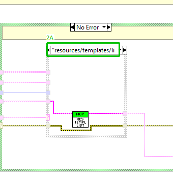 |

**3. Block Diagram objects**

- **3A** SubVI "MCP Server.lvlib:resources templates list.vi" - added at (878,-453)

| Before | After |
|---|---|
|  | 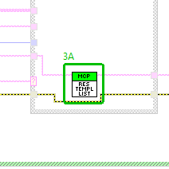 |

**4. Block Diagram objects**

- **4A** Case Structure  - case added : [ "ping" ]

| Before | After |
|---|---|
| 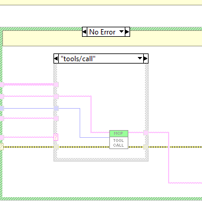 | 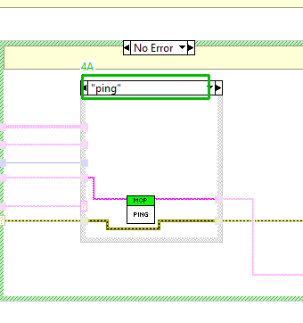 |

**5. Block Diagram objects**

- **5A** SubVI "MCP Server.lvlib:ping.vi" - added at (878,-453)

| Before | After |
|---|---|
| 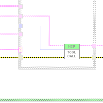 | 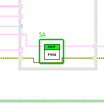 |

**6. Block Diagram objects**

- **6A** SubVI "MCP Server.lvlib:Build Error Response.vi" - added at (1212,-459)
- **6B** wiring changes

| Before | After |
|---|---|
| 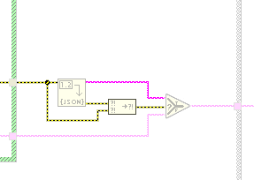 | 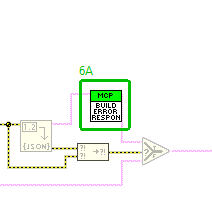 |

**7. Block Diagram objects**

- **7A** SubVI "MCP Server.lvlib:Reject Invalid Request.vi" - added at (1355,-443)
- **7B** SubVI "MCP Server.lvlib:Restore Request ID.vi" - added at (1400,-443)
- **7C** SubVI "MCP Server.lvlib:Null Id For Parse Error.vi" - added at (1462,-443)
- **7D** wiring changes

| Before | After |
|---|---|
| 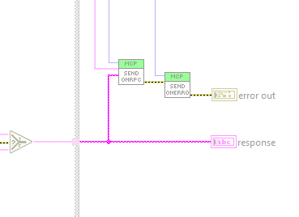 | 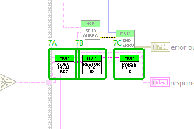 |

Whole block diagram and front panel

| Before | After |
|---|---|
| 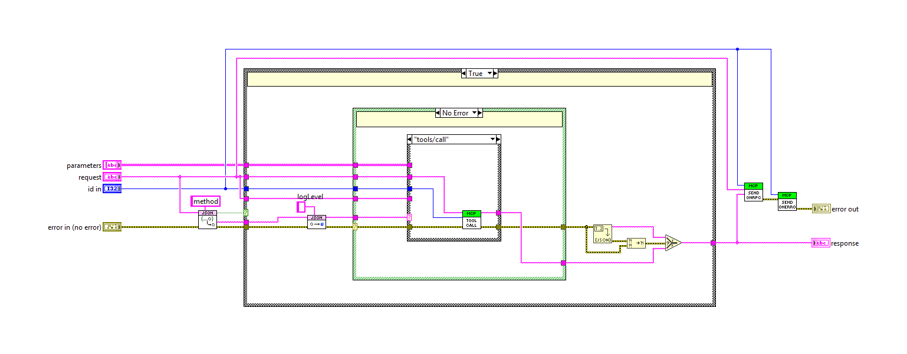 | 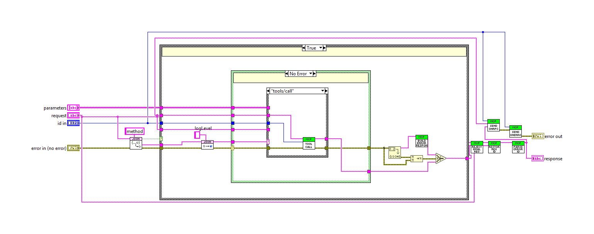 |

| Before | After |
|---|---|
|  | 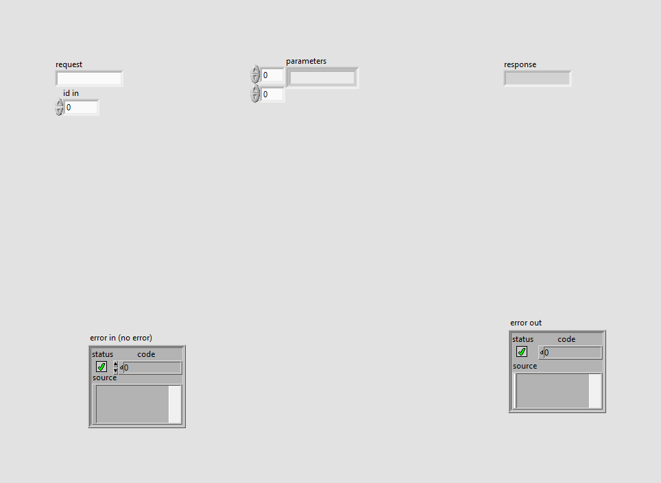 |

### `src/MCP Server/Process HTTP Request.vi` (modified)

**1. Block Diagram objects**

- **1A** SubVI "MCP Server.lvlib:Handle Server Request Batch.vi" - added at (796,-195)
- **1B** SubVI "MCP Server.lvlib:Handle Server Request.vi" - deleted at (796,-195)
- **1C** wiring changes

| Before | After |
|---|---|
| 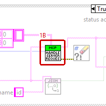 | 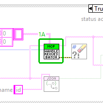 |

**2. VI Attribute - Documentation (VI Properties)**

- **2A** description text : changed from "Answers one HTTP request on the MCP endpoint following the MCP Streamable HTTP transport rules, and stores the response in the Processing object.

1. Reads the HTTP method and the Origin and MCP-Protocol-Version request headers and passes them to Validate HTTP Request.vi.
2. Rejected request (405, 403 or 400): the MCP server is NOT called. The response carries the status code and the JSON-RPC error payload from Validate HTTP Request.vi with Content-Type application/json. A 405 additionally carries the header Allow: POST.
3. Accepted request: the request body is passed to Handle Server Request.vi and its errors are cleared. If the response is empty AND the request body has no top-level id item (a notification), the status is 202 with an empty body. Otherwise the status is 200 with Content-Type application/json and the response as payload.

error out reports only errors of the two header reads. It is informational: a response is always set." to "Answers one HTTP request on the MCP endpoint following the MCP Streamable HTTP transport rules, and stores the response in the Processing object.

1. Reads the HTTP method and the Origin and MCP-Protocol-Version request headers and passes them to Validate HTTP Request.vi.
2. Rejected request (405, 403 or 400): the MCP server is NOT called. The response carries the status code and the JSON-RPC error payload from Validate HTTP Request.vi with Content-Type application/json. A 405 additionally carries the header Allow: POST.
3. Accepted request: the request body, one message or a batch of messages, is passed to Handle Server Request Batch.vi and its errors are cleared. If the response is empty AND the request body has no top-level id item (a notification), the status is 202 with an empty body. Otherwise the status is 200 with Content-Type application/json and the response as payload.

error out reports only errors of the two header reads. It is informational: a response is always set."

Whole block diagram and front panel

| Before | After |
|---|---|
|  | 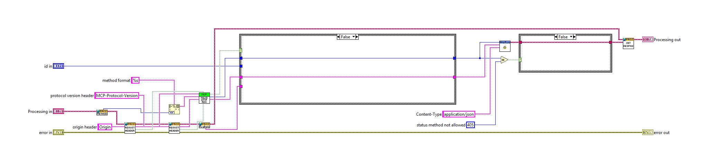 |

| Before | After |
|---|---|
|  |  |

### `src/MCP Server/Validate HTTP Request.vi` (modified)

**1. Block Diagram objects**

- **1A** String Constant "version 1" - deleted at (608,206)
- **1B** String Constant "version 2" - deleted at (608,264)
- **1C** String Constant "version 3" - deleted at (608,296)
- **1D** Equal?  - deleted at (723,200)
- **1E** Equal?  - deleted at (723,245)
- **1F** Equal?  - deleted at (723,290)
- **1G** SubVI "MCP Server.lvlib:Is Supported Protocol Version.vi" - added at (740,240)
- **1H** Or  - deleted at (819,243)
- **1I** Or  - deleted at (900,288)
- **1J** wiring changes

| Before | After |
|---|---|
| 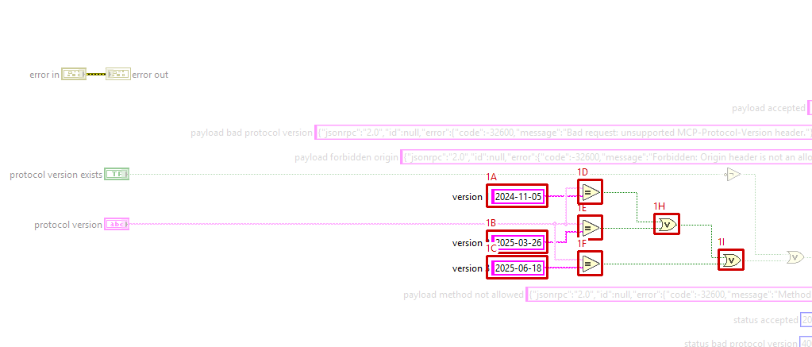 | 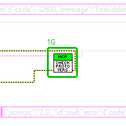 |

**2. VI Attribute - Documentation (VI Properties)**

- **2A** description text : changed from "Decides whether an incoming HTTP request may be handed to the MCP request handler, following the MCP Streamable HTTP transport rules. Pure decision logic with scalar terminals and no side effects.

Checks, in this order:
1. method must be exactly POST, otherwise status 405.
2. Origin (DNS rebinding protection): an absent header is accepted. A present one must be http or https followed by localhost, 127.0.0.1 or [::1] with an optional numeric port, compared case-insensitively. Anything else, including the literal null, gives status 403.
3. MCP-Protocol-Version: an absent header is accepted. A present one must be 2024-11-05, 2025-03-26 or 2025-06-18, otherwise status 400.

When accepted? is TRUE, status code is 200 and payload is empty. When it is FALSE, status code is 405, 403 or 400 and payload is a JSON-RPC error object (id null, code -32600) to be sent with Content-Type application/json.

The error cluster is passed through unchanged. The decision is computed regardless of error in." to "Decides whether an incoming HTTP request may be handed to the MCP request handler, following the MCP Streamable HTTP transport rules. Pure decision logic with scalar terminals and no side effects.

Checks, in this order:
1. method must be exactly POST, otherwise status 405.
2. Origin (DNS rebinding protection): an absent header is accepted. A present one must be http or https followed by localhost, 127.0.0.1 or [::1] with an optional numeric port, compared case-insensitively. Anything else, including the literal null, gives status 403.
3. MCP-Protocol-Version: an absent header is accepted. A present one must be one of the versions in Supported Protocol Versions.vi (checked by Is Supported Protocol Version.vi), otherwise status 400.

When accepted? is TRUE, status code is 200 and payload is empty. When it is FALSE, status code is 405, 403 or 400 and payload is a JSON-RPC error object (id null, code -32600) to be sent with Content-Type application/json.

The error cluster is passed through unchanged. The decision is computed regardless of error in."

Whole block diagram and front panel

| Before | After |
|---|---|
| 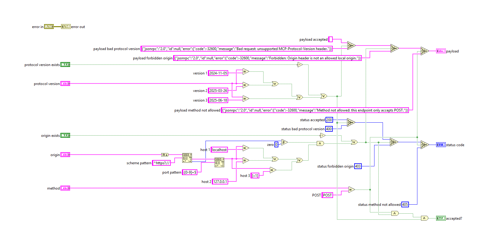 |  |

| Before | After |
|---|---|
|  | 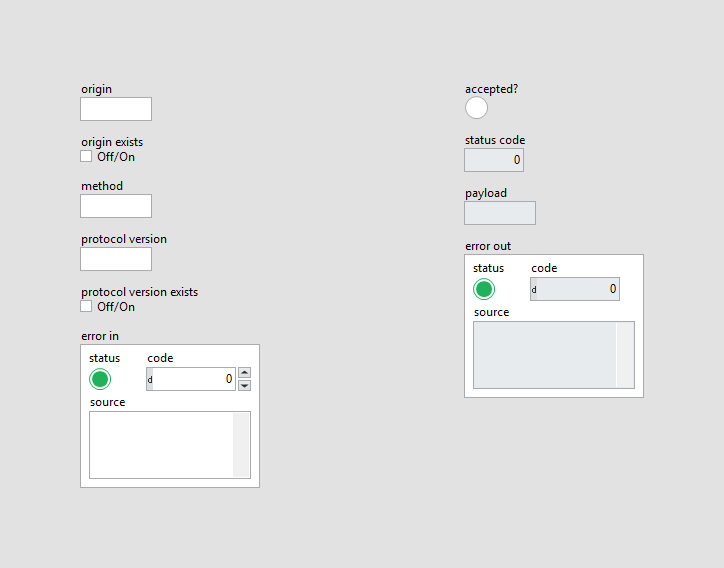 |

### `src/MCP Server/initialize.vi` (modified)

**1. Block Diagram objects**

- **1A** SubVI "MCP Server.lvlib:Negotiate Protocol Version.vi" - added at (106,479)
- **1B** SubVI "MCP Server.lvlib:Set LabVIEW Version.vi" - added at (108,590)
- **1C** wiring changes

| Before | After |
|---|---|
| 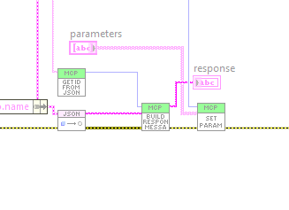 | 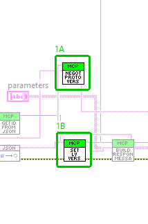 |

Whole block diagram and front panel

| Before | After |
|---|---|
| 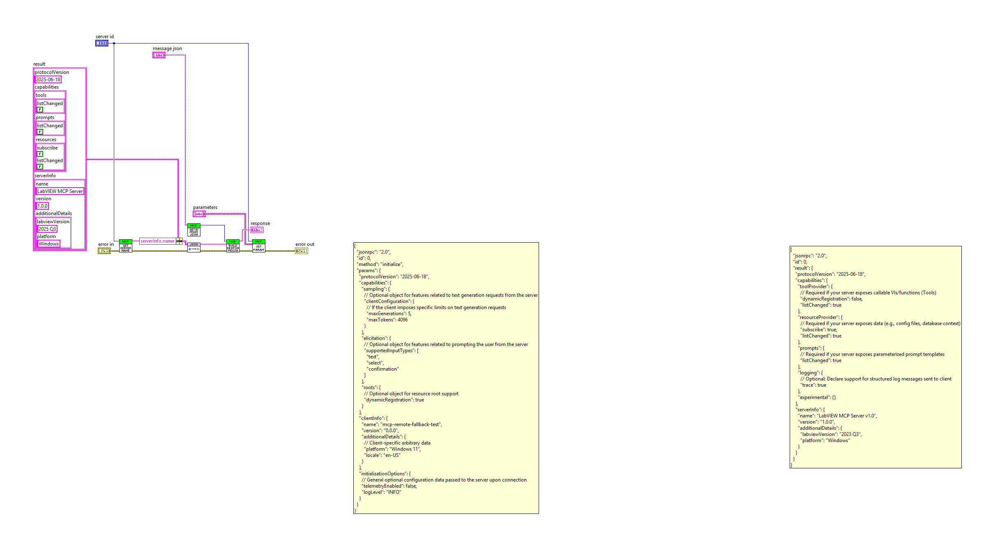 | 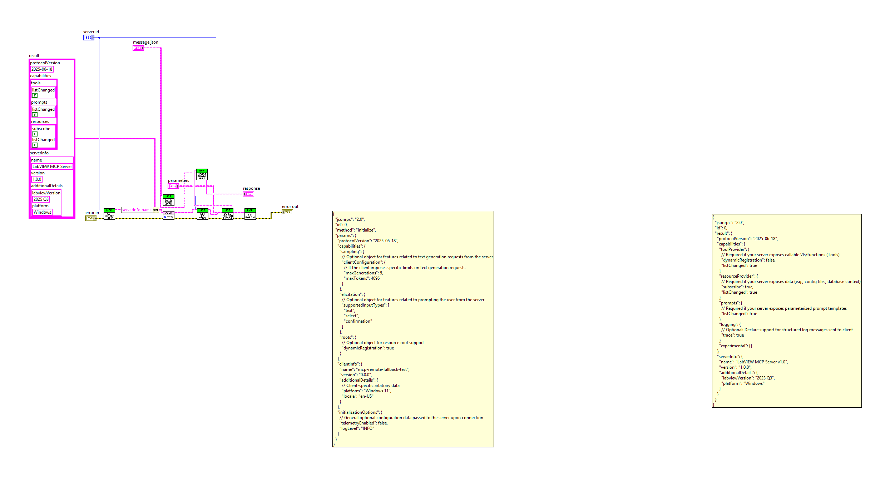 |

| Before | After |
|---|---|
|  | 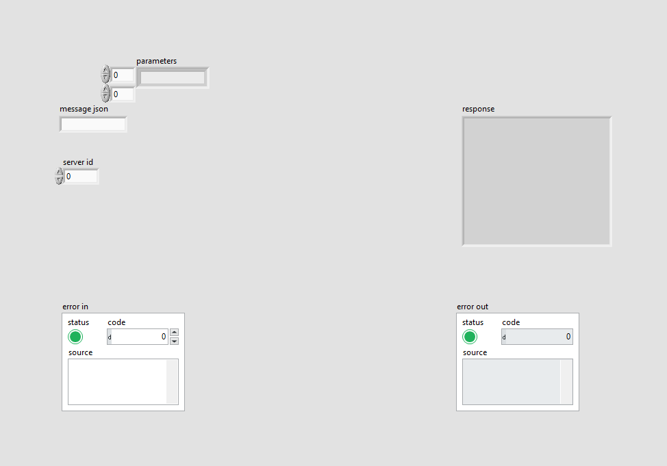 |

### `src/MCP Server/prompts get.vi` (modified)

**1. Block Diagram objects**

- **1A** SubVI "MCP Server.lvlib:Check Prompt Arguments.vi" - added at (885,294)
- **1B** wiring changes

| Before | After |
|---|---|
|  |  |

**2. Block Diagram objects**

- **2A** SubVI "MCP Server.lvlib:Reinitialize VI Inputs.vi" - added at (951,241)
- **2B** wiring changes

| Before | After |
|---|---|
|  |  |

Whole block diagram and front panel

| Before | After |
|---|---|
|  |  |

| Before | After |
|---|---|
|  |  |

### `src/MCP Server/prompts list.vi` (modified)

**1. Block Diagram objects**

- **1A** For Loop  - deleted at (160,96)
- **1B** Unbundle By Name  - deleted at (187,354)
- **1C** For Loop  - deleted at (288,274)
- **1D** Unbundle By Name  - deleted at (355,378)
- **1E** Cluster Constant  - deleted at (369,294)
- **1F** Bundle By Name  - deleted at (454,351)
- **1G** Loop Tunnel  - deleted at (288,390)
- **1H** Cluster Constant  - deleted at (506,116)
- **1I** Loop Tunnel  - deleted at (546,363)
- **1J** Bundle By Name  - deleted at (586,245)
- **1K** Loop Tunnel  - deleted at (160,374)
- **1L** SubVI "MCP Server.lvlib:Build Prompt List JSON.vi" - added at (200,420)
- **1M** Loop Tunnel  - deleted at (678,265)
- **1N** SubVI "JSONtext.lvlib:To JSON Text.vim" - deleted at (720,265)
- **1O** wiring changes

| Before | After |
|---|---|
|  |  |

Whole block diagram and front panel

| Before | After |
|---|---|
|  |  |

| Before | After |
|---|---|
|  |  |

### `src/MCP Server/resources read.vi` (modified)

**1. Block Diagram objects**

- **1A** Case Structure  - deleted at (729,210)
- **1B** Open/Create/Replace File  - deleted at (749,405)
- **1C** Numeric Constant "count" - deleted at (763,382)
- **1D** Read from Text File  - deleted at (798,379)
- **1E** Close File  - deleted at (847,379)
- **1F** Cluster Constant "contents" - deleted at (855,247)
- **1G** SubVI "JSONtext.lvlib:To JSON Text.vim" - deleted at (890,387)
- **1H** Bundle By Name  - deleted at (945,322)
- **1I** SubVI "JSONtext.lvlib:To JSON Text.vim" - deleted at (1031,342)
- **1J** Build Array  - deleted at (1073,342)
- **1K** SubVI "JSONtext.lvlib:Make JSON Array.vi" - deleted at (1116,326)
- **1L** Numeric Constant  - deleted at (763,374)
- **1M** Read from Text File  - deleted at (798,405)
- **1N** SubVI "Base64 Support.lvlib:Base64 Encode.vi" - deleted at (847,374)
- **1O** Close File  - deleted at (847,421)
- **1P** SubVI "JSONtext.lvlib:To JSON Text.vim" - deleted at (890,374)
- **1Q** Tunnel  - deleted at (729,230)
- **1R** Tunnel  - deleted at (729,405)
- **1S** Tunnel  - deleted at (729,429)
- **1T** Tunnel  - deleted at (1158,326)
- **1U** Tunnel  - deleted at (1158,350)
- **1V** Array Constant "Item Names" - deleted at (1162,170)
- **1W** Build Array  - deleted at (1198,326)
- **1X** SubVI "MCP Server.lvlib:Read Resource Contents.vi" - added at (1230,170)
- **1Y** SubVI "JSONtext.lvlib:Make JSON Object.vi" - deleted at (1247,178)
- **1Z** wiring changes

| Before | After |
|---|---|
|  |  |

Whole block diagram and front panel

| Before | After |
|---|---|
|  |  |

| Before | After |
|---|---|
|  |  |

### `src/MCP Server/tool call.vi` (modified)

**1. Block Diagram objects**

- **1A** SubVI "MCP Server.lvlib:Default Tool Arguments.vi" - added at (-75,-300)
- **1B** SubVI "MCP Server.lvlib:Reinitialize VI Inputs.vi" - added at (470,-215)
- **1C** SubVI "MCP Server.lvlib:Check Tool Arguments.vi" - added at (520,-276)
- **1D** SubVI "MCP Server.lvlib:Finish Tool Call Response.vi" - added at (935,-300)
- **1E** SubVI "MCP Server.lvlib:Mark Tool Error Result.vi" - added at (995,-300)
- **1F** SubVI "MCP Server.lvlib:Check Tool Arguments.vi" - added at (1035,-300)
- **1G** wiring changes

| Before | After |
|---|---|
|  |  |

Whole block diagram and front panel

| Before | After |
|---|---|
|  |  |

| Before | After |
|---|---|
|  |  |

### `src/MCP Server/tool list.vi` (modified)

**1. Block Diagram objects**

- **1A** SubVI "MCP Server.lvlib:Add Array Items To Schema.vi" - added at (1928,755)
- **1B** wiring changes

| Before | After |
|---|---|
|  |  |

Whole block diagram and front panel

| Before | After |
|---|---|
|  |  |

| Before | After |
|---|---|
|  |  |

### `tests/Test_MCP_Server.vi` (modified)

**1. Block Diagram objects**

- **1A** SubVI "MCP Server tests.lvlib:Add Fixture Files.vi" - added at (1466,293)
- **1B** SubVI "MCP Server tests.lvlib:Add Fixture Prompt.vi" - added at (1521,293)
- **1C** SubVI "MCP Server tests.lvlib:Add Fixture Tool.vi" - added at (1571,293)
- **1D** wiring changes

| Before | After |
|---|---|
|  |  |

**2. Block Diagram objects**

- **2A** SubVI "MCP Server tests.lvlib:test ping.vi" - added at (2346,293)
- **2B** SubVI "MCP Server tests.lvlib:test string id.vi" - added at (2391,293)
- **2C** SubVI "MCP Server tests.lvlib:test unknown prompt.vi" - added at (2436,293)
- **2D** SubVI "MCP Server tests.lvlib:test unknown resource.vi" - added at (2481,293)
- **2E** SubVI "MCP Server tests.lvlib:test resource text utf8.vi" - added at (2526,293)
- **2F** SubVI "MCP Server tests.lvlib:test resource blob.vi" - added at (2571,293)
- **2G** SubVI "MCP Server tests.lvlib:test unknown tool.vi" - added at (2616,293)
- **2H** SubVI "MCP Server tests.lvlib:test tool call without arguments.vi" - added at (2661,293)
- **2I** SubVI "MCP Server tests.lvlib:test broken tool message.vi" - added at (2706,293)
- **2J** SubVI "MCP Server tests.lvlib:test prompt without arguments.vi" - added at (2751,293)
- **2K** SubVI "MCP Server tests.lvlib:test request without method.vi" - added at (2796,293)
- **2L** SubVI "MCP Server tests.lvlib:test malformed json.vi" - added at (2841,293)
- **2M** SubVI "MCP Server tests.lvlib:test tools list array items.vi" - added at (2886,293)
- **2N** SubVI "MCP Server tests.lvlib:test protocol version negotiation.vi" - added at (2931,293)
- **2O** SubVI "MCP Server tests.lvlib:test resource templates list.vi" - added at (2976,293)
- **2P** SubVI "MCP Server tests.lvlib:test tool call default arguments.vi" - added at (3021,293)
- **2Q** SubVI "MCP Server tests.lvlib:test tool error result.vi" - added at (3066,293)
- **2R** SubVI "MCP Server tests.lvlib:test internal error message.vi" - added at (3111,293)
- **2S** SubVI "MCP Server tests.lvlib:test prompts list required.vi" - added at (3156,293)
- **2T** SubVI "MCP Server tests.lvlib:test prompt required argument.vi" - added at (3201,293)
- **2U** SubVI "MCP Server tests.lvlib:test batch.vi" - added at (3246,293)
- **2V** SubVI "MCP Server tests.lvlib:test non object message.vi" - added at (3291,293)
- **2W** SubVI "MCP Server tests.lvlib:test tool required arguments.vi" - added at (3336,293)
- **2X** SubVI "MCP Server tests.lvlib:test protocol version fallback.vi" - added at (3381,293)
- **2Y** SubVI "MCP Server tests.lvlib:test labview version.vi" - added at (3426,293)
- **2Z** wiring changes

| Before | After |
|---|---|
|  |  |

Whole block diagram and front panel

| Before | After |
|---|---|
|  |  |

| Before | After |
|---|---|
|  |  |

### `tests/test broken tool.vi` (modified)

**1. Block Diagram objects**

- **1A** String Constant "$Path or Item Name" - data value : changed from "<tt>"error"</tt>" to "<tt>"result"</tt>"

| Before | After |
|---|---|
|  |  |

**2. Block Diagram objects**

- **2A** String Constant "$Path or Item Name" - data value : changed from "<tt>"message"</tt>" to "<tt>"$.content[0].text"</tt>"

| Before | After |
|---|---|
|  |  |

**3. Block Diagram objects**

- **3A** String Constant "$Path or Item Name" - data value : changed from "<tt>"code"</tt>" to "<tt>"isError"</tt>"

| Before | After |
|---|---|
|  |  |

**4. Block Diagram objects**

- **4A** String Constant "y" - data value : changed from "<tt>"1003"</tt>" to "<tt>"true"</tt>"

| Before | After |
|---|---|
|  |  |

Whole block diagram and front panel

| Before | After |
|---|---|
|  |  |

| Before | After |
|---|---|
|  |  |

### `tests/test empty msg.vi` (modified)

**1. Block Diagram objects**

- **1A** String Constant "Label (VI Title)" - data value : changed from "<tt>"Test 7: empty json message"</tt>" to "<tt>"Test 7: empty JSON object is an invalid request"</tt>"

| Before | After |
|---|---|
|  |  |

**2. Block Diagram objects**

- **2A** String Constant "y" - data value : changed from "<tt>"-32700"</tt>" to "<tt>"-32600"</tt>"

| Before | After |
|---|---|
|  |  |

Whole block diagram and front panel

| Before | After |
|---|---|
|  |  |

| Before | After |
|---|---|
|  |  |

### `examples/Datalogger MCP Server/sub VIs/Add Readme Resource.vi` (added)

Block diagram (case structures show their visible frame only):

Front panel

### `src/MCP Server/Add Array Items To Schema.vi` (added)

Block diagram (case structures show their visible frame only):

Front panel

### `src/MCP Server/Build Error Response.vi` (added)

Block diagram (case structures show their visible frame only):

Front panel

### `src/MCP Server/Build Prompt List JSON.vi` (added)

Block diagram (case structures show their visible frame only):

Front panel

### `src/MCP Server/Check Prompt Arguments.vi` (added)

Block diagram (case structures show their visible frame only):

Front panel

### `src/MCP Server/Check Tool Arguments.vi` (added)

Block diagram (case structures show their visible frame only):

Front panel

### `src/MCP Server/Choose Protocol Version.vi` (added)

Block diagram (case structures show their visible frame only):

Front panel

### `src/MCP Server/Clean Error Message.vi` (added)

Block diagram (case structures show their visible frame only):

Front panel

### `src/MCP Server/Default Tool Arguments.vi` (added)

Block diagram (case structures show their visible frame only):

Front panel

### `src/MCP Server/Finish Tool Call Response.vi` (added)

Block diagram (case structures show their visible frame only):

Front panel

### `src/MCP Server/Handle Server Request Batch.vi` (added)

Block diagram (case structures show their visible frame only):

Front panel

### `src/MCP Server/Is Supported Protocol Version.vi` (added)

Block diagram (case structures show their visible frame only):

Front panel

### `src/MCP Server/Mark Tool Error Result.vi` (added)

Block diagram (case structures show their visible frame only):

Front panel

### `src/MCP Server/Negotiate Protocol Version.vi` (added)

Block diagram (case structures show their visible frame only):

Front panel

### `src/MCP Server/Null Id For Parse Error.vi` (added)

Block diagram (case structures show their visible frame only):

Front panel

### `src/MCP Server/Read Resource Contents.vi` (added)

Block diagram (case structures show their visible frame only):

Front panel

### `src/MCP Server/Reinitialize VI Inputs.vi` (added)

Block diagram (case structures show their visible frame only):

Front panel

### `src/MCP Server/Reject Invalid Request.vi` (added)

Block diagram (case structures show their visible frame only):

Front panel

### `src/MCP Server/Reject Non Object Message.vi` (added)

Block diagram (case structures show their visible frame only):

Front panel

### `src/MCP Server/Restore Request ID.vi` (added)

Block diagram (case structures show their visible frame only):

Front panel

### `src/MCP Server/Set LabVIEW Version.vi` (added)

Block diagram (case structures show their visible frame only):

Front panel

### `src/MCP Server/Strip Error Details.vi` (added)

Block diagram (case structures show their visible frame only):

Front panel

### `src/MCP Server/Supported Protocol Versions.vi` (added)

Block diagram (case structures show their visible frame only):

Front panel

### `src/MCP Server/ping.vi` (added)

Block diagram (case structures show their visible frame only):

Front panel

### `src/MCP Server/resources templates list.vi` (added)

Block diagram (case structures show their visible frame only):

Front panel

### `tests/Add Fixture Files.vi` (added)

Block diagram (case structures show their visible frame only):

Front panel

### `tests/Add Fixture Prompt.vi` (added)

Block diagram (case structures show their visible frame only):

Front panel

### `tests/Add Fixture Tool.vi` (added)

Block diagram (case structures show their visible frame only):

Front panel

### `tests/fake prompt required argument.vi` (added)

Block diagram (case structures show their visible frame only):

Front panel

### `tests/fake tool required input.vi` (added)

Block diagram (case structures show their visible frame only):

Front panel

### `tests/test batch.vi` (added)

Block diagram (case structures show their visible frame only):

Front panel

### `tests/test broken tool message.vi` (added)

Block diagram (case structures show their visible frame only):

Front panel

### `tests/test internal error message.vi` (added)

Block diagram (case structures show their visible frame only):

Front panel

### `tests/test labview version.vi` (added)

Block diagram (case structures show their visible frame only):

Front panel

### `tests/test malformed json.vi` (added)

Block diagram (case structures show their visible frame only):

Front panel

### `tests/test non object message.vi` (added)

Block diagram (case structures show their visible frame only):

Front panel

### `tests/test ping.vi` (added)

Block diagram (case structures show their visible frame only):

Front panel

### `tests/test prompt required argument.vi` (added)

Block diagram (case structures show their visible frame only):

Front panel

### `tests/test prompt without arguments.vi` (added)

Block diagram (case structures show their visible frame only):

Front panel

### `tests/test prompts list required.vi` (added)

Block diagram (case structures show their visible frame only):

Front panel

### `tests/test protocol version fallback.vi` (added)

Block diagram (case structures show their visible frame only):

Front panel

### `tests/test protocol version negotiation.vi` (added)

Block diagram (case structures show their visible frame only):

Front panel

### `tests/test request without method.vi` (added)

Block diagram (case structures show their visible frame only):

Front panel

### `tests/test resource blob.vi` (added)

Block diagram (case structures show their visible frame only):

Front panel

### `tests/test resource templates list.vi` (added)

Block diagram (case structures show their visible frame only):

Front panel

### `tests/test resource text utf8.vi` (added)

Block diagram (case structures show their visible frame only):

Front panel

### `tests/test string id.vi` (added)

Block diagram (case structures show their visible frame only):

Front panel

### `tests/test tool call default arguments.vi` (added)

Block diagram (case structures show their visible frame only):

Front panel

### `tests/test tool call without arguments.vi` (added)

Block diagram (case structures show their visible frame only):

Front panel

### `tests/test tool error result.vi` (added)

Block diagram (case structures show their visible frame only):

Front panel

### `tests/test tool required arguments.vi` (added)

Block diagram (case structures show their visible frame only):

Front panel

### `tests/test tools list array items.vi` (added)

Block diagram (case structures show their visible frame only):

Front panel

### `tests/test unknown prompt.vi` (added)

Block diagram (case structures show their visible frame only):

Front panel

### `tests/test unknown resource.vi` (added)

Block diagram (case structures show their visible frame only):

Front panel

### `tests/test unknown tool.vi` (added)

Block diagram (case structures show their visible frame only):

Front panel

