## VI diff report

7 modified, 1 added, 0 deleted. Generated by LabVIEW's VI comparison; position and size changes are not shown.

### `src/MCP Server/Check Client Access.vi` (modified)

**1. Block Diagram objects**

- **1A** Front Panel Terminal "local IP" - added at (75,228)
- **1B** String Constant "localhost" - deleted at (213,402)
- **1C** String Constant "ipv6 loopback" - deleted at (249,368)
- **1D** Equal?  - deleted at (322,345)
- **1E** Equal?  - deleted at (322,396)
- **1F** Numeric Constant "len" - deleted at (329,279)
- **1G** String Constant "prefix" - deleted at (334,314)
- **1H** String Subset  - deleted at (358,272)
- **1I** Search 1D Array  - deleted at (543,356)
- **1J** Equal?  - deleted at (547,283)
- **1K** Or  - deleted at (554,322)
- **1L** Numeric Constant "zero" - deleted at (663,375)
- **1M** Greater Or Equal?  - deleted at (686,367)
- **1N** Or  - deleted at (735,281)
- **1O** Or  - deleted at (735,326)
- **1P** Or  - deleted at (803,285)
- **1Q** wiring changes

| Before | After |
|---|---|
| 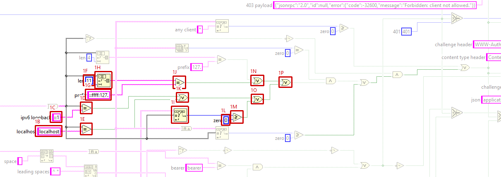 | 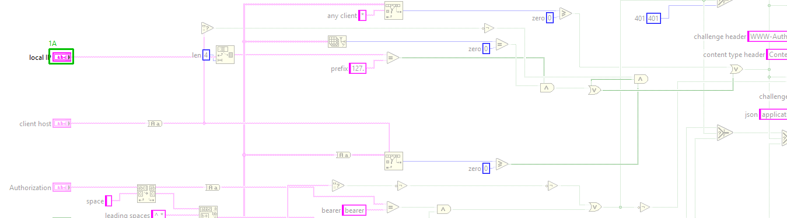 |

**2. Front Panel - Panel**

- **2A** Connector Pane  - control/indicator assignment : changed

| Before | After |
|---|---|
| 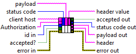 | 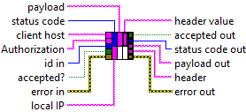 |

**3. Front Panel objects**

- **3A** String "local IP" - added at (88,17)

| Before | After |
|---|---|
| 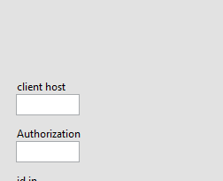 | 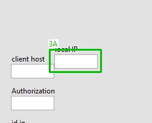 |

**4. VI Attribute - Documentation (VI Properties)**

- **4A** description text : changed from "Decides, in Process HTTP Request.vi and before Validate HTTP Request.vi's result is used, whether a request may reach the MCP server. Runs before the Origin and protocol checks: a client that is not allowed gets 403, then a missing or wrong bearer token gets 401; otherwise accepted?, status code and payload pass through unchanged.

CLIENT: client host is the client's host as the IG HTTP Server reports it, i.e. the name from a reverse DNS lookup of the client's address (an IP address only when that lookup fails). Allowed clients (stored per server by Start.vi) empty means this computer only: a loopback literal (127.x, ::1, ::ffff:127.x), localhost, or this computer's own name, short or FQDN, or its IP address. "*" allows any client. Otherwise client host must equal one of the entries, compared case-insensitively; an IP entry matches when the reported host is that literal IP. No forward lookups are made. A client whose host is empty is refused unless "*" is listed. Reverse DNS names can be spoofed on a local network, so this is a best-effort filter, not security.

TOKEN: when an access token is stored for the server, Authorization must be "Bearer <token>": the scheme compared case-insensitively, the token exactly. The token is never logged and never put into a response.

header and header value: the response header Process HTTP Request.vi sets on the basic response: WWW-Authenticate: Bearer for a 401 from this VI, otherwise Content-Type: application/json, which Create Basic Response.vi has already set (so nothing changes).

Answers: 403 {"jsonrpc":"2.0","id":null,"error":{"code":-32600,"message":"Forbidden: client not allowed."}} and 401 {"jsonrpc":"2.0","id":null,"error":{"code":-32600,"message":"Unauthorized: missing or invalid bearer token."}}." to "Decides, in Process HTTP Request.vi and before Validate HTTP Request.vi's result is used, whether a request may reach the MCP server. Runs before the Origin and protocol checks: a client that is not allowed gets 403, then a missing or wrong bearer token gets 401; otherwise accepted?, status code and payload pass through unchanged.

CLIENT: Allowed clients (stored per server by Start.vi) empty means this computer only. That is decided only by local IP, the local address of the TCP connection the request arrived on (Connection Local IP.vi): the request is allowed when local IP starts with 127., i.e. the connection came in over loopback. The client's host name plays no part here, so this cannot be spoofed by reverse DNS; on Windows a remote peer cannot open a connection whose local address is a loopback address. A client on this computer that connects through the LAN IP is refused. An empty local IP (the address could not be read) is refused too (fail closed). "*" allows any client. Otherwise client host must equal one of the entries, compared case-insensitively; client host is the client's host as the IG HTTP Server reports it, i.e. the name from a reverse DNS lookup of the client's address (an IP address only when that lookup fails). An IP entry matches only when the reported host is exactly that IP. No forward lookups are made. A client whose host is empty is refused unless "*" is listed. Explicit host-name entries rely on reverse DNS names, which can be spoofed on a local network, so they are a best-effort filter, not security: use an access token for them.

TOKEN: when an access token is stored for the server, Authorization must be "Bearer <token>": the scheme compared case-insensitively, the token exactly. The token is never logged and never put into a response.

header and header value: the response header Process HTTP Request.vi sets on the basic response: WWW-Authenticate: Bearer for a 401 from this VI, otherwise Content-Type: application/json, which Create Basic Response.vi has already set (so nothing changes).

Answers: 403 {"jsonrpc":"2.0","id":null,"error":{"code":-32600,"message":"Forbidden: client not allowed."}} and 401 {"jsonrpc":"2.0","id":null,"error":{"code":-32600,"message":"Unauthorized: missing or invalid bearer token."}}."

Whole block diagram and front panel

| Before | After |
|---|---|
|  | 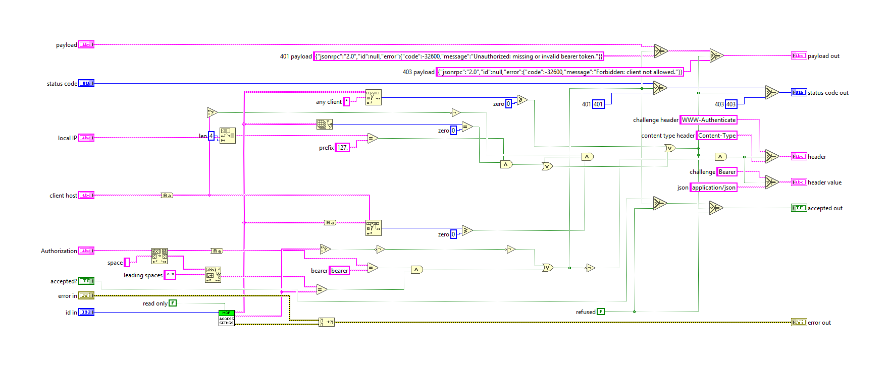 |

| Before | After |
|---|---|
| 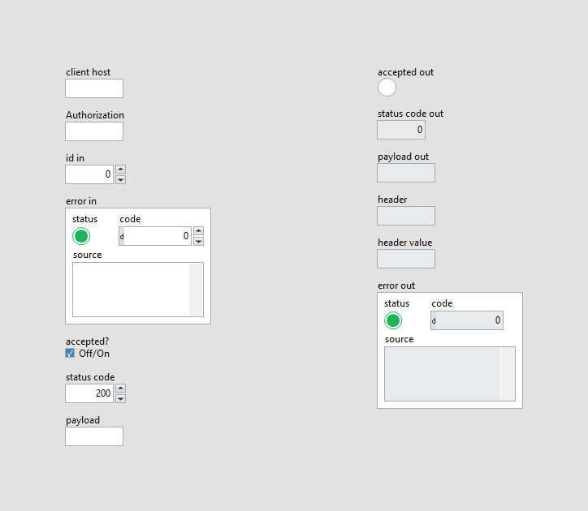 | 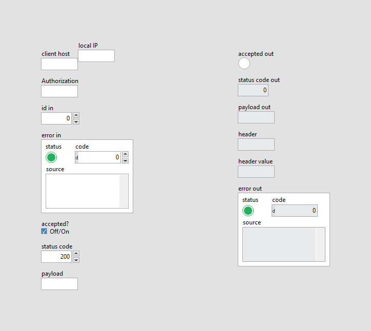 |

### `src/MCP Server/Get Server Name from ID.vi` (modified)

**1. VI Attribute - Documentation (VI Properties)**

- **1A** description text : changed from "Returns a parameter passed along with the mcp calls. These parameters can be specified freely with name+value in the mcp_config.json file. Use parameters for user-specific information, api-keys, login information etc." to "Returns the name of the MCP server with the given id, as it was passed to Start.vi (Name). The name is read from the server registry (Server FGV.vi, Get) through the server's data value reference. initialize.vi uses it for the server name it reports to the client."

Whole block diagram and front panel

| Before | After |
|---|---|
|  | 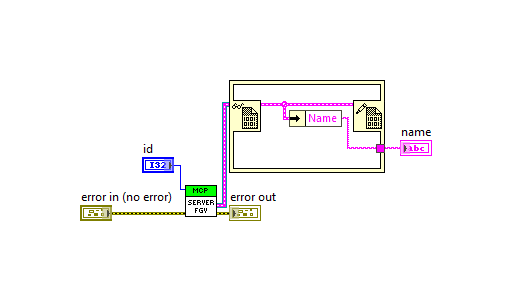 |

| Before | After |
|---|---|
| 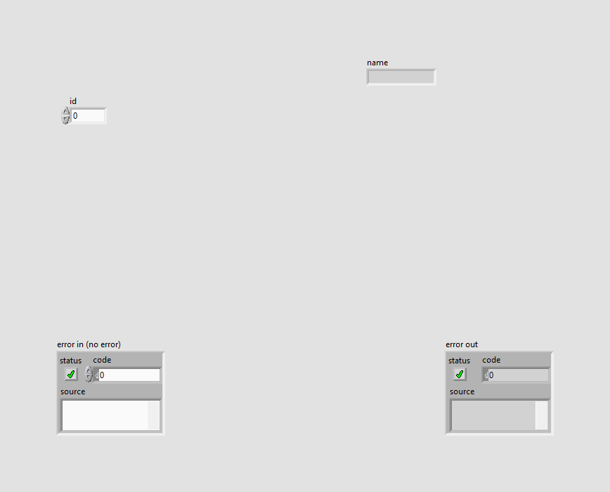 |  |

### `src/MCP Server/MCP Handler/Get Path Regex.vi` (modified)

**1. Block Diagram objects**

- **1A** String Constant "Path Regex" - data value : changed from "<tt>"%s[^/]*"</tt>" to "<tt>"^\\Q%s\\E/?(?:[?#].*)?$"</tt>"

| Before | After |
|---|---|
| 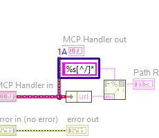 | 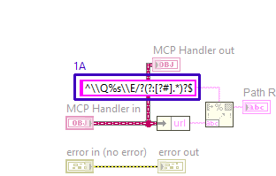 |

**3. VI Attribute - Documentation (VI Properties)**

- **3A** description text : changed from "Specifies the request path that the controller handles requests for in the form of a PCRE regular expression and uses LabVIEW's Match Regular Expression functionality (but not the XNode). Since this uses regular expressions there are some common tricks to avoid odd behavior that might be seen with longer paths that have repeated segments. Eventually the plan is to provide an API that can help build the desired regular expressions but for now you'll need to understand the quirks they can bring.

All request paths start with "/" and to ensure your desired path matches from the start of the request path, put a "^" at the beginning. For example, a pattern of "/test" could match "/test/foo", "/test", "/foo/test", and many more. To ensure the URL begins with "/test" use a pattern of "^/test".

Similar to anchoring a match to the start of the path, the match can be anchored to the end of the path as well with "$" added to the end. For example, "^/test$" would match exactly "/test" and nothing else while a pattern of "/test$" would match "/test", "/foo/test", "/bar/test" and anything ending with "/test".

Submatches are also handled and can allow for segments of the path to become variables that are retrievable from the processing values container. As an example "^/test/(\d+)$" would match any url starting with "/test/" followed by a number, such as when requesting a test ID to be viewed from a database. Submatches are put into the values container in the same order they'd be returned from the Match Regular Expression node with a lookup value of the string representation of the value's 0-based index. To continue the /test/# example from above, the numeric value part of the path could be retrieved by calling Get Value by Name.vi with a name of "0". Values are returned as a variant and will need to be converted to the appropriate type. Since paths are string values, the variant will first need to be converted back into a string and can then be converted from the string to intended final data type.

Another submatch example: "^/post/(\d+)/comment/(\d+)$" which provides two submatches. The post ID would be retrieved with a name of "0" and the comment ID with a name of "1"." to "Returns the request path pattern that the IG HTTP Server uses to route a request to this MCP handler. IG's PathRegex Router (Determine Controller.vi) matches it with PCRE (Match Regular Expression) against the request target's path, followed by ?query and #fragment when the request has them.

The pattern is ^\Q<url>\E/?(?:[?#].*)?$ for the url given to Init.vi (default /mcp/server): the url is quoted with \Q...\E, so regular expression characters in it match literally, and the pattern is anchored at both ends. So /mcp/server, /mcp/server/ and /mcp/server?x=1 match, while /x/mcp/server, /mcp/serverABC and /mcp/server/anything do not and never reach the MCP server. (The format string doubles each backslash because Format Into String reads backslash codes.)"

Whole block diagram and front panel

| Before | After |
|---|---|
| 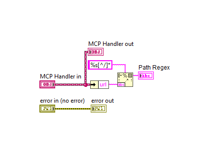 | 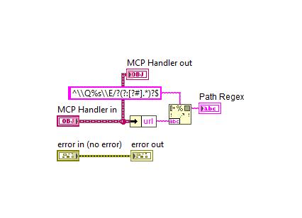 |

| Before | After |
|---|---|
|  | 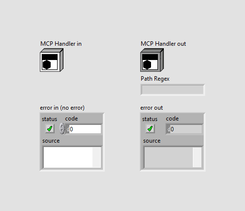 |

### `src/MCP Server/Process HTTP Request.vi` (modified)

**1. Block Diagram objects**

- **1A** SubVI "MCP Server.lvlib:MCP Connection Probe.lvclass:Connection Local IP.vi" - added at (580,-250)
- **1B** Merge Errors "Merge Errors" - added at (592,-200)
- **1C** wiring changes

| Before | After |
|---|---|
| 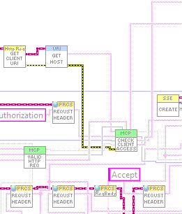 | 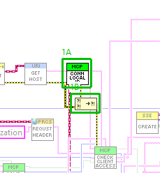 |

**7. VI Attribute - Documentation (VI Properties)**

- **7A** description text : changed from "Answers one HTTP request on the MCP endpoint following the MCP Streamable HTTP transport rules, and stores the response in the Processing object.

1. ACCESS: reads the client host (Get Request, Get Client URI, Get Host: the name from a reverse DNS lookup of the client address) and the Authorization header, and passes them to Check Client Access.vi with the access settings Start.vi stored for this server. A client that is not allowed gets 403, a missing or wrong bearer token 401 with WWW-Authenticate: Bearer. These checks win over every later one.
2. Reads the HTTP method and the Origin and MCP-Protocol-Version request headers and passes them to Validate HTTP Request.vi. Also reads the Mcp-Method and Mcp-Name headers (MCP 2026-07-28).
3. Rejected request (403, 401, 405 or 400): the MCP server is NOT called. The response carries the status code and the JSON-RPC error payload with Content-Type application/json. A 405 additionally carries the header Allow: POST.
4. Accepted request: Prepare Request Dispatch.vi answers a legacy notifications/cancelled itself and decides whether a tools/call is streamed (Start Streamed Request.vi). Otherwise the request body, one message or a batch of messages, is passed with the three MCP headers to Handle MCP Request.vi, which decides the era (legacy or modern) per request, makes the modern header checks and answers; its errors are cleared. Its status code is used: 202 with an empty body for a notification, 200 with Content-Type application/json, or 400/404 for a refused modern request.

error out reports only errors of the first two header reads. It is informational: a response is always set." to "Answers one HTTP request on the MCP endpoint following the MCP Streamable HTTP transport rules, and stores the response in the Processing object.

1. ACCESS: reads the client host (Get Request, Get Client URI, Get Host: the name from a reverse DNS lookup of the client address), the local address of the connection the request arrived on (Connection Local IP.vi, no DNS) and the Authorization header, and passes them to Check Client Access.vi with the access settings Start.vi stored for this server. "This computer only" is decided by that local address; an error reading it only leaves it empty, which Check Client Access.vi refuses in that mode, and never turns into a 500. A client that is not allowed gets 403, a missing or wrong bearer token 401 with WWW-Authenticate: Bearer. These checks win over every later one.
2. Reads the HTTP method and the Origin and MCP-Protocol-Version request headers and passes them to Validate HTTP Request.vi. Also reads the Mcp-Method and Mcp-Name headers (MCP 2026-07-28).
3. Rejected request (403, 401, 405 or 400): the MCP server is NOT called. The response carries the status code and the JSON-RPC error payload with Content-Type application/json. A 405 additionally carries the header Allow: POST.
4. Accepted request: Prepare Request Dispatch.vi answers a legacy notifications/cancelled itself and decides whether a tools/call is streamed (Start Streamed Request.vi). Otherwise the request body, one message or a batch of messages, is passed with the three MCP headers to Handle MCP Request.vi, which decides the era (legacy or modern) per request, makes the modern header checks and answers; its errors are cleared. Its status code is used: 202 with an empty body for a notification, 200 with Content-Type application/json, or 400/404 for a refused modern request.

error out reports only errors of the first two header reads. It is informational: a response is always set."

Whole block diagram and front panel

| Before | After |
|---|---|
| 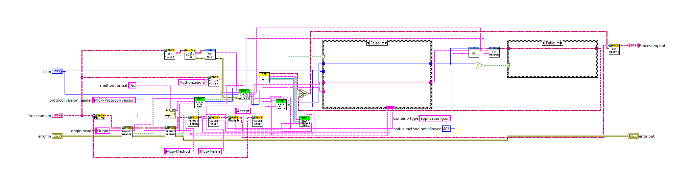 | 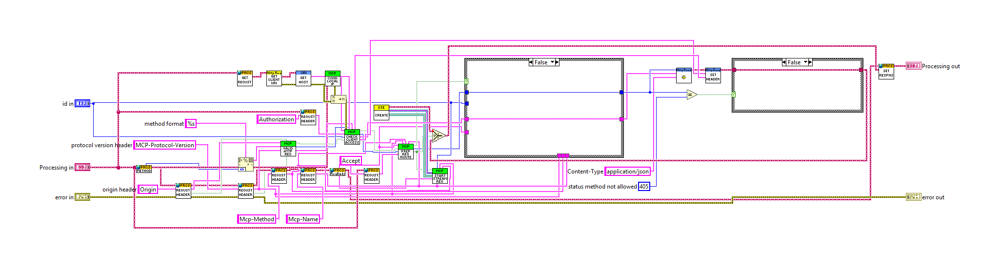 |

| Before | After |
|---|---|
|  |  |

All case frames (2 hidden frames)

| Frame | Picture |
|---|---|
| Whole diagram, visible frames: Case structure 1: False; Case structure 2: False | 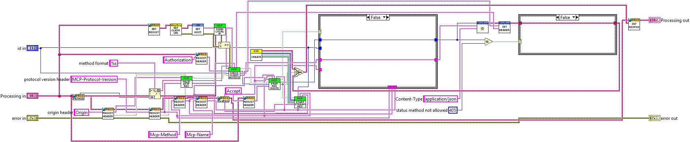 |
| Case structure 1: True |  |
| Case structure 2: True |  |

### `src/MCP Server/Server Access Settings.vi` (modified)

**1. VI Attribute - Documentation (VI Properties)**

- **1A** description text : changed from "Functional global that keeps the access settings of every MCP server in this LabVIEW, keyed by server id: the allowed clients and the access token given to Start.vi. Start.vi writes them when it creates a server; Check Client Access.vi reads them for every request. A later write for the same id replaces the earlier one.

this computer: the names that mean "this computer" for the default allow-list, all in lower case: the computer's full name (FQDN) and its short name as LabVIEW reports them, and its IP address. They are looked up once, on a write, because the lookup can be slow.

write? (T) TRUE stores Allowed clients and Access token for id; FALSE only reads. The outputs are the stored values for id after the call (empty when nothing is stored for id). The token is stored only here and never logged." to "Functional global that keeps the access settings of every MCP server in this LabVIEW, keyed by server id: the allowed clients and the access token given to Start.vi. Start.vi writes them when it creates a server, before the HTTP server is opened; Check Client Access.vi reads them for every request; Stop.vi clears them by writing an empty token and an empty list for the id. A later write for the same id replaces the earlier one.

this computer: the names that mean "this computer", all in lower case: the computer's full name (FQDN) and its short name as LabVIEW reports them, and its IP address. They are looked up once, on a write, because the lookup can be slow. Check Client Access.vi no longer uses them: it decides "this computer only" from the connection's local address.

write? (T) TRUE stores Allowed clients and Access token for id; FALSE only reads. The outputs are the stored values for id after the call (empty when nothing is stored for id). The token is stored only here and never logged."

Whole block diagram and front panel

| Before | After |
|---|---|
|  | 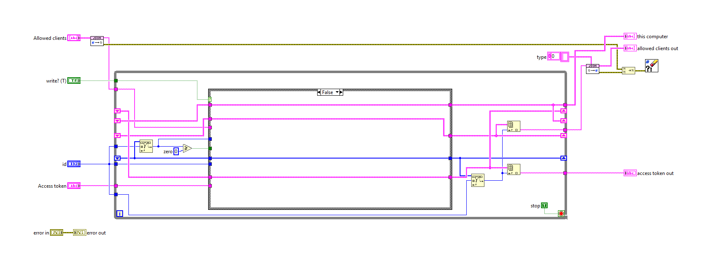 |

| Before | After |
|---|---|
|  |  |

All case frames (1 hidden frames)

| Frame | Picture |
|---|---|
| Whole diagram, visible frames: Case structure 1: False |  |
| Case structure 1: True | 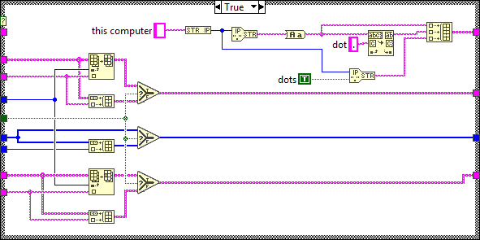 |

### `src/MCP Server/Start.vi` (modified)

**6. Block Diagram objects**

- **6A** Merge Errors "Merge Errors" - added at (655,600)
- **6B** Case Structure "Case Structure" - added at (690,565)
- **6C** SubVI "MCP Server.lvlib:Stop.vi" - added at (740,622)
- **6D** Numeric Constant "no server" - added at (775,585)
- **6E** Tunnel  - added at (690,615)
- **6F** Tunnel  - added at (690,646)
- **6G** Tunnel  - added at (818,615)
- **6H** Tunnel  - added at (818,646)
- **6I** wiring changes

| Before | After |
|---|---|
| 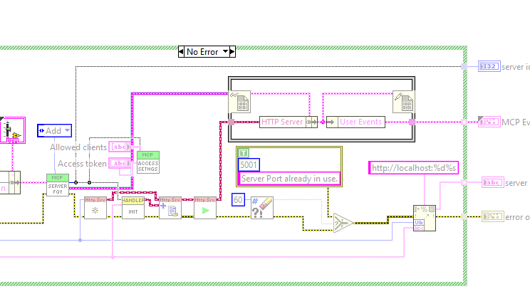 | 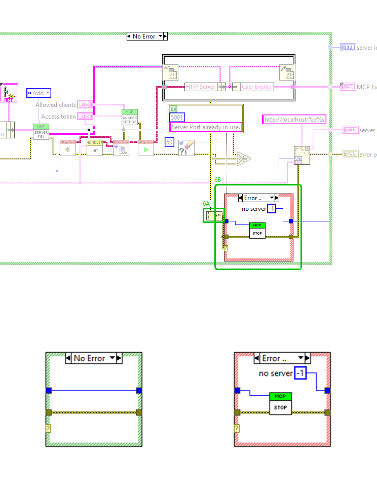 |

**13. VI Attribute - Documentation (VI Properties)**

- **13A** description text : changed from "Creates a new MCP server. The URL will be:
http://localhost:3687/mcp/server
Server name and description will be passed on to the client and the LLM. Be aware that these cost you tokes. For detailled descriptions of the server (e.g. software manual) use resources instead. 
This VI returns user events for different events that can happen inside the server. Make sure to listen to the error event to catch any runtime errors. Use the onRpc event to receive every request that is sent from a client to the server.

Your MCP Client config (e.g. claude_desktop_config.json) should look like this:
{
  "mcpServers": {
    "My Cool Server Display-Name": {
      "command": "npx",
      "args": [
        "mcp-remote",
        "http://127.0.0.1:36987/mcp/server"
      ],
      "env": {
        "YOUR_API_KEY": "<YOUR_SECRET_KEY>",
        "MY_PARAM": "Your custom Parameter"
      }
    }
  }
}

ACCESS CONTROL (Allowed clients, Access token): the IG HTTP Server listens on all network interfaces, so a server is reachable from the network unless a firewall prevents it. Allowed clients filters by client host name as reported by reverse DNS; empty (the default) means this computer only (a loopback literal, localhost, or this computer's own name, short or FQDN), "*" means any client. Client names from reverse DNS can be spoofed on a local network, so the list is a best-effort filter, not security: a server reachable beyond this computer needs Access token, which makes every request carry Authorization: Bearer <token>. Refused clients get HTTP 403, a missing or wrong token HTTP 401.
Note: the default now refuses every client that does not report as this computer. This is a deliberate behaviour change; earlier versions served any client. A client on another computer (also mcp-remote run there) needs an entry in Allowed clients, or "*", and should use Access token." to "Creates a new MCP server. The URL will be:
http://localhost:36987/mcp/server
Server name and description will be passed on to the client and the LLM. Be aware that these cost you tokens. For detailed descriptions of the server (e.g. software manual) use resources instead. 
This VI returns user events for different events that can happen inside the server. Make sure to listen to the error event to catch any runtime errors. Use the onRpc event to receive every request that is sent from a client to the server.

Your MCP Client config (e.g. claude_desktop_config.json) should look like this:
{
  "mcpServers": {
    "My Cool Server Display-Name": {
      "command": "npx",
      "args": [
        "mcp-remote",
        "http://127.0.0.1:36987/mcp/server"
      ],
      "env": {
        "YOUR_API_KEY": "<YOUR_SECRET_KEY>",
        "MY_PARAM": "Your custom Parameter"
      }
    }
  }
}

ACCESS CONTROL (Allowed clients, Access token): the IG HTTP Server listens on all network interfaces, so a server is reachable from the network unless a firewall prevents it. The access settings are stored before the HTTP server is opened, so no request is ever served without them. Allowed clients empty (the default) means this computer only. That is decided by the local address of the connection a request arrives on: only a connection over loopback (127.x, e.g. http://127.0.0.1:36987 or http://localhost:36987) is allowed. It does not depend on reverse DNS and cannot be spoofed by it; a client on this computer that uses the LAN IP is refused. "*" means any client. Other entries are compared with the client host name as reported by reverse DNS, which can be spoofed on a local network, so they are a best-effort filter, not security: a server reachable beyond this computer needs Access token, which makes every request carry Authorization: Bearer <token>. Refused clients get HTTP 403, a missing or wrong token HTTP 401.
Note: the default refuses every client that does not connect over loopback. This is a deliberate behaviour change; earlier versions served any client. A client on another computer (also mcp-remote run there) needs an entry in Allowed clients, or "*", and should use Access token.

ON ERROR: if the server cannot be created (for example error 5001 "Server Port already in use."), server id out is -1 and nothing stays registered: Start.vi removes the half-built server again (Stop.vi: HTTP server, user events, registry entry, access settings). error out carries the original error."

Whole block diagram and front panel

| Before | After |
|---|---|
|  | 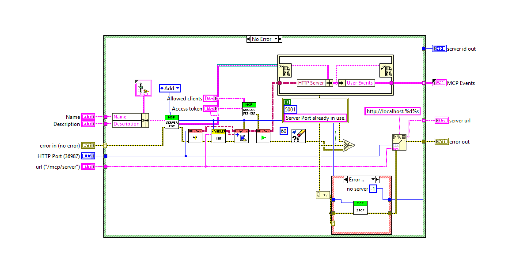 |

| Before | After |
|---|---|
|  |  |

All case frames (2 hidden frames)

| Frame | Picture |
|---|---|
| Whole diagram, visible frames: Case structure 1: No Error; Case structure 2: Error .. | 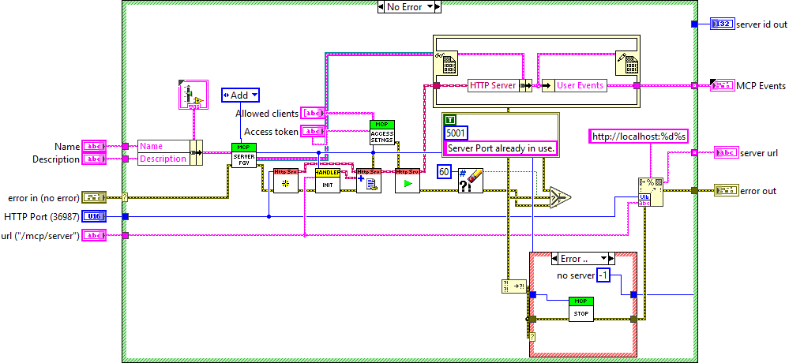 |
| Case structure 2: No Error | 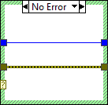 |
| Case structure 1: Error .. | 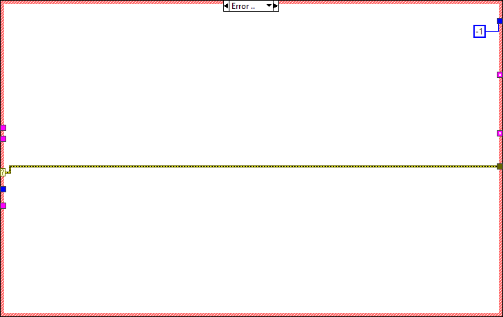 |

### `src/MCP Server/Stop.vi` (modified)

**1. Block Diagram objects**

- **1A** SubVI "MCP Server.lvlib:Server Access Settings.vi" - added at (530,420)
- **1B** wiring changes

| Before | After |
|---|---|
| 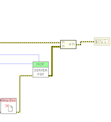 | 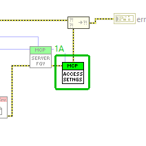 |

**2. VI Attribute - Documentation (VI Properties)**

- **2A** description text : changed from "Stops the MCP server." to "Stops the MCP server with the given id (server id out of Start.vi) and removes everything Start.vi set up for it:
- closes its HTTP server (Cleanup.vi), so the port is free again,
- removes it from the server registry (Server FGV.vi, Remove), which destroys its onError and onRpc user events and its data value reference (Remove Server.vi),
- clears its stored access settings, the access token and the allowed clients (Server Access Settings.vi writes them empty for the id). The token is never logged.

error in does not prevent the clean-up; error out is error in merged with the errors of the clean-up steps. Start.vi calls this VI itself when it fails after registering the server."

Whole block diagram and front panel

| Before | After |
|---|---|
| 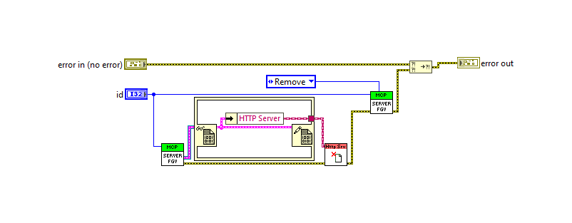 | 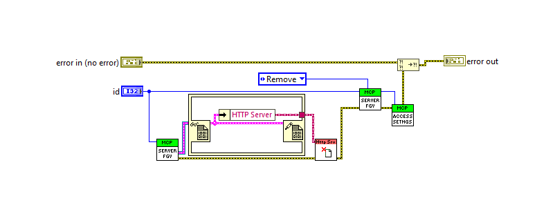 |

| Before | After |
|---|---|
| 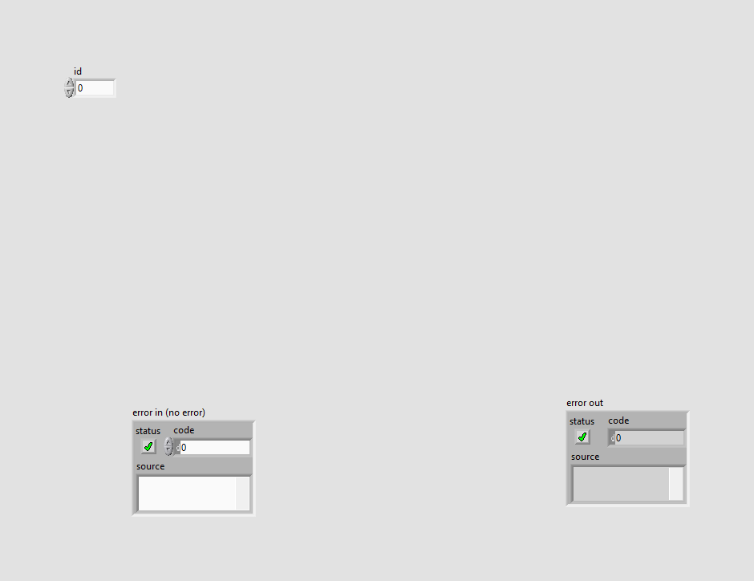 |  |

### `src/MCP Server/MCP Connection Probe/Connection Local IP.vi` (added)

Block diagram (case structures show their visible frame only):

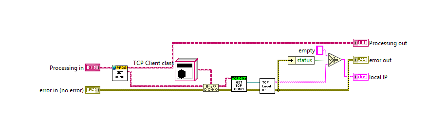

Front panel

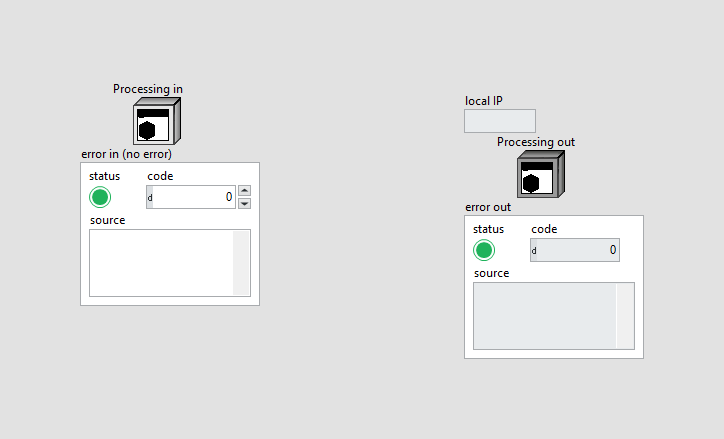

