## VI diff report

4 modified, 5 added, 0 deleted. Generated by LabVIEW's VI comparison; position and size changes are not shown.

### `src/MCP Server/Add Array Items To Schema.vi` (modified)

**1. Block Diagram objects**

- **1A** SubVI "MCP Server.lvlib:Remove Empty Description.vi" - added at (1272,384)
- **1B** wiring changes

| Before | After |
|---|---|
| 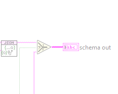 | 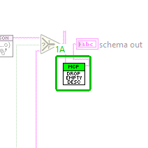 |

**2. VI Attribute - Documentation (VI Properties)**

- **2A** description text : changed from "Completes the JSON schema of one tool input. sub type of the input holds the JSON Schema of its LabVIEW type, made by LV Type To JSON Schema.vi: items for arrays of any dimension (an element type without a JSON equivalent gives "items":{}), properties for clusters, format date-time for timestamps and the item names of enums. It is merged into the input's schema (type, description), so its members are added and its type wins. An input whose sub type is empty is passed through unchanged." to "Completes the JSON schema of one tool input. sub type of the input holds the JSON Schema of its LabVIEW type, made by LV Type To JSON Schema.vi: items for arrays of any dimension (an element type without a JSON equivalent gives "items":{}), properties for clusters, format date-time for timestamps and the item names of enums. It is merged into the input's schema (type, description), so its members are added and its type wins. An input whose sub type is empty is passed through unchanged. Finally an empty description is left out of the schema (Remove Empty Description.vi): it tells a client nothing."

Whole block diagram and front panel

| Before | After |
|---|---|
|  |  |

| Before | After |
|---|---|
|  |  |

### `src/MCP Server/Add Control Details To Schema.vi` (modified)

**1. Block Diagram objects**

- **1A** SubVI "MCP Server.lvlib:Remove Default Error Description.vi" - added at (695,35)
- **1B** wiring changes

| Before | After |
|---|---|
| 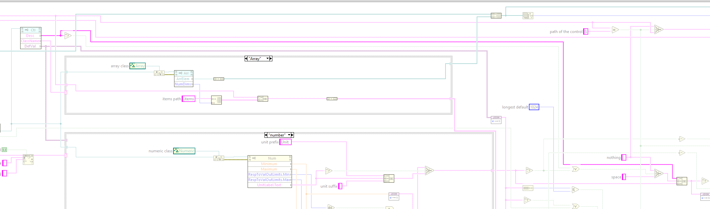 | 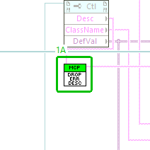 |

**2. VI Attribute - Documentation (VI Properties)**

- **2A** description text : changed from "Adds what the front panel control of a tool input says beyond its type to the JSON Schema of that input, for tools/list. Wire the schema LV Type To JSON Schema.vi made for the control's type into schema, and the control itself into control. The control and its elements are walked together with the schema, to any depth (clusters by element label under properties, array elements under items): every element with a description gets it as description, integers get minimum and maximum from their representation (I8 -128 to 127 up to U64 0 to 18446744073709551615, written as exact integers), a numeric whose data entry limits are not set to Ignore gets those limits instead where they are tighter, and a numeric with a unit gets "Unit: <unit>." appended to its description. The control itself only gets a description when it has a unit (tool list.vi takes its description from the control otherwise), and, when the input is not required, its default value as default, serialized with JSONtext like tools/call values (left out above 1024 characters). Details that cannot be read from a control are left out. With an error in, or without a valid control, schema is passed through unchanged." to "Adds what the front panel control of a tool input says beyond its type to the JSON Schema of that input, for tools/list. Wire the schema LV Type To JSON Schema.vi made for the control's type into schema, and the control itself into control. The control and its elements are walked together with the schema, to any depth (clusters by element label under properties, array elements under items): every element with a description gets it as description (except LabVIEW's default error cluster descriptions, which Remove Default Error Description.vi leaves out), integers get minimum and maximum from their representation (I8 -128 to 127 up to U64 0 to 18446744073709551615, written as exact integers), a numeric whose data entry limits are not set to Ignore gets those limits instead where they are tighter, and a numeric with a unit gets "Unit: <unit>." appended to its description. The control itself only gets a description when it has a unit (tool list.vi takes its description from the control otherwise), and, when the input is not required, its default value as default, serialized with JSONtext like tools/call values (left out above 1024 characters). Details that cannot be read from a control are left out. With an error in, or without a valid control, schema is passed through unchanged."

Whole block diagram and front panel

| Before | After |
|---|---|
|  | 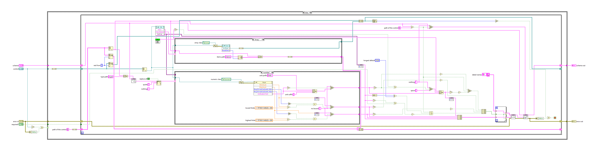 |

| Before | After |
|---|---|
|  | 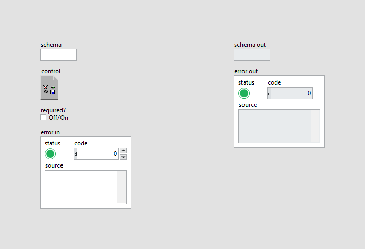 |

All case frames (5 hidden frames)

| Frame | Picture |
|---|---|
| Whole diagram, visible frames: Case structure 1: False; Case structure 2: "number"; Case structure 3: "Array" | 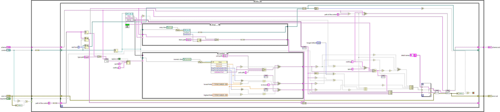 |
| Case structure 1: True | 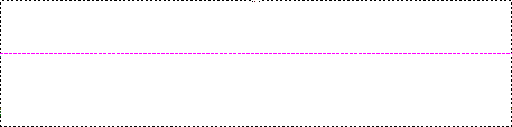 |
| Case structure 2: Default | 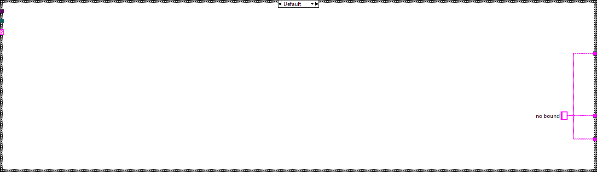 |
| Case structure 2: "integer" | 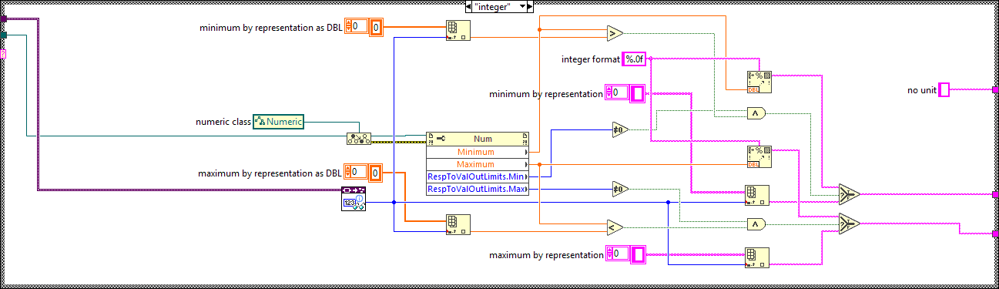 |
| Case structure 3: Default |  |
| Case structure 3: "Cluster" | 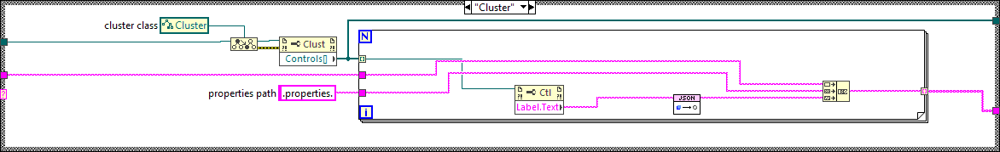 |

### `src/MCP Server/Get Connector Pane Info.vi` (modified)

**1. Block Diagram objects**

- **1A** SubVI "MCP Server.lvlib:Remove Default Error Description.vi" - added at (1361,111)
- **1B** wiring changes

| Before | After |
|---|---|
| 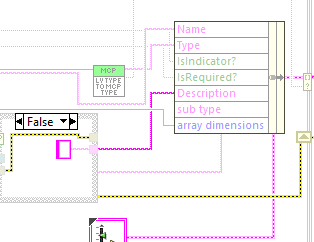 | 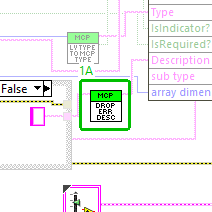 |

**2. VI Attribute - Documentation (VI Properties)**

- **2A** description text : changed from "Utilizes the Application method "Get ConPane Datatype" to read the terminal properties of a subVI without loading it or requiring VI scripting." to "Utilizes the Application method "Get ConPane Datatype" to read the terminal properties of a subVI without loading it or requiring VI scripting. A terminal description that is one of LabVIEW's default error cluster descriptions is returned empty (Remove Default Error Description.vi)."

Whole block diagram and front panel

| Before | After |
|---|---|
|  |  |

| Before | After |
|---|---|
|  | 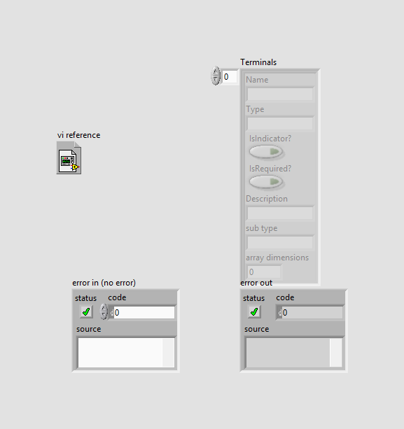 |

All case frames (2 hidden frames)

| Frame | Picture |
|---|---|
| Whole diagram, visible frames: Case structure 1: False; Case structure 2: "Array" | 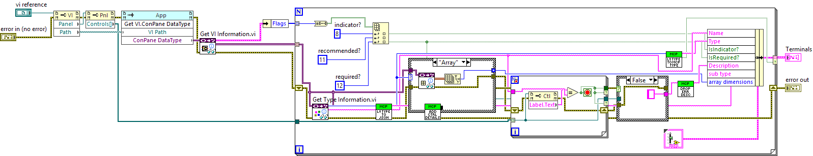 |
| Case structure 1: True |  |
| Case structure 2: Default | 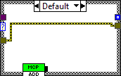 |

### `tests/Test_MCP_Server.vi` (modified)

**1. Block Diagram objects**

- **1A** SubVI "MCP Server tests.lvlib:Add Fixture Error Descriptions Tool.vi" - added at (2146,324)
- **1B** wiring changes

| Before | After |
|---|---|
| 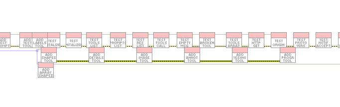 | 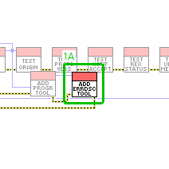 |

**2. Block Diagram objects**

- **2A** SubVI "MCP Server tests.lvlib:test tools list error descriptions.vi" - added at (4926,285)
- **2B** wiring changes

| Before | After |
|---|---|
| 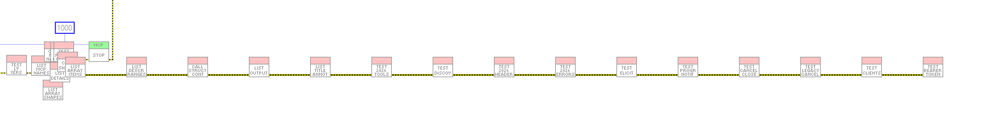 | 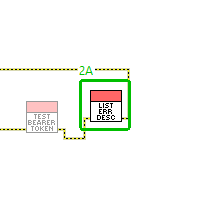 |

Whole block diagram and front panel

| Before | After |
|---|---|
|  | 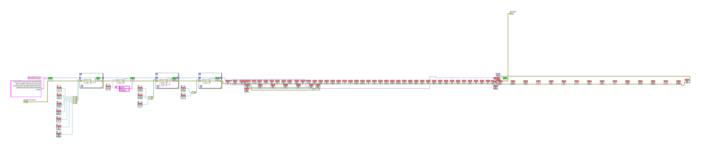 |

| Before | After |
|---|---|
|  |  |

### `src/MCP Server/Remove Default Error Description.vi` (added)

Block diagram (case structures show their visible frame only):

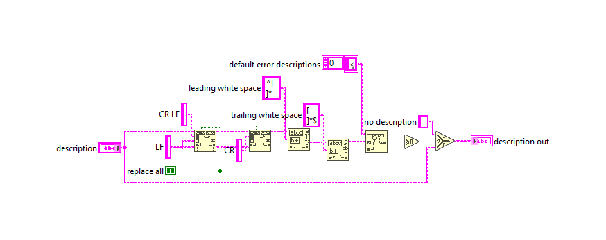

Front panel

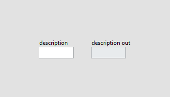

### `src/MCP Server/Remove Empty Description.vi` (added)

Block diagram (case structures show their visible frame only):

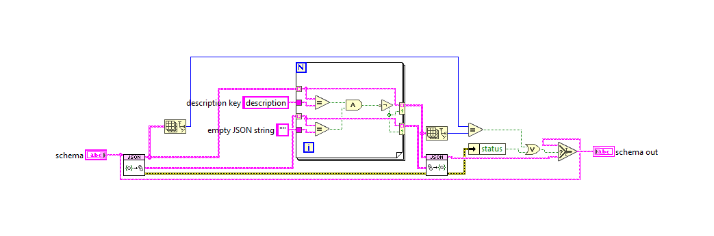

Front panel

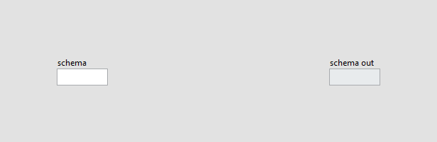

### `tests/Add Fixture Error Descriptions Tool.vi` (added)

Block diagram (case structures show their visible frame only):

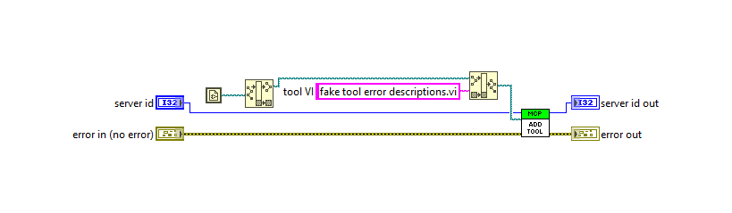

Front panel

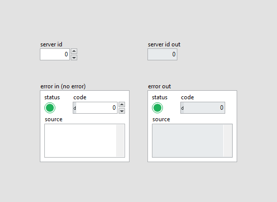

### `tests/fake tool error descriptions.vi` (added)

Block diagram (case structures show their visible frame only):

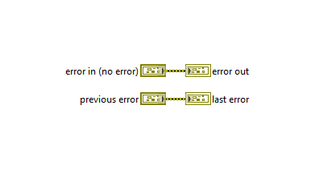

Front panel

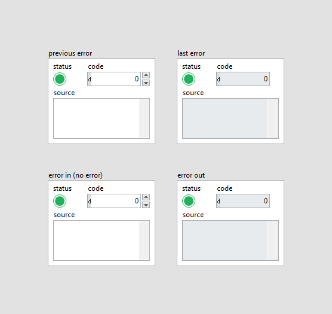

### `tests/test tools list error descriptions.vi` (added)

Block diagram (case structures show their visible frame only):

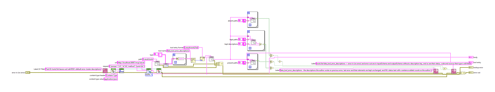

Front panel

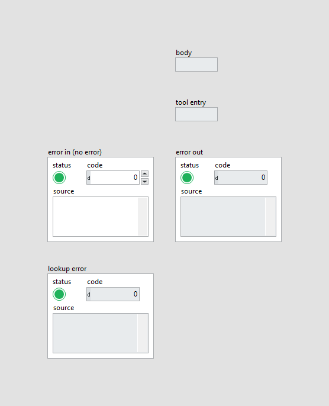

