## VI diff report

99 modified, 5 added, 0 deleted. Generated by LabVIEW's VI comparison; position and size changes are not shown.

### `src/MCP Server/Add Array Items To Schema.vi` (modified)

**1. VI Attribute - Execution (VI Properties)**

- **1A** Automatic Error Handling

Whole block diagram and front panel

| Before | After |
|---|---|
| 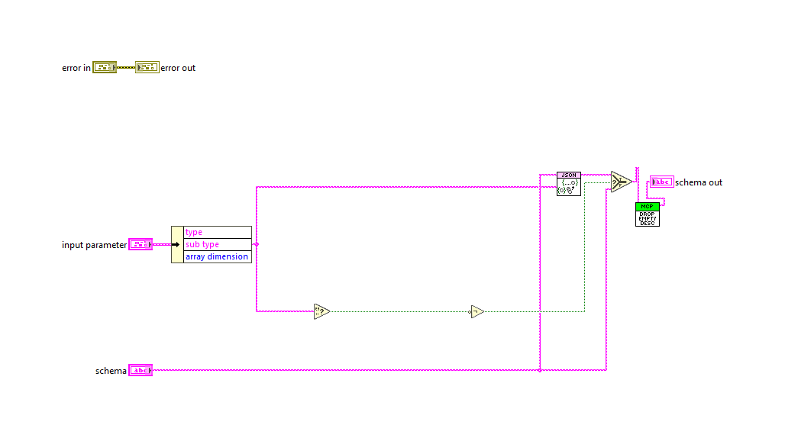 |  |

| Before | After |
|---|---|
|  | 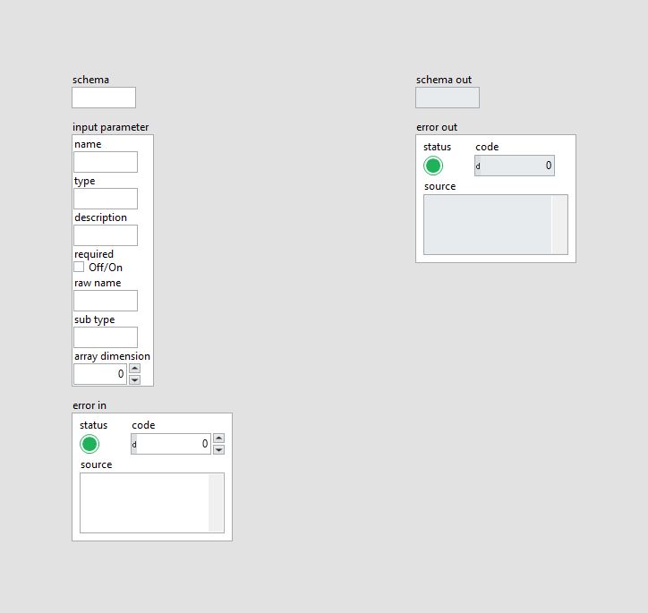 |

### `src/MCP Server/Add Control Details To Schema.vi` (modified)

**1. VI Attribute - Execution (VI Properties)**

- **1A** Automatic Error Handling

Whole block diagram and front panel

| Before | After |
|---|---|
|  | 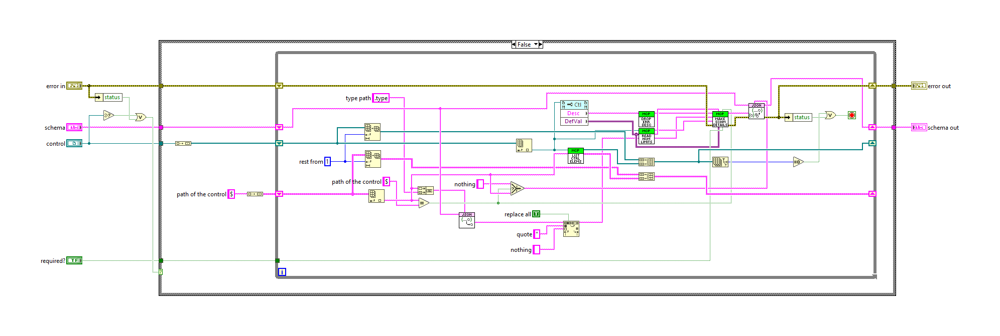 |

| Before | After |
|---|---|
|  | 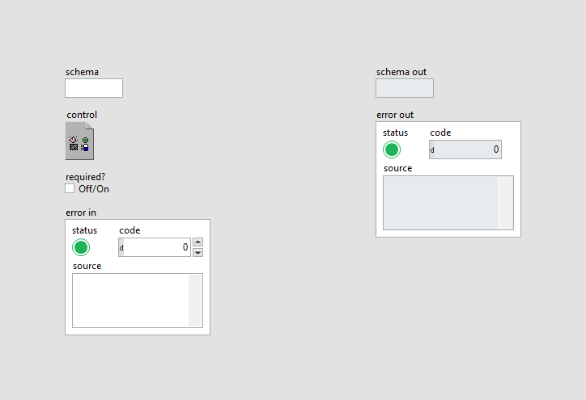 |

All case frames (1 hidden frames)

| Frame | Picture |
|---|---|
| Whole diagram, visible frames: Case structure 1: False | 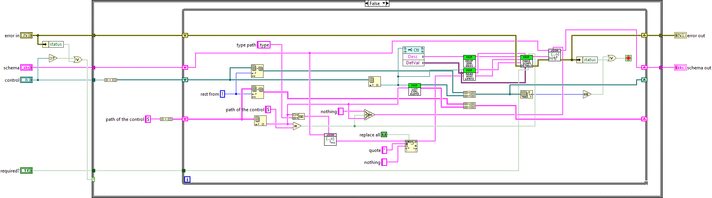 |
| Case structure 1: True | 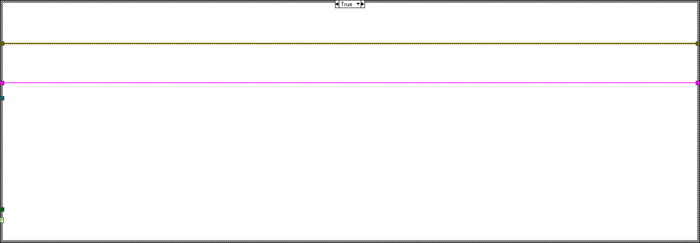 |

### `src/MCP Server/Add Prompt.vi` (modified)

**1. VI Attribute - Execution (VI Properties)**

- **1A** Automatic Error Handling

Whole block diagram and front panel

| Before | After |
|---|---|
|  | 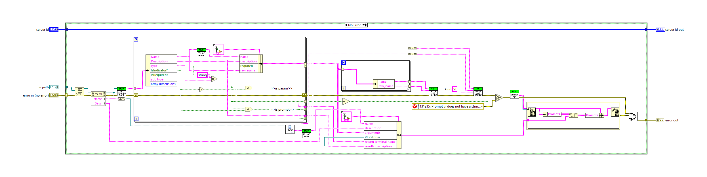 |

| Before | After |
|---|---|
| 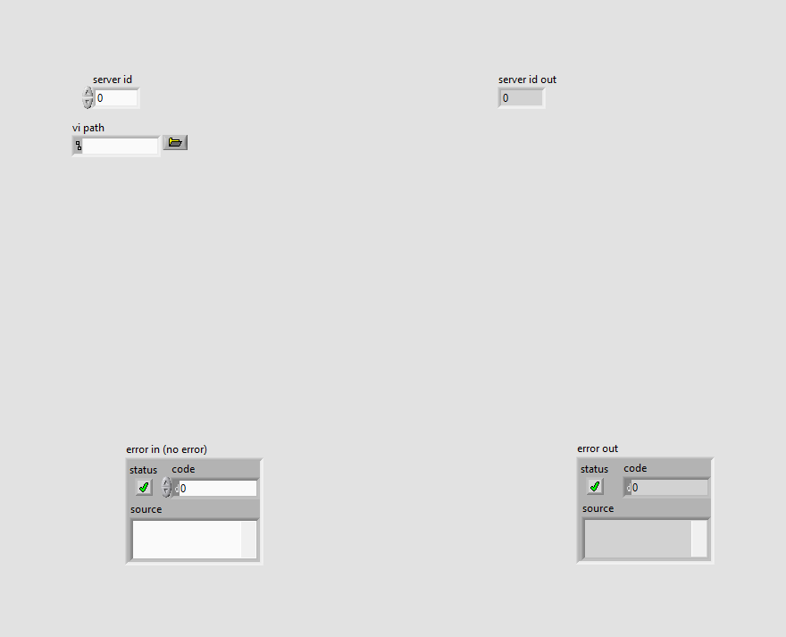 |  |

All case frames (1 hidden frames)

| Frame | Picture |
|---|---|
| Whole diagram, visible frames: Case structure 1: No Error | 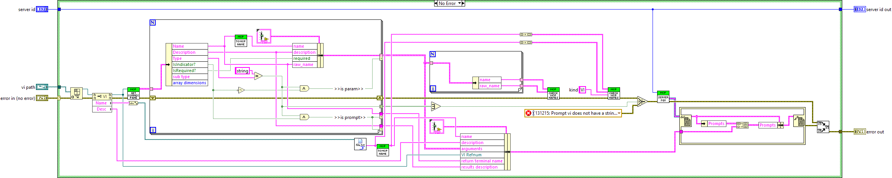 |
| Case structure 1: Error .. | 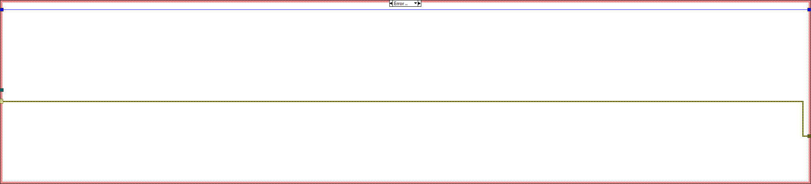 |

### `src/MCP Server/Add Resource (File).vi` (modified)

**1. VI Attribute - Execution (VI Properties)**

- **1A** Automatic Error Handling

Whole block diagram and front panel

| Before | After |
|---|---|
|  | 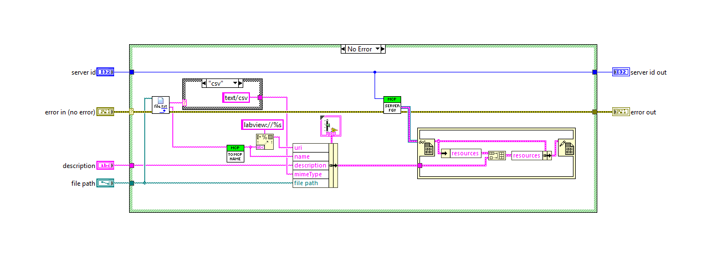 |

| Before | After |
|---|---|
|  | 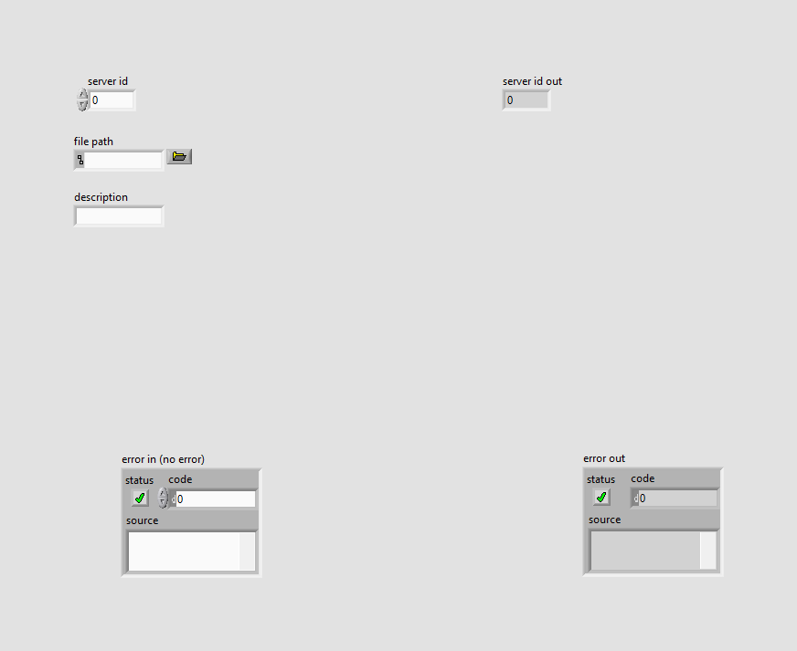 |

All case frames (9 hidden frames)

| Frame | Picture |
|---|---|
| Whole diagram, visible frames: Case structure 1: No Error; Case structure 2: "csv" | 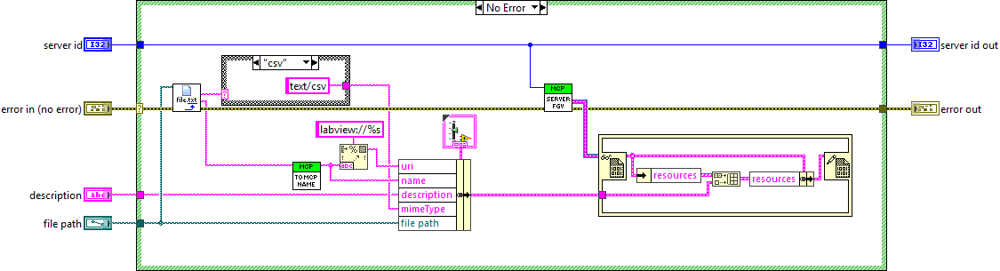 |
| Case structure 2: "pdf" |  |
| Case structure 2: "png" |  |
| Case structure 2: Default | 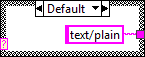 |
| Case structure 2: "md" | 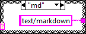 |
| Case structure 2: "json" |  |
| Case structure 2: "py" |  |
| Case structure 2: "c" |  |
| Case structure 2: "xml" | 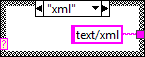 |
| Case structure 1: Error .. | 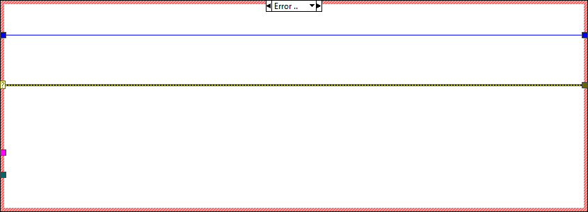 |

### `src/MCP Server/Add Structured Content.vi` (modified)

**1. VI Attribute - Execution (VI Properties)**

- **1A** Automatic Error Handling

Whole block diagram and front panel

| Before | After |
|---|---|
| 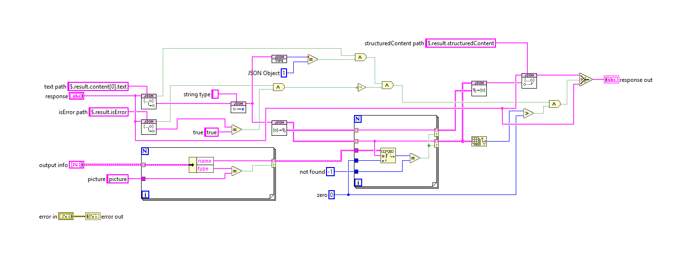 |  |

| Before | After |
|---|---|
| 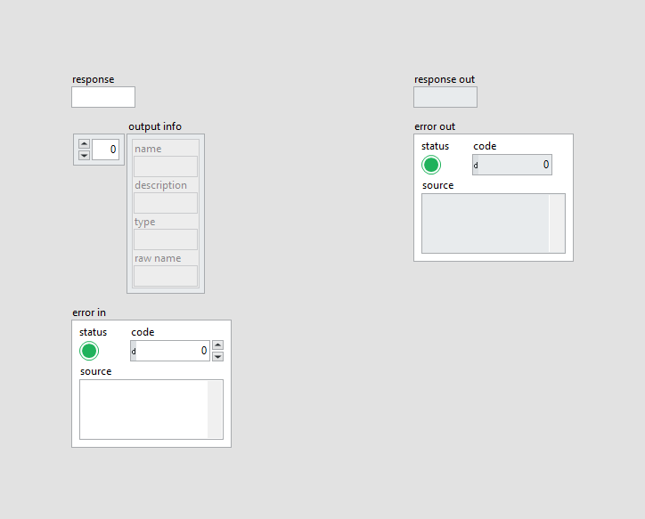 |  |

### `src/MCP Server/Add Tool.vi` (modified)

**1. VI Attribute - Execution (VI Properties)**

- **1A** Automatic Error Handling

Whole block diagram and front panel

| Before | After |
|---|---|
| 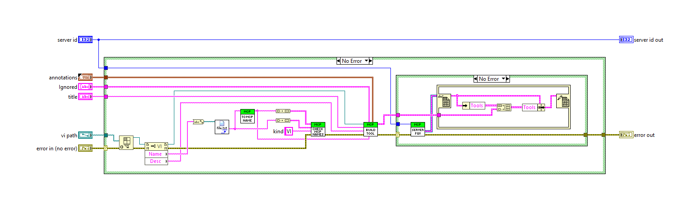 |  |

| Before | After |
|---|---|
|  | 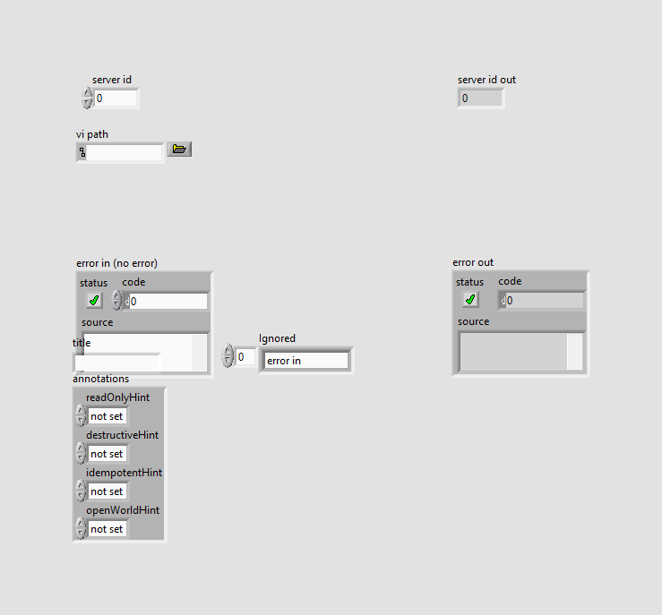 |

All case frames (2 hidden frames)

| Frame | Picture |
|---|---|
| Whole diagram, visible frames: Case structure 1: No Error; Case structure 2: No Error | 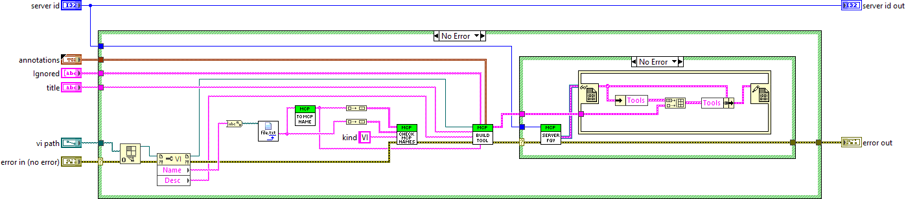 |
| Case structure 2: Error .. | 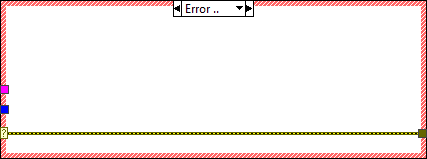 |
| Case structure 1: Error .. | 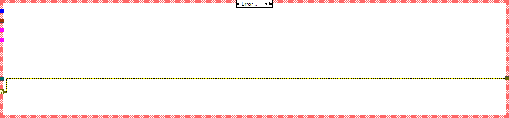 |

### `src/MCP Server/Build Content.vi` (modified)

**1. VI Attribute - Execution (VI Properties)**

- **1A** Automatic Error Handling

Whole block diagram and front panel

| Before | After |
|---|---|
| 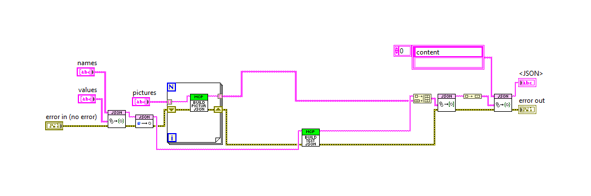 |  |

| Before | After |
|---|---|
| 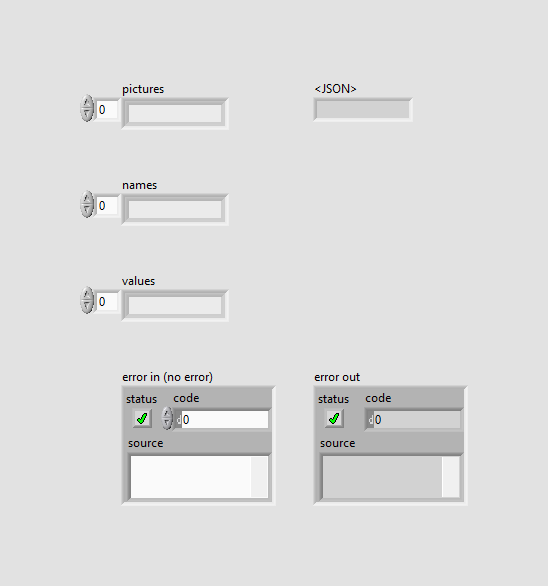 |  |

### `src/MCP Server/Build Error Response.vi` (modified)

**1. VI Attribute - Execution (VI Properties)**

- **1A** Automatic Error Handling

Whole block diagram and front panel

| Before | After |
|---|---|
|  | 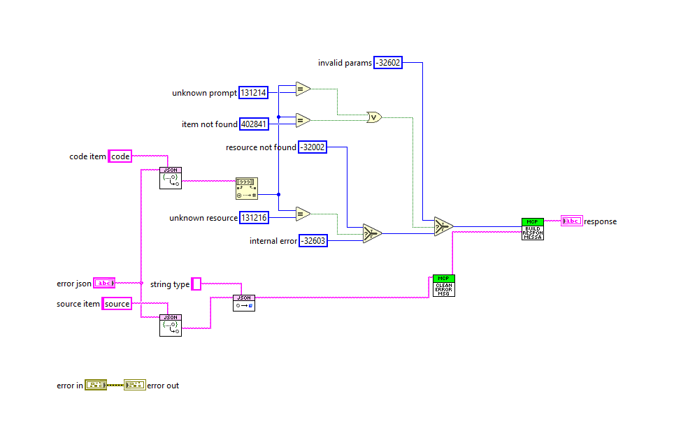 |

| Before | After |
|---|---|
| 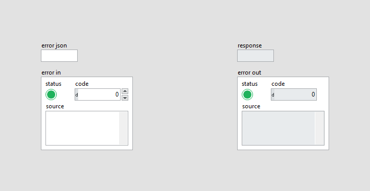 |  |

### `src/MCP Server/Build Method Not Found Response.vi` (modified)

**1. VI Attribute - Execution (VI Properties)**

- **1A** Automatic Error Handling

Whole block diagram and front panel

| Before | After |
|---|---|
|  | 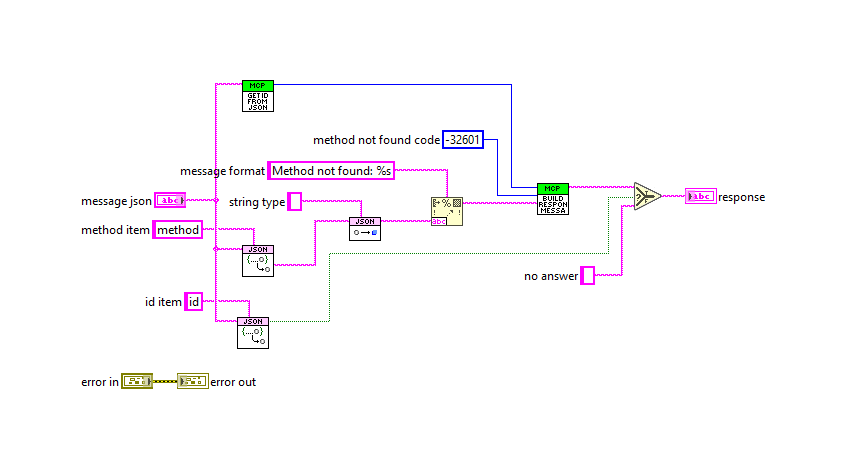 |

| Before | After |
|---|---|
|  | 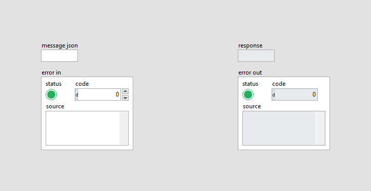 |

### `src/MCP Server/Build Picture JSON.vi` (modified)

**1. VI Attribute - Execution (VI Properties)**

- **1A** Automatic Error Handling

Whole block diagram and front panel

| Before | After |
|---|---|
|  | 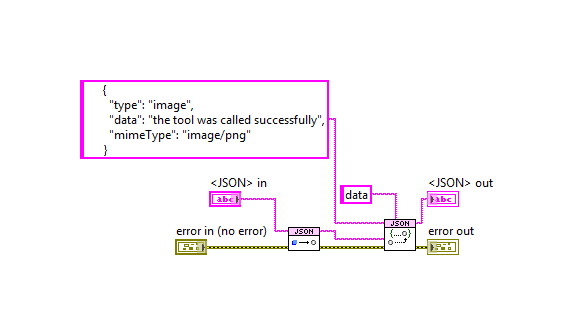 |

| Before | After |
|---|---|
| 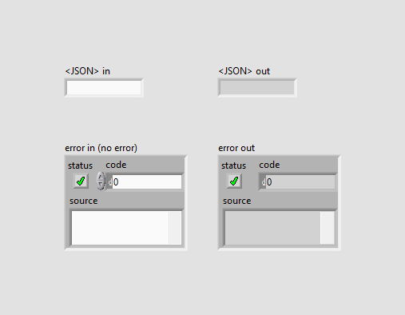 |  |

### `src/MCP Server/Build Prompt List JSON.vi` (modified)

**1. VI Attribute - Execution (VI Properties)**

- **1A** Automatic Error Handling

Whole block diagram and front panel

| Before | After |
|---|---|
| 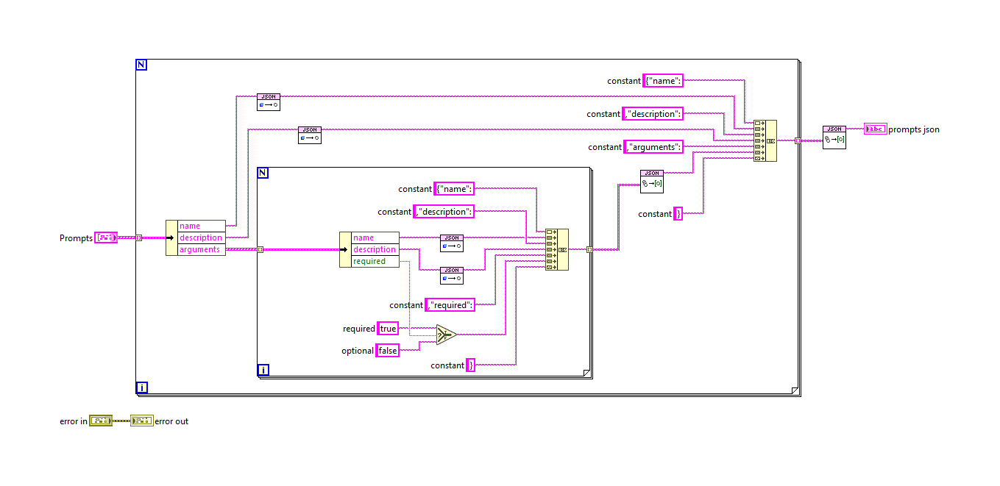 |  |

| Before | After |
|---|---|
| 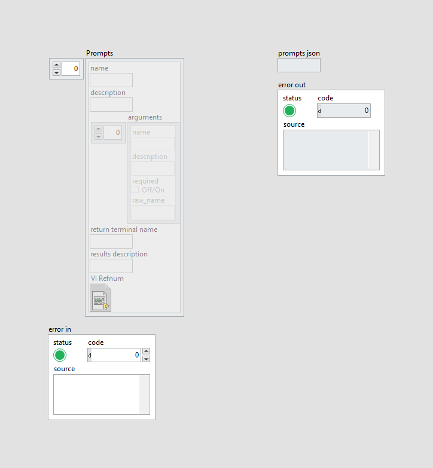 |  |

### `src/MCP Server/Build Response Error.vi` (modified)

**1. VI Attribute - Execution (VI Properties)**

- **1A** Automatic Error Handling

Whole block diagram and front panel

| Before | After |
|---|---|
|  | 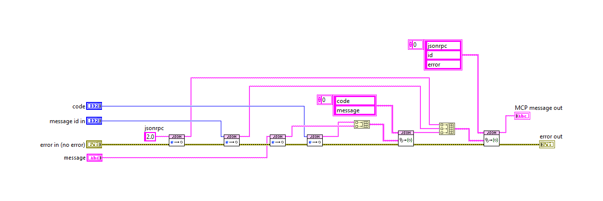 |

| Before | After |
|---|---|
|  | 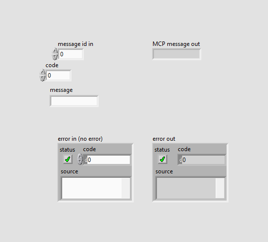 |

### `src/MCP Server/Build Response Message.vi` (modified)

**1. VI Attribute - Execution (VI Properties)**

- **1A** Automatic Error Handling

Whole block diagram and front panel

| Before | After |
|---|---|
| 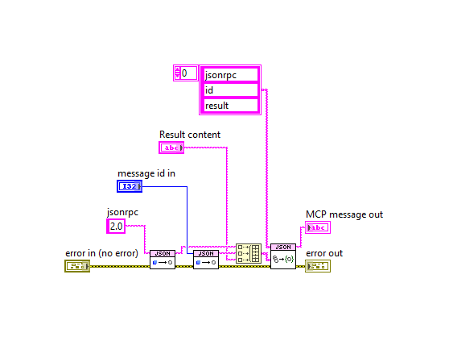 |  |

| Before | After |
|---|---|
|  | 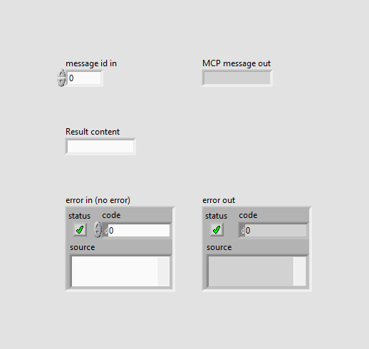 |

### `src/MCP Server/Build Text JSON for MCP.vi` (modified)

**1. VI Attribute - Execution (VI Properties)**

- **1A** Automatic Error Handling

Whole block diagram and front panel

| Before | After |
|---|---|
| 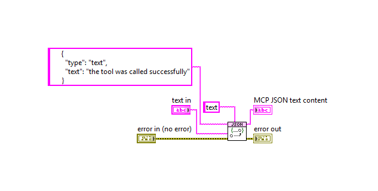 |  |

| Before | After |
|---|---|
| 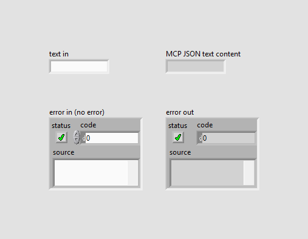 |  |

### `src/MCP Server/Build Tool.vi` (modified)

**1. VI Attribute - Execution (VI Properties)**

- **1A** Automatic Error Handling

Whole block diagram and front panel

| Before | After |
|---|---|
| 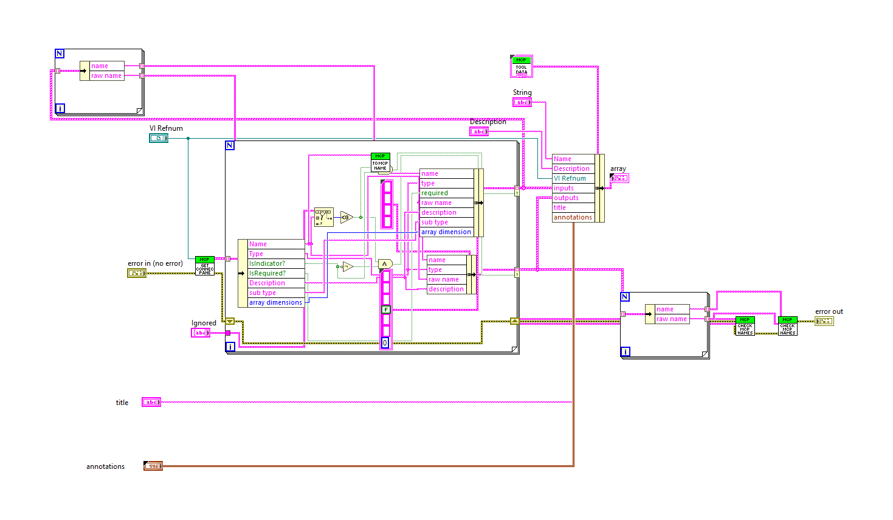 |  |

| Before | After |
|---|---|
| 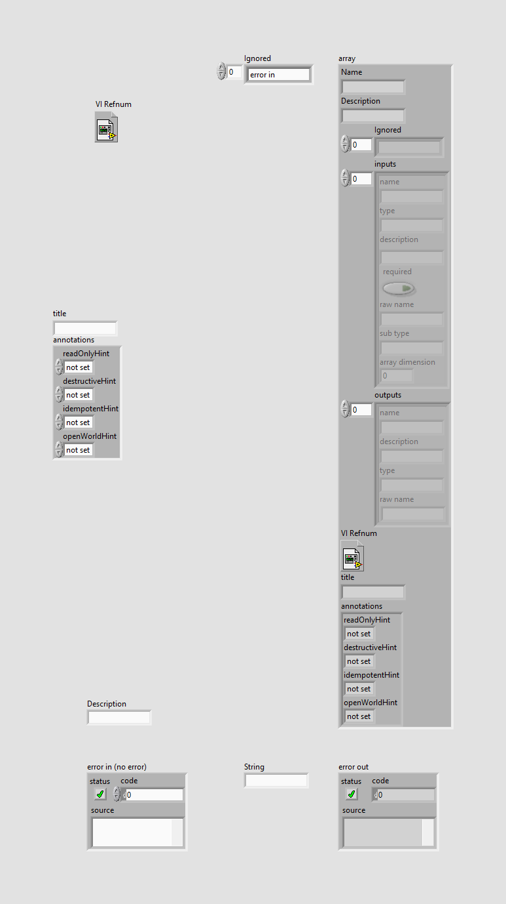 |  |

### `src/MCP Server/Cache Hints.vi` (modified)

**1. VI Attribute - Execution (VI Properties)**

- **1A** Automatic Error Handling

Whole block diagram and front panel

| Before | After |
|---|---|
| 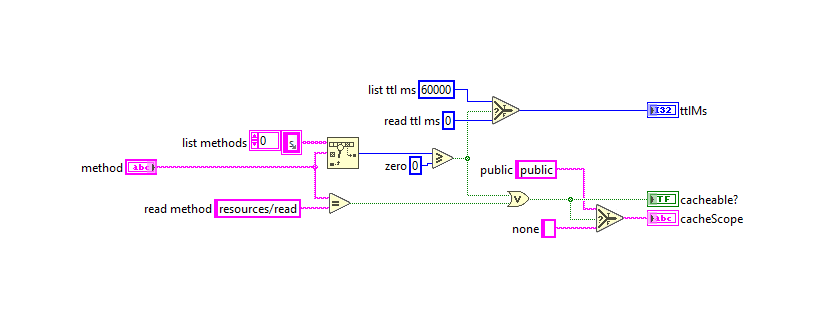 |  |

| Before | After |
|---|---|
| 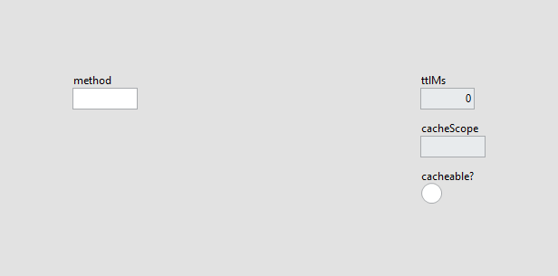 |  |

### `src/MCP Server/Call VI.vi` (modified)

**1. VI Attribute - Execution (VI Properties)**

- **1A** Automatic Error Handling

Whole block diagram and front panel

| Before | After |
|---|---|
| 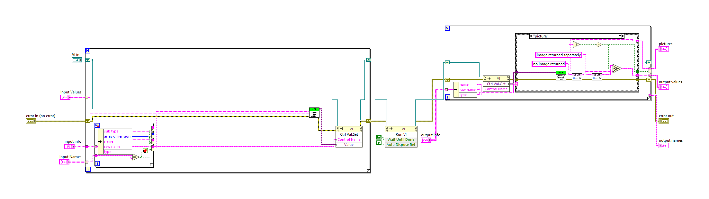 |  |

| Before | After |
|---|---|
|  | 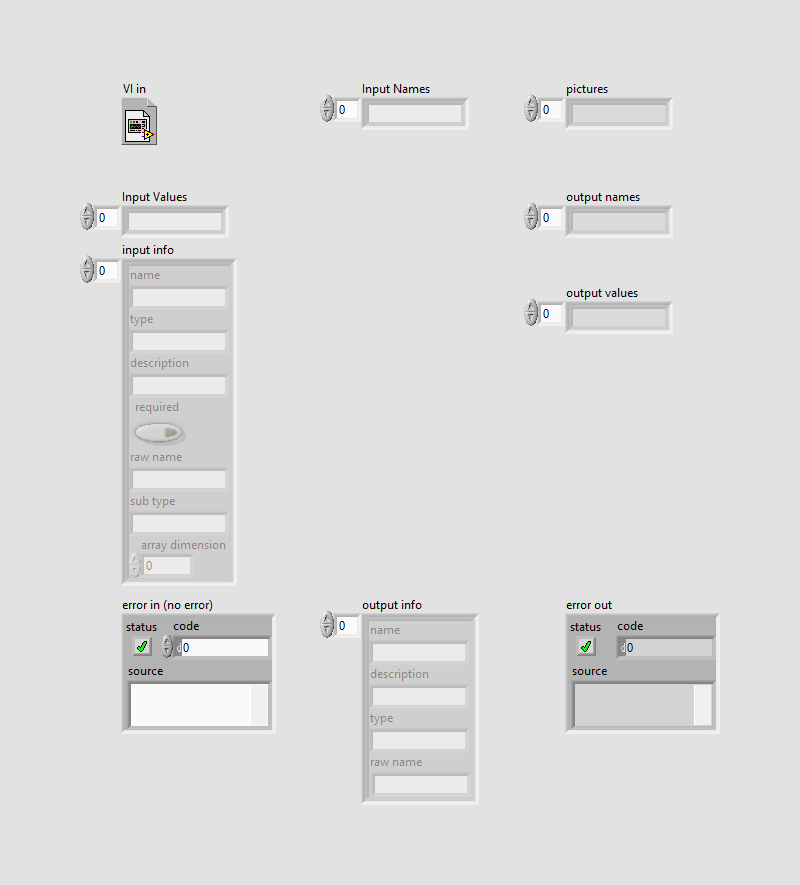 |

All case frames (3 hidden frames)

| Frame | Picture |
|---|---|
| Whole diagram, visible frames: Case structure 1: "picture" | 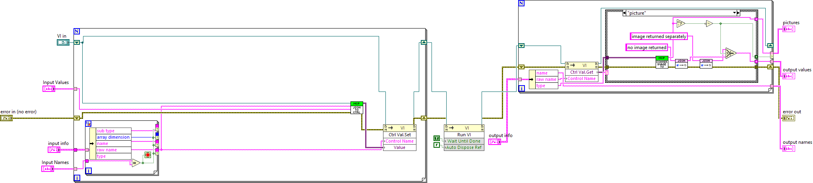 |
| Case structure 1: Default | 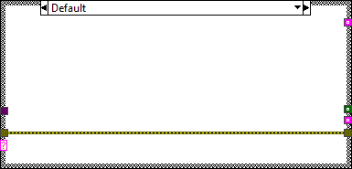 |
| Case structure 1: "boolean", "integer", "number", "object", "string" | 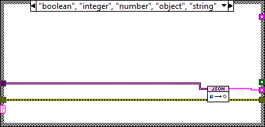 |
| Case structure 1: "array" | 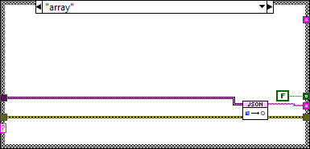 |

### `src/MCP Server/Check Client Access.vi` (modified)

**1. VI Attribute - Execution (VI Properties)**

- **1A** Automatic Error Handling

Whole block diagram and front panel

| Before | After |
|---|---|
|  |  |

| Before | After |
|---|---|
|  |  |

### `src/MCP Server/Check MCP Names.vi` (modified)

**1. VI Attribute - Execution (VI Properties)**

- **1A** Automatic Error Handling

Whole block diagram and front panel

| Before | After |
|---|---|
|  |  |

| Before | After |
|---|---|
|  |  |

All case frames (1 hidden frames)

| Frame | Picture |
|---|---|
| Whole diagram, visible frames: Case structure 1: Error .. |  |
| Case structure 1: No Error |  |

### `src/MCP Server/Check Modern MCP Request.vi` (modified)

**1. VI Attribute - Execution (VI Properties)**

- **1A** Automatic Error Handling

Whole block diagram and front panel

| Before | After |
|---|---|
|  |  |

| Before | After |
|---|---|
|  |  |

### `src/MCP Server/Check Prompt Arguments.vi` (modified)

**1. VI Attribute - Execution (VI Properties)**

- **1A** Automatic Error Handling

Whole block diagram and front panel

| Before | After |
|---|---|
|  |  |

| Before | After |
|---|---|
|  |  |

### `src/MCP Server/Check Tool Arguments.vi` (modified)

**1. VI Attribute - Execution (VI Properties)**

- **1A** Automatic Error Handling

Whole block diagram and front panel

| Before | After |
|---|---|
|  |  |

| Before | After |
|---|---|
|  |  |

### `src/MCP Server/Choose Protocol Version.vi` (modified)

**1. VI Attribute - Execution (VI Properties)**

- **1A** Automatic Error Handling

Whole block diagram and front panel

| Before | After |
|---|---|
|  |  |

| Before | After |
|---|---|
|  |  |

### `src/MCP Server/Clean Error Message.vi` (modified)

**1. VI Attribute - Execution (VI Properties)**

- **1A** Automatic Error Handling

Whole block diagram and front panel

| Before | After |
|---|---|
|  |  |

| Before | After |
|---|---|
|  |  |

### `src/MCP Server/Clear Tools.vi` (modified)

**1. VI Attribute - Execution (VI Properties)**

- **1A** Automatic Error Handling

Whole block diagram and front panel

| Before | After |
|---|---|
|  |  |

| Before | After |
|---|---|
|  |  |

### `src/MCP Server/Complete Tool Entry.vi` (modified)

**1. VI Attribute - Execution (VI Properties)**

- **1A** Automatic Error Handling

Whole block diagram and front panel

| Before | After |
|---|---|
|  |  |

| Before | After |
|---|---|
|  |  |

All case frames (1 hidden frames)

| Frame | Picture |
|---|---|
| Whole diagram, visible frames: Case structure 1: False |  |
| Case structure 1: True |  |

### `src/MCP Server/Convert Image To Base64.vi` (modified)

**1. VI Attribute - Execution (VI Properties)**

- **1A** Automatic Error Handling

Whole block diagram and front panel

| Before | After |
|---|---|
|  |  |

| Before | After |
|---|---|
|  |  |

All case frames (1 hidden frames)

| Frame | Picture |
|---|---|
| Whole diagram, visible frames: Case structure 1: True |  |
| Case structure 1: False |  |

### `src/MCP Server/Create Events.vi` (modified)

**1. VI Attribute - Execution (VI Properties)**

- **1A** Automatic Error Handling

Whole block diagram and front panel

| Before | After |
|---|---|
|  |  |

| Before | After |
|---|---|
|  |  |

### `src/MCP Server/Create Server.vi` (modified)

**1. VI Attribute - Execution (VI Properties)**

- **1A** Automatic Error Handling

Whole block diagram and front panel

| Before | After |
|---|---|
|  |  |

| Before | After |
|---|---|
|  |  |

All case frames (1 hidden frames)

| Frame | Picture |
|---|---|
| Whole diagram, visible frames: Case structure 1: No Error |  |
| Case structure 1: Error .. |  |

### `src/MCP Server/Decode Header Value.vi` (modified)

**1. VI Attribute - Execution (VI Properties)**

- **1A** Automatic Error Handling

Whole block diagram and front panel

| Before | After |
|---|---|
|  |  |

| Before | After |
|---|---|
|  |  |

### `src/MCP Server/Default Tool Arguments.vi` (modified)

**1. VI Attribute - Execution (VI Properties)**

- **1A** Automatic Error Handling

Whole block diagram and front panel

| Before | After |
|---|---|
|  |  |

| Before | After |
|---|---|
|  |  |

### `src/MCP Server/Finish Tool Call Response.vi` (modified)

**1. VI Attribute - Execution (VI Properties)**

- **1A** Automatic Error Handling

Whole block diagram and front panel

| Before | After |
|---|---|
|  |  |

| Before | After |
|---|---|
|  |  |

All case frames (1 hidden frames)

| Frame | Picture |
|---|---|
| Whole diagram, visible frames: Case structure 1: False |  |
| Case structure 1: True |  |

### `src/MCP Server/Generate Unique Server ID.vi` (modified)

**1. VI Attribute - Execution (VI Properties)**

- **1A** Automatic Error Handling

Whole block diagram and front panel

| Before | After |
|---|---|
|  |  |

| Before | After |
|---|---|
|  |  |

All case frames (1 hidden frames)

| Frame | Picture |
|---|---|
| Whole diagram, visible frames: Case structure 1: No Error |  |
| Case structure 1: Error .. |  |

### `src/MCP Server/Get Connector Pane Info.vi` (modified)

**1. VI Attribute - Execution (VI Properties)**

- **1A** Automatic Error Handling

Whole block diagram and front panel

| Before | After |
|---|---|
|  |  |

| Before | After |
|---|---|
|  |  |

All case frames (2 hidden frames)

| Frame | Picture |
|---|---|
| Whole diagram, visible frames: Case structure 1: False; Case structure 2: "Array" |  |
| Case structure 1: True |  |
| Case structure 2: Default |  |

### `src/MCP Server/Get ID from JSON.vi` (modified)

**1. VI Attribute - Execution (VI Properties)**

- **1A** Automatic Error Handling

Whole block diagram and front panel

| Before | After |
|---|---|
|  |  |

| Before | After |
|---|---|
|  |  |

### `src/MCP Server/Get ID from name.vi` (modified)

**1. VI Attribute - Execution (VI Properties)**

- **1A** Automatic Error Handling

Whole block diagram and front panel

| Before | After |
|---|---|
|  |  |

| Before | After |
|---|---|
|  |  |

### `src/MCP Server/Get Parameter.vi` (modified)

**1. VI Attribute - Execution (VI Properties)**

- **1A** Automatic Error Handling

Whole block diagram and front panel

| Before | After |
|---|---|
|  |  |

| Before | After |
|---|---|
|  |  |

All case frames (1 hidden frames)

| Frame | Picture |
|---|---|
| Whole diagram, visible frames: Case structure 1: True |  |
| Case structure 1: False |  |

### `src/MCP Server/Get Prompts.vi` (modified)

**1. VI Attribute - Execution (VI Properties)**

- **1A** Automatic Error Handling

Whole block diagram and front panel

| Before | After |
|---|---|
|  |  |

| Before | After |
|---|---|
|  |  |

### `src/MCP Server/Get Resources.vi` (modified)

**1. VI Attribute - Execution (VI Properties)**

- **1A** Automatic Error Handling

Whole block diagram and front panel

| Before | After |
|---|---|
|  |  |

| Before | After |
|---|---|
|  |  |

### `src/MCP Server/Get Server Name from ID.vi` (modified)

**1. VI Attribute - Execution (VI Properties)**

- **1A** Automatic Error Handling

Whole block diagram and front panel

| Before | After |
|---|---|
|  |  |

| Before | After |
|---|---|
|  |  |

### `src/MCP Server/Get Server.vi` (modified)

**1. VI Attribute - Execution (VI Properties)**

- **1A** Automatic Error Handling

Whole block diagram and front panel

| Before | After |
|---|---|
|  |  |

| Before | After |
|---|---|
|  |  |

### `src/MCP Server/Get Tool.vi` (modified)

**1. VI Attribute - Execution (VI Properties)**

- **1A** Automatic Error Handling

Whole block diagram and front panel

| Before | After |
|---|---|
|  |  |

| Before | After |
|---|---|
|  |  |

### `src/MCP Server/Get Tools.vi` (modified)

**1. VI Attribute - Execution (VI Properties)**

- **1A** Automatic Error Handling

Whole block diagram and front panel

| Before | After |
|---|---|
|  |  |

| Before | After |
|---|---|
|  |  |

### `src/MCP Server/Handle Server Request Batch.vi` (modified)

**1. VI Attribute - Execution (VI Properties)**

- **1A** Automatic Error Handling

Whole block diagram and front panel

| Before | After |
|---|---|
|  |  |

| Before | After |
|---|---|
|  |  |

### `src/MCP Server/Handle Server Request.vi` (modified)

**1. VI Attribute - Execution (VI Properties)**

- **1A** Automatic Error Handling

Whole block diagram and front panel

| Before | After |
|---|---|
|  |  |

| Before | After |
|---|---|
|  |  |

All case frames (14 hidden frames)

| Frame | Picture |
|---|---|
| Whole diagram, visible frames: Case structure 1: True; Case structure 2: No Error; Case structure 3: "tools/call" |  |
| Case structure 1: False |  |
| Case structure 3: Default |  |
| Case structure 3: "initialize" |  |
| Case structure 3: "notifications/initialized" |  |
| Case structure 3: "tools/list" |  |
| Case structure 3: "resources/templates/list" |  |
| Case structure 3: "ping" |  |
| Case structure 3: "resources/list" |  |
| Case structure 3: "resources/read" |  |
| Case structure 3: "prompts/list" |  |
| Case structure 3: "prompts/get" |  |
| Case structure 3: "shutdown" |  |
| Case structure 3: "exit" |  |
| Case structure 2: Error .. |  |

### `src/MCP Server/Is Supported Protocol Version.vi` (modified)

**1. VI Attribute - Execution (VI Properties)**

- **1A** Automatic Error Handling

Whole block diagram and front panel

| Before | After |
|---|---|
|  |  |

| Before | After |
|---|---|
|  |  |

### `src/MCP Server/JSON To Control Value.vi` (modified)

**1. VI Attribute - Execution (VI Properties)**

- **1A** Automatic Error Handling

Whole block diagram and front panel

| Before | After |
|---|---|
|  |  |

| Before | After |
|---|---|
|  |  |

### `src/MCP Server/LV Type To JSON Schema.vi` (modified)

**1. VI Attribute - Execution (VI Properties)**

- **1A** Automatic Error Handling

Whole block diagram and front panel

| Before | After |
|---|---|
|  |  |

| Before | After |
|---|---|
|  |  |

All case frames (8 hidden frames)

| Frame | Picture |
|---|---|
| Whole diagram, visible frames: Case structure 1: "Timestamp" |  |
| Case structure 1: Default |  |
| Case structure 1: "Array" |  |
| Case structure 1: "Cluster" |  |
| Case structure 1: "Enum U8".."Enum U64" |  |
| Case structure 1: "I8".."U64" |  |
| Case structure 1: "Single Float".."Extended Float", "Single Float With Unit".."Extended Float With Unit" |  |
| Case structure 1: "Boolean" |  |
| Case structure 1: "String", "Path" |  |

### `src/MCP Server/LV type to MCP type.vi` (modified)

**1. VI Attribute - Execution (VI Properties)**

- **1A** Automatic Error Handling

Whole block diagram and front panel

| Before | After |
|---|---|
|  |  |

| Before | After |
|---|---|
|  |  |

All case frames (8 hidden frames)

| Frame | Picture |
|---|---|
| Whole diagram, visible frames: Case structure 1: "Invalid Type", Default |  |
| Case structure 1: "Void" |  |
| Case structure 1: "I8".."U64", "Enum U8".."Enum U64" |  |
| Case structure 1: "Single Float".."Extended Complex", "Single Float With Unit".."Extended Complex with Unit" |  |
| Case structure 1: "Boolean" |  |
| Case structure 1: "String", "Path", "Timestamp" |  |
| Case structure 1: "Cluster" |  |
| Case structure 1: "Array" |  |
| Case structure 1: "Picture" |  |

### `src/MCP Server/Legacy Cancellations.vi` (modified)

**1. VI Attribute - Execution (VI Properties)**

- **1A** Automatic Error Handling

Whole block diagram and front panel

| Before | After |
|---|---|
|  |  |

| Before | After |
|---|---|
|  |  |

### `src/MCP Server/List Control Elements.vi` (modified)

**1. VI Attribute - Execution (VI Properties)**

- **1A** Automatic Error Handling

Whole block diagram and front panel

| Before | After |
|---|---|
|  |  |

| Before | After |
|---|---|
|  |  |

All case frames (2 hidden frames)

| Frame | Picture |
|---|---|
| Whole diagram, visible frames: Case structure 1: "Array" |  |
| Case structure 1: Default |  |
| Case structure 1: "Cluster" |  |

### `src/MCP Server/Log.vi` (modified)

**1. VI Attribute - Execution (VI Properties)**

- **1A** Automatic Error Handling

Whole block diagram and front panel

| Before | After |
|---|---|
|  |  |

| Before | After |
|---|---|
|  |  |

### `src/MCP Server/MCP Connection Probe/Connection Local IP.vi` (modified)

**1. VI Attribute - Execution (VI Properties)**

- **1A** Automatic Error Handling

Whole block diagram and front panel

| Before | After |
|---|---|
|  |  |

| Before | After |
|---|---|
|  |  |

### `src/MCP Server/MCP SSE Response/Abort Stream.vi` (modified)

**1. VI Attribute - Execution (VI Properties)**

- **1A** Automatic Error Handling

Whole block diagram and front panel

| Before | After |
|---|---|
|  |  |

| Before | After |
|---|---|
|  |  |

### `src/MCP Server/MCP SSE Response/Create MCP SSE Response.vi` (modified)

**1. VI Attribute - Execution (VI Properties)**

- **1A** Automatic Error Handling

Whole block diagram and front panel

| Before | After |
|---|---|
|  |  |

| Before | After |
|---|---|
|  |  |

### `src/MCP Server/MCP SSE Response/Get Queues.vi` (modified)

**1. VI Attribute - Execution (VI Properties)**

- **1A** Automatic Error Handling

Whole block diagram and front panel

| Before | After |
|---|---|
|  |  |

| Before | After |
|---|---|
|  |  |

### `src/MCP Server/MCP SSE Response/Next Segment.vi` (modified)

**1. VI Attribute - Execution (VI Properties)**

- **1A** Automatic Error Handling

Whole block diagram and front panel

| Before | After |
|---|---|
|  |  |

| Before | After |
|---|---|
|  |  |

### `src/MCP Server/MCP SSE Response/Stream Length.vi` (modified)

**1. VI Attribute - Execution (VI Properties)**

- **1A** Automatic Error Handling

Whole block diagram and front panel

| Before | After |
|---|---|
|  |  |

| Before | After |
|---|---|
|  |  |

### `src/MCP Server/Make Output Property Schema.vi` (modified)

**1. VI Attribute - Execution (VI Properties)**

- **1A** Automatic Error Handling

Whole block diagram and front panel

| Before | After |
|---|---|
|  |  |

| Before | After |
|---|---|
|  |  |

### `src/MCP Server/Make Output Schema.vi` (modified)

**1. VI Attribute - Execution (VI Properties)**

- **1A** Automatic Error Handling

Whole block diagram and front panel

| Before | After |
|---|---|
|  |  |

| Before | After |
|---|---|
|  |  |

### `src/MCP Server/Make Schema Details.vi` (modified)

**1. VI Attribute - Execution (VI Properties)**

- **1A** Automatic Error Handling

Whole block diagram and front panel

| Before | After |
|---|---|
|  |  |

| Before | After |
|---|---|
|  |  |

### `src/MCP Server/Mark Tool Error Result.vi` (modified)

**1. VI Attribute - Execution (VI Properties)**

- **1A** Automatic Error Handling

Whole block diagram and front panel

| Before | After |
|---|---|
|  |  |

| Before | After |
|---|---|
|  |  |

### `src/MCP Server/Negotiate Protocol Version.vi` (modified)

**1. VI Attribute - Execution (VI Properties)**

- **1A** Automatic Error Handling

Whole block diagram and front panel

| Before | After |
|---|---|
|  |  |

| Before | After |
|---|---|
|  |  |

### `src/MCP Server/Null Id For Parse Error.vi` (modified)

**1. VI Attribute - Execution (VI Properties)**

- **1A** Automatic Error Handling

Whole block diagram and front panel

| Before | After |
|---|---|
|  |  |

| Before | After |
|---|---|
|  |  |

### `src/MCP Server/Read Numeric Limits.vi` (modified)

**1. VI Attribute - Execution (VI Properties)**

- **1A** Automatic Error Handling

Whole block diagram and front panel

| Before | After |
|---|---|
|  |  |

| Before | After |
|---|---|
|  |  |

All case frames (2 hidden frames)

| Frame | Picture |
|---|---|
| Whole diagram, visible frames: Case structure 1: "number" |  |
| Case structure 1: Default |  |
| Case structure 1: "integer" |  |

### `src/MCP Server/Read Resource Contents.vi` (modified)

**1. VI Attribute - Execution (VI Properties)**

- **1A** Automatic Error Handling

Whole block diagram and front panel

| Before | After |
|---|---|
|  |  |

| Before | After |
|---|---|
|  |  |

### `src/MCP Server/Reinitialize VI Inputs.vi` (modified)

**1. Block Diagram objects**

- **1A** SubVI "MCP Server.lvlib:Disable Automatic Error Handling.vi" - added at (132,40)
- **1B** wiring changes

| Before | After |
|---|---|
|  |  |

**2. Front Panel - Cluster**

- **2A** String - dropping allowed

| Before | After |
|---|---|
|  |  |

**4. VI Attribute - Documentation (VI Properties)**

- **4A** description text : changed from "Sets every control of a tool or prompt VI back to its default value before the VI is called.  Call VI.vi sets only the inputs that a request gives. Without this step an input that the request leaves out would keep the value of the previous call instead of its default.  An error of the reset (for example because the VI is running) is not reported here: calling the VI reports it." to "Prepares a tool or prompt VI for a call. First switches off the VI's automatic error handling in memory (Disable Automatic Error Handling.vi), so that an error on an unwired output inside the VI cannot open LabVIEW's modal error dialog and stop the server. Then sets every control of the VI back to its default value.  Call VI.vi sets only the inputs that a request gives. Without the reset an input that the request leaves out would keep the value of the previous call instead of its default.  An error of the reset (for example because the VI is running) is not reported here: calling the VI reports it. error in is passed through Disable Automatic Error Handling.vi, which does nothing when it carries an error."

**5. VI Attribute - Execution (VI Properties)**

- **5A** Automatic Error Handling

**6. VI Attribute - Editor Options (VI Properties)**

- **6A** default control style

**7. VI Attribute - Miscellaneous**

- **7A** VI Icon (256 colors)

| Before | After |
|---|---|
|  |  |

Whole block diagram and front panel

| Before | After |
|---|---|
|  |  |

| Before | After |
|---|---|
|  |  |

### `src/MCP Server/Reject Invalid Request.vi` (modified)

**1. VI Attribute - Execution (VI Properties)**

- **1A** Automatic Error Handling

Whole block diagram and front panel

| Before | After |
|---|---|
|  |  |

| Before | After |
|---|---|
|  |  |

### `src/MCP Server/Reject Non Object Message.vi` (modified)

**1. VI Attribute - Execution (VI Properties)**

- **1A** Automatic Error Handling

Whole block diagram and front panel

| Before | After |
|---|---|
|  |  |

| Before | After |
|---|---|
|  |  |

### `src/MCP Server/Remove Default Error Description.vi` (modified)

**1. VI Attribute - Execution (VI Properties)**

- **1A** Automatic Error Handling

Whole block diagram and front panel

| Before | After |
|---|---|
|  |  |

| Before | After |
|---|---|
|  |  |

### `src/MCP Server/Remove Empty Description.vi` (modified)

**1. VI Attribute - Execution (VI Properties)**

- **1A** Automatic Error Handling

Whole block diagram and front panel

| Before | After |
|---|---|
|  |  |

| Before | After |
|---|---|
|  |  |

### `src/MCP Server/Remove Server.vi` (modified)

**1. VI Attribute - Execution (VI Properties)**

- **1A** Automatic Error Handling

Whole block diagram and front panel

| Before | After |
|---|---|
|  |  |

| Before | After |
|---|---|
|  |  |

All case frames (2 hidden frames)

| Frame | Picture |
|---|---|
| Whole diagram, visible frames: Case structure 1: No Error; Case structure 2: True |  |
| Case structure 2: False |  |
| Case structure 1: Error .. |  |

### `src/MCP Server/Restore Request ID.vi` (modified)

**1. VI Attribute - Execution (VI Properties)**

- **1A** Automatic Error Handling

Whole block diagram and front panel

| Before | After |
|---|---|
|  |  |

| Before | After |
|---|---|
|  |  |

### `src/MCP Server/Send onError.vi` (modified)

**1. VI Attribute - Execution (VI Properties)**

- **1A** Automatic Error Handling

Whole block diagram and front panel

| Before | After |
|---|---|
|  |  |

| Before | After |
|---|---|
|  |  |

All case frames (1 hidden frames)

| Frame | Picture |
|---|---|
| Whole diagram, visible frames: Case structure 1: Error .. |  |
| Case structure 1: No Error |  |

### `src/MCP Server/Send onRpc.vi` (modified)

**1. VI Attribute - Execution (VI Properties)**

- **1A** Automatic Error Handling

Whole block diagram and front panel

| Before | After |
|---|---|
|  |  |

| Before | After |
|---|---|
|  |  |

### `src/MCP Server/Server Access Settings.vi` (modified)

**1. VI Attribute - Execution (VI Properties)**

- **1A** Automatic Error Handling

Whole block diagram and front panel

| Before | After |
|---|---|
|  |  |

| Before | After |
|---|---|
|  |  |

All case frames (1 hidden frames)

| Frame | Picture |
|---|---|
| Whole diagram, visible frames: Case structure 1: False |  |
| Case structure 1: True |  |

### `src/MCP Server/Server FGV.vi` (modified)

**1. VI Attribute - Execution (VI Properties)**

- **1A** Automatic Error Handling

Whole block diagram and front panel

| Before | After |
|---|---|
|  |  |

| Before | After |
|---|---|
|  |  |

All case frames (6 hidden frames)

| Frame | Picture |
|---|---|
| Whole diagram, visible frames: Case structure 1: No Error; Case structure 2: "GetAll" |  |
| Case structure 2: "Get" |  |
| Case structure 2: "Add" |  |
| Case structure 2: Default |  |
| Case structure 2: "Remove" |  |
| Case structure 2: "Clear" |  |
| Case structure 1: Error .. |  |

### `src/MCP Server/Set LabVIEW Version.vi` (modified)

**1. VI Attribute - Execution (VI Properties)**

- **1A** Automatic Error Handling

Whole block diagram and front panel

| Before | After |
|---|---|
|  |  |

| Before | After |
|---|---|
|  |  |

### `src/MCP Server/Set Parameters.vi` (modified)

**1. VI Attribute - Execution (VI Properties)**

- **1A** Automatic Error Handling

Whole block diagram and front panel

| Before | After |
|---|---|
|  |  |

| Before | After |
|---|---|
|  |  |

### `src/MCP Server/Set Tool Annotations.vi` (modified)

**1. VI Attribute - Execution (VI Properties)**

- **1A** Automatic Error Handling

Whole block diagram and front panel

| Before | After |
|---|---|
|  |  |

| Before | After |
|---|---|
|  |  |

### `src/MCP Server/Set Tool Title.vi` (modified)

**1. VI Attribute - Execution (VI Properties)**

- **1A** Automatic Error Handling

Whole block diagram and front panel

| Before | After |
|---|---|
|  |  |

| Before | After |
|---|---|
|  |  |

### `src/MCP Server/Start.vi` (modified)

**1. VI Attribute - Execution (VI Properties)**

- **1A** Automatic Error Handling

Whole block diagram and front panel

| Before | After |
|---|---|
|  |  |

| Before | After |
|---|---|
|  |  |

All case frames (2 hidden frames)

| Frame | Picture |
|---|---|
| Whole diagram, visible frames: Case structure 1: No Error; Case structure 2: Error .. |  |
| Case structure 2: No Error |  |
| Case structure 1: Error .. |  |

### `src/MCP Server/Stop.vi` (modified)

**1. VI Attribute - Execution (VI Properties)**

- **1A** Automatic Error Handling

Whole block diagram and front panel

| Before | After |
|---|---|
|  |  |

| Before | After |
|---|---|
|  |  |

### `src/MCP Server/Strip Error Details.vi` (modified)

**1. VI Attribute - Execution (VI Properties)**

- **1A** Automatic Error Handling

Whole block diagram and front panel

| Before | After |
|---|---|
|  |  |

| Before | After |
|---|---|
|  |  |

### `src/MCP Server/Supported Protocol Versions.vi` (modified)

**1. VI Attribute - Execution (VI Properties)**

- **1A** Automatic Error Handling

Whole block diagram and front panel

| Before | After |
|---|---|
|  |  |

| Before | After |
|---|---|
|  |  |

### `src/MCP Server/To MCP Name.vi` (modified)

**1. VI Attribute - Execution (VI Properties)**

- **1A** Automatic Error Handling

Whole block diagram and front panel

| Before | After |
|---|---|
|  |  |

| Before | After |
|---|---|
|  |  |

### `src/MCP Server/Validate HTTP Request.vi` (modified)

**1. VI Attribute - Execution (VI Properties)**

- **1A** Automatic Error Handling

Whole block diagram and front panel

| Before | After |
|---|---|
|  |  |

| Before | After |
|---|---|
|  |  |

### `src/MCP Server/exit.vi` (modified)

**1. VI Attribute - Execution (VI Properties)**

- **1A** Automatic Error Handling

Whole block diagram and front panel

| Before | After |
|---|---|
|  |  |

| Before | After |
|---|---|
|  |  |

### `src/MCP Server/initialize.vi` (modified)

**1. VI Attribute - Execution (VI Properties)**

- **1A** Automatic Error Handling

Whole block diagram and front panel

| Before | After |
|---|---|
|  |  |

| Before | After |
|---|---|
|  |  |

### `src/MCP Server/ping.vi` (modified)

**1. VI Attribute - Execution (VI Properties)**

- **1A** Automatic Error Handling

Whole block diagram and front panel

| Before | After |
|---|---|
|  |  |

| Before | After |
|---|---|
|  |  |

### `src/MCP Server/prompts get.vi` (modified)

**1. VI Attribute - Execution (VI Properties)**

- **1A** Automatic Error Handling

Whole block diagram and front panel

| Before | After |
|---|---|
|  |  |

| Before | After |
|---|---|
|  |  |

### `src/MCP Server/prompts list.vi` (modified)

**1. VI Attribute - Execution (VI Properties)**

- **1A** Automatic Error Handling

Whole block diagram and front panel

| Before | After |
|---|---|
|  |  |

| Before | After |
|---|---|
|  |  |

### `src/MCP Server/resources list.vi` (modified)

**1. VI Attribute - Execution (VI Properties)**

- **1A** Automatic Error Handling

Whole block diagram and front panel

| Before | After |
|---|---|
|  |  |

| Before | After |
|---|---|
|  |  |

### `src/MCP Server/resources read.vi` (modified)

**1. VI Attribute - Execution (VI Properties)**

- **1A** Automatic Error Handling

Whole block diagram and front panel

| Before | After |
|---|---|
|  |  |

| Before | After |
|---|---|
|  |  |

### `src/MCP Server/resources templates list.vi` (modified)

**1. VI Attribute - Execution (VI Properties)**

- **1A** Automatic Error Handling

Whole block diagram and front panel

| Before | After |
|---|---|
|  |  |

| Before | After |
|---|---|
|  |  |

### `src/MCP Server/shutdown.vi` (modified)

**1. VI Attribute - Execution (VI Properties)**

- **1A** Automatic Error Handling

Whole block diagram and front panel

| Before | After |
|---|---|
|  |  |

| Before | After |
|---|---|
|  |  |

### `src/MCP Server/tool call.vi` (modified)

**1. VI Attribute - Execution (VI Properties)**

- **1A** Automatic Error Handling

Whole block diagram and front panel

| Before | After |
|---|---|
|  |  |

| Before | After |
|---|---|
|  |  |

All case frames (2 hidden frames)

| Frame | Picture |
|---|---|
| Whole diagram, visible frames: Case structure 1: Error 1003 |  |
| Case structure 1: No Error |  |
| Case structure 1: Default |  |

### `src/MCP Server/tool list.vi` (modified)

**1. VI Attribute - Execution (VI Properties)**

- **1A** Automatic Error Handling

Whole block diagram and front panel

| Before | After |
|---|---|
|  |  |

| Before | After |
|---|---|
|  |  |

### `tests/Test_MCP_Server.vi` (modified)

**1. Block Diagram objects**

- **1A** SubVI "MCP Server tests.lvlib:Add Fixture Unwired Error Tool.vi" - added at (2146,369)
- **1B** wiring changes

| Before | After |
|---|---|
|  |  |

**2. Block Diagram objects**

- **2A** SubVI "MCP Server tests.lvlib:test streamed tool error.vi" - added at (5021,285)
- **2B** SubVI "MCP Server tests.lvlib:test tool automatic error handling.vi" - added at (5116,285)
- **2C** wiring changes

| Before | After |
|---|---|
|  |  |

Whole block diagram and front panel

| Before | After |
|---|---|
|  |  |

| Before | After |
|---|---|
|  |  |

### `src/MCP Server/Disable Automatic Error Handling.vi` (added)

Block diagram (case structures show their visible frame only):

Front panel

All case frames (2 hidden frames)

| Frame | Picture |
|---|---|
| Whole diagram, visible frames: Case structure 1: No Error; Case structure 2: True |  |
| Case structure 2: False |  |
| Case structure 1: Error .. |  |

### `tests/Add Fixture Unwired Error Tool.vi` (added)

Block diagram (case structures show their visible frame only):

Front panel

### `tests/fake tool unwired error.vi` (added)

Block diagram (case structures show their visible frame only):

Front panel

### `tests/test streamed tool error.vi` (added)

Block diagram (case structures show their visible frame only):

Front panel

### `tests/test tool automatic error handling.vi` (added)

Block diagram (case structures show their visible frame only):

Front panel

