## VI diff report

8 modified, 25 added, 0 deleted. Generated by LabVIEW's VI comparison; position and size changes are not shown.

### `src/MCP Server/Add Resource (File).vi` (modified)

**1. Block Diagram objects**

- **1A** Front Panel Terminal "uri" - added at (332,273)
- **1B** Tunnel  - added at (391,277)

| Before | After |
|---|---|
| 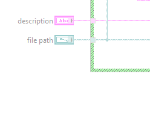 | 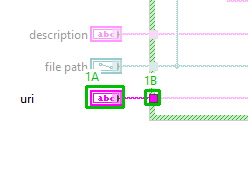 |

**2. Block Diagram objects**

- **2A** SubVI "MCP Server.lvlib:Resource URI.vi" - added at (640,262)
- **2B** Tunnel  - added at (391,277)
- **2C** wiring changes

| Before | After |
|---|---|
| 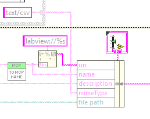 | 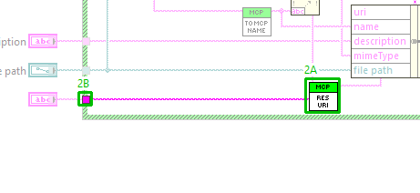 |

**3. Front Panel - Panel**

- **3A** Connector Pane  - control/indicator assignment : changed

| Before | After |
|---|---|
| 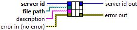 | 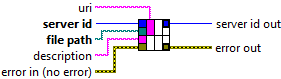 |

**4. Front Panel objects**

- **4A** String "uri" - added at (-4,205)

| Before | After |
|---|---|
| 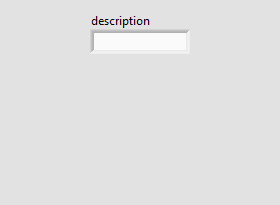 | 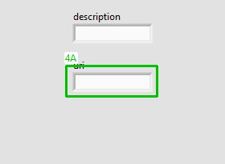 |

**5. VI Attribute - Documentation (VI Properties)**

- **5A** description text : changed from "Adds a resource to a MCP server. Resources are files or information (text) that can be added to a prompt by a user in the client similar to a prompt. A Resource does not have parameters and usually returns a file (txt, md, pdf, png).  This adds a file that will be fully retrieved. Make sure not so exceed several MB of file size. Supported file types: text files, pdf, png" to "Adds a resource to a MCP server. Resources are files or information (text) that can be added to a prompt by a user in the client similar to a prompt. A Resource does not have parameters and usually returns a file (txt, md, pdf, png).  This adds a file that will be fully retrieved. Make sure not so exceed several MB of file size. Supported file types: text files, pdf, png  uri (optional): the uri under which the resource is listed by resources/list and found by resources/read, exactly as given (for example test://static-text); resources/read matches it character for character. Empty (default): labview://, as before. The mimeType is always derived from the file extension (pdf: application/pdf, png: image/png, md: text/markdown, json: application/json, py: text/x-python, c: text/x-c, xml: text/xml, csv: text/csv, anything else: text/plain)."

Whole block diagram and front panel

| Before | After |
|---|---|
| 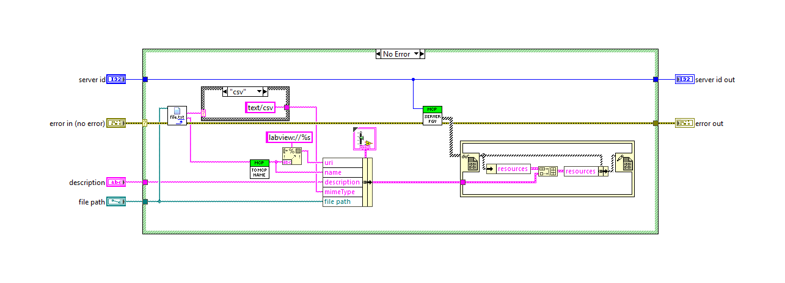 | 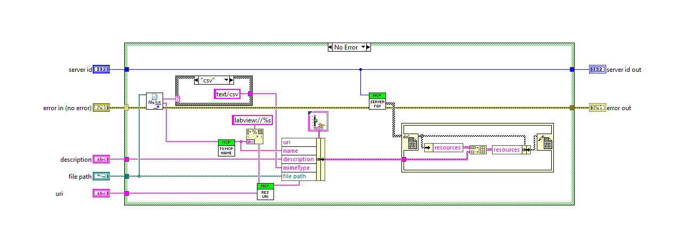 |

| Before | After |
|---|---|
|  |  |

All case frames (9 hidden frames)

| Frame | Picture |
|---|---|
| Whole diagram, visible frames: Case structure 1: No Error; Case structure 2: "csv" | 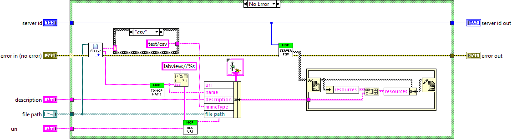 |
| Case structure 2: "pdf" | 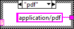 |
| Case structure 2: "png" | 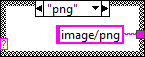 |
| Case structure 2: Default |  |
| Case structure 2: "md" |  |
| Case structure 2: "json" | 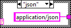 |
| Case structure 2: "py" | 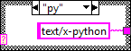 |
| Case structure 2: "c" | 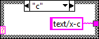 |
| Case structure 2: "xml" |  |
| Case structure 1: Error .. | 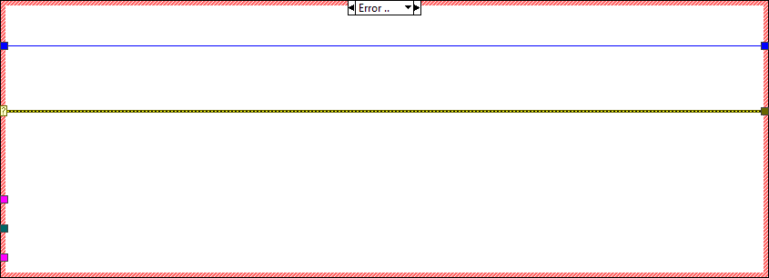 |

### `src/MCP Server/Ask User.vi` (modified)

**1. Block Diagram objects**

- **1A** SubVI "MCP Server.lvlib:Valid Input Response.vi" - added at (909,345)
- **1B** wiring changes

| Before | After |
|---|---|
| 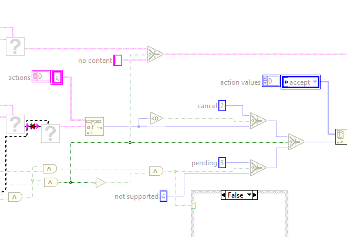 | 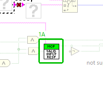 |

**2. VI Attribute - Documentation (VI Properties)**

- **2A** description text : changed from "Asks the user of the MCP client a question while a tool runs (MCP elicitation, form mode), using the multi round-trip pattern of MCP 2026-07-28: the tool VI runs twice. On the first run the question is only registered and action is "pending"; tools/call (or prompts/get) then answers the client with resultType "input_required" and a requestState. The client shows the question and calls the tool again with the user's answer, and on that second run action is accept, decline or cancel and content holds the answer.  HOW TO USE IT IN A TOOL VI: call Ask User.vi before doing anything that has side effects. When action is "pending", return at once and do NOTHING else (no hardware access, no file writes): the run is thrown away and the tool runs again with the answer. Do the real work only on the run that has the answer (accept), and handle decline and cancel. When action is "not supported", the client cannot be asked (a legacy client, or a client without the elicitation capability): fall back to a safe default or refuse, and say so in the tool's outputs.  key identifies the question and must be unique within the tool (use a fixed text such as "confirm_delete"); several questions need several keys.  requestedSchema is passed to the client as given. MCP restricts it to a flat object whose properties are primitives only: string (minLength, maxLength, format email/uri/date/date-time, default), number or integer (minimum, maximum, default), boolean (default) and enums of strings, each with optional title and description. Empty means a plain confirmation, {"type":"object","properties":{}}; anything that is not a JSON object is replaced by that too. Form mode MUST NOT be used to ask for passwords, API keys, tokens or other secrets.  SEVERAL QUESTIONS: a tool may ask several questions, in one run or in several rounds (ask key "first"; once it is answered, ask key "second"). The server keeps the answers of the earlier rounds itself (requestState, Request State Store.vi) and hands every answer given so far to each run, although the client sends back only the answers to the latest questions. When the client retries without the answer to a question, action is "pending" again and the question is asked again.  Only works inside tools/call or prompts/get (in a prompt VI) of a modern request (params._meta with io.modelcontextprotocol/protocolVersion) whose client declared the elicitation capability ({} counts as form mode). The request context comes from Handle MCP Request.vi through the named queues "MCP Request Context" and "MCP Input Requests". Legacy requests always get "not supported": legacy elicitation needs a server-to-client stream, which this server does not have." to "Asks the user of the MCP client a question while a tool runs (MCP elicitation, form mode), using the multi round-trip pattern of MCP 2026-07-28: the tool VI runs twice. On the first run the question is only registered and action is "pending"; tools/call (or prompts/get) then answers the client with resultType "input_required" and a requestState. The client shows the question and calls the tool again with the user's answer, and on that second run action is accept, decline or cancel and content holds the answer.  HOW TO USE IT IN A TOOL VI: call Ask User.vi before doing anything that has side effects. When action is "pending", return at once and do NOTHING else (no hardware access, no file writes): the run is thrown away and the tool runs again with the answer. Do the real work only on the run that has the answer (accept), and handle decline and cancel. When action is "not supported", the client cannot be asked (a legacy client, or a client without the elicitation capability): fall back to a safe default or refuse, and say so in the tool's outputs.  key identifies the question and must be unique within the tool (use a fixed text such as "confirm_delete"); several questions need several keys.  requestedSchema is passed to the client as given. MCP restricts it to a flat object whose properties are primitives only: string (minLength, maxLength, format email/uri/date/date-time, default), number or integer (minimum, maximum, default), boolean (default) and enums of strings, each with optional title and description. Empty means a plain confirmation, {"type":"object","properties":{}}; anything that is not a JSON object is replaced by that too. Form mode MUST NOT be used to ask for passwords, API keys, tokens or other secrets.  SEVERAL QUESTIONS: a tool may ask several questions, in one run or in several rounds (ask key "first"; once it is answered, ask key "second"). The server keeps the answers of the earlier rounds itself (requestState, Request State Store.vi) and hands every answer given so far to each run, although the client sends back only the answers to the latest questions. When the client retries without the answer to a question, action is "pending" again and the question is asked again.  INVALID ANSWERS: an entry in inputResponses counts as an answer only when it is a JSON object whose action is accept, decline or cancel (Valid Input Response.vi). Anything else, for example 42 or {"action":"maybe"}, is treated like a missing answer: action is "pending" again and the question is asked again, so the client gets a new input_required (MCP 2026-07-28: servers should validate inputResponses and re-request missing or invalid input). As for a missing answer this needs a client that can be asked; otherwise action is "not supported". The content of an accepted answer is not checked against requestedSchema; check it in the tool VI.  Only works inside tools/call or prompts/get (in a prompt VI) of a modern request (params._meta with io.modelcontextprotocol/protocolVersion) whose client declared the elicitation capability ({} counts as form mode). The request context comes from Handle MCP Request.vi through the named queues "MCP Request Context" and "MCP Input Requests". Legacy requests always get "not supported": legacy elicitation needs a server-to-client stream, which this server does not have."

Whole block diagram and front panel

| Before | After |
|---|---|
|  | 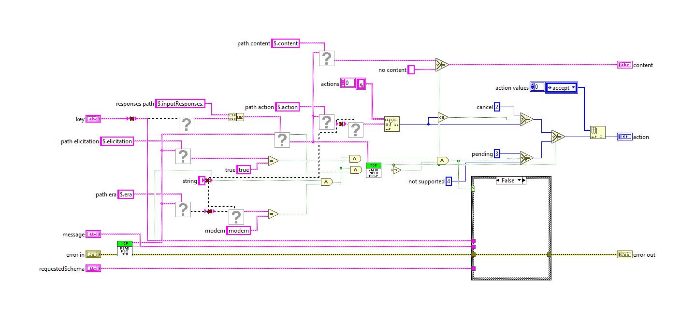 |

| Before | After |
|---|---|
| 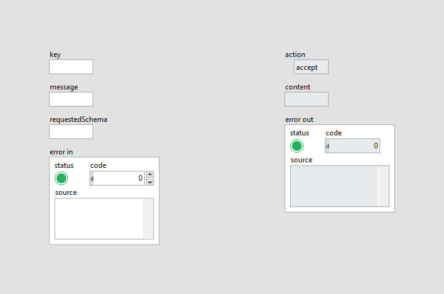 |  |

All case frames (1 hidden frames)

| Frame | Picture |
|---|---|
| Whole diagram, visible frames: Case structure 1: False | 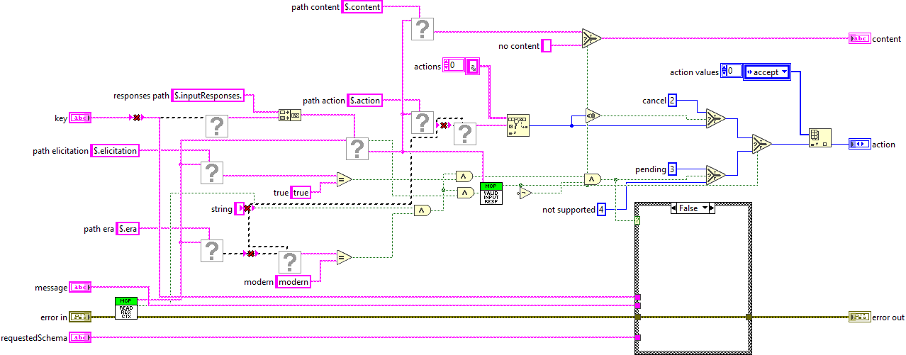 |
| Case structure 1: True |  |

### `src/MCP Server/Check Modern MCP Request.vi` (modified)

**1. Block Diagram objects**

- **1A** Array Constant "modern methods" - data value : changed from "["server/discover", "tools/list", "tools/call", "prompts/list", "prompts/get", "resources/list", "resources/read", "resources/templates/list"]" to "["server/discover", "tools/list", "tools/call", "prompts/list", "prompts/get", "resources/list", "resources/read", "resources/templates/list", "completion/complete"]"

| Before | After |
|---|---|
| 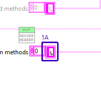 |  |

**2. VI Attribute - Documentation (VI Properties)**

- **2A** description text : changed from "Checks a request against the rules of MCP 2026-07-28 before it is handled, and says whether it is refused, with which HTTP status and which JSON-RPC error body. Only a MODERN request is refused (Read MCP Request Metadata.vi decides the era: params._meta protocolVersion, a modern MCP-Protocol-Version header or the method server/discover). A legacy request is never refused here, except a JSON array that comes with modern headers.  Checked in this order, the first failing check wins: - params._meta missing, or io.modelcontextprotocol/protocolVersion missing in it: 400, -32602 (Invalid params). - MCP-Protocol-Version header missing or different from the _meta protocolVersion: 400, -32020 (header mismatch). - protocolVersion not one of the modern versions of Supported Protocol Versions.vi: 400, -32022 with data.supported and data.requested. - Mcp-Method header missing or different from method: 400, -32020. - tools/call and prompts/get: Mcp-Name must equal params.name; resources/read: params.uri. A value =?base64?...?= is decoded first. Missing or different: 400, -32020. - io.modelcontextprotocol/clientCapabilities missing in params._meta: 400, -32602. - A method the modern era does not have (it has server/discover, tools/list, tools/call, prompts/list, prompts/get, resources/list, resources/read and resources/templates/list; so initialize and ping are refused): 404, -32601. Notifications (no id) are not refused for this. A JSON array (batch) that comes with modern headers (an Mcp-Method header, or a modern MCP-Protocol-Version) is refused with 400, -32600.  A requestState is not checked here but by Resolve Request State.vi, which runs after this VI and only when it did not refuse.  The JSONtext errors are merged and cleared here. error in is passed through unchanged and does not stop the checks." to "Checks a request against the rules of MCP 2026-07-28 before it is handled, and says whether it is refused, with which HTTP status and which JSON-RPC error body. Only a MODERN request is refused (Read MCP Request Metadata.vi decides the era: params._meta protocolVersion, a modern MCP-Protocol-Version header or the method server/discover). A legacy request is never refused here, except a JSON array that comes with modern headers.  Checked in this order, the first failing check wins: - params._meta missing, or io.modelcontextprotocol/protocolVersion missing in it: 400, -32602 (Invalid params). - MCP-Protocol-Version header missing or different from the _meta protocolVersion: 400, -32020 (header mismatch). - protocolVersion not one of the modern versions of Supported Protocol Versions.vi: 400, -32022 with data.supported and data.requested. - Mcp-Method header missing or different from method: 400, -32020. - tools/call and prompts/get: Mcp-Name must equal params.name; resources/read: params.uri. A value =?base64?...?= is decoded first. Missing or different: 400, -32020. - io.modelcontextprotocol/clientCapabilities missing in params._meta: 400, -32602. - A method the modern era does not have (it has server/discover, tools/list, tools/call, prompts/list, prompts/get, resources/list, resources/read, resources/templates/list and completion/complete; so initialize and ping are refused): 404, -32601. Notifications (no id) are not refused for this. A JSON array (batch) that comes with modern headers (an Mcp-Method header, or a modern MCP-Protocol-Version) is refused with 400, -32600.  A requestState is not checked here but by Resolve Request State.vi, which runs after this VI and only when it did not refuse.  The JSONtext errors are merged and cleared here. error in is passed through unchanged and does not stop the checks."

Whole block diagram and front panel

| Before | After |
|---|---|
|  |  |

| Before | After |
|---|---|
|  |  |

### `src/MCP Server/Confirm With User.vi` (modified)

**1. VI Attribute - Documentation (VI Properties)**

- **1A** description text : changed from "Asks the user of the MCP client to confirm something (MCP elicitation without fields), for example before a tool deletes data or moves hardware. A wrapper around Ask User.vi with an empty requestedSchema.  The tool VI runs twice: on the first run pending? is TRUE - return at once and do NOTHING else, no side effects. On the second run confirmed? is TRUE when the user accepted; when it is FALSE (and pending? and not supported? are FALSE) the user declined or cancelled. not supported? is TRUE when the client cannot be asked (a legacy client, or no elicitation capability): fall back to a safe default or refuse.  Works in tools/call and in prompts/get (in a prompt VI) of a modern request. A tool may ask several questions in several rounds; the server carries the earlier answers across the rounds (requestState). key must be unique within the tool. See Ask User.vi for the details and the restrictions of form mode (never ask for passwords or keys)." to "Asks the user of the MCP client to confirm something (MCP elicitation without fields), for example before a tool deletes data or moves hardware. A wrapper around Ask User.vi with an empty requestedSchema.  The tool VI runs twice: on the first run pending? is TRUE - return at once and do NOTHING else, no side effects. On the second run confirmed? is TRUE when the user accepted; when it is FALSE (and pending? and not supported? are FALSE) the user declined or cancelled. An answer that is not valid (not a JSON object with action accept, decline or cancel) counts as no answer: pending? is TRUE again and the question is asked again. not supported? is TRUE when the client cannot be asked (a legacy client, or no elicitation capability): fall back to a safe default or refuse.  Works in tools/call and in prompts/get (in a prompt VI) of a modern request. A tool may ask several questions in several rounds; the server carries the earlier answers across the rounds (requestState). key must be unique within the tool. See Ask User.vi for the details and the restrictions of form mode (never ask for passwords or keys)."

Whole block diagram and front panel

| Before | After |
|---|---|
|  | 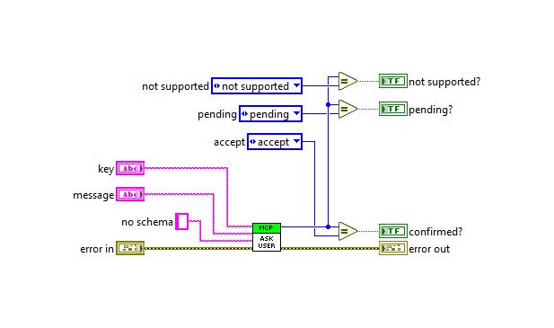 |

| Before | After |
|---|---|
|  |  |

### `src/MCP Server/Finish Tool Call Response.vi` (modified)

**1. Block Diagram objects**

- **1A** SubVI "MCP Server.lvlib:Cached Tool List.vi" - added at (281,235)
- **1B** SubVI "MCP Server.lvlib:tool list.vi" - deleted at (281,235)
- **1C** wiring changes

| Before | After |
|---|---|
| 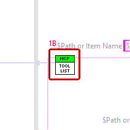 | 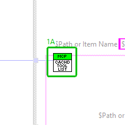 |

Whole block diagram and front panel

| Before | After |
|---|---|
|  | 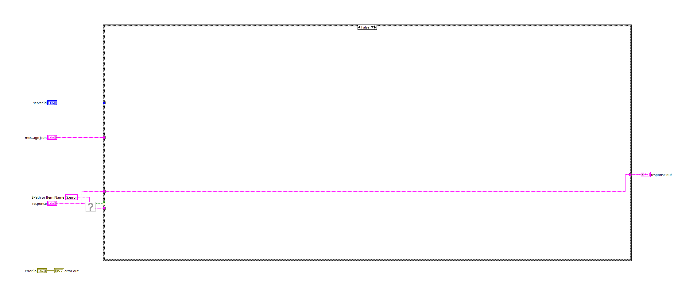 |

| Before | After |
|---|---|
| 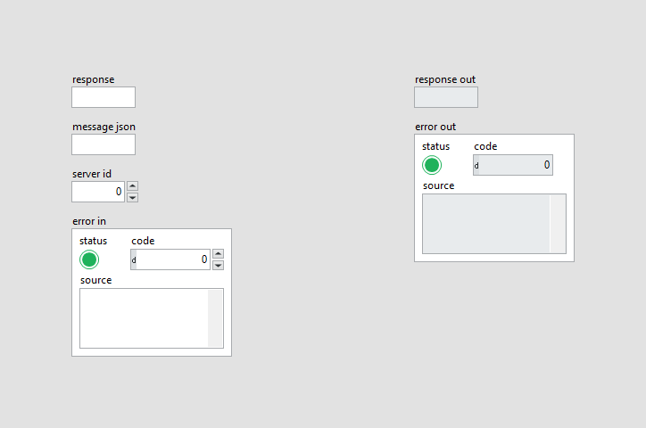 |  |

All case frames (1 hidden frames)

| Frame | Picture |
|---|---|
| Whole diagram, visible frames: Case structure 1: False |  |
| Case structure 1: True | 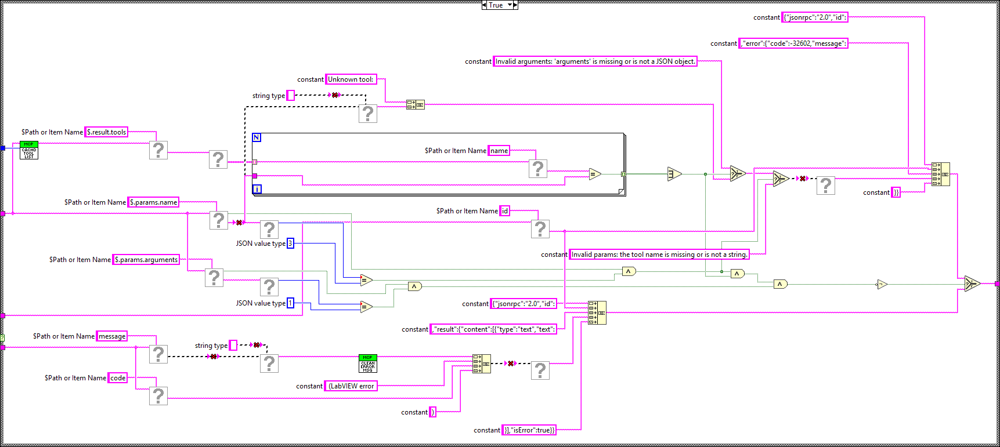 |

### `src/MCP Server/Handle Server Request.vi` (modified)

**1. Block Diagram objects**

- **1A** Case Structure  - number of cases : changed from "13" to "14"
- **1B** Diagram Identifier  - selector value(s) : changed from " Default   "initialize"   "notifications/initialized"   "tools/list"   "tools/call"   "resources/templates/list"   "ping"   "resources/list"   "resources/read"   "prompts/list"   "prompts/get"   "shutdown"   "exit" " to " Default   "initialize"   "notifications/initialized"   "tools/list"   "tools/call"   "resources/templates/list"   "ping"   "resources/list"   "resources/read"   "prompts/list"   "completion/complete"   "prompts/get"   "shutdown"   "exit" "

| Before | After |
|---|---|
|  | 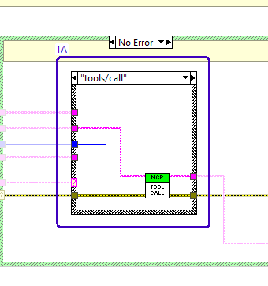 |

**2. Block Diagram objects**

- **2A** SubVI "MCP Server.lvlib:Cached Tool List.vi" - added at (920,-453)
- **2B** SubVI "MCP Server.lvlib:tool list.vi" - deleted at (920,-453)
- **2C** wiring changes

| Before | After |
|---|---|
| 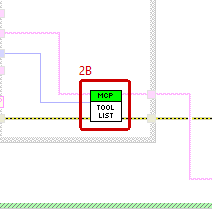 | 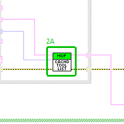 |

**3. Block Diagram objects**

- **3A** Case Structure  - case added : [ "completion/complete" ]
- **3B** SubVI "MCP Server.lvlib:completion complete.vi" - added at (920,-453)

| Before | After |
|---|---|
| 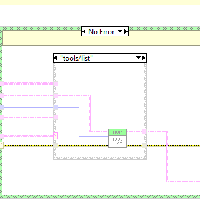 | 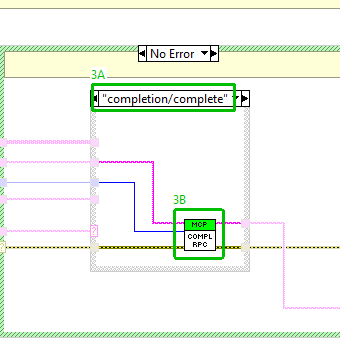 |

Whole block diagram and front panel

| Before | After |
|---|---|
|  | 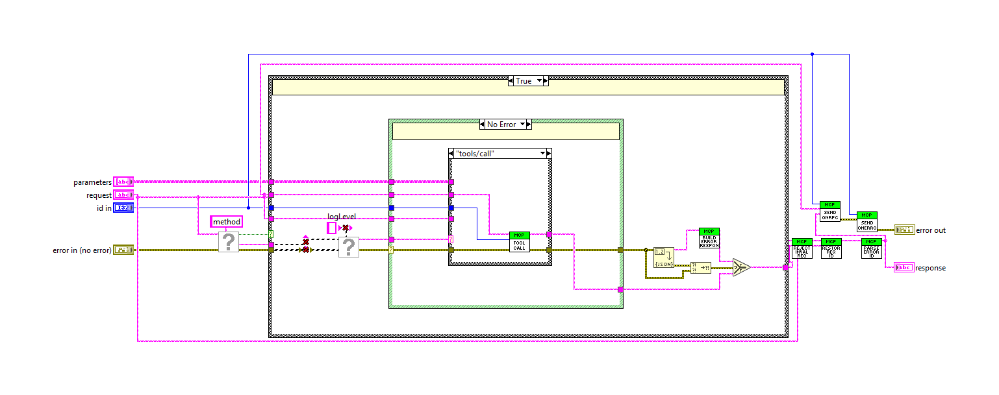 |

| Before | After |
|---|---|
|  |  |

All case frames (15 hidden frames)

| Frame | Picture |
|---|---|
| Whole diagram, visible frames: Case structure 1: True; Case structure 2: No Error; Case structure 3: "tools/call" | 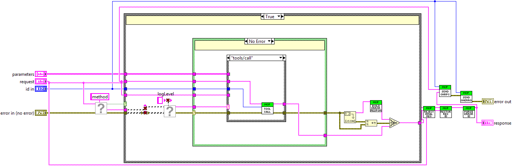 |
| Case structure 1: False |  |
| Case structure 3: Default |  |
| Case structure 3: "initialize" |  |
| Case structure 3: "notifications/initialized" |  |
| Case structure 3: "tools/list" |  |
| Case structure 3: "resources/templates/list" | 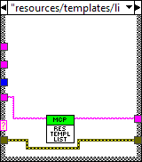 |
| Case structure 3: "ping" |  |
| Case structure 3: "resources/list" |  |
| Case structure 3: "resources/read" |  |
| Case structure 3: "prompts/list" |  |
| Case structure 3: "completion/complete" | 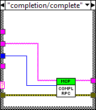 |
| Case structure 3: "prompts/get" |  |
| Case structure 3: "shutdown" |  |
| Case structure 3: "exit" |  |
| Case structure 2: Error .. |  |

### `src/MCP Server/initialize.vi` (modified)

**1. Block Diagram objects**

- **1A** SubVI "MCP Server.lvlib:Add Completions Capability.vi" - added at (83,660)
- **1B** wiring changes

| Before | After |
|---|---|
| 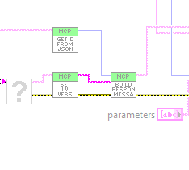 | 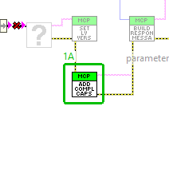 |

Whole block diagram and front panel

| Before | After |
|---|---|
| 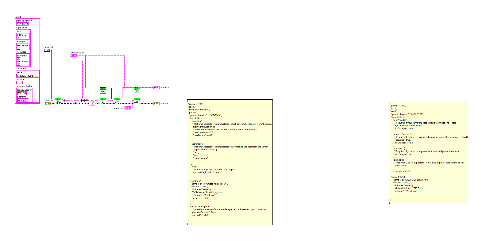 | 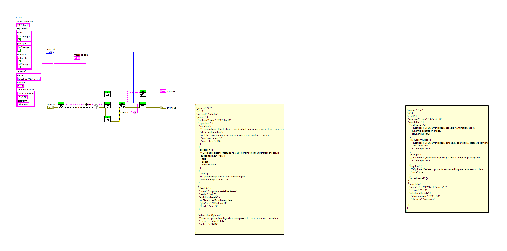 |

| Before | After |
|---|---|
|  | 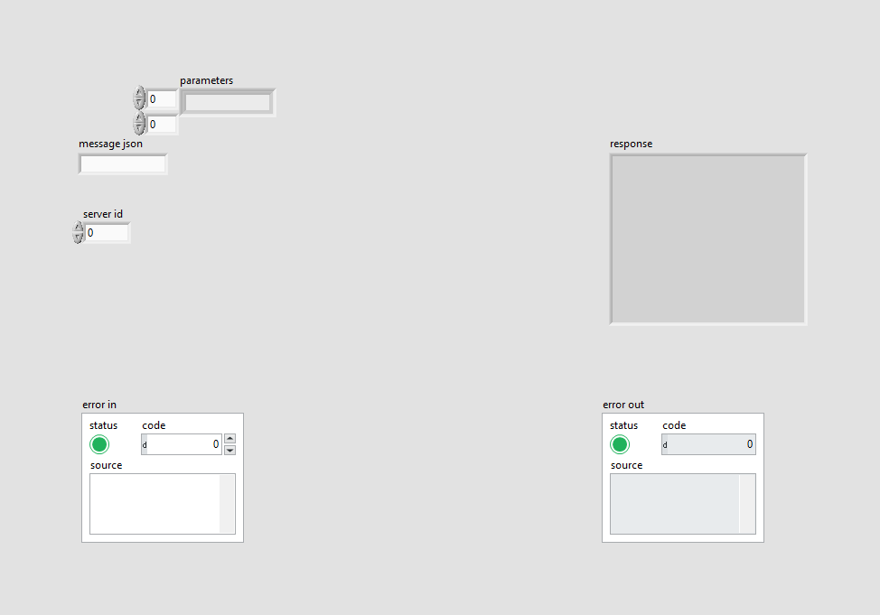 |

### `tests/Test_MCP_Server.vi` (modified)

**1. Block Diagram objects**

- **1A** SubVI "MCP Server tests.lvlib:Add Fixture Custom URI.vi" - added at (2146,544)
- **1B** SubVI "MCP Server tests.lvlib:test completion complete.vi" - added at (5516,520)
- **1C** SubVI "MCP Server tests.lvlib:test resource custom uri.vi" - added at (5516,575)
- **1D** SubVI "MCP Server tests.lvlib:test tools list cache.vi" - added at (5516,632)
- **1E** SubVI "MCP Server tests.lvlib:test invalid input response.vi" - added at (5516,689)
- **1F** wiring changes

| Before | After |
|---|---|
| 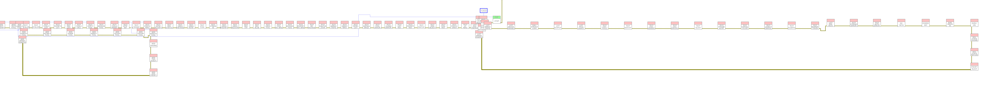 | 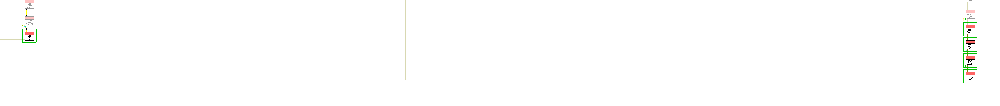 |

Whole block diagram and front panel

| Before | After |
|---|---|
| 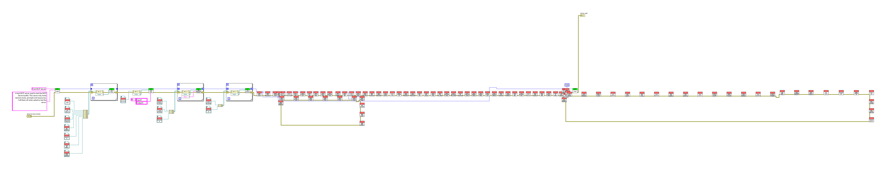 | 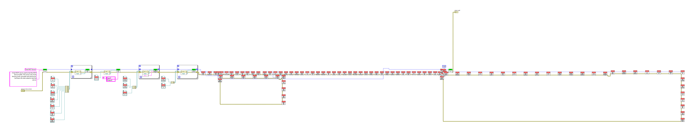 |

| Before | After |
|---|---|
|  |  |

### `examples/Conformance MCP Server/Add Conformance Fixtures.vi` (added)

Block diagram (case structures show their visible frame only):

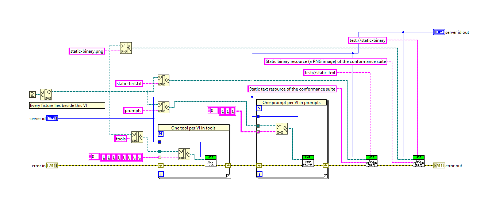

Front panel

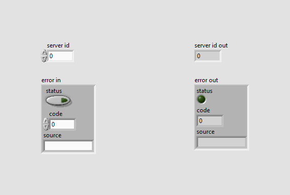

### `examples/Conformance MCP Server/Conformance Main.vi` (added)

Block diagram (case structures show their visible frame only):

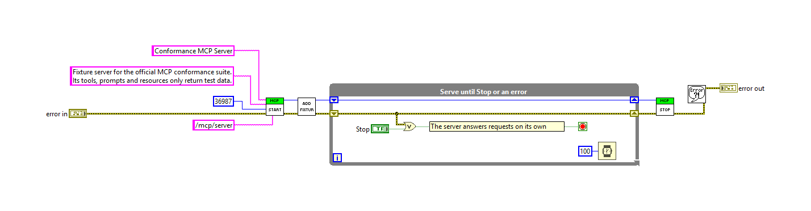

Front panel

### `examples/Conformance MCP Server/prompts/test_input_required_result_prompt.vi` (added)

Block diagram (case structures show their visible frame only):

Front panel

All case frames (1 hidden frames)

| Frame | Picture |
|---|---|
| Whole diagram, visible frames: Case structure 1: True |  |
| Case structure 1: False |  |

### `examples/Conformance MCP Server/prompts/test_prompt_with_arguments.vi` (added)

Block diagram (case structures show their visible frame only):

Front panel

### `examples/Conformance MCP Server/prompts/test_simple_prompt.vi` (added)

Block diagram (case structures show their visible frame only):

Front panel

### `examples/Conformance MCP Server/tools/test_error_handling.vi` (added)

Block diagram (case structures show their visible frame only):

Front panel

### `examples/Conformance MCP Server/tools/test_image_content.vi` (added)

Block diagram (case structures show their visible frame only):

Front panel

### `examples/Conformance MCP Server/tools/test_input_required_result_elicitation.vi` (added)

Block diagram (case structures show their visible frame only):

Front panel

All case frames (1 hidden frames)

| Frame | Picture |
|---|---|
| Whole diagram, visible frames: Case structure 1: True |  |
| Case structure 1: False |  |

### `examples/Conformance MCP Server/tools/test_input_required_result_multi_round.vi` (added)

Block diagram (case structures show their visible frame only):

Front panel

All case frames (2 hidden frames)

| Frame | Picture |
|---|---|
| Whole diagram, visible frames: Case structure 1: True; Case structure 2: True |  |
| Case structure 1: False |  |
| Case structure 2: False |  |

### `examples/Conformance MCP Server/tools/test_input_required_result_request_state.vi` (added)

Block diagram (case structures show their visible frame only):

Front panel

All case frames (1 hidden frames)

| Frame | Picture |
|---|---|
| Whole diagram, visible frames: Case structure 1: True |  |
| Case structure 1: False |  |

### `examples/Conformance MCP Server/tools/test_input_required_result_tampered_state.vi` (added)

Block diagram (case structures show their visible frame only):

Front panel

All case frames (1 hidden frames)

| Frame | Picture |
|---|---|
| Whole diagram, visible frames: Case structure 1: True |  |
| Case structure 1: False |  |

### `examples/Conformance MCP Server/tools/test_simple_text.vi` (added)

Block diagram (case structures show their visible frame only):

Front panel

### `examples/Conformance MCP Server/tools/test_tool_with_progress.vi` (added)

Block diagram (case structures show their visible frame only):

Front panel

### `src/MCP Server/Add Completions Capability.vi` (added)

Block diagram (case structures show their visible frame only):

Front panel

### `src/MCP Server/Cached Tool List.vi` (added)

Block diagram (case structures show their visible frame only):

Front panel

All case frames (1 hidden frames)

| Frame | Picture |
|---|---|
| Whole diagram, visible frames: Case structure 1: True |  |
| Case structure 1: False |  |

### `src/MCP Server/Resource URI.vi` (added)

Block diagram (case structures show their visible frame only):

Front panel

### `src/MCP Server/Tool List Cache.vi` (added)

Block diagram (case structures show their visible frame only):

Front panel

All case frames (1 hidden frames)

| Frame | Picture |
|---|---|
| Whole diagram, visible frames: Case structure 1: True |  |
| Case structure 1: False |  |

### `src/MCP Server/Valid Input Response.vi` (added)

Block diagram (case structures show their visible frame only):

Front panel

### `src/MCP Server/completion complete.vi` (added)

Block diagram (case structures show their visible frame only):

Front panel

### `tests/Add Fixture Custom URI.vi` (added)

Block diagram (case structures show their visible frame only):

Front panel

### `tests/fake tool added later.vi` (added)

Block diagram (case structures show their visible frame only):

Front panel

### `tests/test completion complete.vi` (added)

Block diagram (case structures show their visible frame only):

Front panel

### `tests/test invalid input response.vi` (added)

Block diagram (case structures show their visible frame only):

Front panel

### `tests/test resource custom uri.vi` (added)

Block diagram (case structures show their visible frame only):

Front panel

### `tests/test tools list cache.vi` (added)

Block diagram (case structures show their visible frame only):

Front panel

