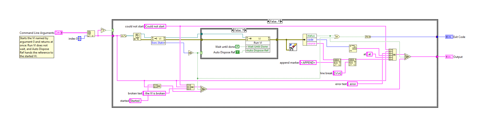
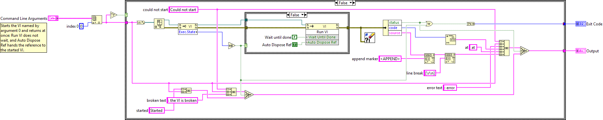
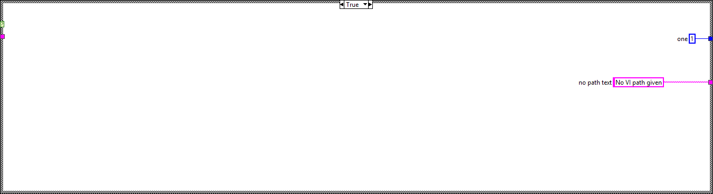
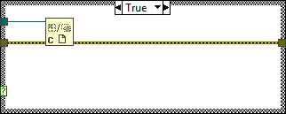

## VI diff report

0 modified, 1 added, 0 deleted. Generated by LabVIEW's VI comparison; position and size changes are not shown.

### `tools/ci/Start VI.vi` (added)

Block diagram (case structures show their visible frame only):

Front panel

All case frames (2 hidden frames)

| Frame | Picture |
|---|---|
| Whole diagram, visible frames: Case structure 1: False; Case structure 2: False |  |
| Case structure 1: True |  |
| Case structure 2: True |  |

