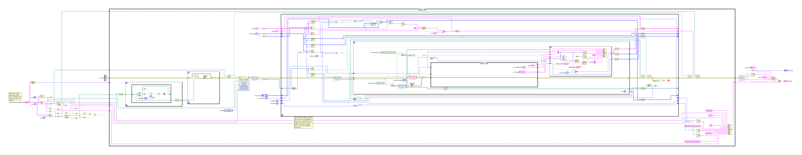

## VI diff report

0 modified, 1 added, 0 deleted. Generated by LabVIEW's VI comparison; position and size changes are not shown.

### `tools/ci/Print Diagram Frames.vi` (added)

Block diagram (case structures show their visible frame only):

Front panel

