## VI diff report

10 modified, 46 added, 3 deleted. Generated by LabVIEW's VI comparison; position and size changes are not shown.

### `examples/Full Featured MCP Server/Buy Any.vi` (modified)

**1. Block Diagram objects**

- **1A** String Constant "format string" - data value : changed from ""Investigate current stock prices. Query the prices and see which stocks are below %s€. Buy all once."" to ""Look at all stocks below %s € per share.\nBefore you buy anything, read the company descriptions (get_stock_info) and the latest news (get_news),\nand look at the price history of your candidates (get_history_chart).\nBuy one share of each stock you consider worth buying, skip the ones the descriptions or\nthe news warn about, and check get_wallet first.\nAfterwards list what you bought, what you skipped and why.""

| Before | After |
|---|---|
| 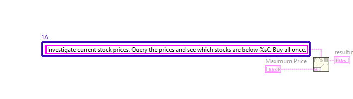 | 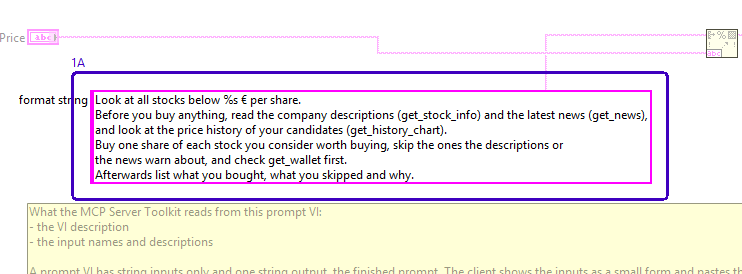 |

**4. VI Attribute - Documentation (VI Properties)**

- **4A** description text : changed from "Buys any stocks below the maximum price once." to "Buys one share of every stock that is worth buying and costs less than the maximum price."

**5. VI Attribute - Execution (VI Properties)**

- **5A** Automatic Error Handling

**6. VI Attribute - Miscellaneous**

- **6A** VI icon

| Before | After |
|---|---|
|  |  |

Whole block diagram and front panel

| Before | After |
|---|---|
| 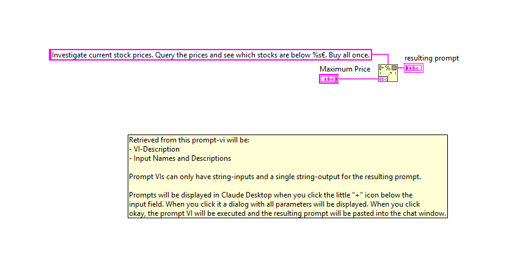 | 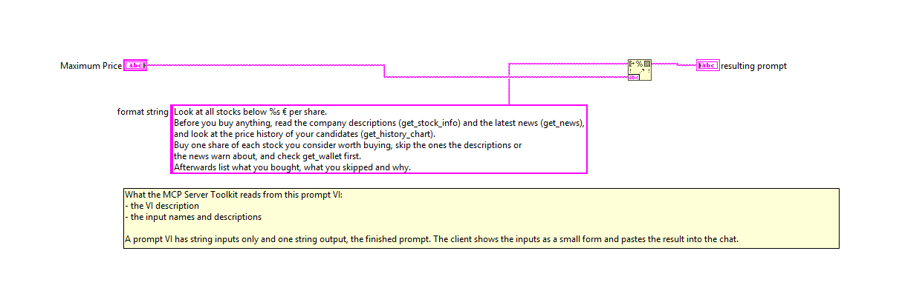 |

| Before | After |
|---|---|
| 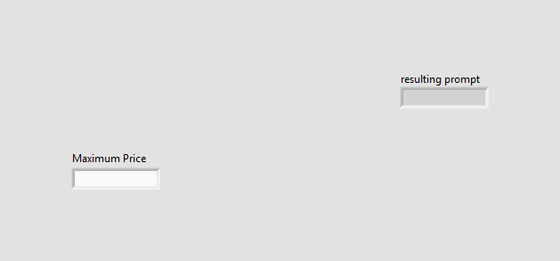 |  |

### `examples/Full Featured MCP Server/Buy Stock.vi` (modified)

**1. Block Diagram objects**

- **1A** Front Panel Terminal "quantity" - added at (40,102)
- **1B** Front Panel Terminal "error in" - added at (40,164)
- **1C** Type Definition "Mode" - added at (129,225)
- **1D** Case Structure  - deleted at (295,144)
- **1E** Tunnel  - deleted at (295,164)
- **1F** Tunnel  - deleted at (295,176)
- **1G** Front Panel Terminal "Order" - data type : changed
- **1H** Front Panel Terminal "Order" - data type name : changed from "Response" to "Order"
- **1I** String Constant "format string" - deleted at (360,164)
- **1J** Format Into String  - deleted at (607,180)
- **1K** String Constant  - deleted at (606,177)
- **1L** Tunnel  - deleted at (650,182)
- **1M** wiring changes

| Before | After |
|---|---|
| 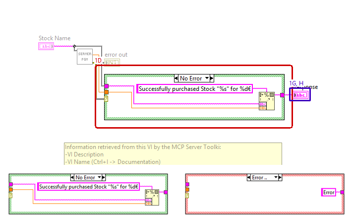 | 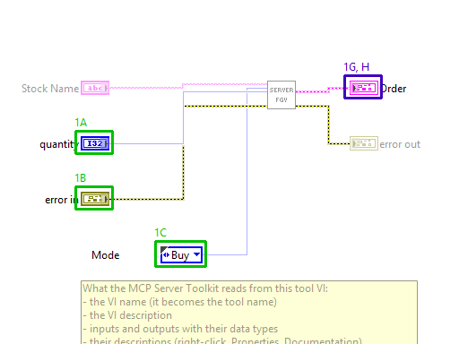 |

**2. Front Panel - Panel**

- **2A** Connector Pane  - control/indicator assignment : changed

| Before | After |
|---|---|
| 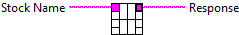 | 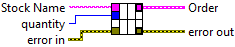 |

**4. Front Panel - String**

- **4A** Cluster "Order" - data type : changed
- **4B** Cluster "Order" - data type name : changed from "Response" to "Order"

| Before | After |
|---|---|
| 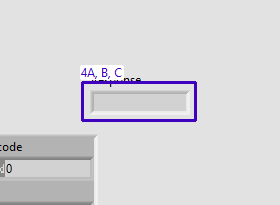 | 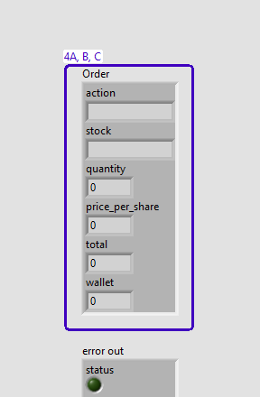 |

**6. Front Panel objects**

- **6A** Cluster "error in" - added at (16,169)

| Before | After |
|---|---|
| 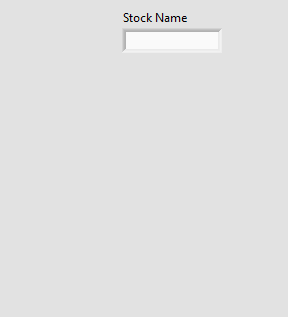 | 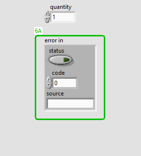 |

**7. Front Panel objects**

- **7A** Numeric "quantity" - added at (27,101)

| Before | After |
|---|---|
| 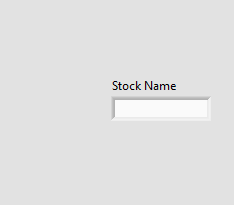 | 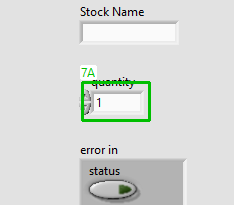 |

**8. VI Attribute - Documentation (VI Properties)**

- **8A** description text : changed from "Buys the stock with the given name and returns a confirmation text with the purchase price. Returns the text Error if the purchase failed." to "Buys shares of one stock at the current price and returns what was bought: stock, quantity, price per share, total and the wallet afterwards. The order is refused with an error that says why when the name is unknown or the wallet does not cover price times quantity."

**9. VI Attribute - Execution (VI Properties)**

- **9A** Automatic Error Handling

**10. VI Attribute - Miscellaneous**

- **10A** VI icon

| Before | After |
|---|---|
|  |  |

Whole block diagram and front panel

| Before | After |
|---|---|
| 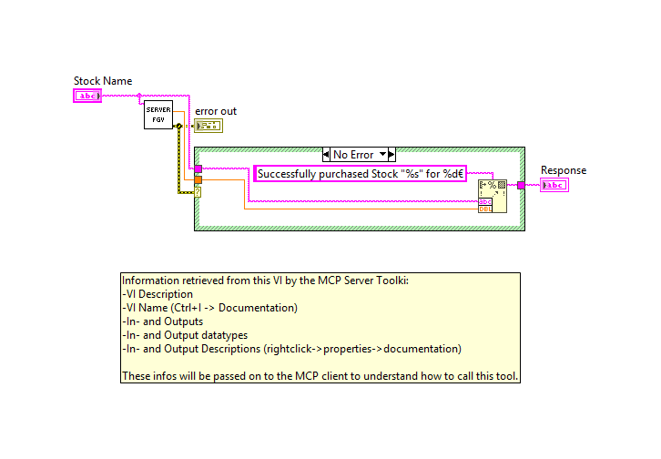 | 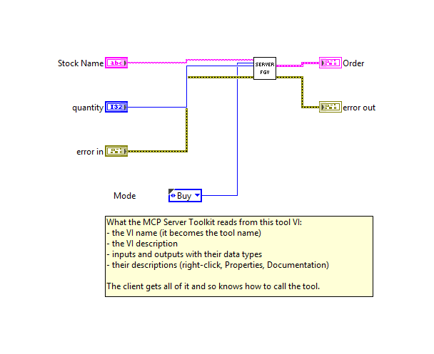 |

| Before | After |
|---|---|
| 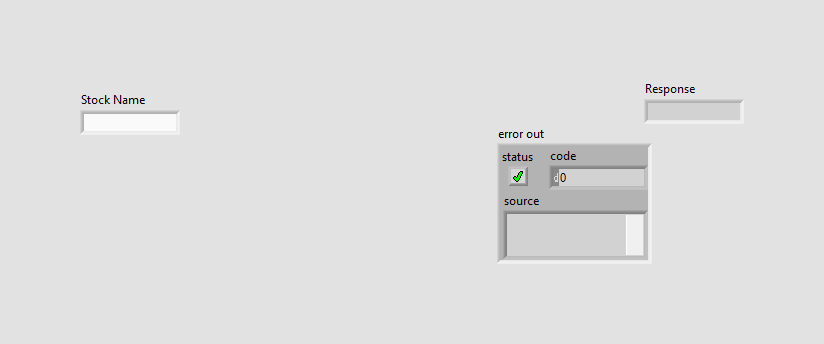 | 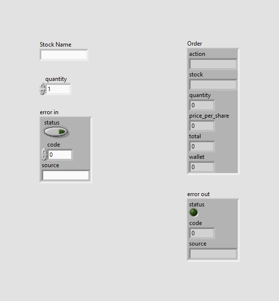 |

### `examples/Full Featured MCP Server/Find Best Trending Stock.vi` (modified)

**1. Block Diagram objects**

- **1A** String Constant "format string" - data value : changed from ""Investigate current stock price and compare them to prices in the past to see which stocks are trending up or down.\nVerify your picks by looking at their history graph. Find the best trending stock.\nIgnore any stocks above %s€."" to ""Find the stock most worth buying right now. Ignore any stock above %s € per share.\n1. Call get_stock_info and read the company descriptions:\n   they tell you how solid each business is.\n2. Call get_news and read the latest headlines. Check move_since_percent to see whether\n   a piece of news is already in the price, and watch for stories that are still unfolding.\n3. Compare the prices now and a few minutes ago (get_stock_prices)\n   and verify your favourites with get_history_chart.\nName your pick and one runner-up, and explain the choice:\nwhat the description says, what the news say and what the chart shows.""

| Before | After |
|---|---|
| 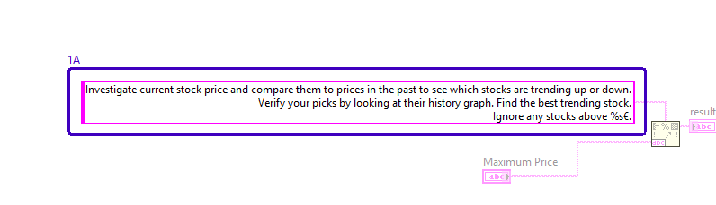 | 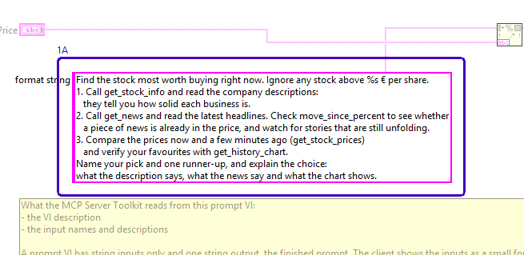 |

**4. VI Attribute - Documentation (VI Properties)**

- **4A** description text : changed from "Investigates current and past prices to detect best trending stocks. Ignores stocks above maximum price." to "Researches the market and names the stock most worth buying. Stocks above the maximum price are ignored."

**5. VI Attribute - Execution (VI Properties)**

- **5A** Automatic Error Handling

**6. VI Attribute - Miscellaneous**

- **6A** VI icon

| Before | After |
|---|---|
|  |  |

Whole block diagram and front panel

| Before | After |
|---|---|
| 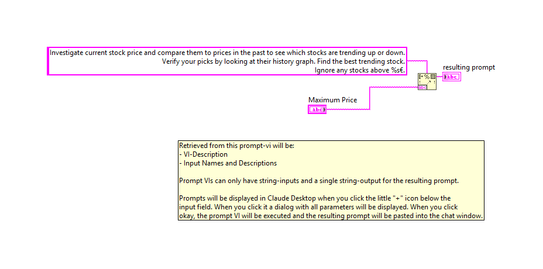 | 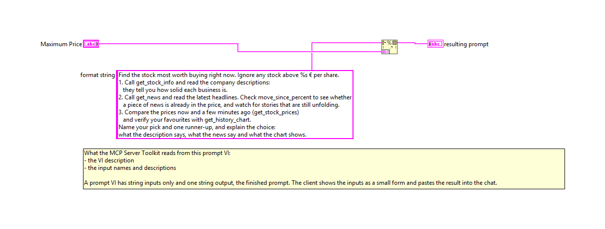 |

| Before | After |
|---|---|
| 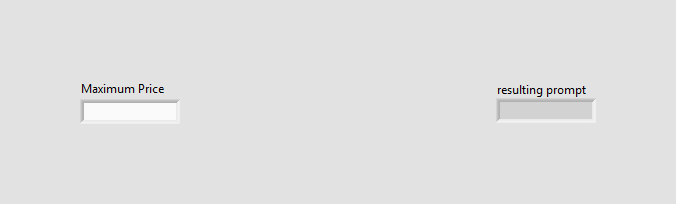 | 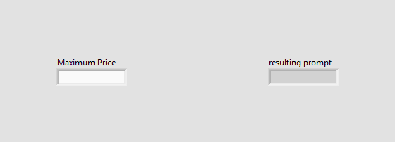 |

### `examples/Full Featured MCP Server/Get History Chart.vi` (modified)

**1. Block Diagram objects**

- **1A** Front Panel Terminal - control vs. indicator
- **1B** Front Panel Terminal "error in" - data type : changed
- **1C** Front Panel Terminal "error in" - data type name : changed from "Waveform Graph" to "error in"
- **1D** SubVI "Full Featured MCP Server.lvlib:Stock Names.vi" - added at (40,288)
- **1E** Type Definition "Mode" - added at (130,225)
- **1F** Unbundle By Name  - number of elements : changed from "2" to "1"
- **1G** Unbundle By Name  - element 1 deleted : "Stocks Prices"
- **1H** Unbundle By Name  - element replaced : changed from "Stock Names" to "price history"
- **1I** Flat Sequence Structure  - deleted at (541,174)
- **1J** Sequence Tunnel  - deleted at (541,215)
- **1K** Numeric Constant "whole history" - added at (590,94)
- **1L** Index Array  - diagram scope : changed
- **1M** Round To Nearest  - added at (669,101)
- **1N** Less Or Equal?  - added at (669,163)
- **1O** Array Size  - added at (755,162)
- **1P** To Long Integer  - added at (759,106)
- **1Q** Increment  - added at (853,101)
- **1R** Sequence Tunnel  - deleted at (903,264)
- **1S** Greater?  - added at (945,101)
- **1T** Or  - added at (1037,103)
- **1U** Select  - added at (1125,97)
- **1V** Subtract  - added at (1221,163)
- **1W** Decrement  - added at (1221,225)
- **1X** String Constant "format string" - data value : changed from ""Successfully displayed Stock "%s""" to ""%s: price in € over the last %d seconds (0 = now)""
- **1Y** Array Subset  - added at (1603,95)
- **1Z** Format Into String  - number of terminals : changed from "6" to "7"
- **127** SubVI "Full Featured MCP Server.lvlib:Draw Price Chart.vi" - added at (1695,95)
- **128** Tunnel  - added at (487,143)
- **129** Tunnel  - added at (487,167)
- **130** Tunnel  - added at (487,191)
- **131** wiring changes

| Before | After |
|---|---|
| 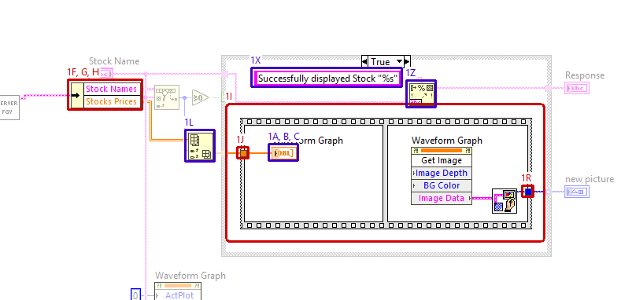 | 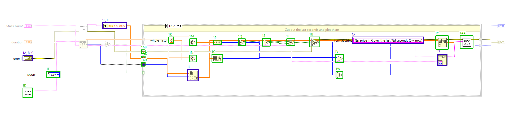 |

**2. Block Diagram objects**

- **2A** Numeric Constant "Active Plot" - deleted at (402,391)
- **2B** Property Node "Waveform Graph" - deleted at (432,383)
- **2C** wiring changes

| Before | After |
|---|---|
| 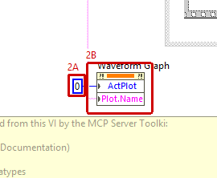 | 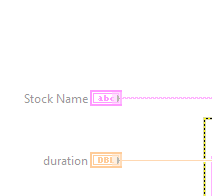 |

**3. Block Diagram objects**

- **3A** String Constant "format string" - data value : changed from ""Stock "%s" not found."" to ""Unknown stock "%s". Call get_stock_names for the exact names.""
- **3B** Cluster Constant "unknown stock" - added at (983,95)
- **3C** Bundle By Name  - added at (1075,95)
- **3D** Merge Errors  - added at (1193,95)
- **3E** Tunnel  - added at (487,143)
- **3F** wiring changes

| Before | After |
|---|---|
| 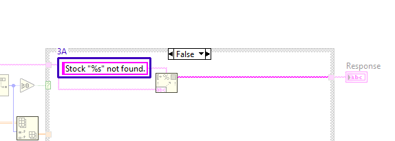 | 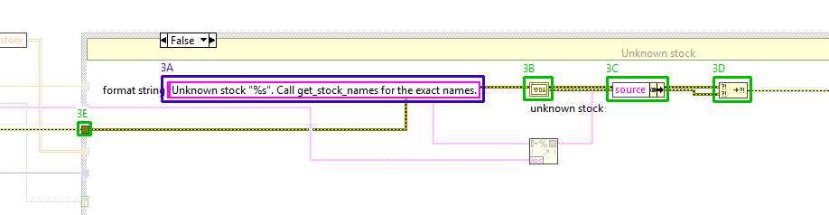 |

**4. Block Diagram objects**

- **4A** Invoke Node "Waveform Graph" - deleted at (758,211)
- **4B** SubVI "Draw Flattened Pixmap.vi" - deleted at (861,264)
- **4C** Sequence Tunnel  - deleted at (903,264)

| Before | After |
|---|---|
| 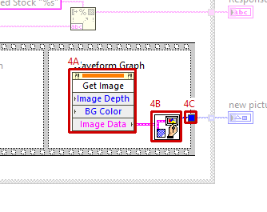 | 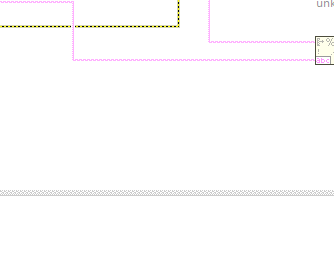 |

**5. Block Diagram objects**

- **5A** Front Panel Terminal "error out" - data type : changed
- **5B** Front Panel Terminal "error out" - data type name : changed from "Response" to "error out"

| Before | After |
|---|---|
| 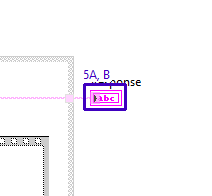 | 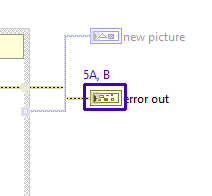 |

**6. Front Panel - Panel**

- **6A** Panel - tabbing order
- **6B** Connector Pane  - control/indicator assignment : changed

| Before | After |
|---|---|
| 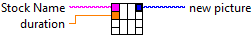 | 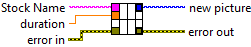 |

**9. Front Panel - Waveform Graph**

- **9A** Waveform Graph - control vs. indicator
- **9B** Cluster "error in" - data type : changed
- **9C** Cluster "error in" - data type name : changed from "Waveform Graph" to "error in"

| Before | After |
|---|---|
| 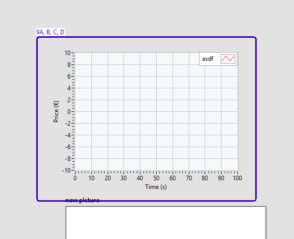 | 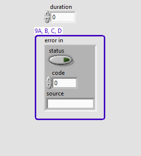 |

**12. Front Panel - String**

- **12A** Cluster "error out" - data type : changed
- **12B** Cluster "error out" - data type name : changed from "Response" to "error out"

| Before | After |
|---|---|
| 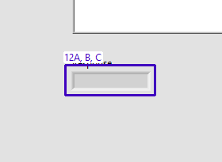 | 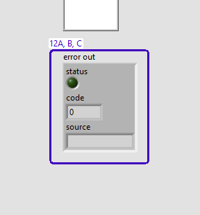 |

**13. VI Attribute - Documentation (VI Properties)**

- **13A** description text : changed from "Returns a picture of a graph of the specified stock for the last time specified by duration." to "Returns a picture of the price chart of one stock for the last duration seconds. The y axis is the price in euros, the x axis the time in seconds with 0 = now at the right edge. Use it to see the trend of a stock and how it reacted to news."

**14. VI Attribute - Execution (VI Properties)**

- **14A** Automatic Error Handling

**15. VI Attribute - Miscellaneous**

- **15A** VI icon

| Before | After |
|---|---|
|  |  |

Whole block diagram and front panel

| Before | After |
|---|---|
| 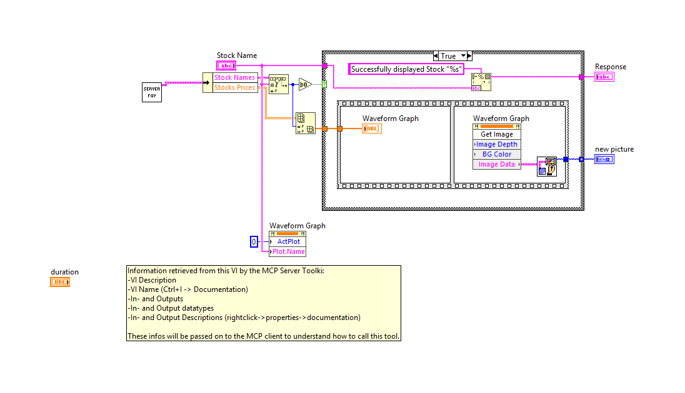 | 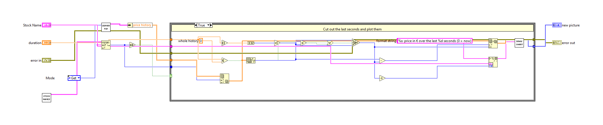 |

| Before | After |
|---|---|
| 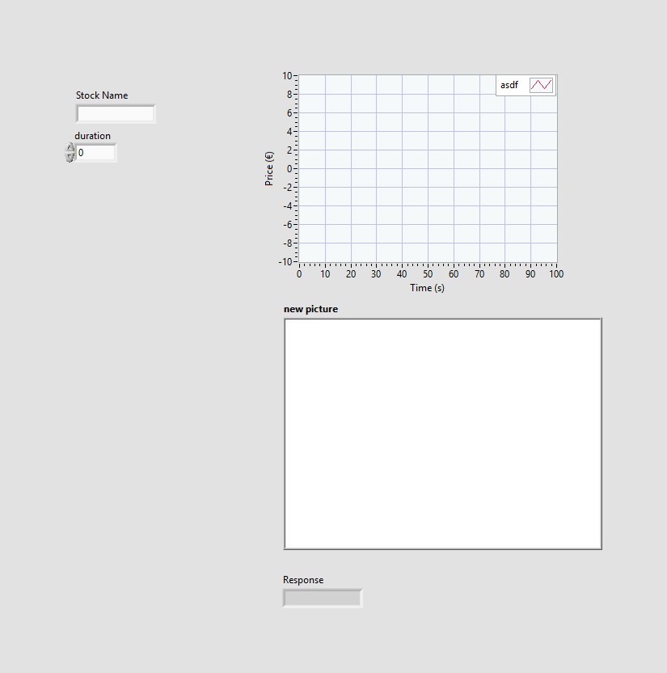 | 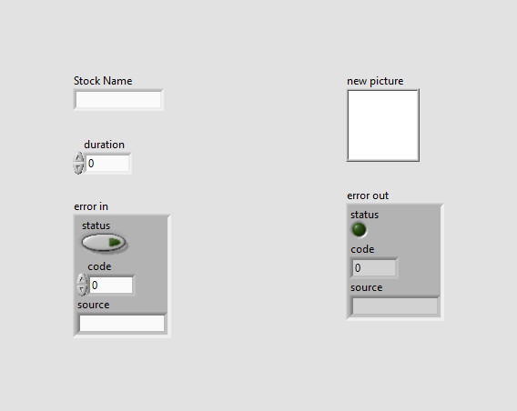 |

All case frames (1 hidden frames)

| Frame | Picture |
|---|---|
| Whole diagram, visible frames: Case structure 1: True | 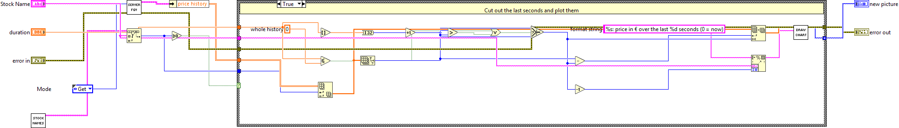 |
| Case structure 1: False | 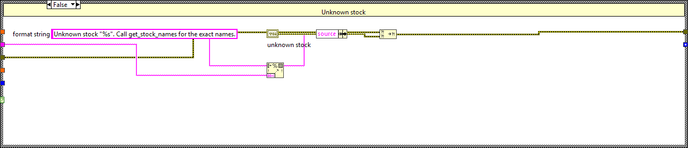 |

### `examples/Full Featured MCP Server/Get Owned Stocks.vi` (modified)

**1. Block Diagram objects**

- **1A** Front Panel Terminal "error in" - added at (40,40)
- **1B** SubVI "Full Featured MCP Server.lvlib:Stock Names.vi" - added at (40,164)
- **1C** Type Definition "Mode" - added at (130,101)
- **1D** Front Panel Terminal "error out" - data type : changed
- **1E** Front Panel Terminal "error out" - data type name : changed from "Owned Stocks" to "error out"
- **1F** Unbundle By Name  - number of elements : changed from "1" to "2"
- **1G** Unbundle By Name  - element replaced : changed from "Owned Stocks" to "price history"
- **1H** Unbundle By Name  - element 1 added : "owned"
- **1I** SubVI "Full Featured MCP Server.lvlib:Prices At.vi" - added at (487,40)
- **1J** For Loop  - added at (579,40)
- **1K** Greater Than 0?  - added at (625,93)
- **1L** Multiply  - added at (625,155)
- **1M** SubVI "Full Featured MCP Server.lvlib:Round To Cents.vi" - added at (711,174)
- **1N** Cluster Constant "position" - added at (757,86)
- **1O** Bundle By Name  - added at (837,87)
- **1P** Loop Tunnel  - added at (579,101)
- **1Q** Loop Tunnel  - added at (579,125)
- **1R** Loop Tunnel  - added at (579,149)
- **1S** Loop Tunnel  - added at (935,77)
- **1T** Loop Tunnel  - added at (935,101)
- **1U** Front Panel Terminal "Owned Stocks" - added at (1004,40)
- **1V** Add Array Elements  - added at (1008,106)
- **1W** SubVI "Full Featured MCP Server.lvlib:Round To Cents.vi" - added at (1096,40)
- **1X** Front Panel Terminal "Total Value" - added at (1188,40)
- **1Y** wiring changes

| Before | After |
|---|---|
| 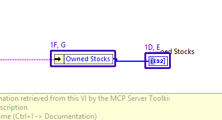 | 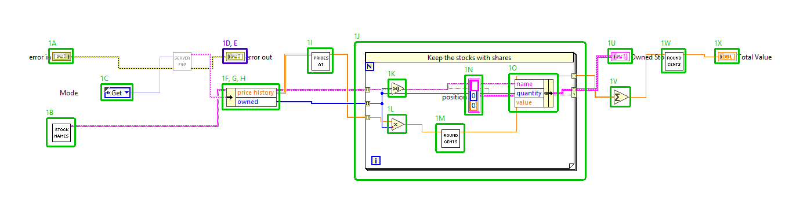 |

**2. Front Panel - Panel**

- **2A** Connector Pane  - control/indicator assignment : changed

| Before | After |
|---|---|
| 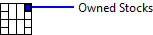 |  |

**3. Front Panel - Array**

- **3A** Cluster "error out" - data type name : changed from "Owned Stocks" to "error out"

| Before | After |
|---|---|
|  |  |

**4. Front Panel objects**

- **4A** Cluster "error in" - added at (16,29)

| Before | After |
|---|---|
|  |  |

**5. Front Panel objects**

- **5A** Numeric "Total Value" - added at (316,170)

| Before | After |
|---|---|
|  |  |

**6. Front Panel objects**

- **6A** Array "Owned Stocks" - added at (357,31)

| Before | After |
|---|---|
|  |  |

**7. VI Attribute - Documentation (VI Properties)**

- **7A** description text : changed from "Returns an array of integers representing all stocks and how many you own of them." to "Returns the stocks you own: name, quantity and current value in euros of each position, and the value of the whole portfolio. Stocks you do not own are left out. The money in the wallet is not included; see get_wallet."

**8. VI Attribute - Execution (VI Properties)**

- **8A** Automatic Error Handling

Whole block diagram and front panel

| Before | After |
|---|---|
|  |  |

| Before | After |
|---|---|
|  |  |

### `examples/Full Featured MCP Server/Get Stock Names.vi` (modified)

**1. Block Diagram objects**

- **1A** Front Panel Terminal "error in" - added at (40,40)
- **1B** Front Panel Terminal "error out" - added at (132,102)

| Before | After |
|---|---|
|  |  |

**2. Block Diagram objects**

- **2A** SubVI "Full Featured MCP Server.lvlib:Stock Names.vi" - added at (40,102)
- **2B** Front Panel Terminal "Stock Names" - data type name : changed from "Stock Names" to "Stock Names"
- **2C** SubVI "Full Featured MCP Server.lvlib:Server FGV.vi" - deleted at (164,274)
- **2D** Unbundle By Name  - deleted at (267,272)
- **2E** wiring changes

| Before | After |
|---|---|
|  |  |

**3. Front Panel - Panel**

- **3A** Connector Pane  - control/indicator assignment : changed

| Before | After |
|---|---|
|  |  |

**4. Front Panel - Array**

- **4A** String  - data type name : changed from "String" to ""

| Before | After |
|---|---|
|  |  |

**5. Front Panel objects**

- **5A** Cluster "error in" - added at (16,29)

| Before | After |
|---|---|
|  |  |

**6. Front Panel objects**

- **6A** Cluster "error out" - added at (316,107)

| Before | After |
|---|---|
|  |  |

**7. VI Attribute - Documentation (VI Properties)**

- **7A** description text : changed from "Returns the names of all stocks in same order as all other tools return the stocks." to "Returns the names of all stocks. Every other tool returns the stocks in this order and expects these exact names."

**8. VI Attribute - Execution (VI Properties)**

- **8A** Automatic Error Handling

**9. VI Attribute - Miscellaneous**

- **9A** VI icon

| Before | After |
|---|---|
|  |  |

Whole block diagram and front panel

| Before | After |
|---|---|
|  |  |

| Before | After |
|---|---|
|  |  |

### `examples/Full Featured MCP Server/Get Stock Prices.vi` (modified)

**1. Block Diagram objects**

- **1A** Front Panel Terminal "error in" - added at (40,102)
- **1B** Type Definition "Mode" - added at (130,163)
- **1C** Front Panel Terminal "error out" - added at (340,40)
- **1D** Unbundle By Name  - element replaced : changed from "Stocks Prices" to "price history"
- **1E** Array Size  - deleted at (401,300)
- **1F** Index Array  - deleted at (443,301)
- **1G** SubVI "Full Featured MCP Server.lvlib:Prices At.vi" - added at (487,40)
- **1H** Decrement  - deleted at (490,321)
- **1I** Subtract  - deleted at (527,326)
- **1J** Index Array  - deleted at (559,285)
- **1K** For Loop  - added at (579,40)
- **1L** SubVI "Full Featured MCP Server.lvlib:Round To Cents.vi" - added at (619,87)
- **1M** Loop Tunnel  - added at (579,101)
- **1N** Loop Tunnel  - added at (770,77)
- **1O** Front Panel Terminal "Prices" - data type name : changed from "Prices" to "Prices"
- **1P** wiring changes

| Before | After |
|---|---|
|  |  |

**2. Front Panel - Panel**

- **2A** Connector Pane  - control/indicator assignment : changed

| Before | After |
|---|---|
|  |  |

**5. Front Panel - Array**

- **5A** Numeric  - data type name : changed from "Numeric" to ""

| Before | After |
|---|---|
|  |  |

**6. Front Panel objects**

- **6A** Cluster "error in" - added at (16,99)

| Before | After |
|---|---|
|  |  |

**7. Front Panel objects**

- **7A** Cluster "error out" - added at (316,107)

| Before | After |
|---|---|
|  |  |

**8. VI Attribute - Documentation (VI Properties)**

- **8A** description text : changed from "Teturns all  prices of the stocks for a specific point in time. Use this twice to compare price changes." to "Returns the prices of all stocks, in euros, at one point in time, in the order of get_stock_names. Call it twice with different times to compare prices."

**9. VI Attribute - Execution (VI Properties)**

- **9A** Automatic Error Handling

**10. VI Attribute - Miscellaneous**

- **10A** VI icon

| Before | After |
|---|---|
|  |  |

Whole block diagram and front panel

| Before | After |
|---|---|
|  |  |

| Before | After |
|---|---|
|  |  |

### `examples/Full Featured MCP Server/Get Wallet.vi` (modified)

**1. Block Diagram objects**

- **1A** Front Panel Terminal "error in" - added at (40,40)
- **1B** Type Definition "Mode" - added at (130,101)
- **1C** Front Panel Terminal "error out" - added at (340,40)
- **1D** Unbundle By Name  - element replaced : changed from "Wallet" to "wallet"
- **1E** SubVI "Full Featured MCP Server.lvlib:Round To Cents.vi" - added at (455,40)
- **1F** wiring changes

| Before | After |
|---|---|
|  |  |

**2. Front Panel - Panel**

- **2A** Connector Pane  - control/indicator assignment : changed

| Before | After |
|---|---|
|  |  |

**4. Front Panel objects**

- **4A** Cluster "error in" - added at (16,29)

| Before | After |
|---|---|
|  |  |

**5. Front Panel objects**

- **5A** Cluster "error out" - added at (316,99)

| Before | After |
|---|---|
|  |  |

**6. VI Attribute - Documentation (VI Properties)**

- **6A** description text : changed from "Returns the currently available money to spend on stocks." to "Returns the money you have available to buy stocks, in euros."

**7. VI Attribute - Execution (VI Properties)**

- **7A** Automatic Error Handling

Whole block diagram and front panel

| Before | After |
|---|---|
|  |  |

| Before | After |
|---|---|
|  |  |

### `examples/Full Featured MCP Server/Server FGV.vi` (modified)

**1. Block Diagram objects**

- **1A** Front Panel Terminal - control vs. indicator
- **1B** Front Panel Terminal "Mode" - data type name : changed from "purchase price" to "Mode"
- **1C** Front Panel Terminal "Mode" - numeric representation : changed from "'purchase price': double [64-bit real (~15 digit precision)] " to "'Mode': typedef 'Full Featured MCP Server.lvlib:Market Mode.ctl'\r\nunsigned word [16-bit integer (0 to 65535)] enum {Get, Init, Advance, Buy, Sell} "
- **1D** Front Panel Terminal "stock name" - data type name : changed from "Stock Name" to "stock name"
- **1E** Front Panel Terminal "quantity" - data type name : changed from "Mode (Get All)" to "quantity"
- **1F** Front Panel Terminal "quantity" - numeric representation : changed from "'Mode (Get All)': typedef 'Full Featured MCP Server.lvlib:Server FGV Modes.ctl'\r\nunsigned word [16-bit integer (0 to 65535)] enum {Update Stocks, Buy Stock, Get All, Init} " to "'quantity': long [32-bit integer (-2147483648 to 2147483647)] "
- **1G** Front Panel Terminal "error in" - data type name : changed from "error in (no error)" to "error in"
- **1H** While Loop  - added at (132,40)
- **1I** Boolean Constant "once" - added at (208,87)
- **1J** Case Structure  - added at (284,87)
- **1K** SubVI "Full Featured MCP Server.lvlib:Initialise Market.vi" - added at (314,117)
- **1L** SubVI "Full Featured MCP Server.lvlib:Simulate Market Tick.vi" - added at (314,117)
- **1M** Tunnel  - added at (284,117)
- **1N** Tunnel  - added at (284,141)
- **1O** Tunnel  - added at (284,165)
- **1P** Tunnel  - added at (284,189)
- **1Q** Tunnel  - added at (489,165)
- **1R** Loop Tunnel  - added at (132,77)
- **1S** Loop Tunnel  - added at (132,101)
- **1T** Loop Tunnel  - added at (132,125)
- **1U** Loop Tunnel  - added at (132,149)
- **1V** Shift Register  - added at (132,173)
- **1W** Case Structure  - deleted at (349,91)
- **1X** Boolean Constant "sell?" - added at (350,117)
- **1Y** Type Definition "Full Features MCP Server Data" - deleted at (1498,105)
- **1Z** Unbundle By Name  - deleted at (402,183)
- **127** Unbundle By Name  - deleted at (398,124)
- **128** Search 1D Array  - deleted at (513,213)
- **129** Tunnel  - deleted at (349,161)
- **130** Tunnel  - deleted at (349,195)
- **131** Tunnel  - deleted at (349,225)
- **132** Feedback Node  - deleted at (349,427)
- **133** SubVI "Full Featured MCP Server.lvlib:Trade Stock.vi" - added at (426,117)
- **134** Tunnel  - added at (489,117)
- **135** Tunnel  - added at (489,141)
- **136** SubVI "Full Featured MCP Server.lvlib:Add Stock Price.vi" - deleted at (513,187)
- **137** Bundle By Name  - deleted at (611,140)
- **138** Array Size  - deleted at (513,122)
- **139** Shift Register  - added at (522,77)
- **140** Loop Tunnel  - added at (529,101)
- **141** Loop Tunnel  - added at (529,125)
- **142** Loop Tunnel  - added at (529,149)
- **143** Error Ring  - deleted at (556,233)
- **144** Front Panel Terminal "market" - data type : changed
- **145** Front Panel Terminal "market" - data type name : changed from "Full Features MCP Server Data" to "market"
- **146** Front Panel Terminal "market" - numeric representation : changed from "'Full Features MCP Server Data': typedef 'Full Featured MCP Server.lvlib:Server Data.ctl'\r\ncluster of 6 elements \r\n    'Stocks Prices': 2D array of \r\n        'Numeric': double [64-bit real (~15 digit precision)] \r\n    'Owned Stocks': 1D array of \r\n     " to "'market': typedef 'Full Featured MCP Server.lvlib:Market State.ctl'\r\ncluster of 12 elements \r\n    'tick': long [32-bit integer (-2147483648 to 2147483647)] \r\n    'price history': 2D array of \r\n        '': double [64-bit real (~15 digit precision)] \r\n   "
- **147** Front Panel Terminal "order" - added at (598,102)
- **148** Index Array  - deleted at (612,169)
- **149** Numeric Constant "index" - deleted at (622,135)
- **150** Index Array  - deleted at (645,123)
- **151** Greater Or Equal To 0?  - deleted at (710,205)
- **152** Replace Array Subset  - deleted at (839,209)
- **153** Select  - deleted at (841,169)
- **154** Decrement  - deleted at (844,135)
- **155** Index Array  - deleted at (888,115)
- **156** Subtract  - deleted at (940,126)
- **157** Case Structure  - deleted at (996,175)
- **158** Bundle By Name  - deleted at (1025,213)
- **159** Tunnel  - deleted at (996,195)
- **160** Tunnel  - deleted at (996,207)
- **161** Tunnel  - deleted at (996,219)
- **162** Tunnel  - deleted at (1134,207)
- **163** Array Constant "Array 3" - deleted at (429,157)
- **164** Numeric Constant "length" - deleted at (667,205)
- **165** Array Subset  - deleted at (701,186)
- **166** For Loop  - deleted at (804,181)
- **167** Numeric Constant "y" - deleted at (833,248)
- **168** Numeric Constant "y" - deleted at (833,320)
- **169** Random Number (0-1)  - deleted at (841,226)
- **170** Random Number (0-1)  - deleted at (841,298)
- **171** Numeric Constant "x" - deleted at (866,186)
- **172** Numeric Constant "y" - deleted at (866,355)
- **173** Random Number (0-1)  - deleted at (871,206)
- **174** Greater?  - deleted at (871,231)
- **175** Greater?  - deleted at (871,303)
- **176** Numeric Constant "y" - deleted at (879,269)
- **177** Multiply  - deleted at (896,341)
- **178** Multiply  - deleted at (904,199)
- **179** Multiply  - deleted at (904,255)
- **180** Select  - deleted at (919,305)
- **181** Select  - deleted at (950,228)
- **182** Loop Tunnel  - deleted at (804,230)
- **183** Loop Tunnel  - deleted at (987,237)
- **184** Array Size  - deleted at (1052,151)
- **185** Numeric Constant "element" - deleted at (1122,130)
- **186** Numeric Constant "dimension size" - deleted at (1134,164)
- **187** Initialize Array  - deleted at (1157,139)
- **188** Numeric Constant  - deleted at (1159,120)
- **189** Numeric Constant "Fluctuation" - deleted at (1176,228)
- **190** For Loop  - deleted at (1200,123)
- **191** SubVI "Full Featured MCP Server.lvlib:Add Stock Price.vi" - deleted at (1228,152)
- **192** Shift Register  - deleted at (1200,150)
- **193** Loop Tunnel  - deleted at (1200,171)
- **194** Loop Tunnel  - deleted at (1218,225)
- **195** Shift Register  - deleted at (1271,150)
- **196** Numeric Constant "element" - deleted at (1271,241)
- **197** Initialize Array  - deleted at (1294,250)
- **198** Numeric Constant "Wallet" - deleted at (1349,194)
- **199** Bundle By Name  - deleted at (1390,135)
- **1100** Tunnel  - deleted at (1574,111)
- **1101** Tunnel  - deleted at (1574,132)
- **1102** Tunnel  - deleted at (1574,144)
- **1103** wiring changes

| Before | After |
|---|---|
|  |  |

**2. Front Panel - Panel**

- **2A** Connector Pane  - control/indicator assignment : changed

| Before | After |
|---|---|
|  |  |

**3. Front Panel - String**

- **3A** String "stock name" - data type name : changed from "Stock Name" to "stock name"

| Before | After |
|---|---|
|  |  |

**4. Front Panel - Cluster**

- **4A** Cluster "error in" - data type name : changed from "error in (no error)" to "error in"

| Before | After |
|---|---|
|  |  |

**5. Front Panel - Numeric**

- **5A** Numeric - control vs. indicator
- **5B** Type Definition "Mode" - data type name : changed from "purchase price" to "Mode"
- **5C** Type Definition "Mode" - numeric representation : changed from "'purchase price': double [64-bit real (~15 digit precision)] " to "'Mode': typedef 'Full Featured MCP Server.lvlib:Market Mode.ctl'\r\nunsigned word [16-bit integer (0 to 65535)] enum {Get, Init, Advance, Buy, Sell} "

| Before | After |
|---|---|
|  |  |

**6. Front Panel - Type Definition**

- **6A** Numeric "quantity" - data type name : changed from "Mode (Get All)" to "quantity"
- **6B** Numeric "quantity" - numeric representation : changed from "'Mode (Get All)': typedef 'Full Featured MCP Server.lvlib:Server FGV Modes.ctl'\r\nunsigned word [16-bit integer (0 to 65535)] enum {Update Stocks, Buy Stock, Get All, Init} " to "'quantity': long [32-bit integer (-2147483648 to 2147483647)] "

| Before | After |
|---|---|
|  |  |

**7. Front Panel - Type Definition**

- **7A** Type Definition "market" - data type name : changed from "Full Features MCP Server Data" to "market"
- **7B** Type Definition - VI name

| Before | After |
|---|---|
|  |  |

**9. Front Panel objects**

- **9A** Cluster "order" - added at (316,857)

| Before | After |
|---|---|
|  |  |

**10. VI Attribute - Documentation (VI Properties)**

- **10A** description text : changed from "This FGV contains the data for the stock market server. It makes sure no race-conditions happen when accessing the data in the main.vi and the mcp tools simultaneously." to "Holds the market state of the example (a functional global variable). main.vi and the tools run at the same time; because this VI is not reentrant, only one of them is in here at any moment, so a purchase can never collide with a price update. Mode selects what happens: Get only reads, Init builds the market, Advance simulates one second, Buy and Sell trade."

**11. VI Attribute - Execution (VI Properties)**

- **11A** Automatic Error Handling

Whole block diagram and front panel

| Before | After |
|---|---|
|  |  |

| Before | After |
|---|---|
|  |  |

All case frames (4 hidden frames)

| Frame | Picture |
|---|---|
| Whole diagram, visible frames: Case structure 1: "Init" |  |
| Case structure 1: "Advance" |  |
| Case structure 1: "Get", Default |  |
| Case structure 1: "Buy" |  |
| Case structure 1: "Sell" |  |

### `examples/Full Featured MCP Server/main.vi` (modified)

**1. Block Diagram objects**

- **1A** Type Definition "Mode (Get All)" - deleted at (575,300)
- **1B** SubVI "Full Featured MCP Server.lvlib:Start Market.vi" - added at (585,330)
- **1C** SubVI "Full Featured MCP Server.lvlib:Server FGV.vi" - deleted at (585,330)
- **1D** Unbundle By Name  - deleted at (635,326)
- **1E** wiring changes

| Before | After |
|---|---|
|  |  |

**2. Block Diagram objects**

- **2A** Static VI Reference "Full Featured MCP Server.lvlib:Sell Stock.vi" - added at (1021,678)
- **2B** Static VI Reference "Full Featured MCP Server.lvlib:Get Stock Info.vi" - added at (1131,736)
- **2C** Static VI Reference "Full Featured MCP Server.lvlib:Get News.vi" - added at (1131,794)
- **2D** Static VI Reference "Full Featured MCP Server.lvlib:Get Market Summary.vi" - added at (1131,852)
- **2E** Build Array  - number of terminals : changed from "7" to "11"
- **2F** wiring changes

| Before | After |
|---|---|
|  |  |

**3. Block Diagram objects**

- **3A** Numeric Constant  - data value : changed from "100" to "1000"

| Before | After |
|---|---|
|  |  |

**4. Block Diagram objects**

- **4A** Type Definition "Mode (Get All)" - deleted at (2057,357)
- **4B** SubVI "Full Featured MCP Server.lvlib:Advance Market.vi" - added at (2108,386)
- **4C** SubVI "Full Featured MCP Server.lvlib:Server FGV.vi" - deleted at (2108,386)
- **4D** Unbundle By Name  - deleted at (2148,383)
- **4E** Front Panel Terminal "News" - added at (2148,390)
- **4F** wiring changes

| Before | After |
|---|---|
|  |  |

**6. Front Panel objects**

- **6A** String "News" - added at (30,547)

| Before | After |
|---|---|
|  |  |

**7. VI Attribute - Execution (VI Properties)**

- **7A** Automatic Error Handling

Whole block diagram and front panel

| Before | After |
|---|---|
|  |  |

| Before | After |
|---|---|
|  |  |

All case frames (3 hidden frames)

| Frame | Picture |
|---|---|
| Whole diagram, visible frames: Case structure 1: No Error; Event structure 2: frame 2 |  |
| Event structure 2: frame 0 |  |
| Event structure 2: frame 1 |  |
| Case structure 1: Error .. |  |

### `examples/Full Featured MCP Server/Advance Market.vi` (added)

Block diagram (case structures show their visible frame only):

Front panel

### `examples/Full Featured MCP Server/Get Market Summary.vi` (added)

Block diagram (case structures show their visible frame only):

Front panel

### `examples/Full Featured MCP Server/Get News.vi` (added)

Block diagram (case structures show their visible frame only):

Front panel

### `examples/Full Featured MCP Server/Get Stock Info.vi` (added)

Block diagram (case structures show their visible frame only):

Front panel

### `examples/Full Featured MCP Server/Market/Add News.vi` (added)

Block diagram (case structures show their visible frame only):

Front panel

### `examples/Full Featured MCP Server/Market/Advance Stories.vi` (added)

Block diagram (case structures show their visible frame only):

Front panel

All case frames (1 hidden frames)

| Frame | Picture |
|---|---|
| Whole diagram, visible frames: Case structure 1: True |  |
| Case structure 1: False |  |

### `examples/Full Featured MCP Server/Market/Append Price.vi` (added)

Block diagram (case structures show their visible frame only):

Front panel

### `examples/Full Featured MCP Server/Market/Apply Event.vi` (added)

Block diagram (case structures show their visible frame only):

Front panel

### `examples/Full Featured MCP Server/Market/Check Order.vi` (added)

Block diagram (case structures show their visible frame only):

Front panel

### `examples/Full Featured MCP Server/Market/Corporate Actions.vi` (added)

Block diagram (case structures show their visible frame only):

Front panel

### `examples/Full Featured MCP Server/Market/Draw Price Chart.vi` (added)

Block diagram (case structures show their visible frame only):

Front panel

### `examples/Full Featured MCP Server/Market/Event Catalogue.vi` (added)

Block diagram (case structures show their visible frame only):

Front panel

### `examples/Full Featured MCP Server/Market/Event Hits.vi` (added)

Block diagram (case structures show their visible frame only):

Front panel

### `examples/Full Featured MCP Server/Market/Event Template.ctl` (added)

Block diagram (case structures show their visible frame only):

Front panel

### `examples/Full Featured MCP Server/Market/Good Outcome.vi` (added)

Block diagram (case structures show their visible frame only):

Front panel

### `examples/Full Featured MCP Server/Market/Indexed History.vi` (added)

Block diagram (case structures show their visible frame only):

Front panel

### `examples/Full Featured MCP Server/Market/Initialise Market.vi` (added)

Block diagram (case structures show their visible frame only):

Front panel

### `examples/Full Featured MCP Server/Market/Market Mode.ctl` (added)

Block diagram (case structures show their visible frame only):

Front panel

### `examples/Full Featured MCP Server/Market/Market State.ctl` (added)

Block diagram (case structures show their visible frame only):

Front panel

### `examples/Full Featured MCP Server/Market/Move Prices.vi` (added)

Block diagram (case structures show their visible frame only):

Front panel

### `examples/Full Featured MCP Server/Market/News Impact.vi` (added)

Block diagram (case structures show their visible frame only):

Front panel

### `examples/Full Featured MCP Server/Market/News Item.ctl` (added)

Block diagram (case structures show their visible frame only):

Front panel

### `examples/Full Featured MCP Server/Market/News Ticker Text.vi` (added)

Block diagram (case structures show their visible frame only):

Front panel

### `examples/Full Featured MCP Server/Market/Percent Change.vi` (added)

Block diagram (case structures show their visible frame only):

Front panel

### `examples/Full Featured MCP Server/Market/Pick Other Stock.vi` (added)

Block diagram (case structures show their visible frame only):

Front panel

### `examples/Full Featured MCP Server/Market/Price Return.vi` (added)

Block diagram (case structures show their visible frame only):

Front panel

### `examples/Full Featured MCP Server/Market/Prices At.vi` (added)

Block diagram (case structures show their visible frame only):

Front panel

### `examples/Full Featured MCP Server/Market/Publish Random Event.vi` (added)

Block diagram (case structures show their visible frame only):

Front panel

All case frames (1 hidden frames)

| Frame | Picture |
|---|---|
| Whole diagram, visible frames: Case structure 1: True |  |
| Case structure 1: False |  |

### `examples/Full Featured MCP Server/Market/Random Chance.vi` (added)

Block diagram (case structures show their visible frame only):

Front panel

### `examples/Full Featured MCP Server/Market/Random Integer.vi` (added)

Block diagram (case structures show their visible frame only):

Front panel

### `examples/Full Featured MCP Server/Market/Report Earnings.vi` (added)

Block diagram (case structures show their visible frame only):

Front panel

All case frames (1 hidden frames)

| Frame | Picture |
|---|---|
| Whole diagram, visible frames: Case structure 1: True |  |
| Case structure 1: False |  |

### `examples/Full Featured MCP Server/Market/Round To Cents.vi` (added)

Block diagram (case structures show their visible frame only):

Front panel

### `examples/Full Featured MCP Server/Market/Schedule Step.vi` (added)

Block diagram (case structures show their visible frame only):

Front panel

### `examples/Full Featured MCP Server/Market/Simulate Market Tick.vi` (added)

Block diagram (case structures show their visible frame only):

Front panel

### `examples/Full Featured MCP Server/Market/Standard Normal.vi` (added)

Block diagram (case structures show their visible frame only):

Front panel

### `examples/Full Featured MCP Server/Market/Start Story.vi` (added)

Block diagram (case structures show their visible frame only):

Front panel

All case frames (1 hidden frames)

| Frame | Picture |
|---|---|
| Whole diagram, visible frames: Case structure 1: True |  |
| Case structure 1: False |  |

### `examples/Full Featured MCP Server/Market/Stock Catalogue.vi` (added)

Block diagram (case structures show their visible frame only):

Front panel

### `examples/Full Featured MCP Server/Market/Stock Entry.ctl` (added)

Block diagram (case structures show their visible frame only):

Front panel

### `examples/Full Featured MCP Server/Market/Stock Names.vi` (added)

Block diagram (case structures show their visible frame only):

Front panel

### `examples/Full Featured MCP Server/Market/Story Catalogue.vi` (added)

Block diagram (case structures show their visible frame only):

Front panel

### `examples/Full Featured MCP Server/Market/Story Step.ctl` (added)

Block diagram (case structures show their visible frame only):

Front panel

### `examples/Full Featured MCP Server/Market/Trade Stock.vi` (added)

Block diagram (case structures show their visible frame only):

Front panel

### `examples/Full Featured MCP Server/Market/Update Market Mood.vi` (added)

Block diagram (case structures show their visible frame only):

Front panel

### `examples/Full Featured MCP Server/Market/Write Headline.vi` (added)

Block diagram (case structures show their visible frame only):

Front panel

### `examples/Full Featured MCP Server/Sell Stock.vi` (added)

Block diagram (case structures show their visible frame only):

Front panel

### `examples/Full Featured MCP Server/Start Market.vi` (added)

Block diagram (case structures show their visible frame only):

Front panel

### Deleted

- `examples/Full Featured MCP Server/Add Stock Price.vi`
- `examples/Full Featured MCP Server/Server Data.ctl`
- `examples/Full Featured MCP Server/Server FGV Modes.ctl`

