## VI diff report

73 modified, 0 added, 0 deleted. Generated by LabVIEW's VI comparison; position and size changes are not shown.

### `src/MCP Server/Add Control Details To Schema.vi` (modified)

**1. VI Attribute - Miscellaneous**

- **1A** VI icon

| Before | After |
|---|---|
|  |  |

Whole block diagram and front panel

| Before | After |
|---|---|
|  | 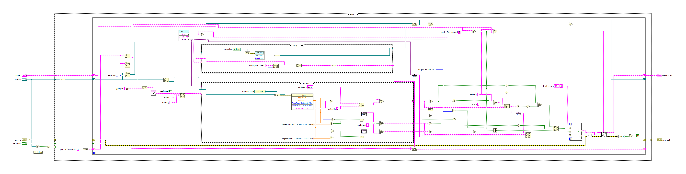 |

| Before | After |
|---|---|
|  |  |

All case frames (5 hidden frames)

| Frame | Picture |
|---|---|
| Whole diagram, visible frames: Case structure 1: False; Case structure 2: "number"; Case structure 3: "Array" | 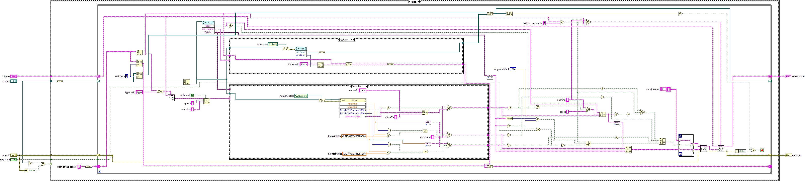 |
| Case structure 1: True |  |
| Case structure 2: Default |  |
| Case structure 2: "integer" |  |
| Case structure 3: Default | 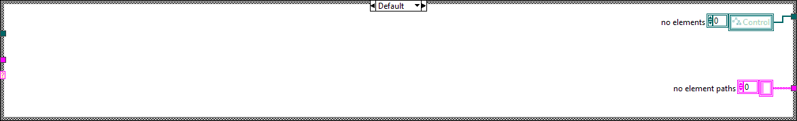 |
| Case structure 3: "Cluster" |  |

### `src/MCP Server/Add Structured Content.vi` (modified)

**1. VI Attribute - Miscellaneous**

- **1A** VI icon

| Before | After |
|---|---|
| 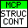 | 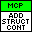 |

Whole block diagram and front panel

| Before | After |
|---|---|
|  | 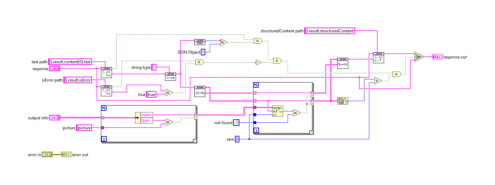 |

| Before | After |
|---|---|
|  |  |

### `src/MCP Server/Ask User.vi` (modified)

**1. VI Attribute - Miscellaneous**

- **1A** VI icon

| Before | After |
|---|---|
|  |  |

Whole block diagram and front panel

| Before | After |
|---|---|
|  |  |

| Before | After |
|---|---|
|  |  |

All case frames (1 hidden frames)

| Frame | Picture |
|---|---|
| Whole diagram, visible frames: Case structure 1: False |  |
| Case structure 1: True |  |

### `src/MCP Server/Build Unsupported Version Error.vi` (modified)

**1. VI Attribute - Miscellaneous**

- **1A** VI icon

| Before | After |
|---|---|
| 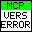 | 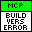 |

Whole block diagram and front panel

| Before | After |
|---|---|
|  | 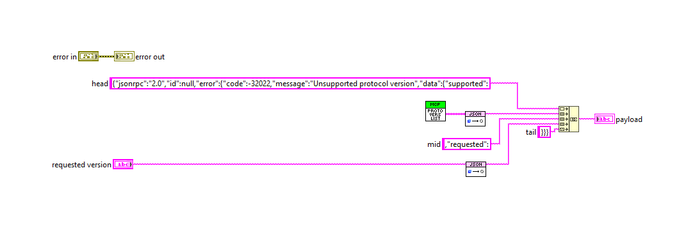 |

| Before | After |
|---|---|
|  |  |

### `src/MCP Server/Cache Hints.vi` (modified)

**1. VI Attribute - Miscellaneous**

- **1A** VI icon

| Before | After |
|---|---|
|  |  |

Whole block diagram and front panel

| Before | After |
|---|---|
| 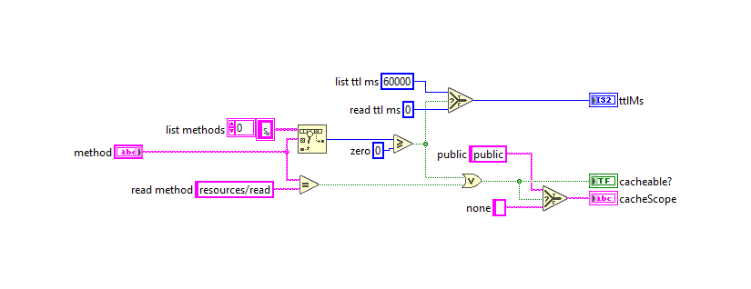 |  |

| Before | After |
|---|---|
| 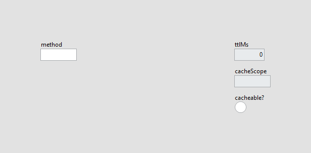 |  |

### `src/MCP Server/Cancel Requested.vi` (modified)

**1. VI Attribute - Miscellaneous**

- **1A** VI icon

| Before | After |
|---|---|
|  |  |

Whole block diagram and front panel

| Before | After |
|---|---|
|  |  |

| Before | After |
|---|---|
|  |  |

All case frames (2 hidden frames)

| Frame | Picture |
|---|---|
| Whole diagram, visible frames: Case structure 1: False; Case structure 2: False |  |
| Case structure 1: True | 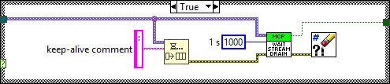 |
| Case structure 2: True | 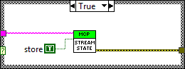 |

### `src/MCP Server/Check Client Access.vi` (modified)

**1. VI Attribute - Miscellaneous**

- **1A** VI icon

| Before | After |
|---|---|
|  |  |

Whole block diagram and front panel

| Before | After |
|---|---|
|  | 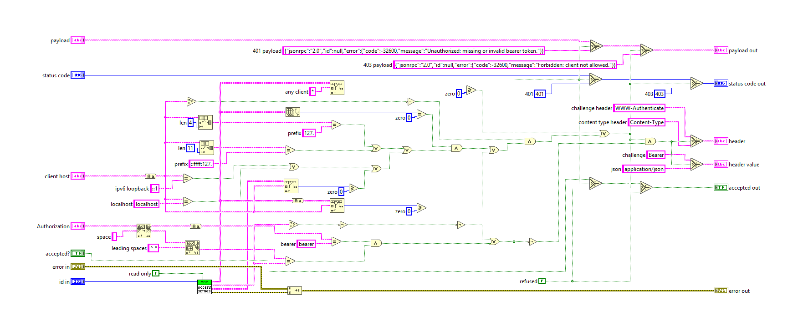 |

| Before | After |
|---|---|
|  |  |

### `src/MCP Server/Check Modern MCP Request.vi` (modified)

**1. VI Attribute - Miscellaneous**

- **1A** VI icon

| Before | After |
|---|---|
|  | 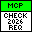 |

Whole block diagram and front panel

| Before | After |
|---|---|
| 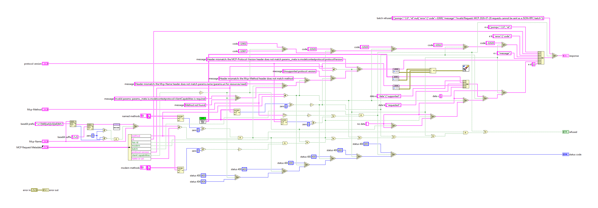 |  |

| Before | After |
|---|---|
|  |  |

### `src/MCP Server/Collect MCP Input Requests.vi` (modified)

**1. VI Attribute - Miscellaneous**

- **1A** VI icon

| Before | After |
|---|---|
| 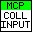 |  |

Whole block diagram and front panel

| Before | After |
|---|---|
|  |  |

| Before | After |
|---|---|
|  |  |

### `src/MCP Server/Complete Modern MCP Result.vi` (modified)

**1. VI Attribute - Miscellaneous**

- **1A** VI icon

| Before | After |
|---|---|
|  | 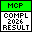 |

Whole block diagram and front panel

| Before | After |
|---|---|
| 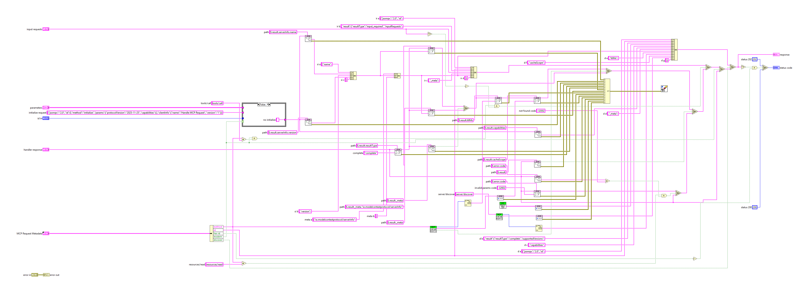 | 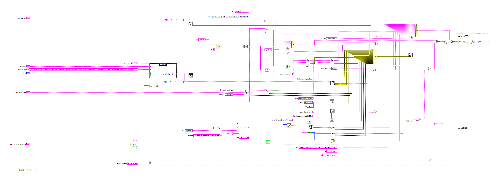 |

| Before | After |
|---|---|
| 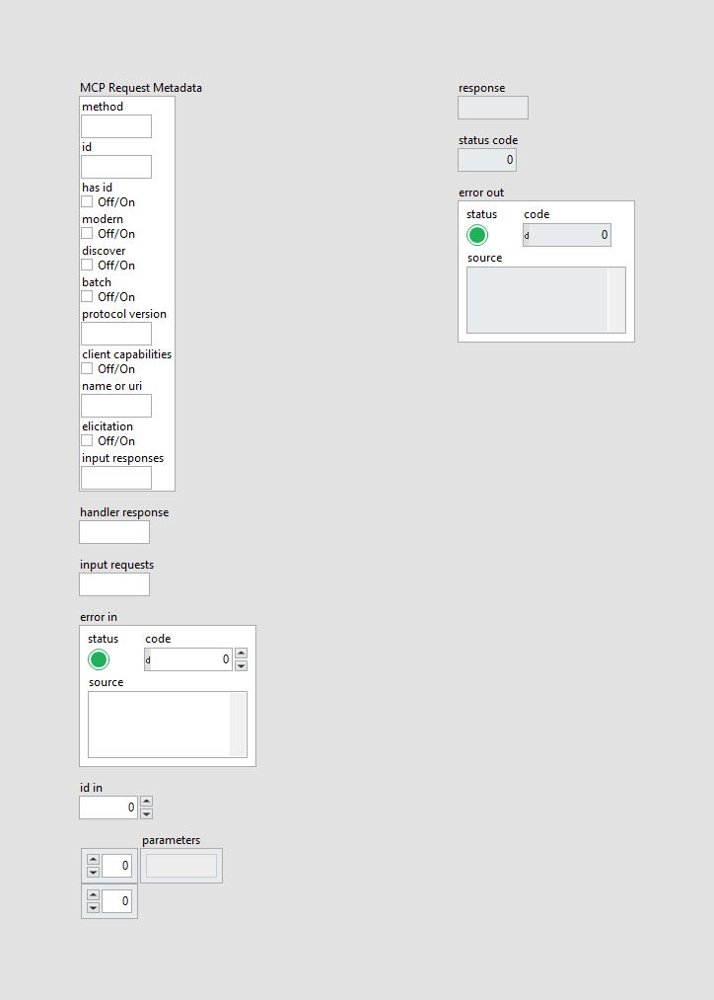 |  |

All case frames (1 hidden frames)

| Frame | Picture |
|---|---|
| Whole diagram, visible frames: Case structure 1: False |  |
| Case structure 1: True | 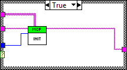 |

### `src/MCP Server/Complete Tool Entry.vi` (modified)

**1. VI Attribute - Miscellaneous**

- **1A** VI icon

| Before | After |
|---|---|
|  |  |

Whole block diagram and front panel

| Before | After |
|---|---|
| 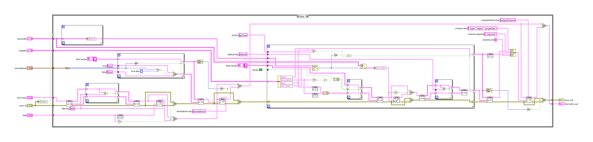 |  |

| Before | After |
|---|---|
| 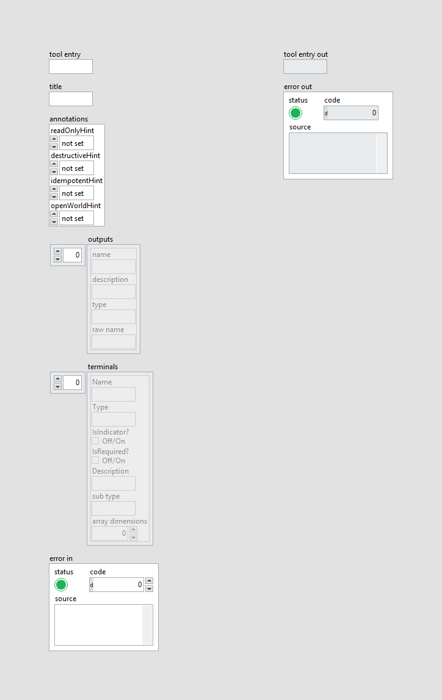 |  |

All case frames (1 hidden frames)

| Frame | Picture |
|---|---|
| Whole diagram, visible frames: Case structure 1: False | 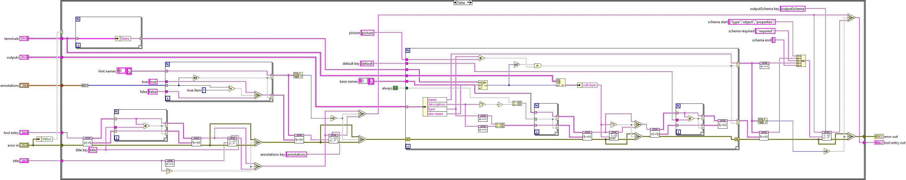 |
| Case structure 1: True | 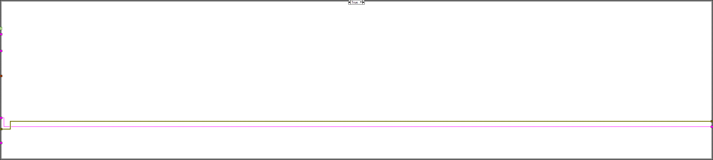 |

### `src/MCP Server/Confirm With User.vi` (modified)

**1. VI Attribute - Miscellaneous**

- **1A** VI icon

| Before | After |
|---|---|
|  |  |

Whole block diagram and front panel

| Before | After |
|---|---|
| 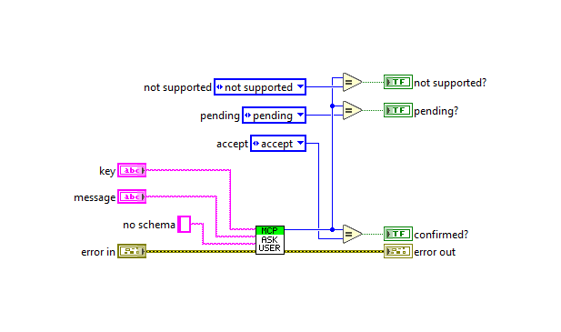 | 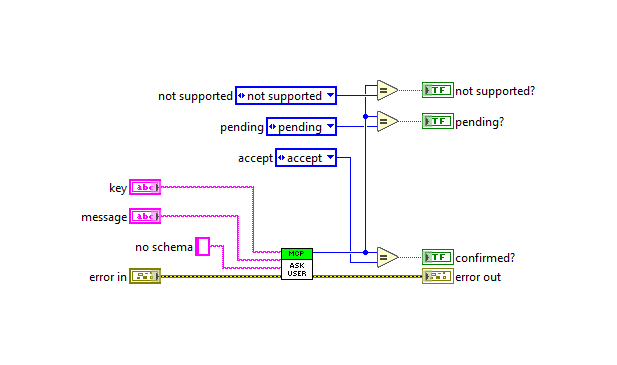 |

| Before | After |
|---|---|
| 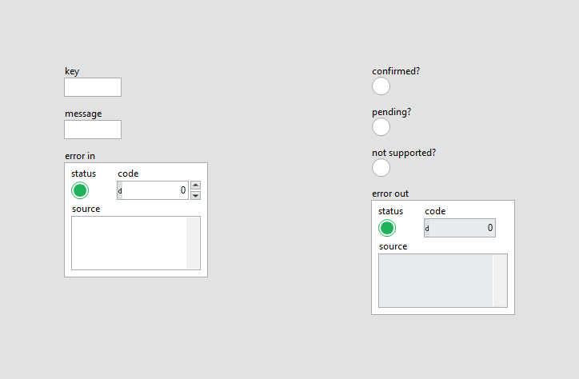 |  |

### `src/MCP Server/Get Request Stream.vi` (modified)

**1. VI Attribute - Miscellaneous**

- **1A** VI icon

| Before | After |
|---|---|
|  |  |

Whole block diagram and front panel

| Before | After |
|---|---|
| 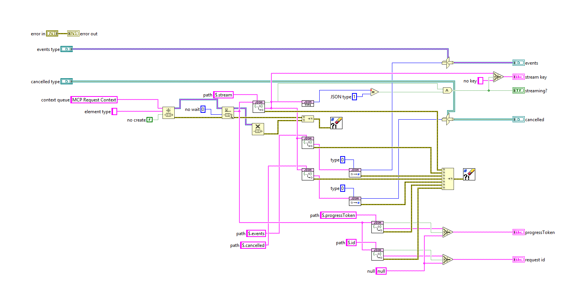 |  |

| Before | After |
|---|---|
|  |  |

### `src/MCP Server/Handle MCP Request.vi` (modified)

**1. VI Attribute - Miscellaneous**

- **1A** VI icon

| Before | After |
|---|---|
|  | 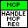 |

Whole block diagram and front panel

| Before | After |
|---|---|
|  | 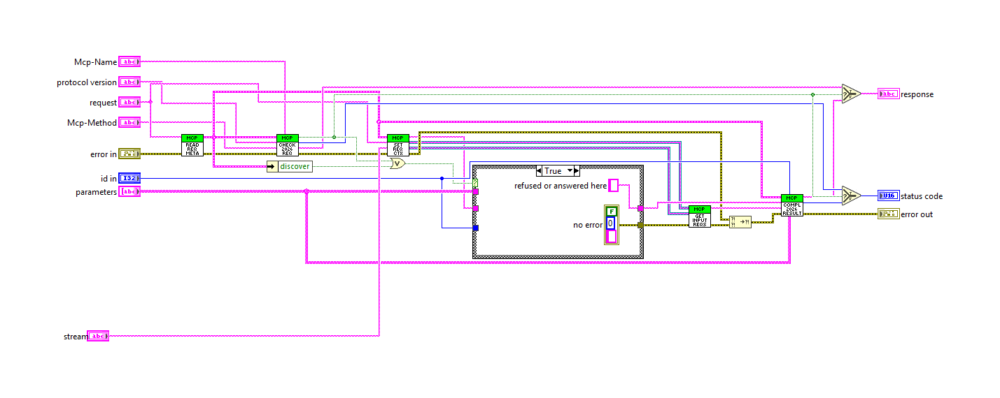 |

| Before | After |
|---|---|
|  |  |

All case frames (1 hidden frames)

| Frame | Picture |
|---|---|
| Whole diagram, visible frames: Case structure 1: True | 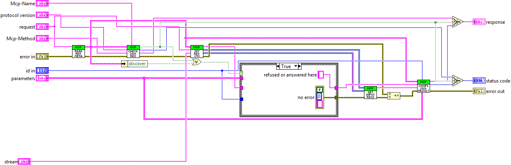 |
| Case structure 1: False | 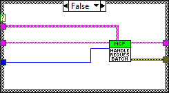 |

### `src/MCP Server/JSON To Control Value.vi` (modified)

**1. VI Attribute - Miscellaneous**

- **1A** VI icon

| Before | After |
|---|---|
|  |  |

Whole block diagram and front panel

| Before | After |
|---|---|
| 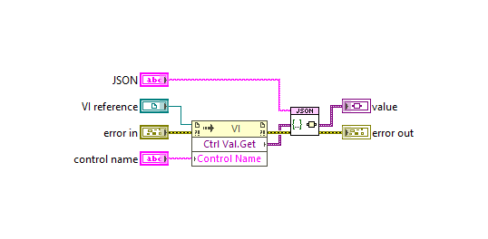 |  |

| Before | After |
|---|---|
|  |  |

### `src/MCP Server/LV Type To JSON Schema.vi` (modified)

**1. VI Attribute - Miscellaneous**

- **1A** VI icon

| Before | After |
|---|---|
|  |  |

Whole block diagram and front panel

| Before | After |
|---|---|
| 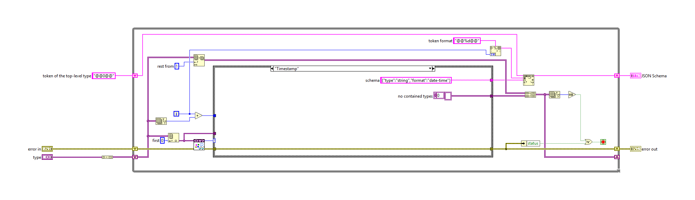 |  |

| Before | After |
|---|---|
|  | 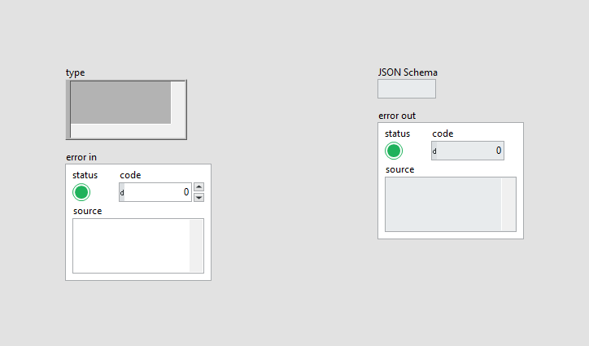 |

All case frames (8 hidden frames)

| Frame | Picture |
|---|---|
| Whole diagram, visible frames: Case structure 1: "Timestamp" | 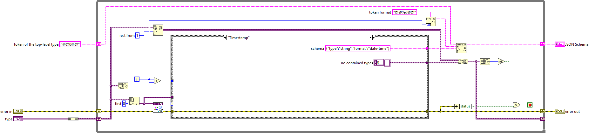 |
| Case structure 1: Default | 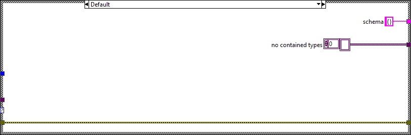 |
| Case structure 1: "Array" | 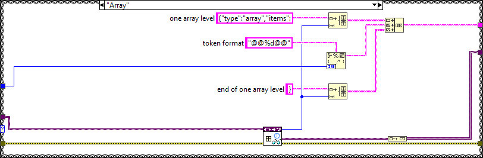 |
| Case structure 1: "Cluster" | 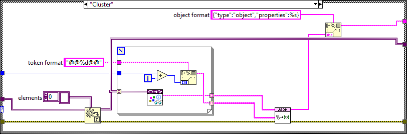 |
| Case structure 1: "Enum U8".."Enum U64" | 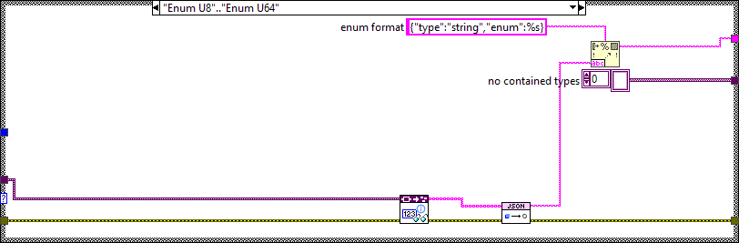 |
| Case structure 1: "I8".."U64" |  |
| Case structure 1: "Single Float".."Extended Float", "Single Float With Unit".."Extended Float With Unit" | 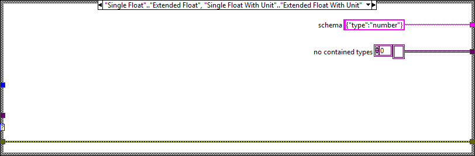 |
| Case structure 1: "Boolean" | 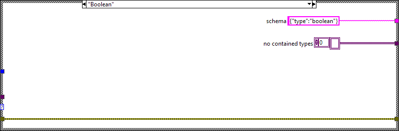 |
| Case structure 1: "String", "Path" | 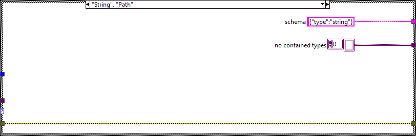 |

### `src/MCP Server/Legacy Cancellations.vi` (modified)

**1. VI Attribute - Miscellaneous**

- **1A** VI icon

| Before | After |
|---|---|
|  |  |

Whole block diagram and front panel

| Before | After |
|---|---|
| 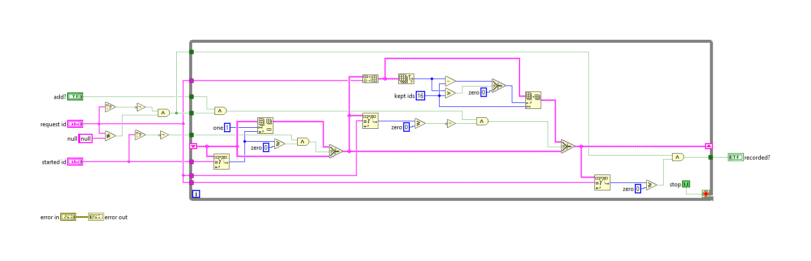 |  |

| Before | After |
|---|---|
|  |  |

### `src/MCP Server/MCP SSE Response/Abort Stream.vi` (modified)

**1. VI Attribute - Miscellaneous**

- **1A** VI icon

| Before | After |
|---|---|
|  |  |

Whole block diagram and front panel

| Before | After |
|---|---|
|  |  |

| Before | After |
|---|---|
|  | 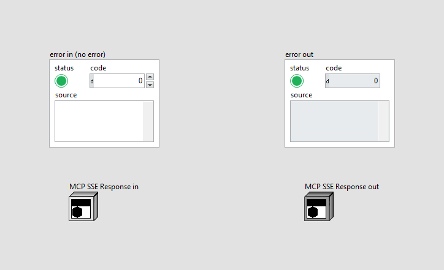 |

### `src/MCP Server/MCP SSE Response/Create MCP SSE Response.vi` (modified)

**1. VI Attribute - Miscellaneous**

- **1A** VI icon

| Before | After |
|---|---|
|  |  |

Whole block diagram and front panel

| Before | After |
|---|---|
|  |  |

| Before | After |
|---|---|
| 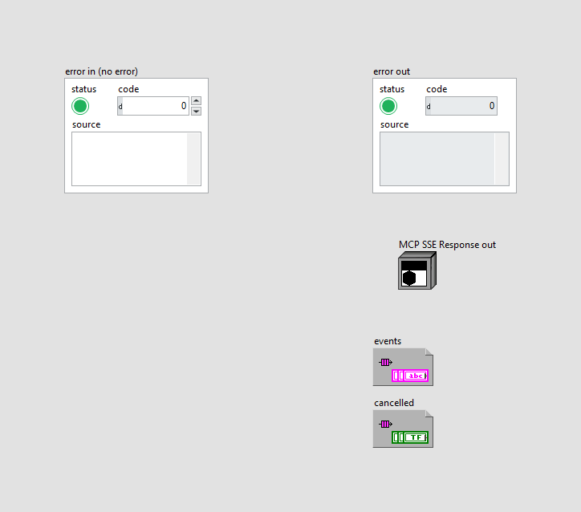 |  |

### `src/MCP Server/MCP SSE Response/Get Queues.vi` (modified)

**1. VI Attribute - Miscellaneous**

- **1A** VI icon

| Before | After |
|---|---|
|  |  |

Whole block diagram and front panel

| Before | After |
|---|---|
|  | 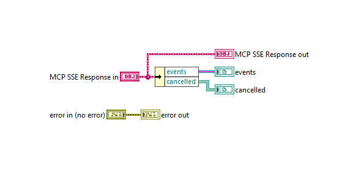 |

| Before | After |
|---|---|
|  |  |

### `src/MCP Server/MCP SSE Response/Next Segment.vi` (modified)

**1. VI Attribute - Miscellaneous**

- **1A** VI icon

| Before | After |
|---|---|
|  |  |

Whole block diagram and front panel

| Before | After |
|---|---|
|  |  |

| Before | After |
|---|---|
|  |  |

### `src/MCP Server/MCP SSE Response/Stream Length.vi` (modified)

**1. VI Attribute - Miscellaneous**

- **1A** VI icon

| Before | After |
|---|---|
| 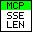 |  |

Whole block diagram and front panel

| Before | After |
|---|---|
|  |  |

| Before | After |
|---|---|
|  |  |

### `src/MCP Server/Prepare Request Dispatch.vi` (modified)

**1. VI Attribute - Miscellaneous**

- **1A** VI icon

| Before | After |
|---|---|
|  |  |

Whole block diagram and front panel

| Before | After |
|---|---|
|  |  |

| Before | After |
|---|---|
|  |  |

### `src/MCP Server/Read MCP Request Metadata.vi` (modified)

**1. VI Attribute - Miscellaneous**

- **1A** VI icon

| Before | After |
|---|---|
|  |  |

Whole block diagram and front panel

| Before | After |
|---|---|
|  |  |

| Before | After |
|---|---|
|  |  |

### `src/MCP Server/Report Progress.vi` (modified)

**1. VI Attribute - Miscellaneous**

- **1A** VI icon

| Before | After |
|---|---|
|  |  |

Whole block diagram and front panel

| Before | After |
|---|---|
|  |  |

| Before | After |
|---|---|
|  |  |

All case frames (2 hidden frames)

| Frame | Picture |
|---|---|
| Whole diagram, visible frames: Case structure 1: False; Case structure 2: False |  |
| Case structure 1: True |  |
| Case structure 2: True |  |

### `src/MCP Server/Run Streamed Request.vi` (modified)

**1. VI Attribute - Miscellaneous**

- **1A** VI icon

| Before | After |
|---|---|
|  |  |

Whole block diagram and front panel

| Before | After |
|---|---|
|  |  |

| Before | After |
|---|---|
|  |  |

All case frames (1 hidden frames)

| Frame | Picture |
|---|---|
| Whole diagram, visible frames: Case structure 1: False |  |
| Case structure 1: True |  |

### `src/MCP Server/Server Access Settings.vi` (modified)

**1. VI Attribute - Miscellaneous**

- **1A** VI icon

| Before | After |
|---|---|
|  |  |

Whole block diagram and front panel

| Before | After |
|---|---|
|  |  |

| Before | After |
|---|---|
|  |  |

All case frames (1 hidden frames)

| Frame | Picture |
|---|---|
| Whole diagram, visible frames: Case structure 1: False |  |
| Case structure 1: True |  |

### `src/MCP Server/Set MCP Request Context.vi` (modified)

**1. VI Attribute - Miscellaneous**

- **1A** VI icon

| Before | After |
|---|---|
|  |  |

Whole block diagram and front panel

| Before | After |
|---|---|
|  |  |

| Before | After |
|---|---|
|  |  |

### `src/MCP Server/Start Streamed Request.vi` (modified)

**1. VI Attribute - Miscellaneous**

- **1A** VI icon

| Before | After |
|---|---|
|  |  |

Whole block diagram and front panel

| Before | After |
|---|---|
|  |  |

| Before | After |
|---|---|
|  |  |

All case frames (2 hidden frames)

| Frame | Picture |
|---|---|
| Whole diagram, visible frames: Case structure 2: False; Case structure 1: False |  |
| Case structure 1: True |  |
| Case structure 2: True |  |

### `src/MCP Server/Stream State.vi` (modified)

**1. VI Attribute - Miscellaneous**

- **1A** VI icon

| Before | After |
|---|---|
|  |  |

Whole block diagram and front panel

| Before | After |
|---|---|
|  |  |

| Before | After |
|---|---|
|  |  |

### `src/MCP Server/Wait For Stream Drain.vi` (modified)

**1. VI Attribute - Miscellaneous**

- **1A** VI icon

| Before | After |
|---|---|
|  |  |

Whole block diagram and front panel

| Before | After |
|---|---|
|  |  |

| Before | After |
|---|---|
|  |  |

All case frames (1 hidden frames)

| Frame | Picture |
|---|---|
| Whole diagram, visible frames: Case structure 1: False |  |
| Case structure 1: True |  |

### `tests/Add Fixture Annotated Tool.vi` (modified)

**1. VI Attribute - Miscellaneous**

- **1A** VI icon

| Before | After |
|---|---|
|  |  |

Whole block diagram and front panel

| Before | After |
|---|---|
|  |  |

| Before | After |
|---|---|
|  |  |

### `tests/Add Fixture Array Shapes Tool.vi` (modified)

**1. VI Attribute - Miscellaneous**

- **1A** VI icon

| Before | After |
|---|---|
|  |  |

Whole block diagram and front panel

| Before | After |
|---|---|
|  |  |

| Before | After |
|---|---|
|  |  |

### `tests/Add Fixture Confirm Tool.vi` (modified)

**1. VI Attribute - Miscellaneous**

- **1A** VI icon

| Before | After |
|---|---|
|  |  |

Whole block diagram and front panel

| Before | After |
|---|---|
|  |  |

| Before | After |
|---|---|
|  |  |

### `tests/Add Fixture Picture Tool.vi` (modified)

**1. VI Attribute - Miscellaneous**

- **1A** VI icon

| Before | After |
|---|---|
|  |  |

Whole block diagram and front panel

| Before | After |
|---|---|
|  |  |

| Before | After |
|---|---|
|  |  |

### `tests/Add Fixture Progress Tool.vi` (modified)

**1. VI Attribute - Miscellaneous**

- **1A** VI icon

| Before | After |
|---|---|
|  |  |

Whole block diagram and front panel

| Before | After |
|---|---|
|  |  |

| Before | After |
|---|---|
|  |  |

### `tests/Add Fixture Schema Details Tool.vi` (modified)

**1. VI Attribute - Miscellaneous**

- **1A** VI icon

| Before | After |
|---|---|
|  |  |

Whole block diagram and front panel

| Before | After |
|---|---|
|  |  |

| Before | After |
|---|---|
|  |  |

### `tests/Add Fixture Schema Shapes Tool.vi` (modified)

**1. VI Attribute - Miscellaneous**

- **1A** VI icon

| Before | After |
|---|---|
|  |  |

Whole block diagram and front panel

| Before | After |
|---|---|
|  |  |

| Before | After |
|---|---|
|  |  |

### `tests/Add Fixture Special Labels Tool.vi` (modified)

**1. VI Attribute - Miscellaneous**

- **1A** VI icon

| Before | After |
|---|---|
|  |  |

Whole block diagram and front panel

| Before | After |
|---|---|
|  |  |

| Before | After |
|---|---|
|  |  |

### `tests/Progress Fixture Record.vi` (modified)

**1. VI Attribute - Miscellaneous**

- **1A** VI icon

| Before | After |
|---|---|
|  |  |

Whole block diagram and front panel

| Before | After |
|---|---|
|  |  |

| Before | After |
|---|---|
|  |  |

### `tests/Run_Protocol_Tests_CLI.vi` (modified)

**1. VI Attribute - Miscellaneous**

- **1A** VI icon

| Before | After |
|---|---|
|  |  |

Whole block diagram and front panel

| Before | After |
|---|---|
|  |  |

| Before | After |
|---|---|
|  |  |

### `tests/fake prompt name clash.vi` (modified)

**1. VI Attribute - Miscellaneous**

- **1A** VI icon

| Before | After |
|---|---|
|  |  |

Whole block diagram and front panel

| Before | After |
|---|---|
|  |  |

| Before | After |
|---|---|
|  |  |

### `tests/fake tool annotated.vi` (modified)

**1. VI Attribute - Miscellaneous**

- **1A** VI icon

| Before | After |
|---|---|
|  |  |

Whole block diagram and front panel

| Before | After |
|---|---|
|  |  |

| Before | After |
|---|---|
|  |  |

### `tests/fake tool array shapes.vi` (modified)

**1. VI Attribute - Miscellaneous**

- **1A** VI icon

| Before | After |
|---|---|
|  |  |

Whole block diagram and front panel

| Before | After |
|---|---|
|  |  |

| Before | After |
|---|---|
|  |  |

### `tests/fake tool confirm.vi` (modified)

**1. VI Attribute - Miscellaneous**

- **1A** VI icon

| Before | After |
|---|---|
|  |  |

Whole block diagram and front panel

| Before | After |
|---|---|
|  |  |

| Before | After |
|---|---|
|  |  |

### `tests/fake tool name clash.vi` (modified)

**1. VI Attribute - Miscellaneous**

- **1A** VI icon

| Before | After |
|---|---|
|  |  |

Whole block diagram and front panel

| Before | After |
|---|---|
|  |  |

| Before | After |
|---|---|
|  |  |

### `tests/fake tool picture outputs.vi` (modified)

**1. VI Attribute - Miscellaneous**

- **1A** VI icon

| Before | After |
|---|---|
|  |  |

Whole block diagram and front panel

| Before | After |
|---|---|
|  |  |

| Before | After |
|---|---|
|  |  |

### `tests/fake tool progress.vi` (modified)

**1. VI Attribute - Miscellaneous**

- **1A** VI icon

| Before | After |
|---|---|
|  |  |

Whole block diagram and front panel

| Before | After |
|---|---|
|  |  |

| Before | After |
|---|---|
|  |  |

All case frames (1 hidden frames)

| Frame | Picture |
|---|---|
| Whole diagram, visible frames: Case structure 1: False |  |
| Case structure 1: True |  |

### `tests/fake tool schema details.vi` (modified)

**1. VI Attribute - Miscellaneous**

- **1A** VI icon

| Before | After |
|---|---|
|  |  |

Whole block diagram and front panel

| Before | After |
|---|---|
|  |  |

| Before | After |
|---|---|
|  |  |

### `tests/fake tool schema shapes.vi` (modified)

**1. VI Attribute - Miscellaneous**

- **1A** VI icon

| Before | After |
|---|---|
|  |  |

Whole block diagram and front panel

| Before | After |
|---|---|
|  |  |

| Before | After |
|---|---|
|  |  |

### `tests/fake tool special labels.vi` (modified)

**1. VI Attribute - Miscellaneous**

- **1A** VI icon

| Before | After |
|---|---|
|  |  |

Whole block diagram and front panel

| Before | After |
|---|---|
|  |  |

| Before | After |
|---|---|
|  |  |

### `tests/test access allowed clients.vi` (modified)

**1. VI Attribute - Miscellaneous**

- **1A** VI icon

| Before | After |
|---|---|
|  |  |

Whole block diagram and front panel

| Before | After |
|---|---|
|  |  |

| Before | After |
|---|---|
|  |  |

All case frames (1 hidden frames)

| Frame | Picture |
|---|---|
| Whole diagram, visible frames: Case structure 1: False |  |
| Case structure 1: True |  |

### `tests/test access bearer token.vi` (modified)

**1. VI Attribute - Miscellaneous**

- **1A** VI icon

| Before | After |
|---|---|
|  |  |

Whole block diagram and front panel

| Before | After |
|---|---|
|  |  |

| Before | After |
|---|---|
|  |  |

All case frames (1 hidden frames)

| Frame | Picture |
|---|---|
| Whole diagram, visible frames: Case structure 1: False |  |
| Case structure 1: True |  |

### `tests/test add prompt name clash.vi` (modified)

**1. VI Attribute - Miscellaneous**

- **1A** VI icon

| Before | After |
|---|---|
|  |  |

Whole block diagram and front panel

| Before | After |
|---|---|
|  |  |

| Before | After |
|---|---|
|  |  |

### `tests/test add tool name clash.vi` (modified)

**1. VI Attribute - Miscellaneous**

- **1A** VI icon

| Before | After |
|---|---|
|  |  |

Whole block diagram and front panel

| Before | After |
|---|---|
|  |  |

| Before | After |
|---|---|
|  |  |

### `tests/test elicitation.vi` (modified)

**1. VI Attribute - Miscellaneous**

- **1A** VI icon

| Before | After |
|---|---|
|  |  |

Whole block diagram and front panel

| Before | After |
|---|---|
|  |  |

| Before | After |
|---|---|
|  |  |

### `tests/test modern errors.vi` (modified)

**1. VI Attribute - Miscellaneous**

- **1A** VI icon

| Before | After |
|---|---|
|  |  |

Whole block diagram and front panel

| Before | After |
|---|---|
|  |  |

| Before | After |
|---|---|
|  |  |

### `tests/test modern headers.vi` (modified)

**1. VI Attribute - Miscellaneous**

- **1A** VI icon

| Before | After |
|---|---|
|  |  |

Whole block diagram and front panel

| Before | After |
|---|---|
|  |  |

| Before | After |
|---|---|
|  |  |

### `tests/test modern tools list.vi` (modified)

**1. VI Attribute - Miscellaneous**

- **1A** VI icon

| Before | After |
|---|---|
|  |  |

Whole block diagram and front panel

| Before | After |
|---|---|
|  |  |

| Before | After |
|---|---|
|  |  |

### `tests/test progress cancel by close.vi` (modified)

**1. VI Attribute - Miscellaneous**

- **1A** VI icon

| Before | After |
|---|---|
|  |  |

Whole block diagram and front panel

| Before | After |
|---|---|
|  |  |

| Before | After |
|---|---|
|  |  |

All case frames (1 hidden frames)

| Frame | Picture |
|---|---|
| Whole diagram, visible frames: Case structure 1: False |  |
| Case structure 1: True |  |

### `tests/test progress legacy cancel.vi` (modified)

**1. VI Attribute - Miscellaneous**

- **1A** VI icon

| Before | After |
|---|---|
|  |  |

Whole block diagram and front panel

| Before | After |
|---|---|
|  |  |

| Before | After |
|---|---|
|  |  |

All case frames (4 hidden frames)

| Frame | Picture |
|---|---|
| Whole diagram, visible frames: Case structure 1: False; Case structure 2: False; Case structure 3: False; Case structure 4: False |  |
| Case structure 1: True |  |
| Case structure 2: True |  |
| Case structure 3: True |  |
| Case structure 4: True |  |

### `tests/test progress notifications.vi` (modified)

**1. VI Attribute - Miscellaneous**

- **1A** VI icon

| Before | After |
|---|---|
|  |  |

Whole block diagram and front panel

| Before | After |
|---|---|
|  |  |

| Before | After |
|---|---|
|  |  |

### `tests/test server discover.vi` (modified)

**1. VI Attribute - Miscellaneous**

- **1A** VI icon

| Before | After |
|---|---|
|  |  |

Whole block diagram and front panel

| Before | After |
|---|---|
|  |  |

| Before | After |
|---|---|
|  |  |

### `tests/test tools call mcp names.vi` (modified)

**1. VI Attribute - Miscellaneous**

- **1A** VI icon

| Before | After |
|---|---|
|  |  |

Whole block diagram and front panel

| Before | After |
|---|---|
|  |  |

| Before | After |
|---|---|
|  |  |

### `tests/test tools call schema shapes.vi` (modified)

**1. VI Attribute - Miscellaneous**

- **1A** VI icon

| Before | After |
|---|---|
|  |  |

Whole block diagram and front panel

| Before | After |
|---|---|
|  |  |

| Before | After |
|---|---|
|  |  |

### `tests/test tools call structured content.vi` (modified)

**1. VI Attribute - Miscellaneous**

- **1A** VI icon

| Before | After |
|---|---|
|  |  |

Whole block diagram and front panel

| Before | After |
|---|---|
|  |  |

| Before | After |
|---|---|
|  |  |

### `tests/test tools list array shapes.vi` (modified)

**1. VI Attribute - Miscellaneous**

- **1A** VI icon

| Before | After |
|---|---|
|  |  |

Whole block diagram and front panel

| Before | After |
|---|---|
|  |  |

| Before | After |
|---|---|
|  |  |

### `tests/test tools list descriptions defaults ranges.vi` (modified)

**1. VI Attribute - Miscellaneous**

- **1A** VI icon

| Before | After |
|---|---|
|  |  |

Whole block diagram and front panel

| Before | After |
|---|---|
|  |  |

| Before | After |
|---|---|
|  |  |

### `tests/test tools list every array has items.vi` (modified)

**1. VI Attribute - Miscellaneous**

- **1A** VI icon

| Before | After |
|---|---|
|  |  |

Whole block diagram and front panel

| Before | After |
|---|---|
|  |  |

| Before | After |
|---|---|
|  |  |

All case frames (2 hidden frames)

| Frame | Picture |
|---|---|
| Whole diagram, visible frames: Case structure 1: Default |  |
| Case structure 1: "JSON Object" |  |
| Case structure 1: "JSON Array" |  |

### `tests/test tools list mcp names.vi` (modified)

**1. VI Attribute - Miscellaneous**

- **1A** VI icon

| Before | After |
|---|---|
|  |  |

Whole block diagram and front panel

| Before | After |
|---|---|
|  |  |

| Before | After |
|---|---|
|  |  |

### `tests/test tools list output schema.vi` (modified)

**1. VI Attribute - Miscellaneous**

- **1A** VI icon

| Before | After |
|---|---|
|  |  |

Whole block diagram and front panel

| Before | After |
|---|---|
|  |  |

| Before | After |
|---|---|
|  |  |

### `tests/test tools list schema details.vi` (modified)

**1. VI Attribute - Miscellaneous**

- **1A** VI icon

| Before | After |
|---|---|
|  |  |

Whole block diagram and front panel

| Before | After |
|---|---|
|  |  |

| Before | After |
|---|---|
|  |  |

### `tests/test tools list title annotations.vi` (modified)

**1. VI Attribute - Miscellaneous**

- **1A** VI icon

| Before | After |
|---|---|
|  |  |

Whole block diagram and front panel

| Before | After |
|---|---|
|  |  |

| Before | After |
|---|---|
|  |  |

