## VI diff report

7 modified, 18 added, 0 deleted. Generated by LabVIEW's VI comparison; position and size changes are not shown.

### `src/MCP Server/Is Supported Protocol Version.vi` (modified)

**1. Block Diagram objects**

- **1A** SubVI Terminal - control vs. indicator
- **1B** SubVI Terminal - control vs. indicator
- **1C** wiring changes

| Before | After |
|---|---|
| 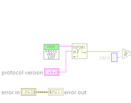 | 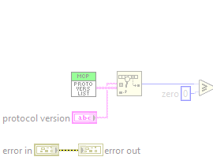 |

**2. VI Attribute - Documentation (VI Properties)**

- **2A** description text : changed from "TRUE if protocol version is one of the versions in Supported Protocol Versions.vi. The comparison is exact (case and white space count).

Used by Validate HTTP Request.vi for the MCP-Protocol-Version header." to "Checks a protocol version (the MCP-Protocol-Version request header) against all versions of Supported Protocol Versions.vi, modern and legacy. Which era a request belongs to is decided per request by params._meta, not here."

Whole block diagram and front panel

| Before | After |
|---|---|
|  | 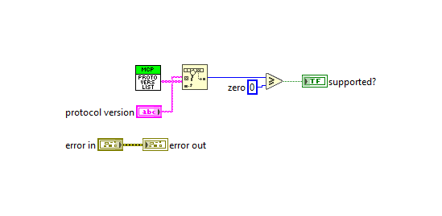 |

| Before | After |
|---|---|
|  | 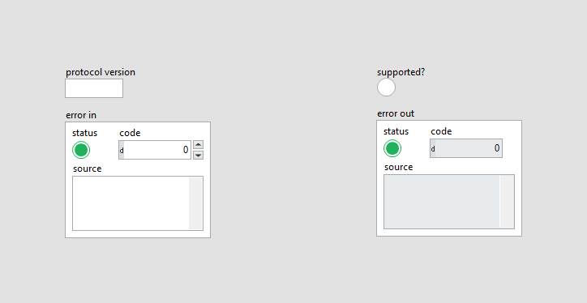 |

### `src/MCP Server/Process HTTP Request.vi` (modified)

**1. Block Diagram objects**

- **1A** String Constant "Header" - added at (410,12)
- **1B** String Constant "Header" - added at (420,30)
- **1C** SubVI "HTTP Server.lvlib:Processing.lvclass:Request Header.vi" - added at (498,-19)
- **1D** Tunnel  - added at (796,-80)
- **1E** Tunnel  - added at (804,-80)
- **1F** Tunnel  - added at (812,-80)
- **1G** wiring changes

| Before | After |
|---|---|
| 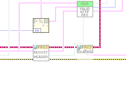 | 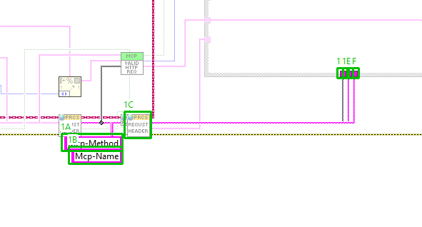 |

**2. Block Diagram objects**

- **2A** String Constant "id item name" - deleted at (734,-110)
- **2B** SubVI "MCP Server.lvlib:Handle MCP Request.vi" - added at (796,-195)
- **2C** SubVI "MCP Server.lvlib:Handle Server Request Batch.vi" - deleted at (796,-195)
- **2D** SubVI "JSONtext.lvlib:Find Item.vi" - deleted at (796,-128)
- **2E** Tunnel  - added at (796,-80)
- **2F** Tunnel  - added at (804,-80)
- **2G** Tunnel  - added at (812,-80)
- **2H** Empty String/Path?  - deleted at (928,-219)
- **2I** Not  - deleted at (929,-180)
- **2J** And  - deleted at (994,-213)
- **2K** Numeric Constant "status accepted notification" - deleted at (1021,-256)
- **2L** Numeric Constant "status ok" - deleted at (1120,-192)
- **2M** Select  - deleted at (1171,-219)
- **2N** wiring changes

| Before | After |
|---|---|
| 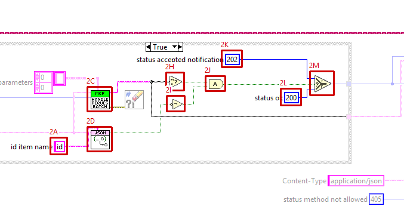 | 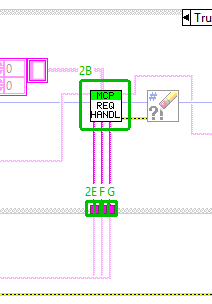 |

**3. VI Attribute - Documentation (VI Properties)**

- **3A** description text : changed from "Answers one HTTP request on the MCP endpoint following the MCP Streamable HTTP transport rules, and stores the response in the Processing object.

1. Reads the HTTP method and the Origin and MCP-Protocol-Version request headers and passes them to Validate HTTP Request.vi.
2. Rejected request (405, 403 or 400): the MCP server is NOT called. The response carries the status code and the JSON-RPC error payload from Validate HTTP Request.vi with Content-Type application/json. A 405 additionally carries the header Allow: POST.
3. Accepted request: the request body, one message or a batch of messages, is passed to Handle Server Request Batch.vi and its errors are cleared. If the response is empty AND the request body has no top-level id item (a notification), the status is 202 with an empty body. Otherwise the status is 200 with Content-Type application/json and the response as payload.

error out reports only errors of the two header reads. It is informational: a response is always set." to "Answers one HTTP request on the MCP endpoint following the MCP Streamable HTTP transport rules, and stores the response in the Processing object.

1. Reads the HTTP method and the Origin and MCP-Protocol-Version request headers and passes them to Validate HTTP Request.vi. Also reads the Mcp-Method and Mcp-Name headers (MCP 2026-07-28).
2. Rejected request (405, 403 or 400): the MCP server is NOT called. The response carries the status code and the JSON-RPC error payload from Validate HTTP Request.vi with Content-Type application/json. A 405 additionally carries the header Allow: POST.
3. Accepted request: the request body, one message or a batch of messages, is passed with the three MCP headers to Handle MCP Request.vi, which decides the era (legacy or modern) per request, makes the modern header checks and answers; its errors are cleared. Its status code is used: 202 with an empty body for a notification, 200 with Content-Type application/json, or 400/404 for a refused modern request.

error out reports only errors of the first two header reads. It is informational: a response is always set."

Whole block diagram and front panel

| Before | After |
|---|---|
|  |  |

| Before | After |
|---|---|
|  |  |

All case frames (2 hidden frames)

| Frame | Picture |
|---|---|
| Whole diagram, visible frames: Case structure 1: False; Case structure 2: False |  |
| Case structure 1: True |  |
| Case structure 2: True |  |

### `src/MCP Server/Supported Protocol Versions.vi` (modified)

**1. Block Diagram objects**

- **1A** Array Constant "supported versions" - data value : changed from "<tt>["2025-06-18", "2025-03-26", "2024-11-05"]</tt>" to "<tt>["2025-11-25", "2025-06-18", "2025-03-26", "2024-11-05"]</tt>"

| Before | After |
|---|---|
| 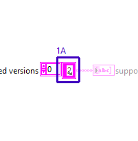 | 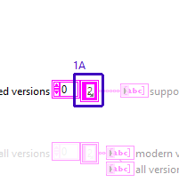 |

**2. Block Diagram objects**

- **2A** Array Constant "modern versions" - added at (750,374)
- **2B** Front Panel Terminal "modern versions" - added at (779,378)

| Before | After |
|---|---|
| 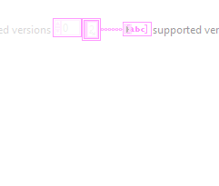 | 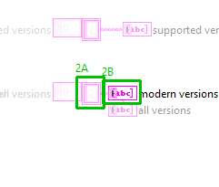 |

**3. Block Diagram objects**

- **3A** Array Constant "all versions" - added at (750,374)
- **3B** Front Panel Terminal "all versions" - added at (779,396)

| Before | After |
|---|---|
| 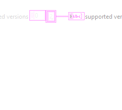 | 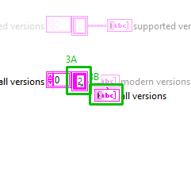 |

**4. Front Panel - Panel**

- **4A** Connector Pane  - control/indicator assignment : changed

| Before | After |
|---|---|
| 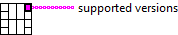 | 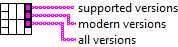 |

**6. Front Panel objects**

- **6A** Array "modern versions" - added at (812,17)

| Before | After |
|---|---|
|  | 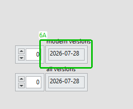 |

**7. Front Panel objects**

- **7A** Array "all versions" - added at (812,72)

| Before | After |
|---|---|
|  | 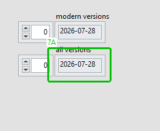 |

**8. VI Attribute - Documentation (VI Properties)**

- **8A** description text : changed from "The MCP protocol versions this server supports, newest first. This is the only place the list is kept: initialize (Choose Protocol Version.vi, called by Negotiate Protocol Version.vi) and the MCP-Protocol-Version header check (Is Supported Protocol Version.vi, called by Validate HTTP Request.vi) both read it.

The first entry is the version initialize answers with when the client asks for a version that is not in the list.

To support another protocol version, first implement what that version changes in the protocol (see its changelog in the MCP specification), then add it to this list - at the top if it is the newest." to "The single source of the MCP protocol versions this server supports, in two eras.

- supported versions: the legacy versions, negotiated by initialize.
- modern versions: the versions served without initialize, chosen per request by params._meta.io.modelcontextprotocol/protocolVersion (2026-07-28 and later).
- all versions: modern versions followed by supported versions, for the MCP-Protocol-Version header check, server/discover and the -32022 Unsupported protocol version error."

Whole block diagram and front panel

| Before | After |
|---|---|
| 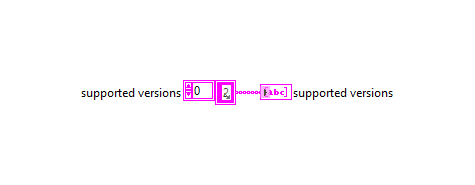 | 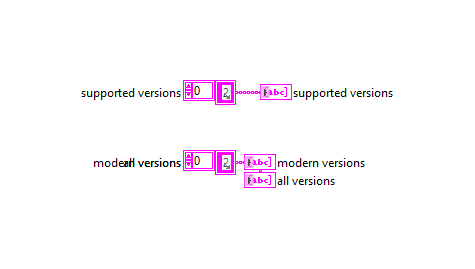 |

| Before | After |
|---|---|
|  | 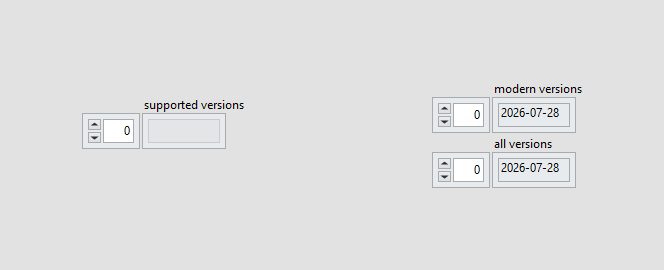 |

### `src/MCP Server/Validate HTTP Request.vi` (modified)

**1. Block Diagram objects**

- **1A** String Constant "payload bad protocol version" - deleted at (385,125)
- **1B** SubVI "MCP Server.lvlib:Build Unsupported Version Error.vi" - added at (836,240)

| Before | After |
|---|---|
| 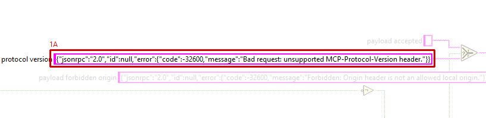 | 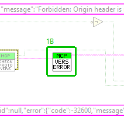 |

**3. VI Attribute - Documentation (VI Properties)**

- **3A** description text : changed from "Decides whether an incoming HTTP request may be handed to the MCP request handler, following the MCP Streamable HTTP transport rules. Pure decision logic with scalar terminals and no side effects.

Checks, in this order:
1. method must be exactly POST, otherwise status 405.
2. Origin (DNS rebinding protection): an absent header is accepted. A present one must be http or https followed by localhost, 127.0.0.1 or [::1] with an optional numeric port, compared case-insensitively. Anything else, including the literal null, gives status 403.
3. MCP-Protocol-Version: an absent header is accepted. A present one must be one of the versions in Supported Protocol Versions.vi (checked by Is Supported Protocol Version.vi), otherwise status 400.

When accepted? is TRUE, status code is 200 and payload is empty. When it is FALSE, status code is 405, 403 or 400 and payload is a JSON-RPC error object (id null, code -32600) to be sent with Content-Type application/json.

The error cluster is passed through unchanged. The decision is computed regardless of error in." to "Decides whether an incoming HTTP request may be handed to the MCP request handler, following the MCP Streamable HTTP transport rules. Pure decision logic with scalar terminals and no side effects.

Checks, in this order:
1. method must be exactly POST, otherwise status 405.
2. Origin (DNS rebinding protection): an absent header is accepted. A present one must be http or https followed by localhost, 127.0.0.1 or [::1] with an optional numeric port, compared case-insensitively. Anything else, including the literal null, gives status 403.
3. MCP-Protocol-Version: an absent header is accepted. A present one must be one of all versions in Supported Protocol Versions.vi, modern or legacy (checked by Is Supported Protocol Version.vi), otherwise status 400.

When accepted? is TRUE, status code is 200 and payload is empty. When it is FALSE, status code is 405, 403 or 400 and payload is a JSON-RPC error object (id null) to be sent with Content-Type application/json: code -32600 for 405 and 403, and for 400 the MCP 2026-07-28 error -32022 Unsupported protocol version with data.supported and data.requested (Build Unsupported Version Error.vi), in both eras, so that dual-era clients recognise a modern server.

The modern-era checks of the other headers (Mcp-Method, Mcp-Name, MCP-Protocol-Version against params._meta) need the body and are made by Handle MCP Request.vi.

The error cluster is passed through unchanged. The decision is computed regardless of error in."

Whole block diagram and front panel

| Before | After |
|---|---|
| 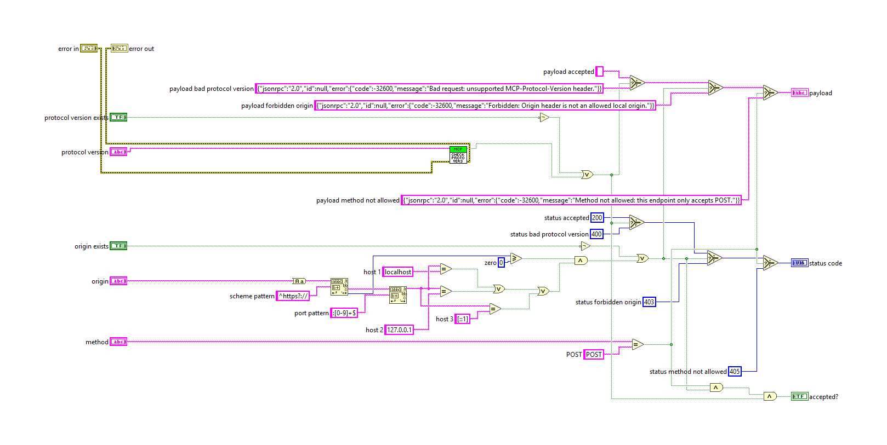 | 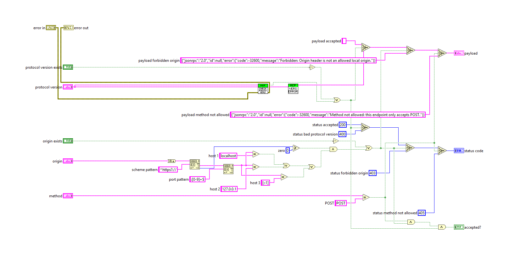 |

| Before | After |
|---|---|
|  |  |

### `tests/Test_MCP_Server.vi` (modified)

**1. Block Diagram objects**

- **1A** SubVI "MCP Server tests.lvlib:Add Fixture Confirm Tool.vi" - added at (1998,323)
- **1B** wiring changes

| Before | After |
|---|---|
| 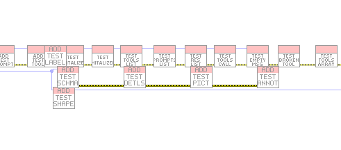 | 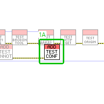 |

**2. Block Diagram objects**

- **2A** SubVI "MCP Server tests.lvlib:test modern tools list.vi" - added at (3998,296)
- **2B** SubVI "MCP Server tests.lvlib:test server discover.vi" - added at (4094,296)
- **2C** SubVI "MCP Server tests.lvlib:test modern headers.vi" - added at (4190,296)
- **2D** SubVI "MCP Server tests.lvlib:test modern errors.vi" - added at (4286,296)
- **2E** SubVI "MCP Server tests.lvlib:test elicitation.vi" - added at (4382,296)
- **2F** wiring changes

| Before | After |
|---|---|
| 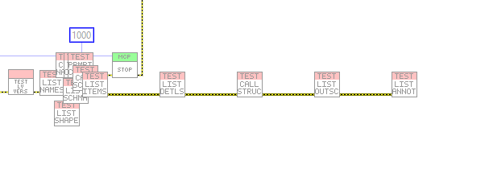 | 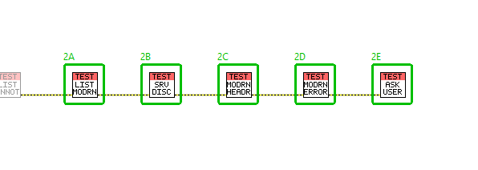 |

Whole block diagram and front panel

| Before | After |
|---|---|
|  |  |

| Before | After |
|---|---|
|  |  |

### `tests/test http protocol version.vi` (modified)

**1. Block Diagram objects**

- **1A** String Constant "Label" - data value : changed from "<tt>"MCP-Protocol-Version 1999-01-01 -> 400 with error -32600"</tt>" to "<tt>"MCP-Protocol-Version 1999-01-01 -> 400 with error -32022 (Unsupported protocol version, the MCP 2026-07-28 code in both eras)"</tt>"

| Before | After |
|---|---|
| 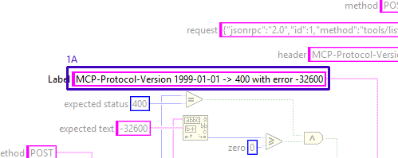 | 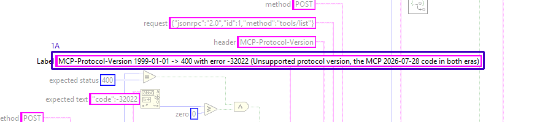 |

**2. Block Diagram objects**

- **2A** String Constant "expected text" - data value : changed from "<tt>"-32600"</tt>" to "<tt>""code":-32022"</tt>"

| Before | After |
|---|---|
| 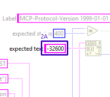 | 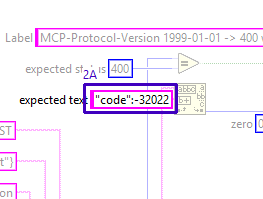 |

**3. VI Attribute - Documentation (VI Properties)**

- **3A** description text : changed from "A request with an unsupported MCP-Protocol-Version header must be rejected with 400 and a JSON-RPC error with code -32600. A supported version must be handled normally." to "A request with an unsupported MCP-Protocol-Version header must be rejected with 400 and the JSON-RPC error -32022 Unsupported protocol version (MCP 2026-07-28, used in both eras so that dual-era clients recognise a modern server; it was -32600 before). A supported version must be handled normally."

Whole block diagram and front panel

| Before | After |
|---|---|
| 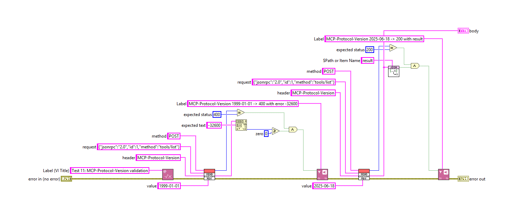 | 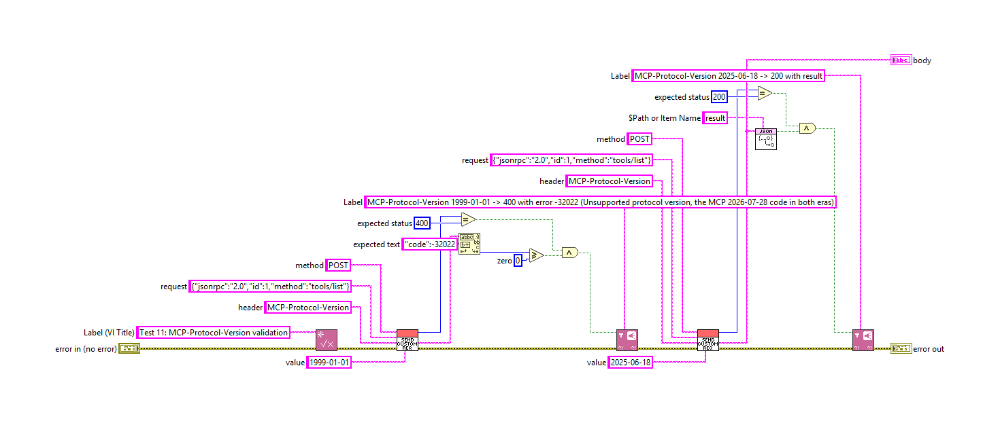 |

| Before | After |
|---|---|
|  |  |

### `tests/test protocol version negotiation.vi` (modified)

**1. Block Diagram objects**

- **1A** String Constant "Label" - data value : changed from "<tt>"initialize asking for 1999-01-01 -> protocolVersion 2025-06-18"</tt>" to "<tt>"initialize asking for 1999-01-01 -> protocolVersion 2025-11-25 (the newest legacy version)"</tt>"

| Before | After |
|---|---|
| 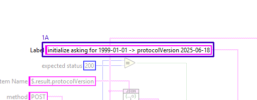 | 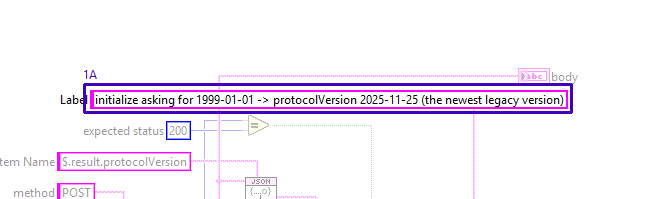 |

**2. Block Diagram objects**

- **2A** String Constant "constant" - data value : changed from "<tt>""2025-06-18""</tt>" to "<tt>""2025-11-25""</tt>"

| Before | After |
|---|---|
| 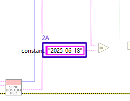 | 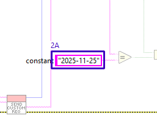 |

**3. VI Attribute - Documentation (VI Properties)**

- **3A** description text : changed from "initialize answers with the protocol version the client asked for if the server supports it, otherwise with the version the server prefers." to "initialize answers with the protocol version the client asked for if the server supports it in the legacy era, otherwise with the version the server prefers: the newest legacy version, 2025-11-25 (it was 2025-06-18 before 2025-11-25 was added)."

Whole block diagram and front panel

| Before | After |
|---|---|
|  | 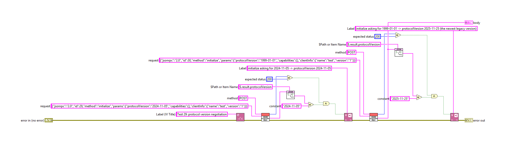 |

| Before | After |
|---|---|
|  |  |

### `src/MCP Server/Ask User.vi` (added)

Block diagram (case structures show their visible frame only):

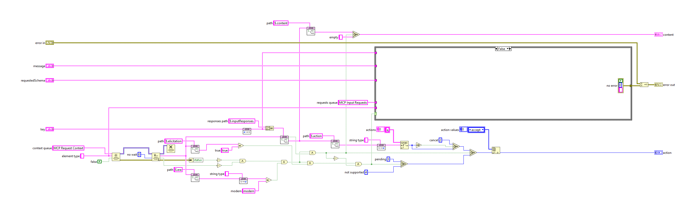

Front panel

All case frames (1 hidden frames)

| Frame | Picture |
|---|---|
| Whole diagram, visible frames: Case structure 1: False | 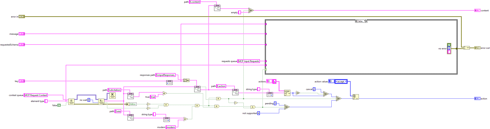 |
| Case structure 1: True |  |

### `src/MCP Server/Build Unsupported Version Error.vi` (added)

Block diagram (case structures show their visible frame only):

Front panel

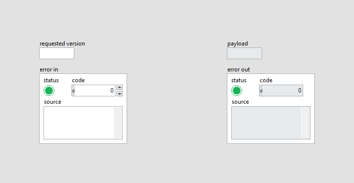

### `src/MCP Server/Cache Hints.vi` (added)

Block diagram (case structures show their visible frame only):

Front panel

### `src/MCP Server/Check Modern MCP Request.vi` (added)

Block diagram (case structures show their visible frame only):

Front panel

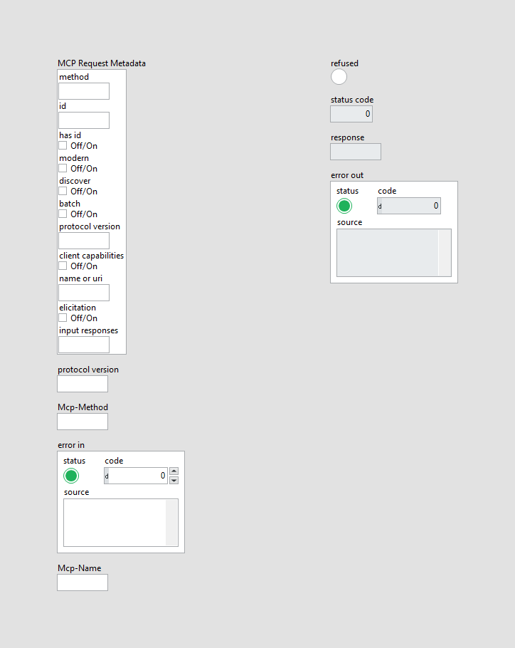

### `src/MCP Server/Collect MCP Input Requests.vi` (added)

Block diagram (case structures show their visible frame only):

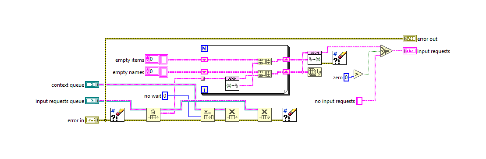

Front panel

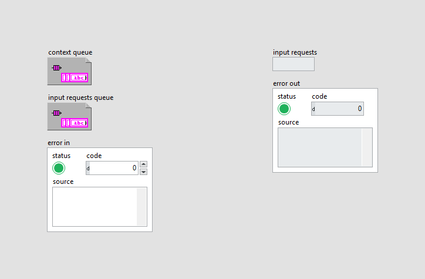

### `src/MCP Server/Complete Modern MCP Result.vi` (added)

Block diagram (case structures show their visible frame only):

Front panel

All case frames (1 hidden frames)

| Frame | Picture |
|---|---|
| Whole diagram, visible frames: Case structure 1: False | 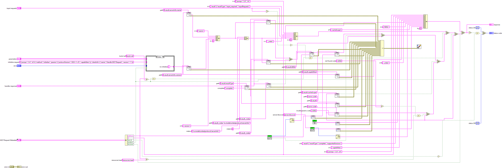 |
| Case structure 1: True |  |

### `src/MCP Server/Confirm With User.vi` (added)

Block diagram (case structures show their visible frame only):

Front panel

### `src/MCP Server/Handle MCP Request.vi` (added)

Block diagram (case structures show their visible frame only):

Front panel

All case frames (1 hidden frames)

| Frame | Picture |
|---|---|
| Whole diagram, visible frames: Case structure 1: True | 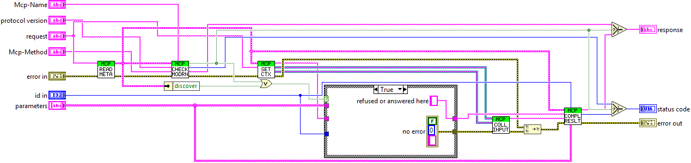 |
| Case structure 1: False |  |

### `src/MCP Server/MCP Request Metadata.ctl` (added)

Block diagram (case structures show their visible frame only):

Front panel

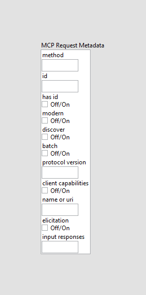

### `src/MCP Server/Read MCP Request Metadata.vi` (added)

Block diagram (case structures show their visible frame only):

Front panel

### `src/MCP Server/Set MCP Request Context.vi` (added)

Block diagram (case structures show their visible frame only):

Front panel

### `tests/Add Fixture Confirm Tool.vi` (added)

Block diagram (case structures show their visible frame only):

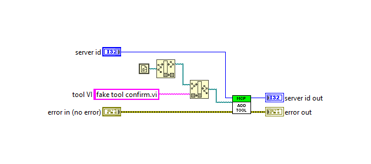

Front panel

### `tests/fake tool confirm.vi` (added)

Block diagram (case structures show their visible frame only):

Front panel

### `tests/test elicitation.vi` (added)

Block diagram (case structures show their visible frame only):

Front panel

### `tests/test modern errors.vi` (added)

Block diagram (case structures show their visible frame only):

Front panel

### `tests/test modern headers.vi` (added)

Block diagram (case structures show their visible frame only):

Front panel

### `tests/test modern tools list.vi` (added)

Block diagram (case structures show their visible frame only):

Front panel

### `tests/test server discover.vi` (added)

Block diagram (case structures show their visible frame only):

Front panel

