## VI diff report

6 modified, 7 added, 0 deleted. Generated by LabVIEW's VI comparison; position and size changes are not shown.

### `src/MCP Server/Add Array Items To Schema.vi` (modified)

**1. Block Diagram objects**

- **1A** String Constant "constant" - deleted at (735,482)
- **1B** Equal? "Equal?" - deleted at (845,418)
- **1C** String Constant "constant" - deleted at (850,302)
- **1D** SubVI "JSONtext.lvlib:To JSON Text.vim" - deleted at (852,351)
- **1E** Numeric Constant "1D" - deleted at (854,570)
- **1F** Greater Or Equal?  - deleted at (877,450)
- **1G** Decrement  - deleted at (877,562)
- **1H** String Constant "constant" - deleted at (879,271)
- **1I** String Constant "constant" - deleted at (886,381)
- **1J** Initialize Array  - deleted at (948,443)
- **1K** Initialize Array  - deleted at (948,493)
- **1L** Concatenate Strings "Concatenate Strings" - deleted at (954,343)
- **1M** String Constant "constant" - deleted at (995,380)
- **1N** Concatenate Strings "Concatenate Strings" - deleted at (1048,343)
- **1O** And "And" - deleted at (1051,424)
- **1P** String Constant "$Path or Item Name" - deleted at (1106,240)
- **1Q** And "And" - deleted at (1110,428)
- **1R** SubVI "JSONtext.lvlib:Merge into Object.vi" - added at (1169,344)
- **1S** SubVI "JSONtext.lvlib:Set Item.vi" - deleted at (1169,344)
- **1T** wiring changes

| Before | After |
|---|---|
| 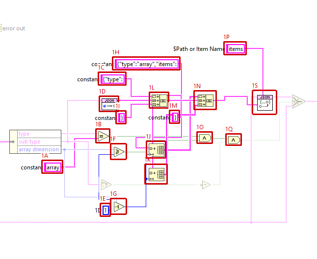 | 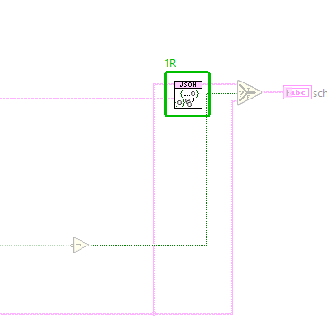 |

**2. VI Attribute - Documentation (VI Properties)**

- **2A** description text : changed from "Completes the JSON schema of one tool input. JSON Schema wants an array to say what its elements are, so for an input of type array the schema gets "items": {"type": }. An array of N dimensions gets N-1 levels of {"type":"array","items":...} around that, so a 2D array is an array of arrays and a 3D array an array of arrays of arrays. Other inputs, and arrays whose sub type is empty, are passed through unchanged." to "Completes the JSON schema of one tool input. sub type of the input holds the JSON Schema of its LabVIEW type, made by LV Type To JSON Schema.vi: items for arrays of any dimension (an element type without a JSON equivalent gives "items":{}), properties for clusters, format date-time for timestamps and the item names of enums. It is merged into the input's schema (type, description), so its members are added and its type wins. An input whose sub type is empty is passed through unchanged."

Whole block diagram and front panel

| Before | After |
|---|---|
|  |  |

| Before | After |
|---|---|
|  |  |

### `src/MCP Server/Call VI.vi` (modified)

**1. Block Diagram objects**

- **1A** Case Structure  - deleted at (426,14)
- **1B** Variant "Variant" - deleted at (861,34)
- **1C** Numeric Constant  - deleted at (448,34)
- **1D** SubVI "JSONtext.lvlib:From JSON Text.vim" - deleted at (471,66)
- **1E** To Variant  - deleted at (543,65)
- **1F** String Constant  - deleted at (446,34)
- **1G** SubVI "JSONtext.lvlib:From JSON Text.vim" - deleted at (473,68)
- **1H** To Variant  - deleted at (538,67)
- **1I** Boolean Constant  - deleted at (446,34)
- **1J** SubVI "JSONtext.lvlib:From JSON Text.vim" - deleted at (472,62)
- **1K** To Variant  - deleted at (543,61)
- **1L** Case Structure  - deleted at (446,49)
- **1M** String Constant "source" - deleted at (549,125)
- **1N** Cluster Constant "error out" - deleted at (744,69)
- **1O** Format Into String  - deleted at (746,158)
- **1P** Bundle By Name  - deleted at (792,156)
- **1Q** Variant "Variant" - deleted at (834,69)
- **1R** Array Constant "Input Values" - deleted at (554,69)
- **1S** SubVI "JSONtext.lvlib:From JSON Text.vim" - deleted at (587,87)
- **1T** SubVI "JSONtext.lvlib:From JSON Text.vim" - deleted at (587,85)
- **1U** Array Constant "Input Values" - deleted at (556,69)
- **1V** To Variant  - deleted at (631,84)
- **1W** Tunnel  - deleted at (446,69)
- **1X** Tunnel  - deleted at (446,81)
- **1Y** Tunnel  - deleted at (861,74)
- **1Z** Tunnel  - deleted at (861,101)
- **127** Tunnel  - deleted at (426,61)
- **128** Tunnel  - deleted at (426,73)
- **129** Tunnel  - deleted at (426,85)
- **130** Tunnel  - deleted at (426,97)
- **131** SubVI "MCP Server.lvlib:JSON To Control Value.vi" - added at (892,175)
- **132** Tunnel  - deleted at (893,39)
- **133** Tunnel  - deleted at (893,73)
- **134** wiring changes

| Before | After |
|---|---|
| 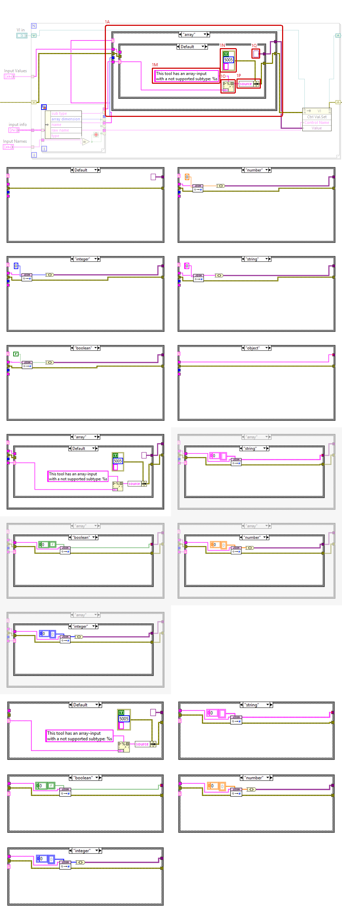 | 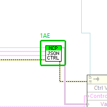 |

**2. Block Diagram objects**

- **2A** Case Structure  - number of cases : changed from "<tt>8</tt>" to "<tt>4</tt>"
- **2B** Diagram Identifier  - selector value(s) : changed from "<tt> Default   "number"   "integer"   "string"   "boolean"   "object"   "array"   "picture" </tt>" to "<tt> Default   "boolean", "integer", "number", "object", "string"   "array"   "picture" </tt>"

| Before | After |
|---|---|
| 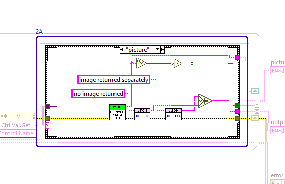 | 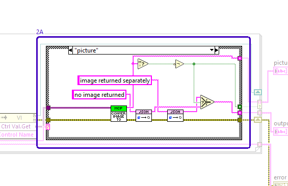 |

**3. Block Diagram objects**

- **3A** Case Structure  - case deleted : [ "number" ]
- **3B** Numeric Constant  - deleted at (1553,28)
- **3C** Variant To Data  - deleted at (1576,60)
- **3D** SubVI "JSONtext.lvlib:To JSON Text.vim" - deleted at (1834,68)

| Before | After |
|---|---|
| 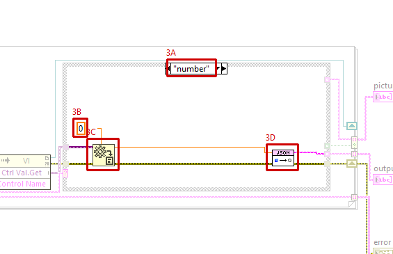 |  |

**4. Block Diagram objects**

- **4A** Case Structure  - case deleted : [ "integer" ]
- **4B** Numeric Constant  - deleted at (1553,28)
- **4C** Variant To Data  - deleted at (1576,60)
- **4D** SubVI "JSONtext.lvlib:To JSON Text.vim" - deleted at (1834,68)

| Before | After |
|---|---|
| 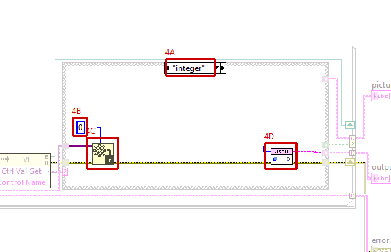 | 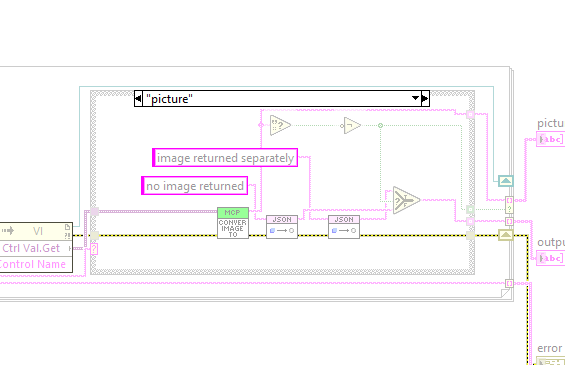 |

**5. Block Diagram objects**

- **5A** Case Structure  - case deleted : [ "string" ]
- **5B** String Constant  - deleted at (1758,26)
- **5C** Variant To Data  - deleted at (1785,60)
- **5D** SubVI "JSONtext.lvlib:To JSON Text.vim" - deleted at (1834,68)

| Before | After |
|---|---|
| 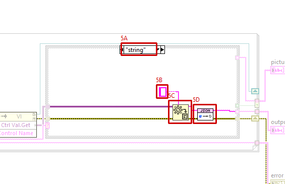 |  |

**6. Block Diagram objects**

- **6A** Case Structure  - case deleted : [ "boolean" ]
- **6B** Boolean Constant  - deleted at (1552,32)
- **6C** Variant To Data  - deleted at (1578,60)
- **6D** SubVI "JSONtext.lvlib:To JSON Text.vim" - deleted at (1834,68)

| Before | After |
|---|---|
| 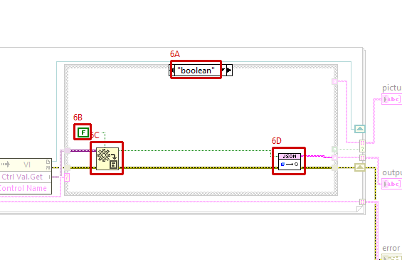 |  |

**7. VI Attribute - Documentation (VI Properties)**

- **7A** description text : changed from "" to "Sets the tool VI's controls from the tools/call arguments, runs the VI and reads its outputs. Each argument is converted into the data type of its control by JSON To Control Value.vi (JSONtext), so arrays of any dimension, clusters (members named by element label), timestamps (ISO 8601 strings) and enums (item names) are accepted. Each output is serialized from its control value with JSONtext To JSON Text, except pictures, which are returned as images."

Whole block diagram and front panel

| Before | After |
|---|---|
| 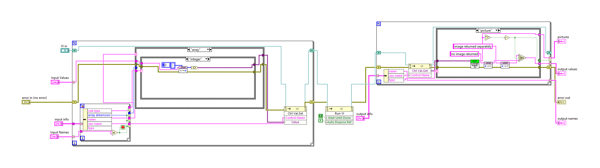 | 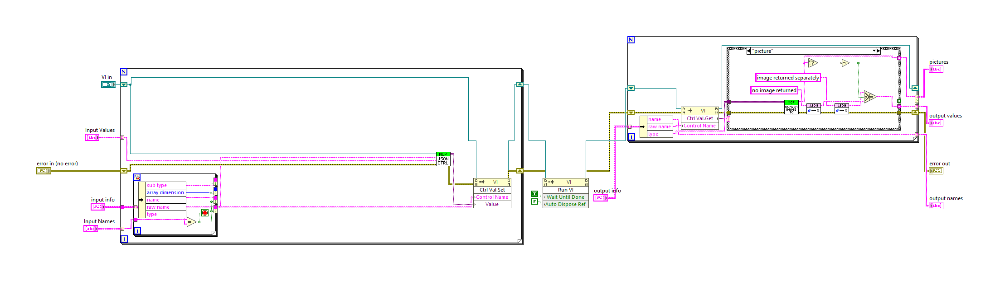 |

| Before | After |
|---|---|
| 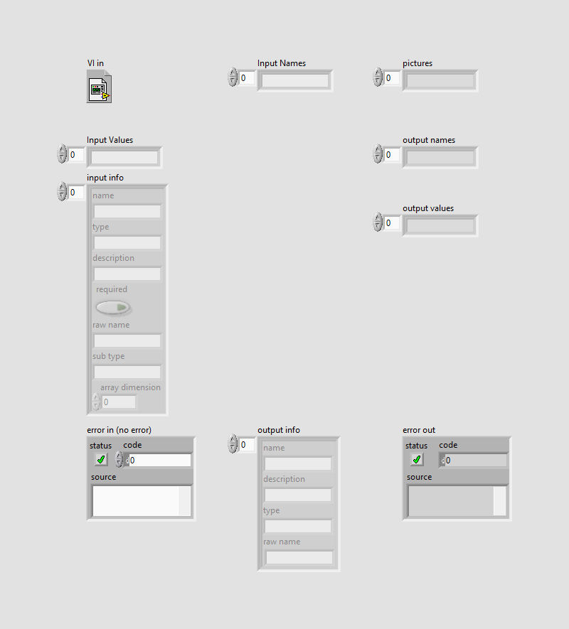 |  |

### `src/MCP Server/Get Connector Pane Info.vi` (modified)

**1. Block Diagram objects**

- **1A** SubVI "MCP Server.lvlib:LV Type To JSON Schema.vi" - added at (768,156)
- **1B** Tunnel  - deleted at (995,110)
- **1C** wiring changes

| Before | After |
|---|---|
| 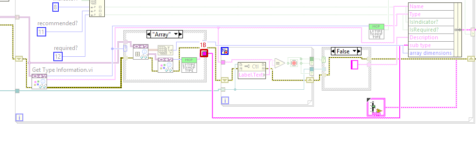 | 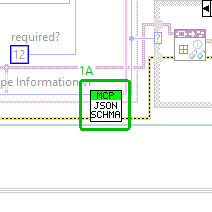 |

**2. Block Diagram objects**

- **2A** String Constant "JSON to Insert" - deleted at (968,105)
- **2B** Tunnel  - deleted at (995,110)

| Before | After |
|---|---|
| 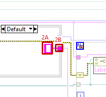 | 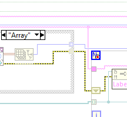 |

**3. Block Diagram objects**

- **3A** SubVI "NI_Data Type.lvlib:Get Type Information.vi" - deleted at (903,122)
- **3B** SubVI "MCP Server.lvlib:LV type to MCP type.vi" - deleted at (952,122)
- **3C** Tunnel  - deleted at (995,110)
- **3D** wiring changes

| Before | After |
|---|---|
| 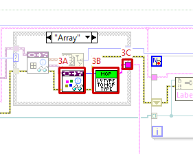 | 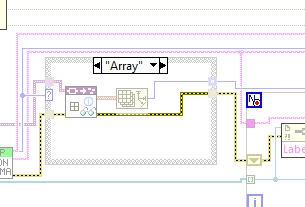 |

Whole block diagram and front panel

| Before | After |
|---|---|
|  |  |

| Before | After |
|---|---|
|  |  |

### `src/MCP Server/LV type to MCP type.vi` (modified)

**1. Block Diagram objects**

- **1A** Diagram Identifier  - selector value(s) : changed from "<tt> "Invalid Type", Default   "Void"   "I8".."U64", "Enum U8".."Enum U64"   "Single Float".."Extended Complex", "Single Float With Unit".."Extended Complex with Unit"   "Boolean"   "String", "Path"   "Cluster"   "Array"   "Picture" </tt>" to "<tt> "Invalid Type", Default   "Void"   "I8".."U64", "Enum U8".."Enum U64"   "Single Float".."Extended Complex", "Single Float With Unit".."Extended Complex with Unit"   "Boolean"   "String", "Path", "Timestamp"   "Cluster"   "Array"   "Picture" </tt>"

| Before | After |
|---|---|
| 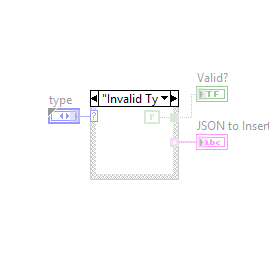 |  |

Whole block diagram and front panel

| Before | After |
|---|---|
| 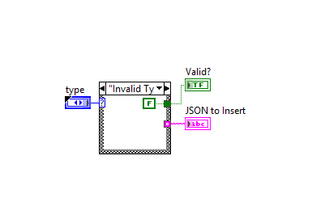 |  |

| Before | After |
|---|---|
|  | 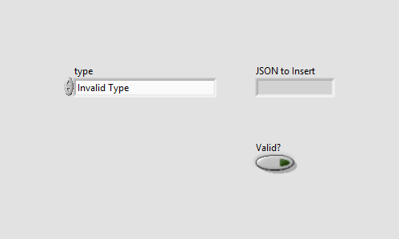 |

### `tests/Test_MCP_Server.vi` (modified)

**1. Block Diagram objects**

- **1A** SubVI "MCP Server tests.lvlib:Add Fixture Schema Shapes Tool.vi" - added at (1614,323)
- **1B** wiring changes

| Before | After |
|---|---|
| 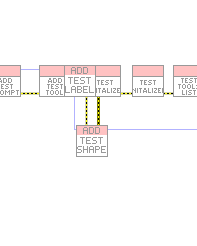 | 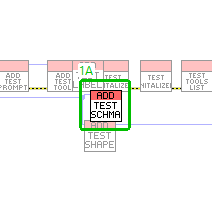 |

**2. Block Diagram objects**

- **2A** SubVI "MCP Server tests.lvlib:test tools list schema details.vi" - added at (3494,304)
- **2B** SubVI "MCP Server tests.lvlib:test tools call schema shapes.vi" - added at (3506,288)
- **2C** SubVI "MCP Server tests.lvlib:test tools list every array has items.vi" - added at (3518,296)
- **2D** wiring changes

| Before | After |
|---|---|
| 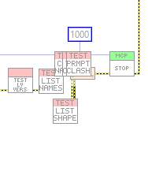 | 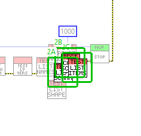 |

Whole block diagram and front panel

| Before | After |
|---|---|
|  |  |

| Before | After |
|---|---|
|  |  |

### `tests/test tools call array.vi` (modified)

**1. Block Diagram objects**

- **1A** String Constant "y" - data value : changed from "<tt></tt>" to "<tt></tt>"

| Before | After |
|---|---|
| 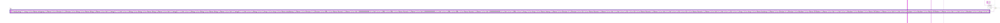 | 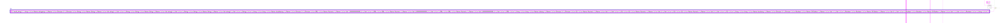 |

Whole block diagram and front panel

| Before | After |
|---|---|
|  | 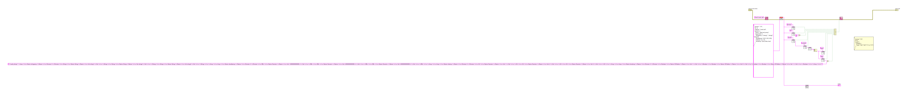 |

| Before | After |
|---|---|
|  |  |

### `src/MCP Server/JSON To Control Value.vi` (added)

Block diagram (case structures show their visible frame only):

Front panel

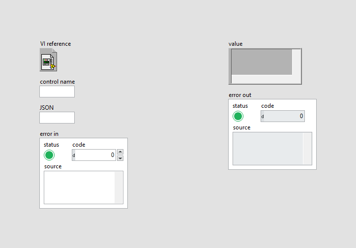

### `src/MCP Server/LV Type To JSON Schema.vi` (added)

Block diagram (case structures show their visible frame only):

Front panel

### `tests/Add Fixture Schema Shapes Tool.vi` (added)

Block diagram (case structures show their visible frame only):

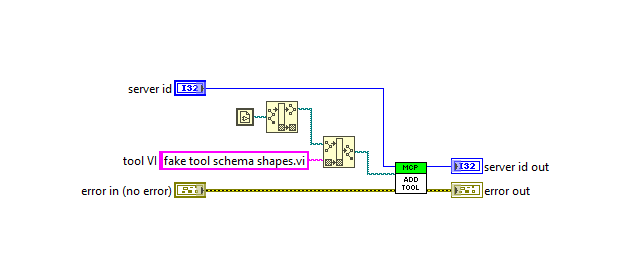

Front panel

### `tests/fake tool schema shapes.vi` (added)

Block diagram (case structures show their visible frame only):

Front panel

### `tests/test tools call schema shapes.vi` (added)

Block diagram (case structures show their visible frame only):

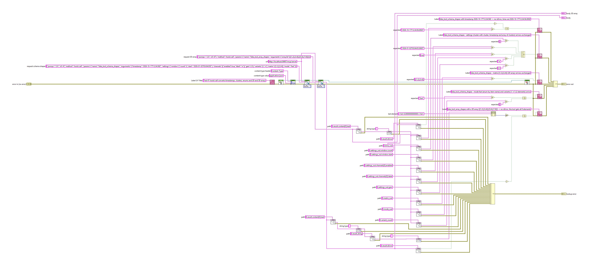

Front panel

### `tests/test tools list every array has items.vi` (added)

Block diagram (case structures show their visible frame only):

Front panel

### `tests/test tools list schema details.vi` (added)

Block diagram (case structures show their visible frame only):

Front panel

