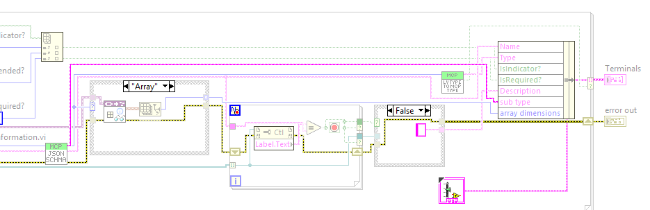
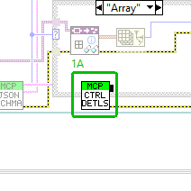
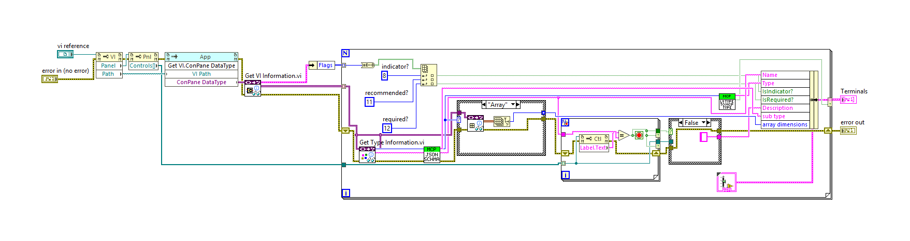
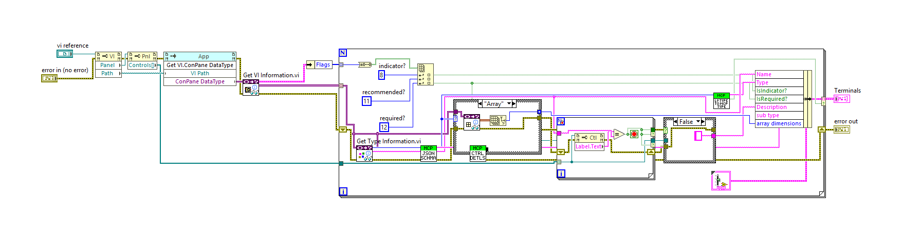
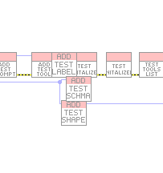
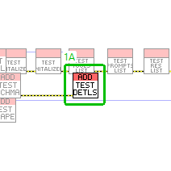
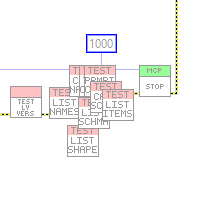
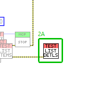
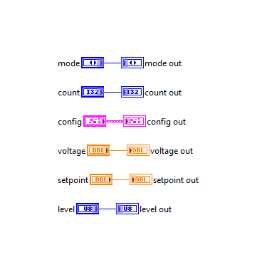

## VI diff report

2 modified, 4 added, 0 deleted. Generated by LabVIEW's VI comparison; position and size changes are not shown.

### `src/MCP Server/Get Connector Pane Info.vi` (modified)

**1. Block Diagram objects**

- **1A** SubVI "MCP Server.lvlib:Add Control Details To Schema.vi" - added at (864,156)
- **1B** wiring changes

| Before | After |
|---|---|
|  |  |

Whole block diagram and front panel

| Before | After |
|---|---|
|  |  |

| Before | After |
|---|---|
|  |  |

### `tests/Test_MCP_Server.vi` (modified)

**1. Block Diagram objects**

- **1A** SubVI "MCP Server tests.lvlib:Add Fixture Schema Details Tool.vi" - added at (1710,323)
- **1B** wiring changes

| Before | After |
|---|---|
|  |  |

**2. Block Diagram objects**

- **2A** SubVI "MCP Server tests.lvlib:test tools list descriptions defaults ranges.vi" - added at (3614,296)
- **2B** wiring changes

| Before | After |
|---|---|
|  |  |

Whole block diagram and front panel

| Before | After |
|---|---|
|  |  |

| Before | After |
|---|---|
|  |  |

### `src/MCP Server/Add Control Details To Schema.vi` (added)

Block diagram (case structures show their visible frame only):

Front panel

### `tests/Add Fixture Schema Details Tool.vi` (added)

Block diagram (case structures show their visible frame only):

Front panel

### `tests/fake tool schema details.vi` (added)

Block diagram (case structures show their visible frame only):

Front panel

### `tests/test tools list descriptions defaults ranges.vi` (added)

Block diagram (case structures show their visible frame only):

Front panel

