## VI diff report

2 modified, 3 added, 0 deleted. Generated by LabVIEW's VI comparison; position and size changes are not shown.

### `src/MCP Server/Add Array Items To Schema.vi` (modified)

**1. Block Diagram objects**

- **1A** Numeric Constant "2D" - deleted at (854,458)
- **1B** Greater Or Equal?  - added at (877,450)
- **1C** Equal?  - deleted at (877,450)
- **1D** Decrement  - added at (877,562)
- **1E** Equal?  - deleted at (877,562)
- **1F** Initialize Array  - added at (948,443)
- **1G** Initialize Array  - added at (948,493)
- **1H** Or  - deleted at (954,448)
- **1I** Select  - deleted at (1109,351)
- **1J** wiring changes

| Before | After |
|---|---|
| 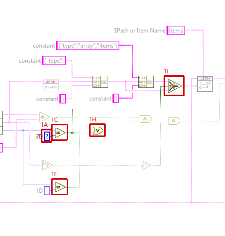 | 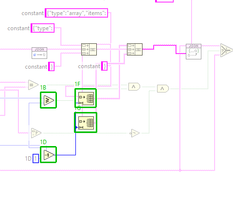 |

**2. VI Attribute - Documentation (VI Properties)**

- **2A** description text : changed from "Completes the JSON schema of one tool input. JSON Schema wants an array to say what its elements are, so for an input of type array the schema gets "items": {"type": }. A 2D array gets an array of arrays. Other inputs, and arrays of more than two dimensions, are passed through unchanged." to "Completes the JSON schema of one tool input. JSON Schema wants an array to say what its elements are, so for an input of type array the schema gets "items": {"type": }. An array of N dimensions gets N-1 levels of {"type":"array","items":...} around that, so a 2D array is an array of arrays and a 3D array an array of arrays of arrays. Other inputs, and arrays whose sub type is empty, are passed through unchanged."

Whole block diagram and front panel

| Before | After |
|---|---|
| 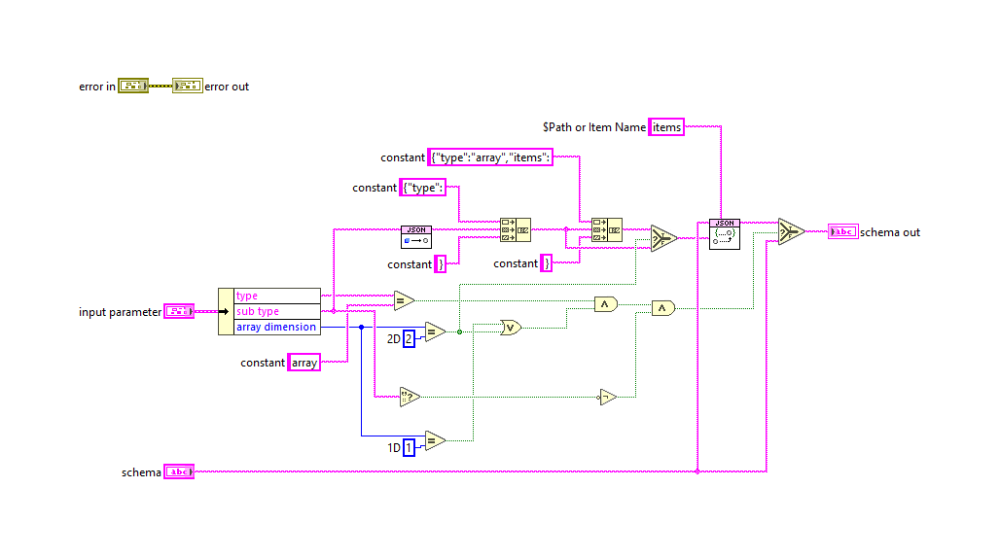 | 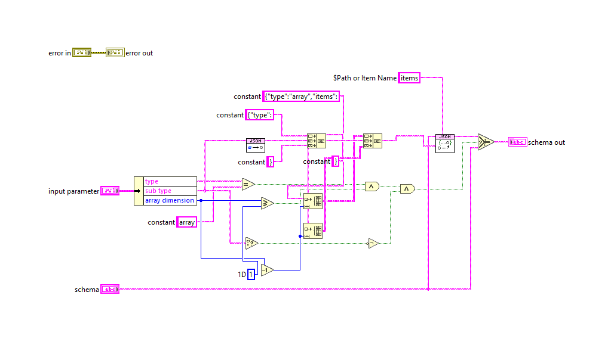 |

| Before | After |
|---|---|
| 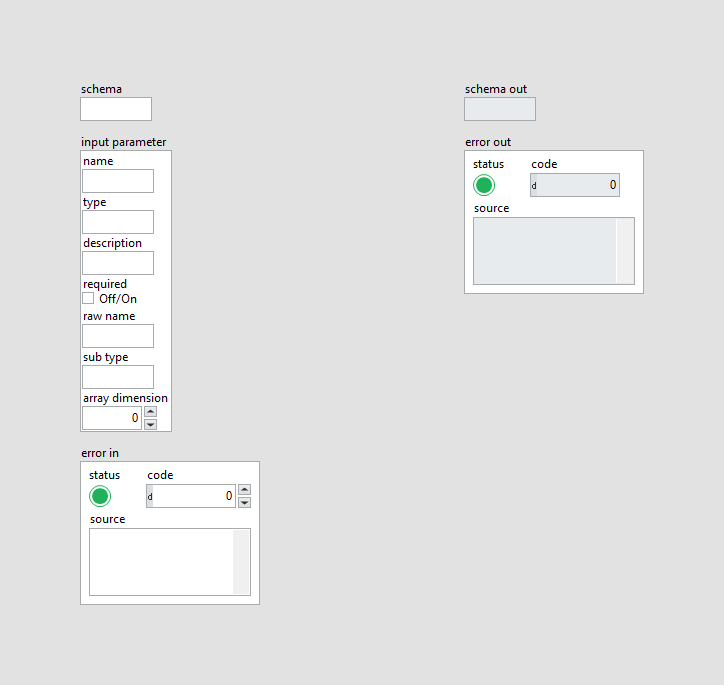 |  |

### `tests/Test_MCP_Server.vi` (modified)

**1. Block Diagram objects**

- **1A** SubVI "MCP Server tests.lvlib:Add Fixture Array Shapes Tool.vi" - added at (1608,353)
- **1B** wiring changes

| Before | After |
|---|---|
| 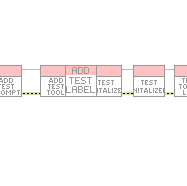 | 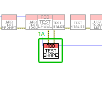 |

**2. Block Diagram objects**

- **2A** SubVI "MCP Server tests.lvlib:test tools list array shapes.vi" - added at (3483,332)
- **2B** wiring changes

| Before | After |
|---|---|
| 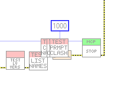 | 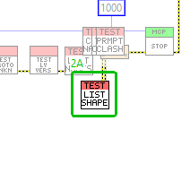 |

Whole block diagram and front panel

| Before | After |
|---|---|
| 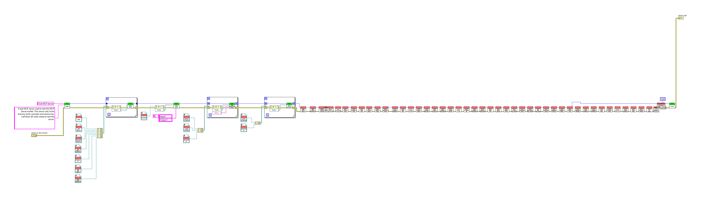 | 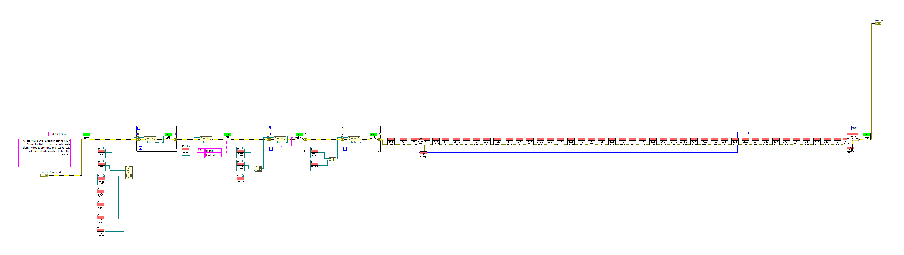 |

| Before | After |
|---|---|
|  |  |

### `tests/Add Fixture Array Shapes Tool.vi` (added)

Block diagram (case structures show their visible frame only):

Front panel

### `tests/fake tool array shapes.vi` (added)

Block diagram (case structures show their visible frame only):

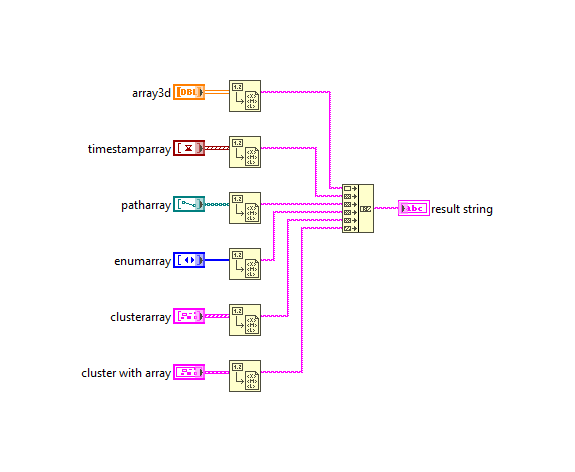

Front panel

### `tests/test tools list array shapes.vi` (added)

Block diagram (case structures show their visible frame only):

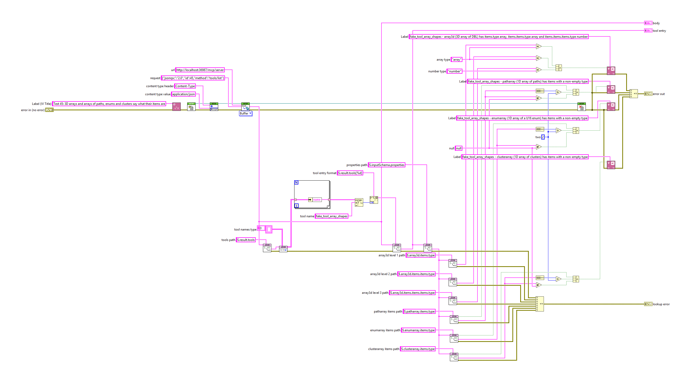

Front panel

