## VI diff report

8 modified, 11 added, 0 deleted. Generated by LabVIEW's VI comparison; position and size changes are not shown.

### `src/MCP Server/Add Tool.vi` (modified)

**1. Block Diagram objects**

- **1A** Front Panel Terminal "title" - added at (-1494,-331)
- **1B** Tunnel  - added at (-990,-420)

| Before | After |
|---|---|
| 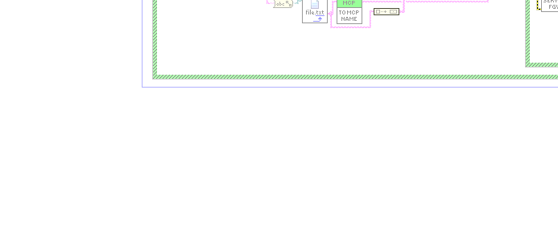 | 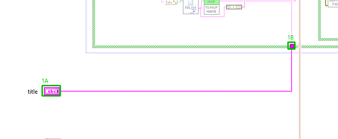 |

**2. Block Diagram objects**

- **2A** Front Panel Terminal "annotations" - added at (-1491,-226)
- **2B** Tunnel  - added at (-974,-420)

| Before | After |
|---|---|
| 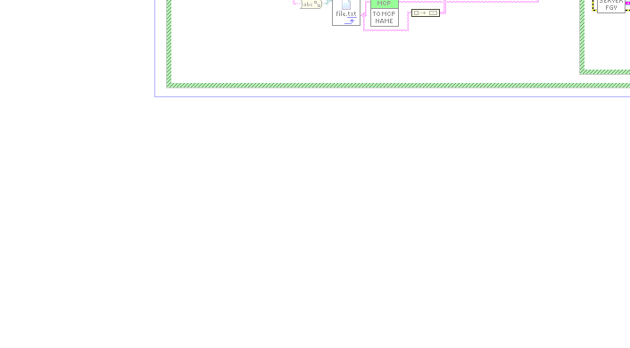 | 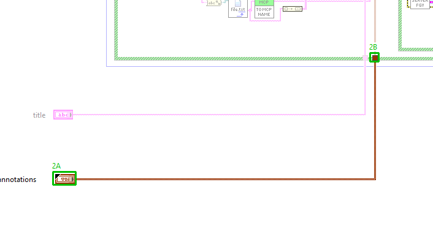 |

**3. Block Diagram objects**

- **3A** Tunnel  - added at (-990,-420)
- **3B** Tunnel  - added at (-974,-420)
- **3C** wiring changes

| Before | After |
|---|---|
| 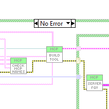 | 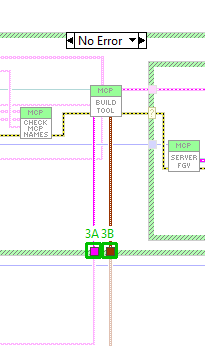 |

**4. Front Panel - Panel**

- **4A** Connector Pane  - control/indicator assignment : changed

| Before | After |
|---|---|
| 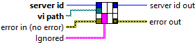 | 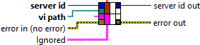 |

**5. Front Panel objects**

- **5A** String "title" - added at (20,319)

| Before | After |
|---|---|
| 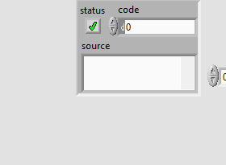 | 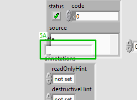 |

**6. Front Panel objects**

- **6A** Type Definition "annotations" - added at (20,357)

| Before | After |
|---|---|
| 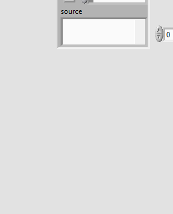 | 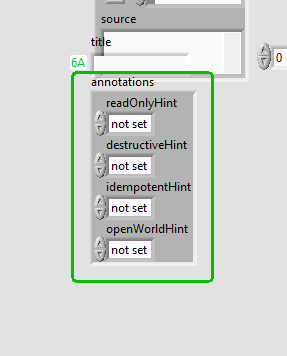 |

**7. VI Attribute - Documentation (VI Properties)**

- **7A** description text : changed from "Adds a "tool" to the MCP server. Tools are functions the LLM can call during a chat response. Tools are SubVIs. Controls on the connector pane of the SubVI are the in- and outputs of a tool. Use "irgnored" to hide any control from the LLM. Use the description property of a control to add additional information to the parameter for the LLM. Use the VI description for an overall human understandable description of the function and it's usage. Be precise, but don't write tons of text, this description will cost you tokens." to "Adds a "tool" to the MCP server. Tools are functions the LLM can call during a chat response. Tools are SubVIs. Controls on the connector pane of the SubVI are the in- and outputs of a tool. Use "irgnored" to hide any control from the LLM. Use the description property of a control to add additional information to the parameter for the LLM. Use the VI description for an overall human understandable description of the function and it's usage. Be precise, but don't write tons of text, this description will cost you tokens.

Optional: title gives the tool a human-readable display name, and annotations gives behaviour hints (readOnlyHint, destructiveHint, idempotentHint, openWorldHint). Both are sent in tools/list only when they are set; see the descriptions of those two controls.

The outputs of the tool that are not pictures are described in tools/list as outputSchema, and tools/call returns them as structuredContent next to the text."

Whole block diagram and front panel

| Before | After |
|---|---|
| 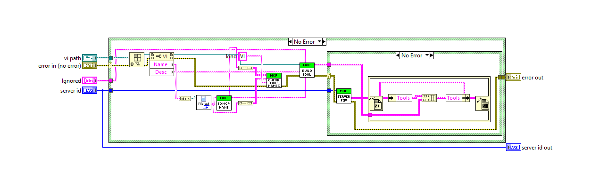 |  |

| Before | After |
|---|---|
| 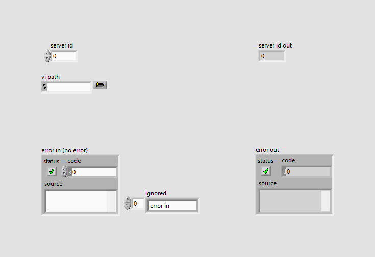 |  |

### `src/MCP Server/Build Tool.vi` (modified)

**1. Block Diagram objects**

- **1A** Front Panel Terminal "title" - added at (143,573)
- **1B** Front Panel Terminal "annotations" - added at (146,678)
- **1C** Bundle By Name  - number of elements : changed from "<tt>5</tt>" to "<tt>7</tt>"
- **1D** Bundle By Name  - element 5 added : "title"
- **1E** Bundle By Name  - element 6 added : "annotations"
- **1F** Front Panel Terminal "array" - data type : changed
- **1G** wiring changes

| Before | After |
|---|---|
| 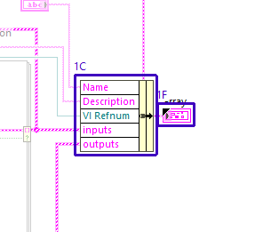 | 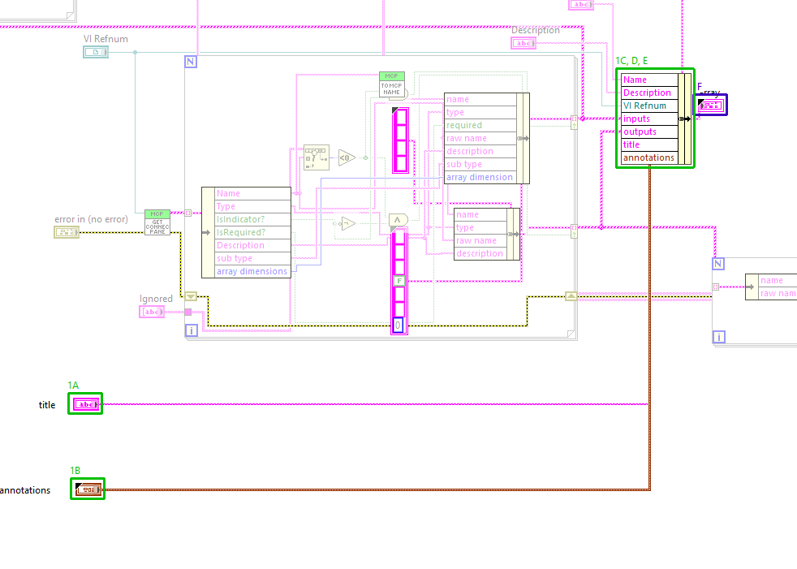 |

**2. Front Panel - Panel**

- **2A** Connector Pane  - control/indicator assignment : changed

| Before | After |
|---|---|
| 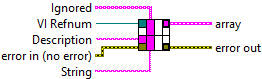 | 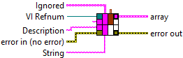 |

**4. Front Panel objects**

- **4A** String "title" - added at (20,439)

| Before | After |
|---|---|
|  | 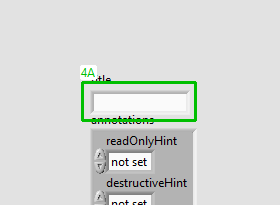 |

**5. Front Panel objects**

- **5A** Type Definition "annotations" - added at (20,477)

| Before | After |
|---|---|
|  | 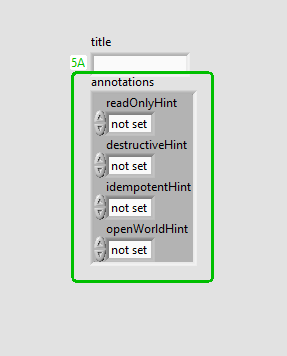 |

Whole block diagram and front panel

| Before | After |
|---|---|
| 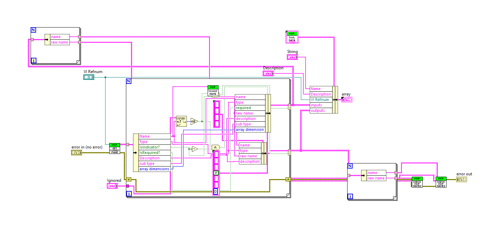 | 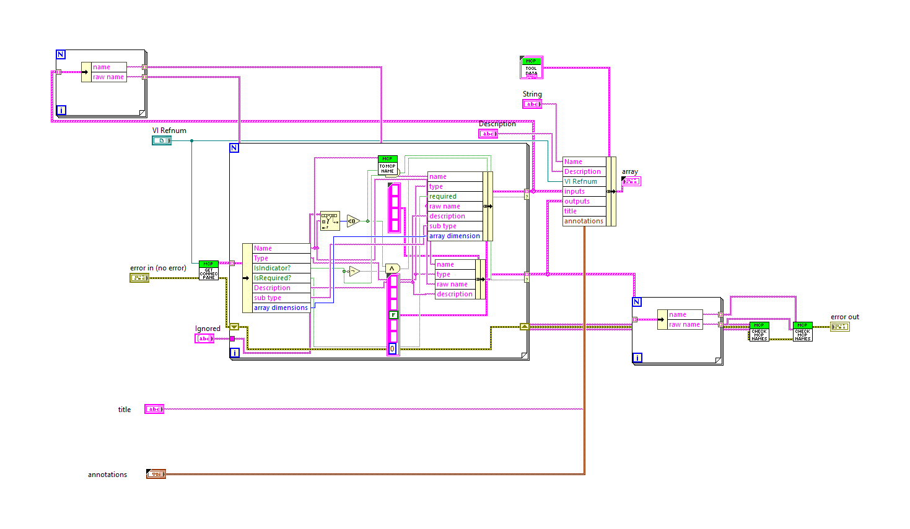 |

| Before | After |
|---|---|
| 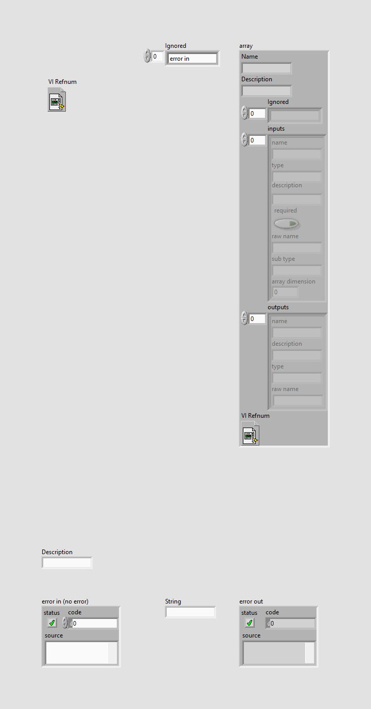 | 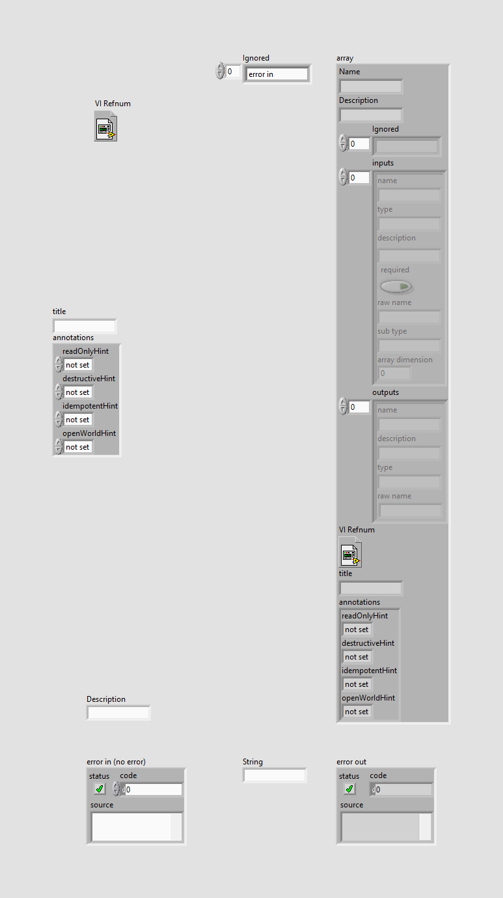 |

### `src/MCP Server/Check Tool Arguments.vi` (modified)

**1. Block Diagram objects**

- **1A** String Constant "constant" - data value : changed from "<tt>","error":{"code":-32602,"message":"</tt>" to "<tt>","result":{"content":[{"type":"text","text":"</tt>"
- **1B** String Constant "constant" - data value : changed from "<tt>"}}"</tt>" to "<tt>"}],"isError":true}}"</tt>"

| Before | After |
|---|---|
| 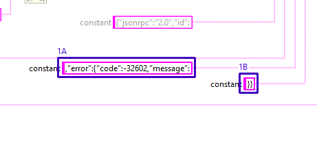 | 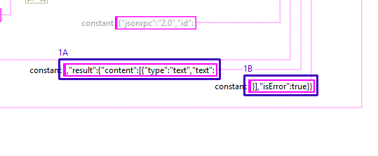 |

**3. VI Attribute - Documentation (VI Properties)**

- **3A** description text : changed from "Checks that a tools/call request gives every required input of the tool. A required input is one that is set to Required on the connector pane of the tool VI (tools/list lists it in inputSchema.required).

If the tool is registered, arguments is missing or a JSON object, and one or more required inputs are not in it:
- error out is LabVIEW error 402841 (the code JSONtext uses for a missing item) with the text Missing required argument(s): followed by the names. Wired to Call VI.vi, this keeps the tool from running.
- response out is JSON-RPC error -32602 (Invalid params) with that text and the id of the request.
Otherwise error out is error in and response out is response.

Arguments that the tool does not have are not checked here. tool call.vi calls this VI twice: before Call VI.vi on the error wire, and at the end on the response wire. The same logic is in Check Prompt Arguments.vi for prompts/get." to "Checks that a tools/call request gives every required input of the tool. A required input is one that is set to Required on the connector pane of the tool VI (tools/list lists it in inputSchema.required).

If the tool is registered, arguments is missing or a JSON object, and one or more required inputs are not in it:
- error out is LabVIEW error 402841 (the code JSONtext uses for a missing item) with the text Missing required argument(s): followed by the names. Wired to Call VI.vi, this keeps the tool from running.
- response out is a tools/call result with isError true and that text as its only content item, with the id of the request. Since MCP 2025-11-25 an input validation error is a tool execution error, not a protocol error, so that the model can correct the call.
Otherwise error out is error in and response out is response.

Arguments that the tool does not have are not checked here. tool call.vi calls this VI twice: before Call VI.vi on the error wire, and at the end on the response wire. Check Prompt Arguments.vi does the same for prompts/get, where a missing argument stays a JSON-RPC error."

Whole block diagram and front panel

| Before | After |
|---|---|
|  | 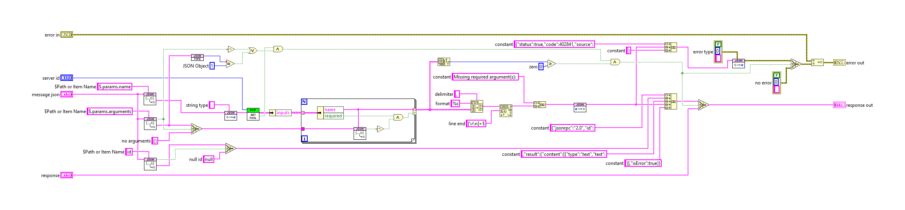 |

| Before | After |
|---|---|
| 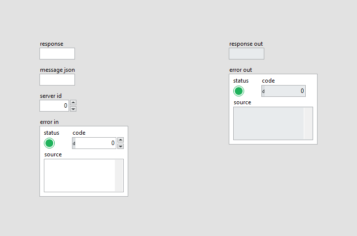 |  |

### `src/MCP Server/Tool Data.ctl` (modified)

**1. Front Panel - Cluster**

- **1A** Cluster "Tool Data" - cluster elements added/deleted : changed from "<tt></tt>" to "<tt>title annotations</tt>"

| Before | After |
|---|---|
| 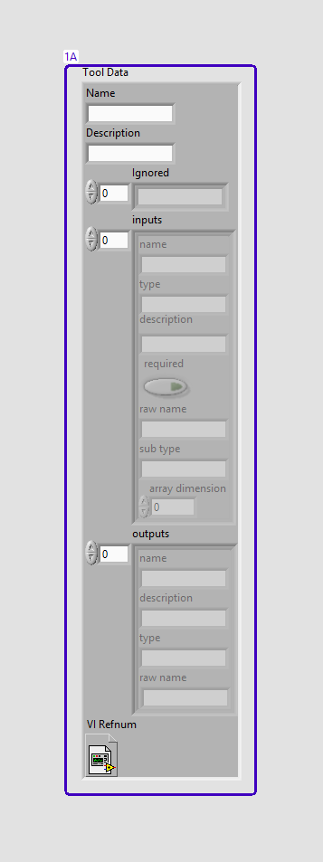 | 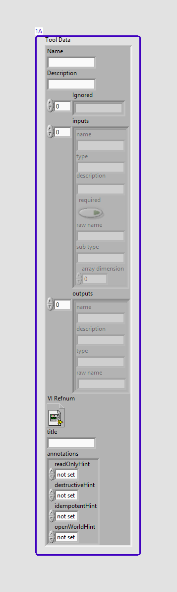 |

Whole block diagram and front panel

| Before | After |
|---|---|
|  |  |

| Before | After |
|---|---|
| 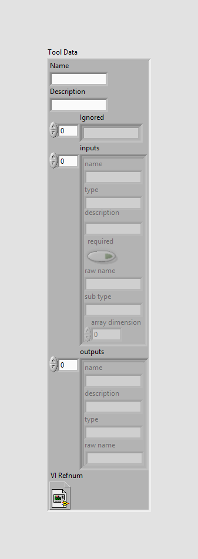 | 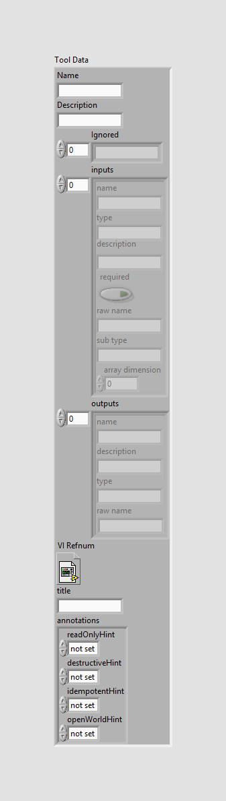 |

### `src/MCP Server/tool call.vi` (modified)

**1. Block Diagram objects**

- **1A** SubVI "MCP Server.lvlib:Add Structured Content.vi" - added at (1095,-300)
- **1B** wiring changes

| Before | After |
|---|---|
| 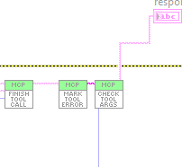 | 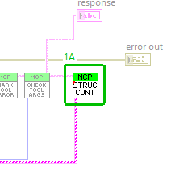 |

Whole block diagram and front panel

| Before | After |
|---|---|
| 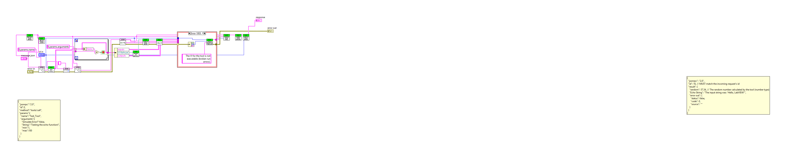 | 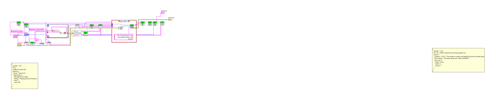 |

| Before | After |
|---|---|
|  | 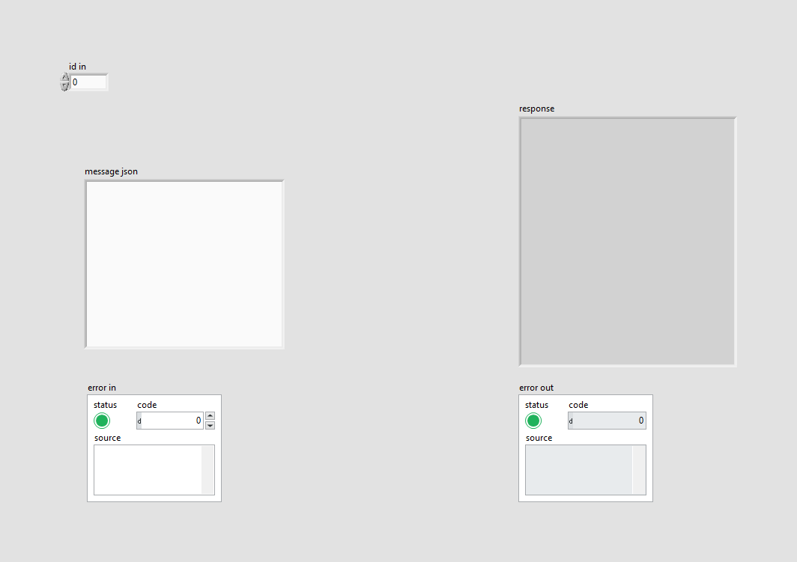 |

### `src/MCP Server/tool list.vi` (modified)

**1. Block Diagram objects**

- **1A** Unbundle By Name "Unbundle By Name" - number of elements : changed from "<tt>4</tt>" to "<tt>7</tt>"
- **1B** Unbundle By Name "Unbundle By Name" - element 4 added : "title"
- **1C** Unbundle By Name "Unbundle By Name" - element 5 added : "annotations"
- **1D** Unbundle By Name "Unbundle By Name" - element 6 added : "VI Refnum"
- **1E** String Constant "<JSON>" - deleted at (1018,798)
- **1F** SubVI "MCP Server.lvlib:Get Connector Pane Info.vi" - added at (1060,792)
- **1G** For Loop  - deleted at (1095,767)
- **1H** Unbundle By Name  - deleted at (1236,885)
- **1I** Cluster Constant  - deleted at (1244,792)
- **1J** Bundle By Name  - deleted at (1353,849)
- **1K** String Constant "JSON" - deleted at (1450,831)
- **1L** SubVI "JSONtext.lvlib:Merge Cluster into Object.vim" - deleted at (1479,845)
- **1M** SubVI "JSONtext.lvlib:Merge into Object.vi" - deleted at (1530,810)
- **1N** Shift Register  - deleted at (1095,799)
- **1O** Loop Tunnel  - deleted at (1095,820)
- **1P** Shift Register  - deleted at (1095,832)
- **1Q** Shift Register  - deleted at (1574,799)
- **1R** Shift Register  - deleted at (1574,832)
- **1S** Loop Tunnel  - deleted at (1581,787)
- **1T** String Constant "$Path or Item Name" - deleted at (2001,645)
- **1U** Cluster Constant  - deleted at (2098,672)
- **1V** String Constant "type" - deleted at (2114,768)
- **1W** String Constant "JSON" - deleted at (2140,801)
- **1X** Bundle By Name  - deleted at (2180,732)
- **1Y** SubVI "JSONtext.lvlib:Merge into Object.vi" - deleted at (2193,800)
- **1Z** SubVI - Express VI configuration
- **127** String Constant "$Path or Item Name" - deleted at (2447,639)
- **128** SubVI "JSONtext.lvlib:Merge Cluster into Object.vim" - deleted at (2493,722)
- **129** String Constant "JSON" - deleted at (2569,677)
- **130** SubVI "JSONtext.lvlib:Merge into Object.vi" - deleted at (2596,727)
- **131** Diagram Disable Structure  - deleted at (2872,643)
- **132** SubVI "JSONtext.lvlib:Merge into Object.vi" - deleted at (2887,664)
- **133** Code Disable Tunnel  - deleted at (2872,664)
- **134** Code Disable Tunnel  - deleted at (2872,680)
- **135** Code Disable Tunnel  - deleted at (2872,688)
- **136** SubVI "MCP Server.lvlib:Complete Tool Entry.vi" - added at (2899,664)
- **137** Code Disable Tunnel  - deleted at (3163,664)
- **138** Code Disable Tunnel  - deleted at (3163,688)
- **139** wiring changes

| Before | After |
|---|---|
| 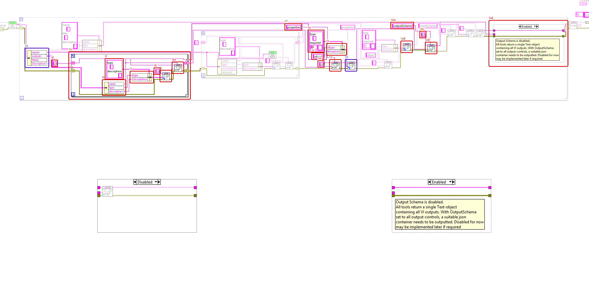 | 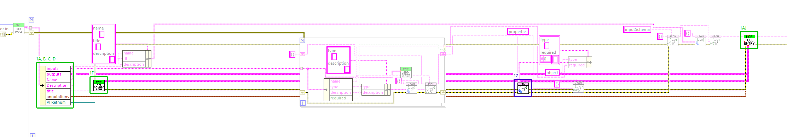 |

Whole block diagram and front panel

| Before | After |
|---|---|
|  | 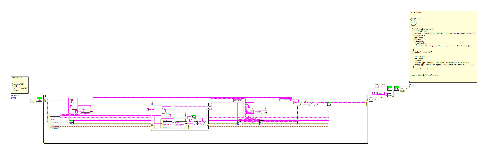 |

| Before | After |
|---|---|
|  |  |

### `tests/Test_MCP_Server.vi` (modified)

**1. Block Diagram objects**

- **1A** SubVI "MCP Server tests.lvlib:Add Fixture Picture Tool.vi" - added at (1806,323)
- **1B** SubVI "MCP Server tests.lvlib:Add Fixture Annotated Tool.vi" - added at (1902,323)
- **1C** wiring changes

| Before | After |
|---|---|
| 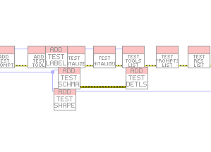 | 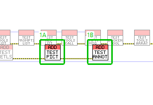 |

**2. Block Diagram objects**

- **2A** SubVI "MCP Server tests.lvlib:test tools call structured content.vi" - added at (3710,296)
- **2B** SubVI "MCP Server tests.lvlib:test tools list output schema.vi" - added at (3806,296)
- **2C** SubVI "MCP Server tests.lvlib:test tools list title annotations.vi" - added at (3902,296)
- **2D** wiring changes

| Before | After |
|---|---|
| 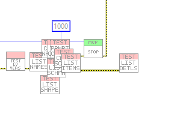 | 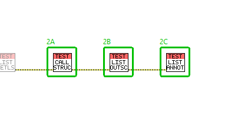 |

Whole block diagram and front panel

| Before | After |
|---|---|
| 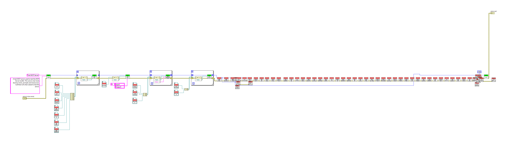 | 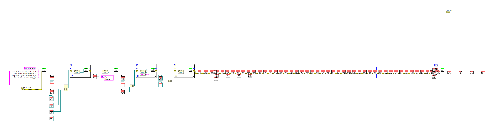 |

| Before | After |
|---|---|
|  |  |

### `tests/test tool required arguments.vi` (modified)

**1. Block Diagram objects**

- **1A** String Constant "Label" - data value : changed from "<tt>"tools/call fake_tool_required_input without arguments -> error -32602 Missing required argument(s): b, a (the order of inputSchema.required), no result, id 40"</tt>" to "<tt>"tools/call fake_tool_required_input without arguments -> result with isError true and the text Missing required argument(s): b, a (the order of inputSchema.required), no JSON-RPC error, id 40"</tt>"

| Before | After |
|---|---|
| 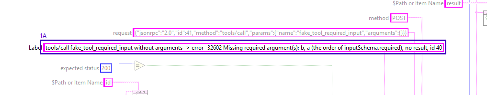 | 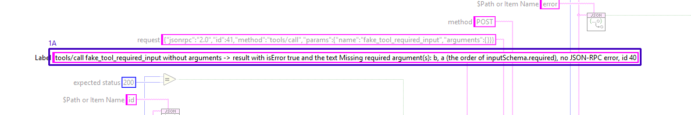 |

**2. Block Diagram objects**

- **2A** String Constant "$Path or Item Name" - data value : changed from "<tt>"$.error.message"</tt>" to "<tt>"$.result.content[0].text"</tt>"

| Before | After |
|---|---|
| 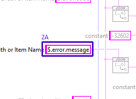 | 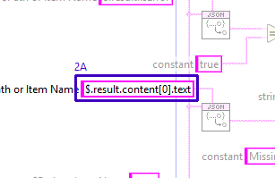 |

**3. Block Diagram objects**

- **3A** String Constant "$Path or Item Name" - data value : changed from "<tt>"$.error.code"</tt>" to "<tt>"$.result.isError"</tt>"

| Before | After |
|---|---|
|  |  |

**4. Block Diagram objects**

- **4A** String Constant "$Path or Item Name" - data value : changed from "<tt>"result"</tt>" to "<tt>"error"</tt>"

| Before | After |
|---|---|
|  |  |

**5. Block Diagram objects**

- **5A** String Constant "constant" - data value : changed from "<tt>"-32602"</tt>" to "<tt>"true"</tt>"

| Before | After |
|---|---|
|  |  |

**6. Block Diagram objects**

- **6A** String Constant "$Path or Item Name" - data value : changed from "<tt>"$.error.message"</tt>" to "<tt>"$.result.content[0].text"</tt>"

| Before | After |
|---|---|
|  |  |

**7. Block Diagram objects**

- **7A** String Constant "$Path or Item Name" - data value : changed from "<tt>"$.error.code"</tt>" to "<tt>"$.result.isError"</tt>"

| Before | After |
|---|---|
|  |  |

**8. Block Diagram objects**

- **8A** String Constant "Label" - data value : changed from "<tt>"tools/call fake_tool_required_input with arguments {} -> error -32602 naming b and a, no result, id 41"</tt>" to "<tt>"tools/call fake_tool_required_input with arguments {} -> result with isError true naming b and a, no JSON-RPC error, id 41"</tt>"

| Before | After |
|---|---|
|  |  |

**9. Block Diagram objects**

- **9A** String Constant "$Path or Item Name" - data value : changed from "<tt>"result"</tt>" to "<tt>"error"</tt>"

| Before | After |
|---|---|
|  |  |

**10. Block Diagram objects**

- **10A** String Constant "constant" - data value : changed from "<tt>"-32602"</tt>" to "<tt>"true"</tt>"

| Before | After |
|---|---|
|  |  |

**11. Block Diagram objects**

- **11A** String Constant "$Path or Item Name" - data value : changed from "<tt>"$.error.message"</tt>" to "<tt>"$.result.content[0].text"</tt>"

| Before | After |
|---|---|
|  |  |

**12. Block Diagram objects**

- **12A** String Constant "$Path or Item Name" - data value : changed from "<tt>"$.error.code"</tt>" to "<tt>"$.result.isError"</tt>"

| Before | After |
|---|---|
|  |  |

**13. Block Diagram objects**

- **13A** String Constant "$Path or Item Name" - data value : changed from "<tt>"result"</tt>" to "<tt>"error"</tt>"

| Before | After |
|---|---|
|  |  |

**14. Block Diagram objects**

- **14A** String Constant "Label" - data value : changed from "<tt>"tools/call fake_tool_required_input with only a -> error -32602 naming only b, no result, id 42"</tt>" to "<tt>"tools/call fake_tool_required_input with only a -> result with isError true naming only b, no JSON-RPC error, id 42"</tt>"

| Before | After |
|---|---|
|  |  |

**15. Block Diagram objects**

- **15A** String Constant "constant" - data value : changed from "<tt>"-32602"</tt>" to "<tt>"true"</tt>"

| Before | After |
|---|---|
|  |  |

**16. VI Attribute - Documentation (VI Properties)**

- **16A** description text : changed from "tools/call that leaves out a required input of the tool (one set to Required on the connector pane) is answered with JSON-RPC error -32602 that names the missing arguments, and the tool is not run: the answer has no result. With all required arguments the tool runs. fake_tool_required_input has the required inputs a and b." to "tools/call that leaves out a required input of the tool (one set to Required on the connector pane) is answered with a normal result with isError true and one text item that names the missing arguments in the order of inputSchema.required (Missing required argument(s): ...), so that the model can correct the call. It is not a JSON-RPC error, and the tool is not run. With all required arguments the tool runs. fake_tool_required_input has the required inputs a and b."

Whole block diagram and front panel

| Before | After |
|---|---|
|  |  |

| Before | After |
|---|---|
|  |  |

### `src/MCP Server/Add Structured Content.vi` (added)

Block diagram (case structures show their visible frame only):

Front panel

### `src/MCP Server/Complete Tool Entry.vi` (added)

Block diagram (case structures show their visible frame only):

Front panel

### `src/MCP Server/Tool Annotations.ctl` (added)

Block diagram (case structures show their visible frame only):

Front panel

### `src/MCP Server/Tool Hint.ctl` (added)

Block diagram (case structures show their visible frame only):

Front panel

### `tests/Add Fixture Annotated Tool.vi` (added)

Block diagram (case structures show their visible frame only):

Front panel

### `tests/Add Fixture Picture Tool.vi` (added)

Block diagram (case structures show their visible frame only):

Front panel

### `tests/fake tool annotated.vi` (added)

Block diagram (case structures show their visible frame only):

Front panel

### `tests/fake tool picture outputs.vi` (added)

Block diagram (case structures show their visible frame only):

Front panel

### `tests/test tools call structured content.vi` (added)

Block diagram (case structures show their visible frame only):

Front panel

### `tests/test tools list output schema.vi` (added)

Block diagram (case structures show their visible frame only):

Front panel

### `tests/test tools list title annotations.vi` (added)

Block diagram (case structures show their visible frame only):

Front panel

