## VI diff report

11 modified, 18 added, 1 deleted. Generated by LabVIEW's VI comparison; position and size changes are not shown.

### `src/MCP Server/Add Prompt.vi` (modified)

No functional differences found (cosmetic changes only).

Whole block diagram and front panel

| Before | After |
|---|---|
| 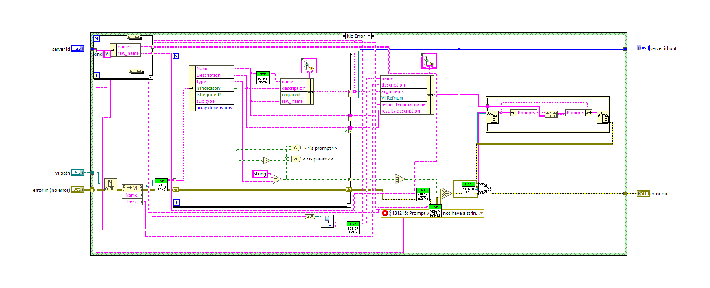 | 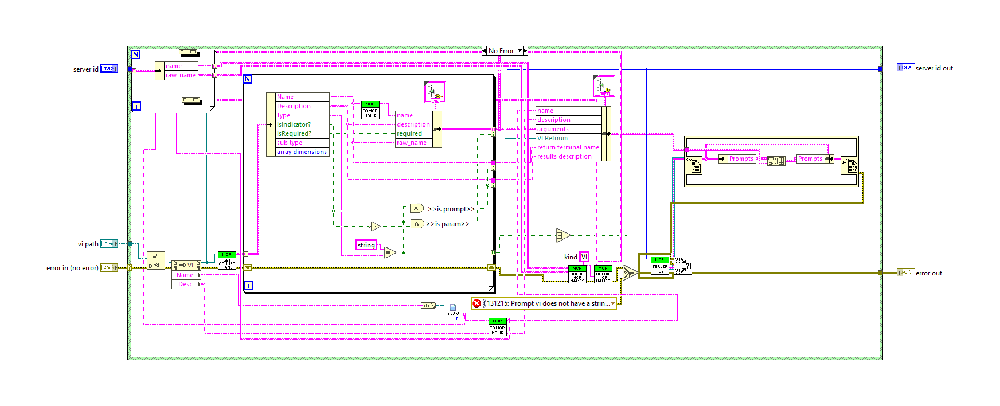 |

| Before | After |
|---|---|
| 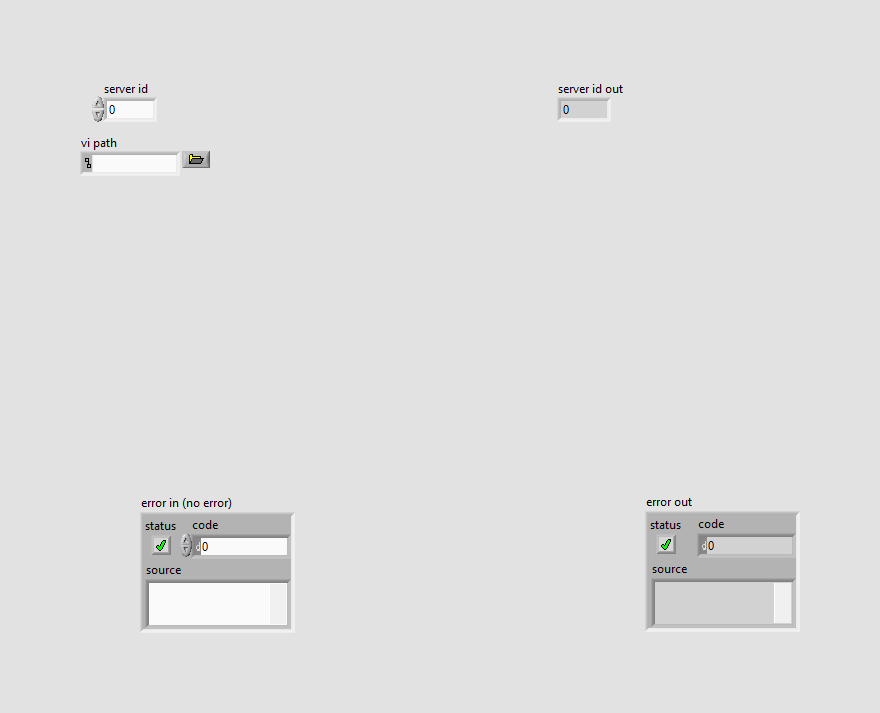 |  |

All case frames (1 hidden frames)

| Frame | Picture |
|---|---|
| Whole diagram, visible frames: Case structure 1: No Error | 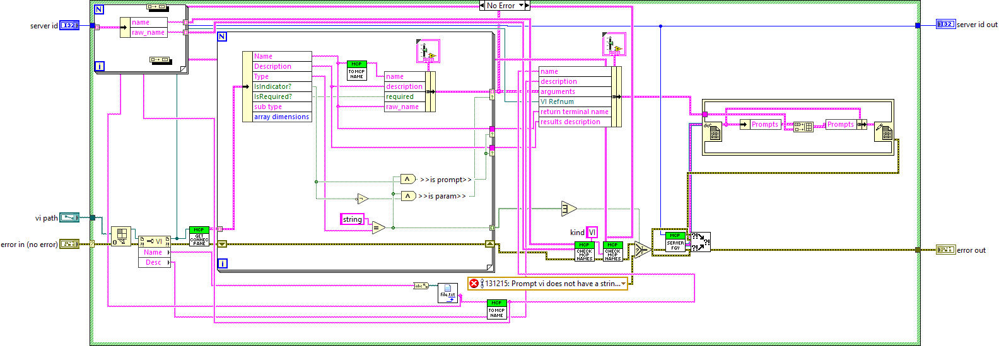 |
| Case structure 1: Error .. | 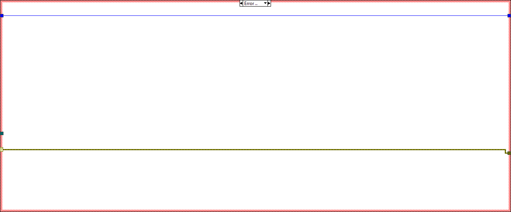 |

### `src/MCP Server/Add Tool.vi` (modified)

No functional differences found (cosmetic changes only).

Whole block diagram and front panel

| Before | After |
|---|---|
| 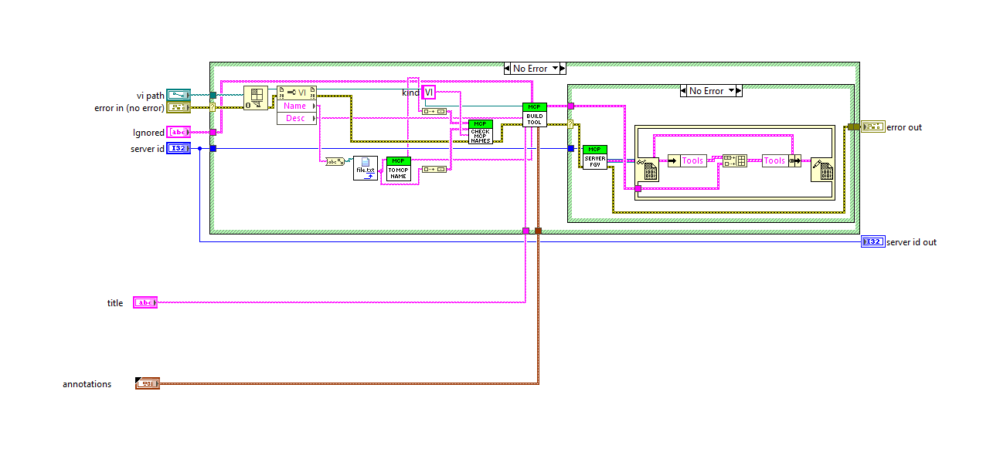 | 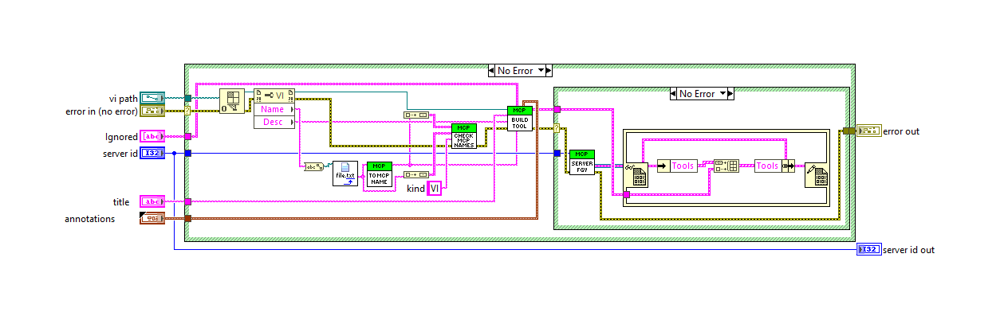 |

| Before | After |
|---|---|
|  | 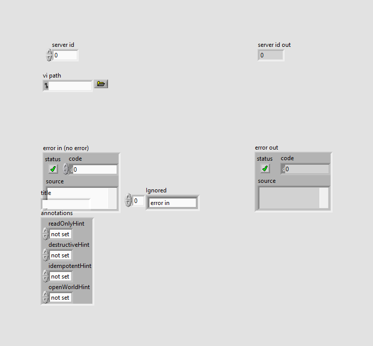 |

All case frames (2 hidden frames)

| Frame | Picture |
|---|---|
| Whole diagram, visible frames: Case structure 1: No Error; Case structure 2: No Error | 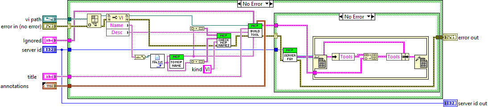 |
| Case structure 2: Error .. | 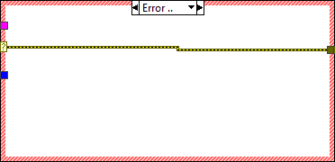 |
| Case structure 1: Error .. | 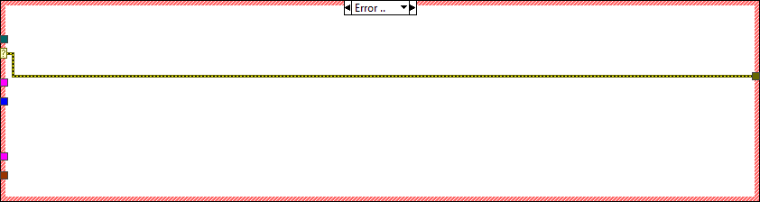 |

### `src/MCP Server/Ask User.vi` (modified)

**1. Block Diagram objects**

- **1A** String Constant "context queue" - deleted at (117,480)
- **1B** String Constant "element type" - deleted at (225,511)
- **1C** Boolean Constant "false" - deleted at (292,535)
- **1D** Obtain Queue  - deleted at (348,508)
- **1E** SubVI "MCP Server.lvlib:Read Request Context.vi" - added at (389,251)
- **1F** Numeric Constant "no wait" - deleted at (448,505)
- **1G** Preview Queue Element  - deleted at (503,508)
- **1H** String Constant "path elicitation" - data type name : changed from "<tt>path</tt>" to "<tt>path elicitation</tt>"
- **1I** String Constant "path era" - data type name : changed from "<tt>path</tt>" to "<tt>path era</tt>"
- **1J** Release Queue  - deleted at (561,476)
- **1K** Unbundle By Name  - deleted at (647,528)
- **1L** Not  - deleted at (753,528)
- **1M** Not  - deleted at (753,549)
- **1N** And  - deleted at (844,532)
- **1O** String Constant "requests queue" - deleted at (1225,303)
- **1P** Tunnel  - deleted at (1367,329)
- **1Q** Merge Errors  - deleted at (2397,234)
- **1R** wiring changes

| Before | After |
|---|---|
| 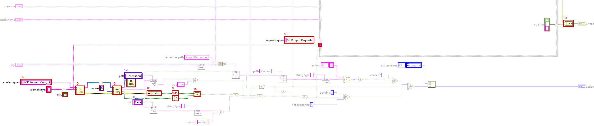 | 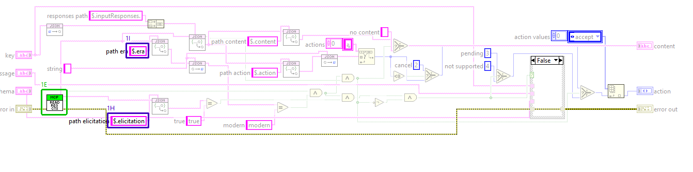 |

**2. Block Diagram objects**

- **2A** String Constant "string" - data type name : changed from "<tt>string type</tt>" to "<tt>string</tt>"
- **2B** String Constant "string type" - deleted at (786,580)
- **2C** wiring changes

| Before | After |
|---|---|
| 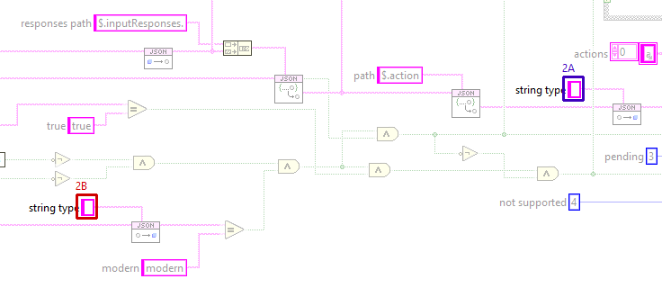 | 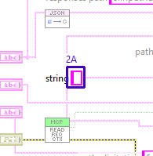 |

**3. Block Diagram objects**

- **3A** String Constant "path content" - data type name : changed from "<tt>path</tt>" to "<tt>path content</tt>"

| Before | After |
|---|---|
| 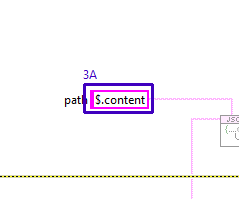 | 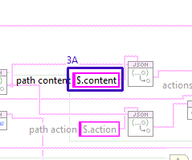 |

**4. Block Diagram objects**

- **4A** String Constant "path action" - data type name : changed from "<tt>path</tt>" to "<tt>path action</tt>"

| Before | After |
|---|---|
| 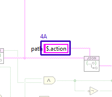 | 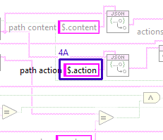 |

**5. Block Diagram objects**

- **5A** String Constant "no content" - data type name : changed from "<tt>empty</tt>" to "<tt>no content</tt>"

| Before | After |
|---|---|
| 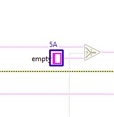 | 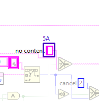 |

**6. Block Diagram objects**

- **6A** SubVI "MCP Server.lvlib:Register Input Request.vi" - added at (1345,251)
- **6B** SubVI "JSONtext.lvlib:JSON type.vi" - deleted at (1467,255)
- **6C** Empty String/Path?  - deleted at (1471,216)
- **6D** Not  - deleted at (1528,218)
- **6E** Numeric Constant "JSON Object" - deleted at (1541,284)
- **6F** Equal?  - deleted at (1589,254)
- **6G** String Constant "b" - deleted at (1611,140)
- **6H** String Constant "confirmation schema" - deleted at (1624,315)
- **6I** And  - deleted at (1671,222)
- **6J** SubVI "JSONtext.lvlib:To JSON Text.vim" - deleted at (1744,166)
- **6K** Select  - deleted at (1824,216)
- **6L** String Constant "c" - deleted at (1864,174)
- **6M** Boolean Constant "true" - deleted at (1933,235)
- **6N** Obtain Queue  - deleted at (1959,219)
- **6O** String Constant "a" - deleted at (2062,115)
- **6P** String Constant "d" - deleted at (2063,176)
- **6Q** Concatenate Strings  - deleted at (2096,129)
- **6R** Enqueue Element  - deleted at (2154,219)
- **6S** Release Queue  - deleted at (2210,219)
- **6T** Tunnel  - deleted at (1367,329)
- **6U** wiring changes

| Before | After |
|---|---|
| 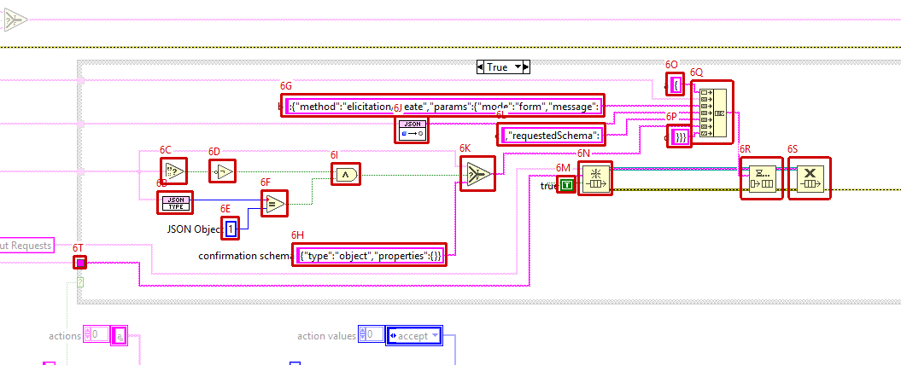 | 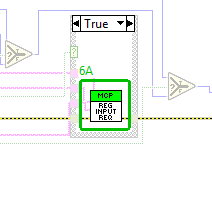 |

**7. Block Diagram objects**

- **7A** Cluster Constant "no error" - deleted at (2311,218)
- **7B** wiring changes

| Before | After |
|---|---|
| 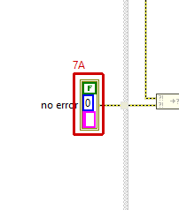 | 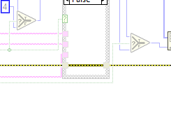 |

**8. Block Diagram objects**

- **8A** wiring changes

| Before | After |
|---|---|
| 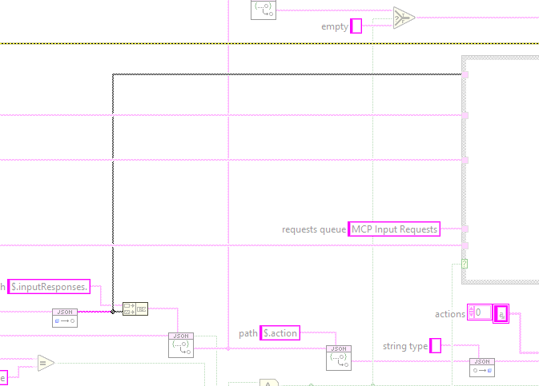 | 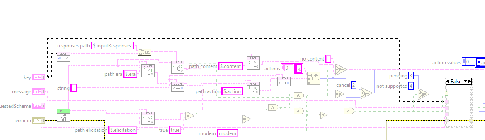 |

Whole block diagram and front panel

| Before | After |
|---|---|
|  |  |

| Before | After |
|---|---|
|  | 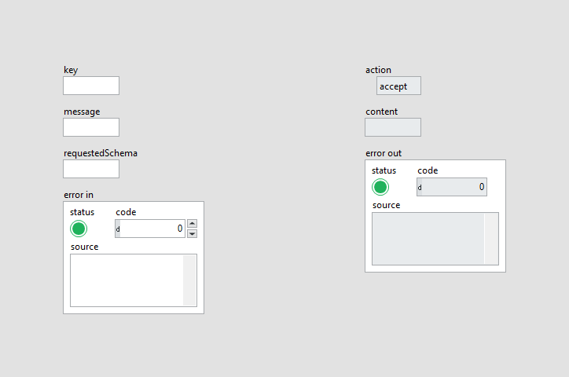 |

All case frames (1 hidden frames)

| Frame | Picture |
|---|---|
| Whole diagram, visible frames: Case structure 1: False |  |
| Case structure 1: True | 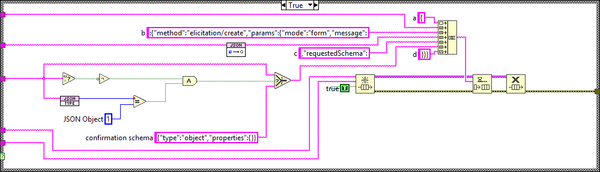 |

### `src/MCP Server/Cancel Requested.vi` (modified)

**1. Block Diagram objects**

- **1A** String Constant "path" - deleted at (-360,66)
- **1B** SubVI "MCP Server.lvlib:Stream State.vi" - deleted at (-357,742)
- **1C** String Constant "path" - deleted at (-272,701)
- **1D** SubVI "JSONtext.lvlib:Find Item.vi" - deleted at (-270,91)
- **1E** SubVI "JSONtext.lvlib:JSON type.vi" - deleted at (-183,71)
- **1F** SubVI "JSONtext.lvlib:Find Item.vi" - deleted at (-183,726)
- **1G** Numeric Constant "type" - deleted at (-157,3)
- **1H** SubVI "JSONtext.lvlib:From JSON Text.vim" - deleted at (-134,35)
- **1I** String Constant "path" - deleted at (-125,253)
- **1J** Numeric Constant "type" - deleted at (-100,687)
- **1K** String Constant "path" - deleted at (-93,138)
- **1L** SubVI "JSONtext.lvlib:From JSON Text.vim" - deleted at (-77,719)
- **1M** Numeric Constant "no wait" - deleted at (-70,642)
- **1N** Numeric Constant "JSON type" - deleted at (-69,92)
- **1O** SubVI "JSONtext.lvlib:To JSON Text.vim" - deleted at (55,35)
- **1P** SubVI "JSONtext.lvlib:Find Item.vi" - deleted at (55,163)
- **1Q** SubVI "JSONtext.lvlib:Find Item.vi" - deleted at (55,235)
- **1R** SubVI "JSONtext.lvlib:To JSON Text.vim" - deleted at (55,291)
- **1S** SubVI "JSONtext.lvlib:To JSON Text.vim" - deleted at (55,555)
- **1T** Preview Queue Element  - deleted at (55,631)
- **1U** Equal?  - deleted at (59,86)
- **1V** Empty String/Path?  - deleted at (59,586)
- **1W** SubVI "Clear Errors.vi" - deleted at (305,631)
- **1X** Merge Errors  - deleted at (308,186)
- **1Y** Equal?  - deleted at (312,280)
- **1Z** And  - deleted at (315,84)
- **127** Not  - deleted at (321,455)
- **128** String Constant "true" - deleted at (329,164)
- **129** SubVI "Clear Errors.vi" - deleted at (417,195)
- **130** Equal?  - deleted at (419,158)
- **131** And  - deleted at (420,552)
- **132** And  - deleted at (421,459)
- **133** SubVI "MCP Server.lvlib:Read Stream State.vi" - added at (435,312)
- **134** And  - deleted at (524,137)
- **135** And  - deleted at (532,335)
- **136** Numeric Constant "zero" - deleted at (532,470)
- **137** Select  - deleted at (555,453)
- **138** Or  - deleted at (618,366)
- **139** String Constant "null" - deleted at (631,158)
- **140** SubVI "MCP Server.lvlib:Legacy Cancellations.vi" - deleted at (702,480)
- **141** Select  - deleted at (704,35)
- **142** String Constant "keep-alive comment" - added at (728,249)
- **143** SubVI "MCP Server.lvlib:Send Stream Event.vi" - added at (750,312)
- **144** Not  - deleted at (851,479)
- **145** SubVI "MCP Server.lvlib:Write Stream State.vi" - added at (866,312)
- **146** And  - deleted at (898,439)
- **147** Case Structure  - deleted at (1014,224)
- **148** String Constant "keep-alive comment" - deleted at (1184,262)
- **149** Enqueue Element  - deleted at (1222,274)
- **150** Numeric Constant "1 s" - deleted at (1295,268)
- **151** SubVI "MCP Server.lvlib:Wait For Stream Drain.vi" - deleted at (1352,265)
- **152** SubVI "Clear Errors.vi" - deleted at (1409,265)
- **153** Boolean Constant "no probe" - deleted at (1460,245)
- **154** Tunnel  - deleted at (1014,244)
- **155** Tick Count (ms)  - deleted at (1014,423)
- **156** Tunnel  - deleted at (1500,248)
- **157** Not  - deleted at (1540,356)
- **158** Not Equal?  - deleted at (1661,377)
- **159** String Constant "false" - deleted at (1675,341)
- **160** String Constant "true" - deleted at (1678,309)
- **161** String Constant "st c" - deleted at (1715,252)
- **162** Select  - deleted at (1752,327)
- **163** Number To Decimal String  - deleted at (1754,440)
- **164** Or  - deleted at (1755,406)
- **165** And  - deleted at (1833,402)
- **166** String Constant "st d" - deleted at (1837,354)
- **167** String Constant "st a" - deleted at (1848,379)
- **168** String Constant "st b" - deleted at (1849,552)
- **169** String Constant "st e" - deleted at (2029,447)
- **170** Concatenate Strings  - deleted at (2054,384)
- **171** Case Structure  - deleted at (2111,398)
- **172** Boolean Constant "store" - deleted at (2173,460)
- **173** SubVI "MCP Server.lvlib:Stream State.vi" - deleted at (2214,441)
- **174** Cluster Constant "no error" - deleted at (2315,418)
- **175** Tunnel  - deleted at (2111,441)
- **176** Tunnel  - deleted at (2362,465)
- **177** Merge Errors  - deleted at (2432,440)
- **178** SubVI "Clear Errors.vi" - deleted at (2488,429)
- **179** wiring changes

| Before | After |
|---|---|
| 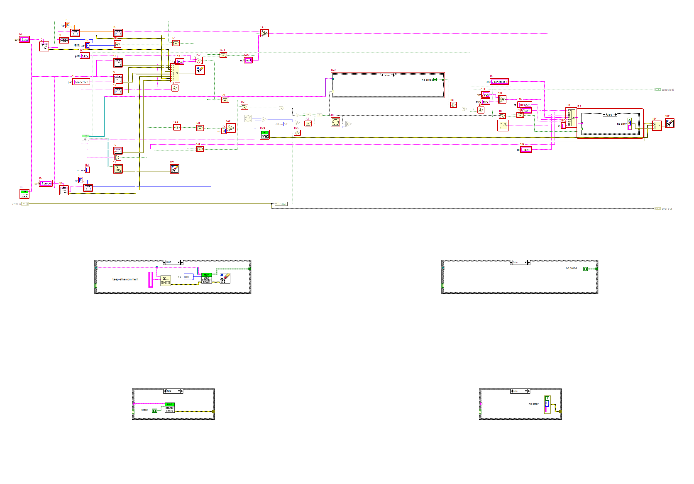 | 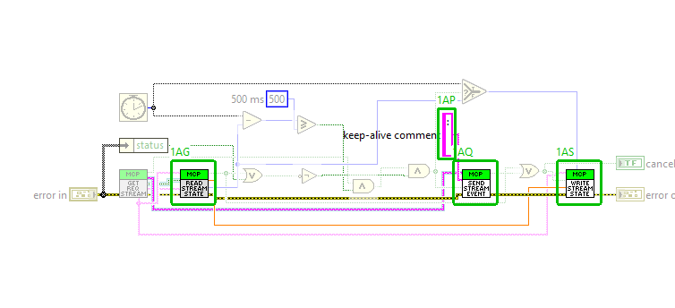 |

Whole block diagram and front panel

| Before | After |
|---|---|
|  | 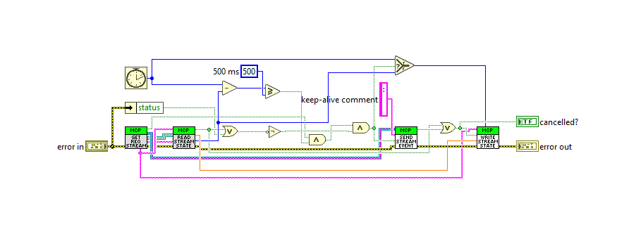 |

| Before | After |
|---|---|
|  |  |

### `src/MCP Server/Complete Modern MCP Result.vi` (modified)

**1. Block Diagram objects**

- **1A** String Constant "initialize request" - deleted at (141,251)
- **1B** Front Panel Terminal "MCP Request Metadata" - numeric representation : changed from "<tt>'MCP Request Metadata': typedef 'MCP Server.lvlib:MCP Request Metadata.ctl'\r\ncluster of 11 elements \r\n    'method': string \r\n    'id': string \r\n    'has id': boolean (TRUE or FALSE) \r\n    'modern': boolean (TRUE or FALSE) \r\n    'discover': boolean (TRUE</tt>" to "<tt>'MCP Request Metadata': cluster of 11 elements \r\n    'method': string \r\n    'id': string \r\n    'has id': boolean (TRUE or FALSE) \r\n    'modern': boolean (TRUE or FALSE) \r\n    'discover': boolean (TRUE or FALSE) \r\n    'batch': boolean (TRUE or FALSE) \r\n </tt>"
- **1C** SubVI "MCP Server.lvlib:Read Server Info.vi" - added at (911,341)
- **1D** String Constant "resources/read" - deleted at (912,992)
- **1E** String Constant "tools/call" - deleted at (941,205)
- **1F** SubVI "MCP Server.lvlib:Input Required Response.vi" - added at (1013,229)
- **1G** SubVI "MCP Server.lvlib:Build Discover Response.vi" - added at (1013,341)
- **1H** Case Structure  - deleted at (1089,212)
- **1I** Equal?  - deleted at (1089,986)
- **1J** SubVI "MCP Server.lvlib:Complete Handler Result.vi" - added at (1130,341)
- **1K** SubVI "MCP Server.lvlib:initialize.vi" - deleted at (1136,256)
- **1L** String Constant "no initialize" - deleted at (1255,286)
- **1M** Tunnel  - deleted at (1089,232)
- **1N** Tunnel  - deleted at (1089,256)
- **1O** Tunnel  - deleted at (1089,284)
- **1P** Equal?  - deleted at (1089,381)
- **1Q** And  - deleted at (1139,379)
- **1R** String Constant "path" - deleted at (1214,348)
- **1S** String Constant "path" - deleted at (1222,-142)
- **1T** Tunnel  - deleted at (1295,291)
- **1U** String Constant "si b" - deleted at (1365,733)
- **1V** SubVI "MCP Server.lvlib:Response Status Code.vi" - added at (1373,288)
- **1W** SubVI "JSONtext.lvlib:Find Item.vi" - deleted at (1396,-117)
- **1X** SubVI "JSONtext.lvlib:Find Item.vi" - deleted at (1396,291)
- **1Y** String Constant "meta a" - deleted at (1432,773)
- **1Z** String Constant "si a" - deleted at (1473,15)
- **127** String Constant "ir b" - deleted at (1569,-170)
- **128** String Constant "si c" - deleted at (1589,91)
- **129** String Constant "path" - deleted at (1590,711)
- **130** Concatenate Strings  - deleted at (1614,60)
- **131** String Constant "path" - deleted at (1644,412)
- **132** String Constant "complete" - deleted at (1680,448)
- **133** String Constant "meta b" - deleted at (1735,756)
- **134** String Constant "ir a" - deleted at (1758,-209)
- **135** String Constant "path" - deleted at (1792,680)
- **136** String Constant "path" - deleted at (1792,787)
- **137** Concatenate Strings  - deleted at (1828,68)
- **138** SubVI "JSONtext.lvlib:Set Item.vi" - deleted at (1832,437)
- **139** Empty String/Path?  - deleted at (1992,-133)
- **140** String Constant "ir c" - deleted at (1993,94)
- **141** SubVI "JSONtext.lvlib:Set Item.vi" - deleted at (1994,-58)
- **142** SubVI "JSONtext.lvlib:Set Item.vi" - deleted at (1994,245)
- **143** SubVI "JSONtext.lvlib:Find Item.vi" - deleted at (1996,421)
- **144** SubVI "MCP Server.lvlib:Cache Hints.vi" - deleted at (2003,814)
- **145** String Constant "server/discover" - deleted at (2125,649)
- **146** String Constant "path" - deleted at (2137,288)
- **147** Select  - deleted at (2166,226)
- **148** String Constant "ir d" - deleted at (2170,83)
- **149** Not  - deleted at (2171,123)
- **150** Number To Decimal String  - deleted at (2171,686)
- **151** Concatenate Strings  - deleted at (2199,36)
- **152** String Constant "path" - deleted at (2260,480)
- **153** String Constant "d b" - deleted at (2262,866)
- **154** String Constant "path" - deleted at (2264,325)
- **155** String Constant "path" - deleted at (2300,511)
- **156** String Constant "path" - deleted at (2300,587)
- **157** And  - deleted at (2316,221)
- **158** SubVI "JSONtext.lvlib:Set Item.vi" - deleted at (2319,185)
- **159** SubVI "MCP Server.lvlib:Cache Hints.vi" - deleted at (2324,753)
- **160** String Constant "path" - deleted at (2326,542)
- **161** String Constant "invalid params code" - deleted at (2328,618)
- **162** SubVI "JSONtext.lvlib:To JSON Text.vim" - deleted at (2329,664)
- **163** SubVI "MCP Server.lvlib:Supported Protocol Versions.vi" - deleted at (2341,697)
- **164** String Constant "d a" - deleted at (2447,928)
- **165** String Constant "d f" - deleted at (2475,7)
- **166** String Constant "d c" - deleted at (2479,897)
- **167** SubVI "JSONtext.lvlib:Set Item.vi" - deleted at (2508,185)
- **168** SubVI "JSONtext.lvlib:Set Item.vi" - deleted at (2508,640)
- **169** SubVI "JSONtext.lvlib:Find Item.vi" - deleted at (2509,496)
- **170** SubVI "JSONtext.lvlib:Find Item.vi" - deleted at (2511,350)
- **171** SubVI "JSONtext.lvlib:Find Item.vi" - deleted at (2511,569)
- **172** SubVI "JSONtext.lvlib:To JSON Text.vim" - deleted at (2514,713)
- **173** Number To Decimal String  - deleted at (2516,809)
- **174** SubVI "JSONtext.lvlib:To JSON Text.vim" - deleted at (2518,761)
- **175** String Constant "not found code" - deleted at (2519,242)
- **176** Merge Errors  - deleted at (2846,95)
- **177** Equal?  - deleted at (2855,584)
- **178** Select  - deleted at (2858,44)
- **179** String Constant "d d" - deleted at (2863,256)
- **180** String Constant "d e" - deleted at (2868,-15)
- **181** SubVI "Clear Errors.vi" - deleted at (3125,128)
- **182** And  - deleted at (3128,658)
- **183** String Constant "d g" - deleted at (3145,-4)
- **184** Concatenate Strings  - deleted at (3174,-99)
- **185** Select  - deleted at (3196,640)
- **186** Select  - deleted at (3276,242)
- **187** Not  - deleted at (3279,965)
- **188** Empty String/Path?  - deleted at (3515,28)
- **189** Numeric Constant "status 202" - deleted at (3568,-9)
- **190** And  - deleted at (3568,34)
- **191** Numeric Constant "status 200" - deleted at (3568,713)
- **192** Select  - deleted at (3618,28)
- **193** wiring changes

| Before | After |
|---|---|
| 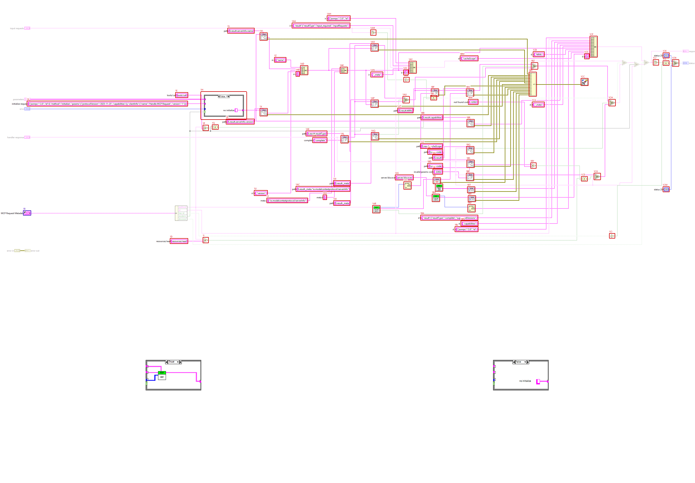 | 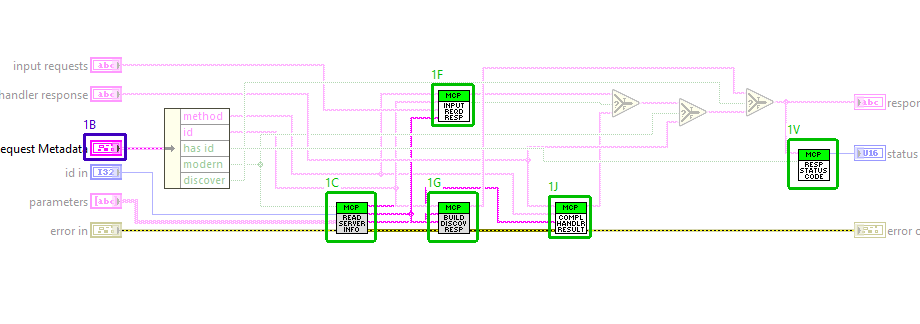 |

**11. VI Attribute - Miscellaneous**

- **11A** VI Icon (256 colors)

| Before | After |
|---|---|
|  | 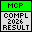 |

Whole block diagram and front panel

| Before | After |
|---|---|
|  | 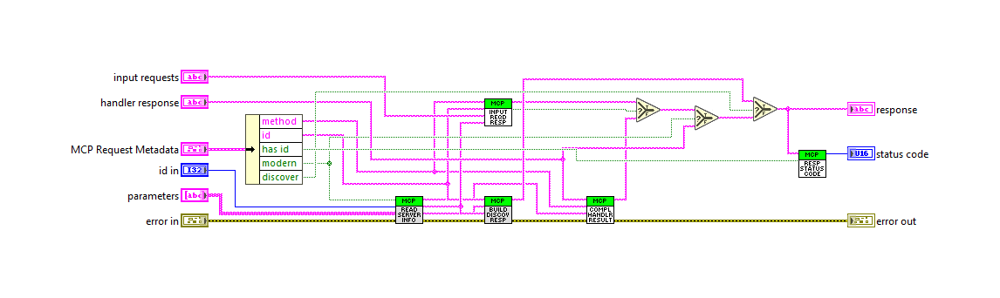 |

| Before | After |
|---|---|
|  |  |

### `src/MCP Server/Get Connector Pane Info.vi` (modified)

No functional differences found (cosmetic changes only).

Whole block diagram and front panel

| Before | After |
|---|---|
| 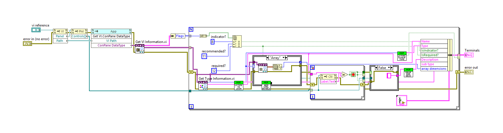 | 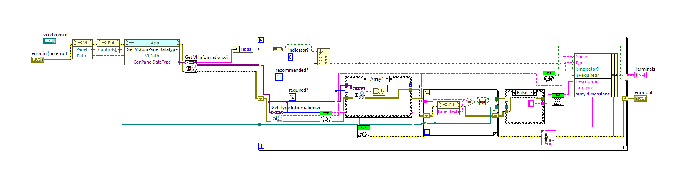 |

| Before | After |
|---|---|
|  |  |

All case frames (2 hidden frames)

| Frame | Picture |
|---|---|
| Whole diagram, visible frames: Case structure 1: False; Case structure 2: "Array" | 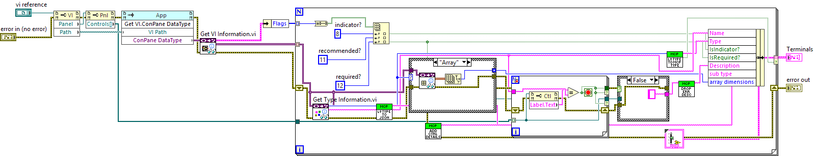 |
| Case structure 1: True | 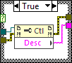 |
| Case structure 2: Default | 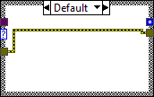 |

### `src/MCP Server/Get Request Stream.vi` (modified)

**1. Block Diagram objects**

- **1A** SubVI "MCP Server.lvlib:Read Request Context.vi" - added at (123,326)
- **1B** String Constant "context queue" - deleted at (358,278)
- **1C** String Constant "element type" - deleted at (466,309)
- **1D** Boolean Constant "no create" - deleted at (558,333)
- **1E** Obtain Queue  - deleted at (600,306)
- **1F** Numeric Constant "no wait" - deleted at (700,303)
- **1G** Preview Queue Element  - deleted at (756,306)
- **1H** Release Queue  - deleted at (835,349)
- **1I** Merge Errors  - deleted at (966,329)
- **1J** SubVI "Clear Errors.vi" - deleted at (1041,333)
- **1K** Merge Errors  - deleted at (1334,467)
- **1L** SubVI "Clear Errors.vi" - deleted at (1390,468)
- **1M** wiring changes

| Before | After |
|---|---|
| 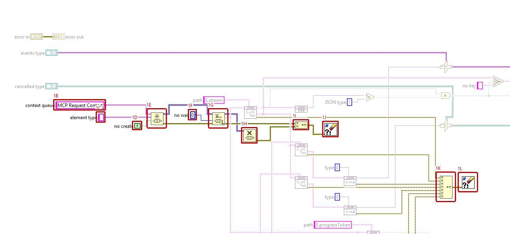 | 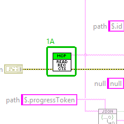 |

**2. Front Panel - Cluster**

- **2A** String - dropping allowed

| Before | After |
|---|---|
| 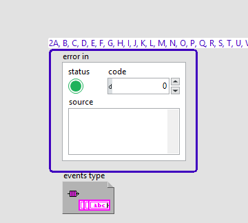 | 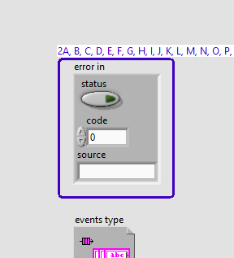 |

**12. VI Attribute - Editor Options (VI Properties)**

- **12A** default control style

**13. VI Attribute - Miscellaneous**

- **13A** VI Icon (256 colors)

| Before | After |
|---|---|
|  |  |

Whole block diagram and front panel

| Before | After |
|---|---|
|  | 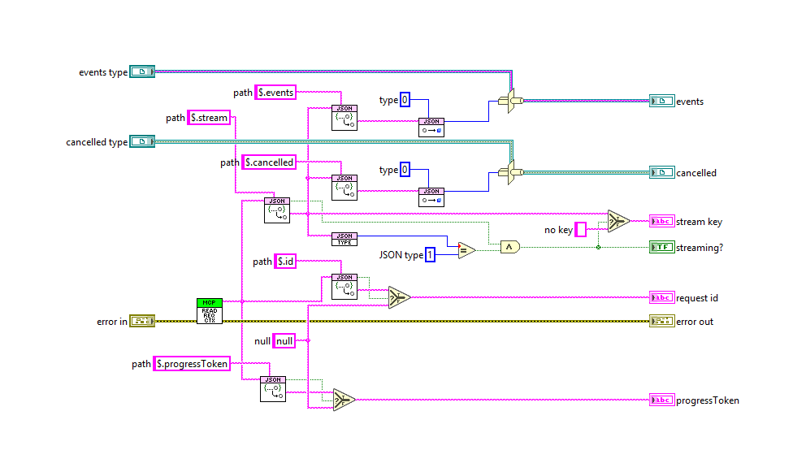 |

| Before | After |
|---|---|
|  | 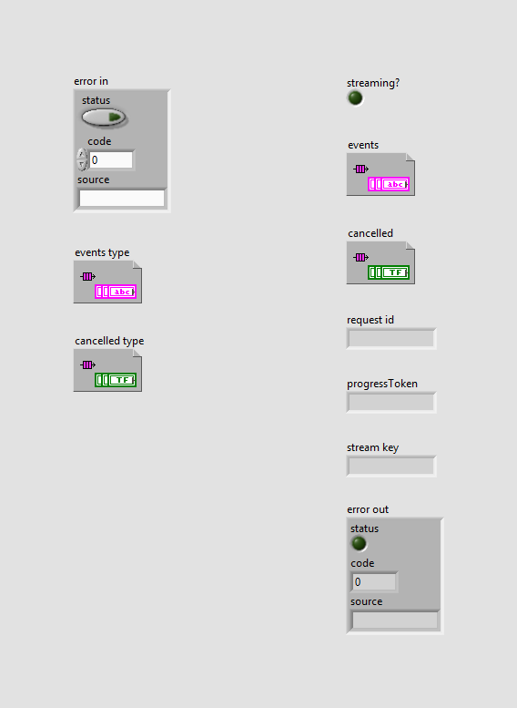 |

### `src/MCP Server/Process HTTP Request.vi` (modified)

**1. Block Diagram objects**

- **1A** SubVI "Select Value.vim" - deleted at (285,-64)
- **1B** Select  - added at (800,-130)
- **1C** wiring changes

| Before | After |
|---|---|
| 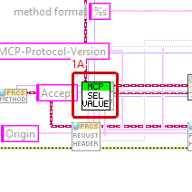 | 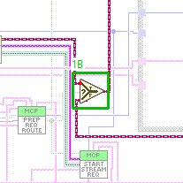 |

Whole block diagram and front panel

| Before | After |
|---|---|
| 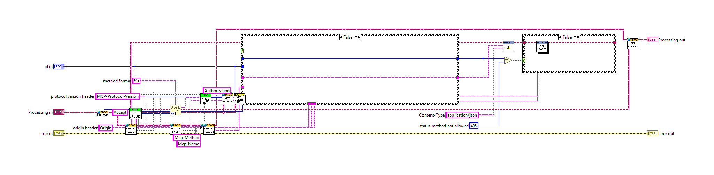 |  |

| Before | After |
|---|---|
|  |  |

All case frames (2 hidden frames)

| Frame | Picture |
|---|---|
| Whole diagram, visible frames: Case structure 1: False; Case structure 2: False |  |
| Case structure 1: True |  |
| Case structure 2: True |  |

### `src/MCP Server/Report Progress.vi` (modified)

**1. Block Diagram objects**

- **1A** String Constant "path" - deleted at (21,383)
- **1B** SubVI "MCP Server.lvlib:Stream State.vi" - deleted at (24,24)
- **1C** String Constant "path" - deleted at (109,629)
- **1D** SubVI "JSONtext.lvlib:Find Item.vi" - deleted at (111,408)
- **1E** SubVI "JSONtext.lvlib:JSON type.vi" - deleted at (213,107)
- **1F** SubVI "JSONtext.lvlib:Find Item.vi" - deleted at (213,654)
- **1G** Numeric Constant "type" - deleted at (239,465)
- **1H** SubVI "MCP Server.lvlib:Read Stream State.vi" - added at (240,209)
- **1I** SubVI "JSONtext.lvlib:From JSON Text.vim" - deleted at (262,497)
- **1J** String Constant "path" - deleted at (271,548)
- **1K** Numeric Constant "type" - deleted at (296,638)
- **1L** String Constant "path" - deleted at (303,402)
- **1M** SubVI "JSONtext.lvlib:From JSON Text.vim" - deleted at (319,670)
- **1N** Numeric Constant "no wait" - deleted at (326,67)
- **1O** Numeric Constant "JSON type" - deleted at (327,124)
- **1P** SubVI "MCP Server.lvlib:Build Progress Event.vi" - added at (378,53)
- **1Q** SubVI "MCP Server.lvlib:Should Send Progress.vi" - added at (378,123)
- **1R** SubVI "MCP Server.lvlib:Send Stream Event.vi" - added at (516,273)
- **1S** String Constant "m" - deleted at (547,374)
- **1T** Preview Queue Element  - deleted at (587,-12)
- **1U** SubVI "JSONtext.lvlib:Find Item.vi" - deleted at (587,427)
- **1V** SubVI "JSONtext.lvlib:To JSON Text.vim" - deleted at (587,483)
- **1W** SubVI "JSONtext.lvlib:Find Item.vi" - deleted at (587,573)
- **1X** SubVI "JSONtext.lvlib:To JSON Text.vim" - deleted at (587,704)
- **1Y** SubVI "JSONtext.lvlib:To JSON Text.vim" - deleted at (587,752)
- **1Z** SubVI "JSONtext.lvlib:To JSON Text.vim" - deleted at (587,800)
- **127** SubVI "JSONtext.lvlib:To JSON Text.vim" - deleted at (587,848)
- **128** SubVI "JSONtext.lvlib:To JSON Text.vim" - deleted at (587,896)
- **129** Empty String/Path?  - deleted at (591,30)
- **130** Equal?  - deleted at (591,106)
- **131** Greater?  - deleted at (591,135)
- **132** Empty String/Path?  - deleted at (591,335)
- **133** Not A Number/Path/Refnum?  - deleted at (592,180)
- **134** Not A Number/Path/Refnum?  - deleted at (592,289)
- **135** SubVI "MCP Server.lvlib:Write Stream State.vi" - added at (665,273)
- **136** String Constant "p a" - deleted at (1039,252)
- **137** SubVI "Clear Errors.vi" - deleted at (1077,35)
- **138** Merge Errors  - deleted at (1080,564)
- **139** Equal?  - deleted at (1087,120)
- **140** Concatenate Strings  - deleted at (1089,461)
- **141** And  - deleted at (1092,159)
- **142** String Constant "t" - deleted at (1096,325)
- **143** Not  - deleted at (1101,85)
- **144** Not  - deleted at (1101,379)
- **145** Numeric Constant "zero" - deleted at (1102,422)
- **146** String Constant "true" - deleted at (1115,-17)
- **147** Greater?  - deleted at (1125,414)
- **148** SubVI "Clear Errors.vi" - deleted at (1188,585)
- **149** Concatenate Strings  - deleted at (1192,330)
- **150** Equal?  - deleted at (1193,-23)
- **151** And  - deleted at (1195,16)
- **152** And  - deleted at (1195,363)
- **153** And  - deleted at (1200,118)
- **154** String Constant "none" - deleted at (1218,397)
- **155** Select  - deleted at (1305,402)
- **156** And  - deleted at (1308,-25)
- **157** And  - deleted at (1316,155)
- **158** Numeric Constant "zero" - deleted at (1316,687)
- **159** Select  - deleted at (1339,670)
- **160** String Constant "none" - deleted at (1351,365)
- **161** String Constant "p b" - deleted at (1422,280)
- **162** Select  - deleted at (1447,334)
- **163** Or  - deleted at (1450,93)
- **164** SubVI "MCP Server.lvlib:Legacy Cancellations.vi" - deleted at (1453,-123)
- **165** Not  - deleted at (1455,155)
- **166** String Constant "null" - deleted at (1463,49)
- **167** Unbundle By Name  - deleted at (1630,205)
- **168** Or  - deleted at (1641,159)
- **169** Or  - deleted at (1646,97)
- **170** Not  - deleted at (1647,182)
- **171** String Constant "p c" - deleted at (1667,345)
- **172** Concatenate Strings  - deleted at (1743,237)
- **173** And  - deleted at (1746,178)
- **174** Not  - deleted at (1748,123)
- **175** Not  - deleted at (1748,205)
- **176** And  - deleted at (1817,119)
- **177** And  - deleted at (1817,201)
- **178** And  - deleted at (1867,197)
- **179** Case Structure  - deleted at (1917,186)
- **180** Enqueue Element  - deleted at (1975,253)
- **181** Numeric Constant "1 s" - deleted at (2048,256)
- **182** SubVI "MCP Server.lvlib:Wait For Stream Drain.vi" - deleted at (2105,253)
- **183** SubVI "Clear Errors.vi" - deleted at (2162,253)
- **184** Boolean Constant "nothing to drain" - deleted at (2197,233)
- **185** Tunnel  - deleted at (1917,224)
- **186** Tunnel  - deleted at (1917,261)
- **187** Select  - deleted at (1919,12)
- **188** Tunnel  - deleted at (2237,236)
- **189** Not  - deleted at (2276,232)
- **190** String Constant "false" - deleted at (2395,114)
- **191** String Constant "true" - deleted at (2398,71)
- **192** String Constant "st c" - deleted at (2450,30)
- **193** Select  - deleted at (2487,76)
- **194** Number To Decimal String  - deleted at (2489,364)
- **195** String Constant "st d" - deleted at (2572,67)
- **196** String Constant "st a" - deleted at (2583,-57)
- **197** String Constant "st b" - deleted at (2584,-6)
- **198** String Constant "st e" - deleted at (2764,11)
- **199** Concatenate Strings  - deleted at (2789,-52)
- **1100** Case Structure  - deleted at (2846,-64)
- **1101** Boolean Constant "store" - deleted at (2909,-25)
- **1102** SubVI "MCP Server.lvlib:Stream State.vi" - deleted at (2950,-44)
- **1103** Cluster Constant "no error" - deleted at (3051,-44)
- **1104** Tunnel  - deleted at (2846,-20)
- **1105** Tunnel  - deleted at (3098,-20)
- **1106** Merge Errors  - deleted at (3168,-45)
- **1107** SubVI "Clear Errors.vi" - deleted at (3224,-56)
- **1108** wiring changes

| Before | After |
|---|---|
|  |  |

**3. Front Panel - Cluster**

- **3A** String - dropping allowed

| Before | After |
|---|---|
|  |  |

**8. VI Attribute - Editor Options (VI Properties)**

- **8A** default control style

**9. VI Attribute - Miscellaneous**

- **9A** VI Icon (256 colors)

| Before | After |
|---|---|
|  |  |

Whole block diagram and front panel

| Before | After |
|---|---|
|  |  |

| Before | After |
|---|---|
|  |  |

### `src/MCP Server/Run Streamed Request.vi` (modified)

**1. Block Diagram objects**

- **1A** Numeric Constant "u32" - deleted at (-118,542)
- **1B** Type Cast "Type Cast" - deleted at (-11,463)
- **1C** Type Cast "Type Cast" - deleted at (-11,565)
- **1D** String Constant "s b" - deleted at (9,514)
- **1E** Number To Decimal String "Number To Decimal String" - deleted at (49,471)
- **1F** Number To Decimal String "Number To Decimal String" - deleted at (49,573)
- **1G** String Constant "s a" - deleted at (125,450)
- **1H** String Constant "path" - deleted at (250,73)
- **1I** String Constant "s c" - deleted at (262,506)
- **1J** String Constant "path" - deleted at (282,1)
- **1K** SubVI "MCP Server.lvlib:Stream State.vi" - deleted at (287,98)
- **1L** Concatenate Strings "Concatenate Strings" - deleted at (287,475)
- **1M** String Constant "path" - deleted at (290,193)
- **1N** SubVI "JSONtext.lvlib:Find Item.vi" - deleted at (413,26)
- **1O** SubVI "JSONtext.lvlib:Find Item.vi" - deleted at (413,98)
- **1P** SubVI "JSONtext.lvlib:To JSON Text.vim" - deleted at (413,154)
- **1Q** SubVI "JSONtext.lvlib:Find Item.vi" - deleted at (413,218)
- **1R** SubVI "Clear Errors.vi" - deleted at (624,397)
- **1S** Merge Errors "Merge Errors" - deleted at (630,153)
- **1T** Equal? "Equal?" - deleted at (632,293)
- **1U** String Constant "true" - deleted at (654,447)
- **1V** String Constant "empty state" - data type name : changed from "<tt>state in</tt>" to "<tt>empty state</tt>"
- **1W** Boolean Constant "reset" - data type name : changed from "<tt>all</tt>" to "<tt>reset</tt>"
- **1X** Numeric Constant "no wait" - deleted at (670,337)
- **1Y** String Constant "cr" - deleted at (671,229)
- **1Z** SubVI "MCP Server.lvlib:Build Stream Object.vi" - added at (733,233)
- **127** Equal? "Equal?" - deleted at (755,378)
- **128** Preview Queue Element "Preview Queue Element" - deleted at (757,340)
- **129** Boolean Constant "all" - deleted at (759,199)
- **130** Empty String/Path? "Empty String/Path?" - deleted at (762,317)
- **131** Search and Replace String "Search and Replace String" - deleted at (785,228)
- **132** SubVI "Clear Errors.vi" - deleted at (860,340)
- **133** And "And" - deleted at (872,299)
- **134** String Constant "nothing" - deleted at (905,255)
- **135** String Constant "lf" - deleted at (910,199)
- **136** Or "Or" - deleted at (963,282)
- **137** SubVI "MCP Server.lvlib:Legacy Cancellations.vi" - deleted at (972,493)
- **138** Search and Replace String "Search and Replace String" - deleted at (987,206)
- **139** SubVI "MCP Server.lvlib:Stream Was Cancelled.vi" - added at (1039,395)
- **140** String Constant "no response" - data type name : changed from "<tt>nothing</tt>" to "<tt>no response</tt>"
- **141** Or "Or" - deleted at (1064,286)
- **142** String Constant "data" - deleted at (1085,178)
- **143** Select  - added at (1097,362)
- **144** String Constant "end of event" - deleted at (1114,223)
- **145** Concatenate Strings "Concatenate Strings" - deleted at (1149,197)
- **146** Not "Not" - deleted at (1154,286)
- **147** Not "Not" - deleted at (1154,319)
- **148** SubVI "MCP Server.lvlib:Finish Stream.vi" - added at (1184,395)
- **149** And "And" - deleted at (1207,290)
- **150** Case Structure "Case Structure" - deleted at (1257,164)
- **151** Enqueue Element "Enqueue Element" - deleted at (1292,197)
- **152** Cluster Constant "no error" - deleted at (1393,388)
- **153** Tunnel  - deleted at (1257,184)
- **154** Tunnel  - deleted at (1257,205)
- **155** Tunnel  - deleted at (1441,413)
- **156** String Constant "end marker" - deleted at (1543,392)
- **157** Enqueue Element "Enqueue Element" - deleted at (1584,389)
- **158** Numeric Constant "5 s" - deleted at (1657,392)
- **159** SubVI "MCP Server.lvlib:Wait For Stream Drain.vi" - deleted at (1714,389)
- **160** Release Queue "Release Queue" - deleted at (1772,389)
- **161** Release Queue "Release Queue" - deleted at (1830,389)
- **162** Merge Errors "Merge Errors" - deleted at (1902,412)
- **163** SubVI "Clear Errors.vi" - deleted at (1958,397)
- **164** wiring changes

| Before | After |
|---|---|
|  |  |

**11. VI Attribute - Miscellaneous**

- **11A** VI Icon (256 colors)

| Before | After |
|---|---|
|  |  |

Whole block diagram and front panel

| Before | After |
|---|---|
|  |  |

| Before | After |
|---|---|
|  |  |

### `src/MCP Server/Start.vi` (modified)

No functional differences found (cosmetic changes only).

Whole block diagram and front panel

| Before | After |
|---|---|
|  |  |

| Before | After |
|---|---|
|  |  |

All case frames (1 hidden frames)

| Frame | Picture |
|---|---|
| Whole diagram, visible frames: Case structure 1: No Error |  |
| Case structure 1: Error .. |  |

### `src/MCP Server/Add Cache Hints.vi` (added)

Block diagram (case structures show their visible frame only):

Front panel

### `src/MCP Server/Add Result Fields.vi` (added)

Block diagram (case structures show their visible frame only):

Front panel

### `src/MCP Server/Build Discover Response.vi` (added)

Block diagram (case structures show their visible frame only):

Front panel

### `src/MCP Server/Build Progress Event.vi` (added)

Block diagram (case structures show their visible frame only):

Front panel

### `src/MCP Server/Build Stream Object.vi` (added)

Block diagram (case structures show their visible frame only):

Front panel

### `src/MCP Server/Complete Handler Result.vi` (added)

Block diagram (case structures show their visible frame only):

Front panel

### `src/MCP Server/Finish Stream.vi` (added)

Block diagram (case structures show their visible frame only):

Front panel

All case frames (1 hidden frames)

| Frame | Picture |
|---|---|
| Whole diagram, visible frames: Case structure 1: True |  |
| Case structure 1: False |  |

### `src/MCP Server/Input Required Response.vi` (added)

Block diagram (case structures show their visible frame only):

Front panel

### `src/MCP Server/Read Request Context.vi` (added)

Block diagram (case structures show their visible frame only):

Front panel

### `src/MCP Server/Read Server Info.vi` (added)

Block diagram (case structures show their visible frame only):

Front panel

All case frames (1 hidden frames)

| Frame | Picture |
|---|---|
| Whole diagram, visible frames: Case structure 1: False |  |
| Case structure 1: True |  |

### `src/MCP Server/Read Stream State.vi` (added)

Block diagram (case structures show their visible frame only):

Front panel

All case frames (1 hidden frames)

| Frame | Picture |
|---|---|
| Whole diagram, visible frames: Case structure 1: True |  |
| Case structure 1: False |  |

### `src/MCP Server/Register Input Request.vi` (added)

Block diagram (case structures show their visible frame only):

Front panel

### `src/MCP Server/Remap Resource Not Found.vi` (added)

Block diagram (case structures show their visible frame only):

Front panel

### `src/MCP Server/Response Status Code.vi` (added)

Block diagram (case structures show their visible frame only):

Front panel

### `src/MCP Server/Send Stream Event.vi` (added)

Block diagram (case structures show their visible frame only):

Front panel

All case frames (1 hidden frames)

| Frame | Picture |
|---|---|
| Whole diagram, visible frames: Case structure 1: False |  |
| Case structure 1: True |  |

### `src/MCP Server/Should Send Progress.vi` (added)

Block diagram (case structures show their visible frame only):

Front panel

### `src/MCP Server/Stream Was Cancelled.vi` (added)

Block diagram (case structures show their visible frame only):

Front panel

### `src/MCP Server/Write Stream State.vi` (added)

Block diagram (case structures show their visible frame only):

Front panel

All case frames (1 hidden frames)

| Frame | Picture |
|---|---|
| Whole diagram, visible frames: Case structure 1: True |  |
| Case structure 1: False |  |

### Deleted

- `src/MCP Server/Select Value.vim`

