## VI diff report

11 modified, 4 added, 0 deleted. Generated by LabVIEW's VI comparison; position and size changes are not shown.

### `src/MCP Server/Check Modern MCP Request.vi` (modified)

**1. Block Diagram objects**

- **1A** Empty String/Path?  - added at (449,253)
- **1B** Build Array  - number of terminals : changed from "7" to "8"
- **1C** wiring changes

| Before | After |
|---|---|
| 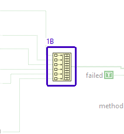 | 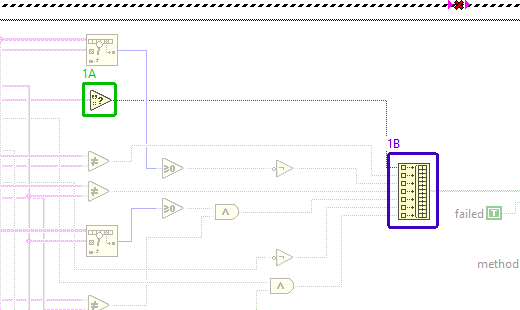 |

**2. Block Diagram objects**

- **2A** Numeric Constant "method not found check" - data value : changed from "5" to "6"

| Before | After |
|---|---|
| 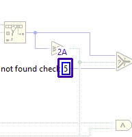 | 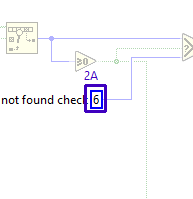 |

**3. Block Diagram objects**

- **3A** Array Constant "check messages" - data value : changed from "["Header mismatch: the MCP-Protocol-Version header does not match params._meta io.modelcontextprotocol/protocolVersion", "Unsupported protocol version", "Header mismatch: the Mcp-Method header does not match method", "Header mismatch: the Mcp-Name header does not match params.name (params.uri for resources/read)", "Invalid params: params._meta io.modelcontextprotocol/clientCapabilities is required", "Method not found"]" to "["Invalid params: params._meta must carry io.modelcontextprotocol/protocolVersion and io.modelcontextprotocol/clientCapabilities", "Header mismatch: the MCP-Protocol-Version header does not match params._meta io.modelcontextprotocol/protocolVersion", "Unsupported protocol version", "Header mismatch: the Mcp-Method header does not match method", "Header mismatch: the Mcp-Name header does not match params.name (params.uri for resources/read)", "Invalid params: params._meta io.modelcontextprotocol/clientCapabilities is required", "Method not found"]"

| Before | After |
|---|---|
| 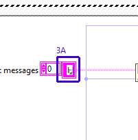 | 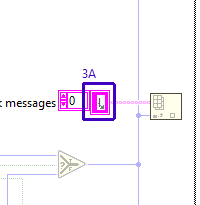 |

**4. Block Diagram objects**

- **4A** Array Constant "check statuses" - data value : changed from "[400, 400, 400, 400, 400, 404]" to "[400, 400, 400, 400, 400, 400, 404]"

| Before | After |
|---|---|
| 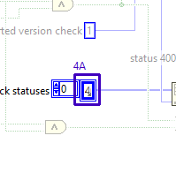 | 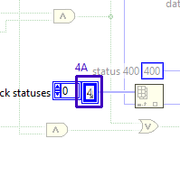 |

**5. Block Diagram objects**

- **5A** Numeric Constant "unsupported version check" - data value : changed from "1" to "2"

| Before | After |
|---|---|
| 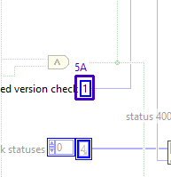 | 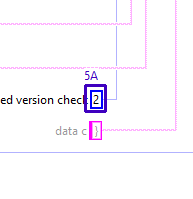 |

**6. Block Diagram objects**

- **6A** Array Constant "check codes" - data value : changed from "["-32020", "-32022", "-32020", "-32020", "-32602", "-32601"]" to "["-32602", "-32020", "-32022", "-32020", "-32020", "-32602", "-32601"]"

| Before | After |
|---|---|
| 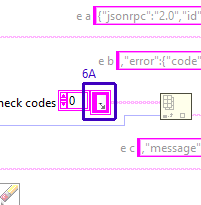 | 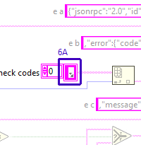 |

**7. Front Panel - Cluster**

- **7A** Boolean - mechanical action
- **7B** Boolean - mechanical action
- **7C** Boolean - mechanical action
- **7D** Boolean - mechanical action
- **7E** Boolean - mechanical action
- **7F** Boolean - mechanical action

| Before | After |
|---|---|
| 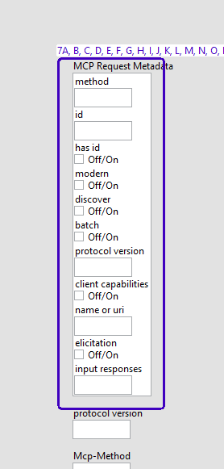 | 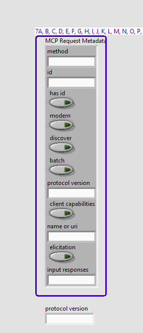 |

**10. Front Panel - Cluster**

- **10A** String - dropping allowed

| Before | After |
|---|---|
| 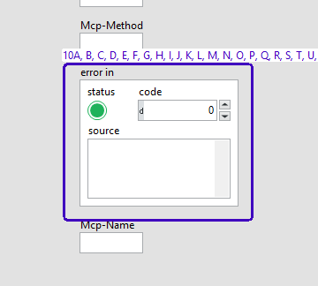 | 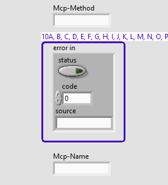 |

**16. VI Attribute - Documentation (VI Properties)**

- **16A** description text : changed from "Checks a request against the rules of MCP 2026-07-28 before it is handled, and says whether it is refused, with which HTTP status and which JSON-RPC error body. A legacy request is never refused here, except a JSON array that comes with modern headers.  Checked in this order, the first failing check wins: - MCP-Protocol-Version header missing or different from the _meta protocolVersion: 400, -32020 (header mismatch). - protocolVersion not one of the modern versions of Supported Protocol Versions.vi: 400, -32022 with data.supported and data.requested. - Mcp-Method header missing or different from method: 400, -32020. - tools/call and prompts/get: Mcp-Name must equal params.name; resources/read: params.uri. A value =?base64?...?= is decoded first. Missing or different: 400, -32020. - io.modelcontextprotocol/clientCapabilities missing in params._meta: 400, -32602. - A method the modern era does not have (it has server/discover, tools/list, tools/call, prompts/list, prompts/get, resources/list, resources/read and resources/templates/list): 404, -32601. Notifications (no id) are not refused for this. A JSON array (batch) that comes with modern headers (an Mcp-Method header, or a modern MCP-Protocol-Version) is refused with 400, -32600.  The JSONtext errors are merged and cleared here. error in is passed through unchanged and does not stop the checks." to "Checks a request against the rules of MCP 2026-07-28 before it is handled, and says whether it is refused, with which HTTP status and which JSON-RPC error body. Only a MODERN request is refused (Read MCP Request Metadata.vi decides the era: params._meta protocolVersion, a modern MCP-Protocol-Version header or the method server/discover). A legacy request is never refused here, except a JSON array that comes with modern headers.  Checked in this order, the first failing check wins: - params._meta missing, or io.modelcontextprotocol/protocolVersion missing in it: 400, -32602 (Invalid params). - MCP-Protocol-Version header missing or different from the _meta protocolVersion: 400, -32020 (header mismatch). - protocolVersion not one of the modern versions of Supported Protocol Versions.vi: 400, -32022 with data.supported and data.requested. - Mcp-Method header missing or different from method: 400, -32020. - tools/call and prompts/get: Mcp-Name must equal params.name; resources/read: params.uri. A value =?base64?...?= is decoded first. Missing or different: 400, -32020. - io.modelcontextprotocol/clientCapabilities missing in params._meta: 400, -32602. - A method the modern era does not have (it has server/discover, tools/list, tools/call, prompts/list, prompts/get, resources/list, resources/read and resources/templates/list; so initialize and ping are refused): 404, -32601. Notifications (no id) are not refused for this. A JSON array (batch) that comes with modern headers (an Mcp-Method header, or a modern MCP-Protocol-Version) is refused with 400, -32600.  The JSONtext errors are merged and cleared here. error in is passed through unchanged and does not stop the checks."

**17. VI Attribute - Editor Options (VI Properties)**

- **17A** default control style

**18. VI Attribute - Miscellaneous**

- **18A** VI icon

| Before | After |
|---|---|
|  |  |

Whole block diagram and front panel

| Before | After |
|---|---|
| 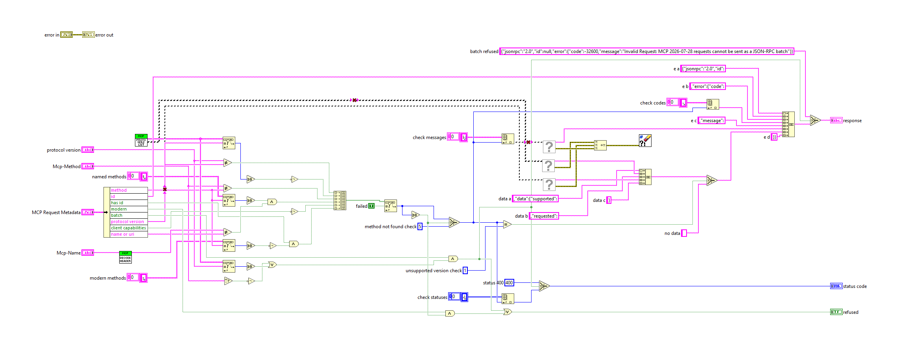 |  |

| Before | After |
|---|---|
| 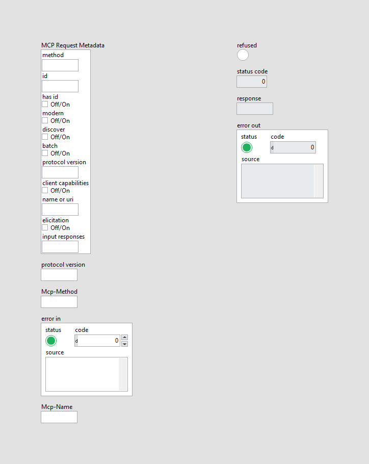 |  |

### `src/MCP Server/Complete Handler Result.vi` (modified)

**1. Block Diagram objects**

- **1A** Front Panel Terminal "uri" - added at (40,145)
- **1B** wiring changes

| Before | After |
|---|---|
| 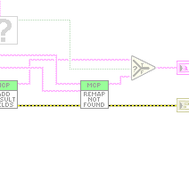 | 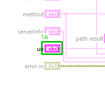 |

**2. Front Panel - Panel**

- **2A** Connector Pane  - control/indicator assignment : changed

| Before | After |
|---|---|
| 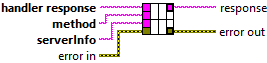 | 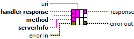 |

**3. Front Panel objects**

- **3A** String "uri" - added at (16,241)

| Before | After |
|---|---|
| 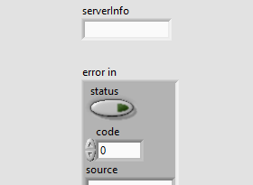 | 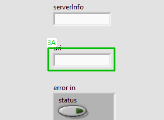 |

**4. VI Attribute - Documentation (VI Properties)**

- **4A** description text : changed from "Completes the handler's answer to a modern (MCP 2026-07-28) request that is not server/discover and did not ask the user: a response with a result gets the result fields (Add Result Fields.vi); any other response goes through Remap Resource Not Found.vi. Used by Complete Modern MCP Result.vi.  Runs regardless of error in, which is passed through unchanged; the JSONtext errors are not passed on." to "Completes the handler's answer to a modern (MCP 2026-07-28) request that is not server/discover and did not ask the user: a response with a result gets the result fields (Add Result Fields.vi); any other response goes through Remap Resource Not Found.vi, which gets uri (params.uri of a resources/read) for error.data.uri. Used by Complete Modern MCP Result.vi.  Runs regardless of error in, which is passed through unchanged; the JSONtext errors are not passed on."

Whole block diagram and front panel

| Before | After |
|---|---|
| 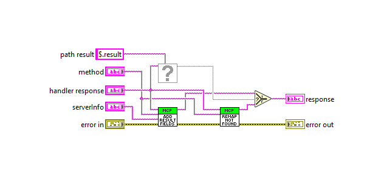 | 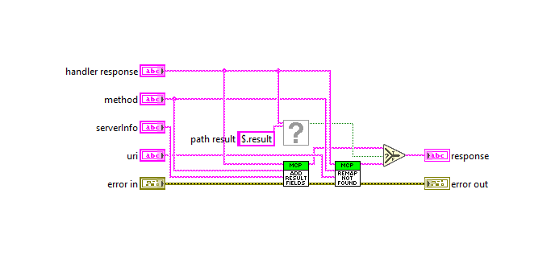 |

| Before | After |
|---|---|
| 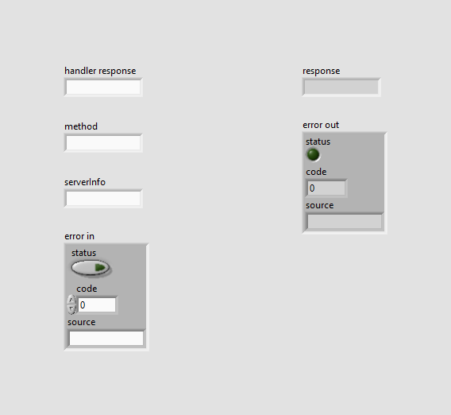 | 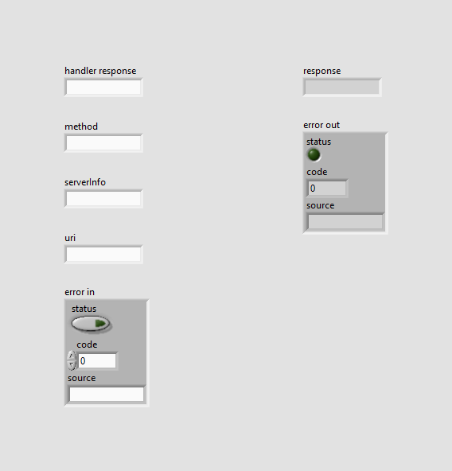 |

### `src/MCP Server/Complete Modern MCP Result.vi` (modified)

**1. Block Diagram objects**

- **1A** Unbundle By Name  - number of elements : changed from "5" to "6"
- **1B** Unbundle By Name  - element 5 added : "name or uri"
- **1C** wiring changes

| Before | After |
|---|---|
| 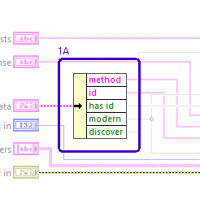 | 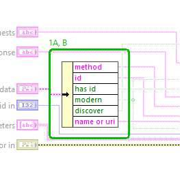 |

**2. VI Attribute - Documentation (VI Properties)**

- **2A** description text : changed from "Turns what the request handler answered into the HTTP response body and status of a request that was not refused.  LEGACY requests: the handler's answer is returned unchanged.  MODERN requests (MCP 2026-07-28): - server/discover is answered here (supportedVersions = all versions, capabilities and serverInfo as initialize reports them, and the cache hints of Cache Hints.vi). - A tools/call for which a tool registered questions is answered with {"resultType":"input_required","inputRequests":{...}} instead of the tool result (no requestState: the retry carries the original params with inputResponses). - Every other result gets "resultType":"complete" and _meta io.modelcontextprotocol/serverInfo; the methods named in Cache Hints.vi also get ttlMs and cacheScope. - resources/read errors -32002 (resource not found) become -32602.  serverInfo is taken from initialize.vi (called with a synthetic initialize request, only for modern requests), so name and version always match what initialize reports.  status code is 202 when there is nothing to answer (empty response to a notification), otherwise 200.  The JSONtext errors are merged and cleared here. error in is passed through unchanged and does not stop the completion." to "Turns what the request handler answered into the HTTP response body and status of a request that was not refused.  LEGACY requests: the handler's answer is returned unchanged.  MODERN requests (MCP 2026-07-28): - server/discover is answered here (supportedVersions = all versions, capabilities and serverInfo as initialize reports them, and the cache hints of Cache Hints.vi). - A tools/call for which a tool registered questions is answered with {"resultType":"input_required","inputRequests":{...}} instead of the tool result (no requestState: the retry carries the original params with inputResponses). - Every other result gets "resultType":"complete" and _meta io.modelcontextprotocol/serverInfo; the methods named in Cache Hints.vi also get ttlMs and cacheScope. - resources/read errors -32002 (resource not found) become -32602 with data {"uri":} (Complete Handler Result.vi gets name or uri of MCP Request Metadata.ctl).  serverInfo is taken from initialize.vi (called with a synthetic initialize request, only for modern requests), so name and version always match what initialize reports.  status code is 202 when there is nothing to answer (empty response to a notification), otherwise 200.  The JSONtext errors are merged and cleared here. error in is passed through unchanged and does not stop the completion."

Whole block diagram and front panel

| Before | After |
|---|---|
|  |  |

| Before | After |
|---|---|
|  |  |

### `src/MCP Server/Handle MCP Request.vi` (modified)

**1. Block Diagram objects**

- **1A** wiring changes

| Before | After |
|---|---|
| 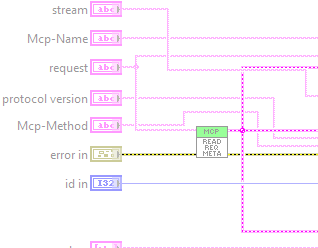 | 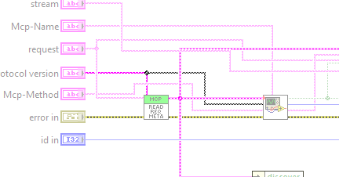 |

**2. VI Attribute - Documentation (VI Properties)**

- **2A** description text : changed from "Handles the body of one HTTP POST in either MCP era and returns the HTTP status code and the response body. Replaces the direct call of Handle Server Request Batch.vi in Process HTTP Request.vi.  ERA, per request, without session state: a JSON object whose params._meta carries io.modelcontextprotocol/protocolVersion is MODERN (MCP 2026-07-28), unless its method is initialize. Everything else is LEGACY and is passed to Handle Server Request Batch.vi unchanged, so legacy answers stay exactly as they were.  MODERN requests are checked first, in this order, and refused without being handled: - MCP-Protocol-Version header missing or different from the _meta protocolVersion: 400, -32020 (header mismatch). - protocolVersion not one of the modern versions of Supported Protocol Versions.vi: 400, -32022 with data.supported and data.requested. - Mcp-Method header missing or different from method: 400, -32020. - tools/call and prompts/get: Mcp-Name must equal params.name; resources/read: params.uri. A value =?base64?...?= is decoded first. Missing or different: 400, -32020. - io.modelcontextprotocol/clientCapabilities missing in params._meta: 400, -32602. - A method the modern era does not have (it has server/discover, tools/list, tools/call, prompts/list, prompts/get, resources/list, resources/read and resources/templates/list; no ping, logging/setLevel or notifications/initialized): 404, -32601. Notifications (no id) are answered with 202 as before. A JSON array (batch) that comes with modern headers (an Mcp-Method header, or a modern MCP-Protocol-Version) is refused with 400, -32600.  MODERN results: server/discover is answered here (supportedVersions = all versions, capabilities and serverInfo as initialize reports them). Every other result is handled as before and then gets "resultType":"complete" and _meta io.modelcontextprotocol/serverInfo; the methods named in Cache Hints.vi also get ttlMs and cacheScope. resources/read errors -32002 (resource not found) become -32602.  REQUEST CONTEXT: while a request is handled, its context ({"era","elicitation","inputResponses","id","progressToken","stream"}) is the only element of the named queue "MCP Request Context" (size 1, which also serialises request handling), and questions that Ask User.vi registers are collected from the named queue "MCP Input Requests". When a modern tools/call registered questions, the result is {"resultType":"input_required","inputRequests":{...}} instead of the tool result (no requestState: the retry carries the original params with inputResponses).  serverInfo is taken from initialize.vi (called with a synthetic initialize request), so name and version always match what initialize reports.  STREAMING: stream is empty for a normal request. For a streamed tools/call Run Streamed Request.vi passes the stream object {"events":..,"cancelled":..} (the queues of the MCP SSE Response, as numbers); it goes into the request context, where Report Progress.vi and Cancel Requested.vi find it. id and progressToken in the context are the JSON text of the request id and of params._meta.progressToken." to "Handles the body of one HTTP POST in either MCP era and returns the HTTP status code and the response body. Replaces the direct call of Handle Server Request Batch.vi in Process HTTP Request.vi.  ERA, per request, without session state (Read MCP Request Metadata.vi): a JSON object is MODERN (MCP 2026-07-28) when its params._meta carries io.modelcontextprotocol/protocolVersion, when the MCP-Protocol-Version header (protocol version) is one of the modern versions of Supported Protocol Versions.vi, or when its method is server/discover. Everything else is LEGACY and is passed to Handle Server Request Batch.vi unchanged, so legacy answers stay exactly as they were.  MODERN requests are checked first, in this order, and refused without being handled: - params._meta missing, or io.modelcontextprotocol/protocolVersion missing in it: 400, -32602. - MCP-Protocol-Version header missing or different from the _meta protocolVersion: 400, -32020 (header mismatch). - protocolVersion not one of the modern versions of Supported Protocol Versions.vi: 400, -32022 with data.supported and data.requested. - Mcp-Method header missing or different from method: 400, -32020. - tools/call and prompts/get: Mcp-Name must equal params.name; resources/read: params.uri. A value =?base64?...?= is decoded first. Missing or different: 400, -32020. - io.modelcontextprotocol/clientCapabilities missing in params._meta: 400, -32602. - A method the modern era does not have (it has server/discover, tools/list, tools/call, prompts/list, prompts/get, resources/list, resources/read and resources/templates/list; no initialize, ping, logging/setLevel or notifications/initialized): 404, -32601. Notifications (no id) are answered with 202 as before. A JSON array (batch) that comes with modern headers (an Mcp-Method header, or a modern MCP-Protocol-Version) is refused with 400, -32600.  MODERN results: server/discover is answered here (supportedVersions = all versions, capabilities and serverInfo as initialize reports them). Every other result is handled as before and then gets "resultType":"complete" and _meta io.modelcontextprotocol/serverInfo; the methods named in Cache Hints.vi also get ttlMs and cacheScope. resources/read errors -32002 (resource not found) become -32602 with data {"uri":}.  REQUEST CONTEXT: while a request is handled, its context ({"era","elicitation","inputResponses","id","progressToken","stream"}) is the only element of the named queue "MCP Request Context" (size 1, which also serialises request handling), and questions that Ask User.vi registers are collected from the named queue "MCP Input Requests". When a modern tools/call registered questions, the result is {"resultType":"input_required","inputRequests":{...}} instead of the tool result (no requestState: the retry carries the original params with inputResponses).  serverInfo is taken from initialize.vi (called with a synthetic initialize request), so name and version always match what initialize reports.  STREAMING: stream is empty for a normal request. For a streamed tools/call Run Streamed Request.vi passes the stream object {"events":..,"cancelled":..} (the queues of the MCP SSE Response, as numbers); it goes into the request context, where Report Progress.vi and Cancel Requested.vi find it. id and progressToken in the context are the JSON text of the request id and of params._meta.progressToken."

Whole block diagram and front panel

| Before | After |
|---|---|
|  |  |

| Before | After |
|---|---|
|  | 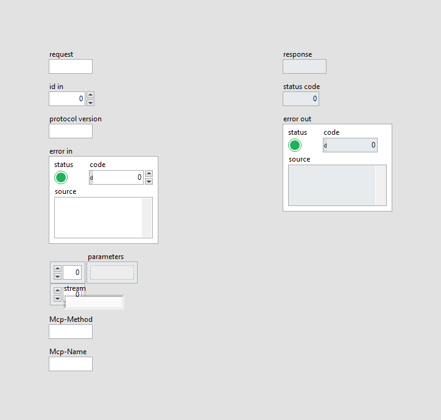 |

All case frames (1 hidden frames)

| Frame | Picture |
|---|---|
| Whole diagram, visible frames: Case structure 1: True | 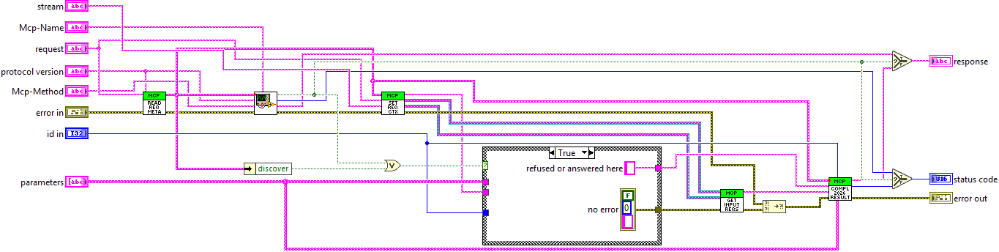 |
| Case structure 1: False | 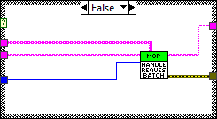 |

### `src/MCP Server/Prepare Request Dispatch.vi` (modified)

**1. Block Diagram objects**

- **1A** wiring changes

| Before | After |
|---|---|
| 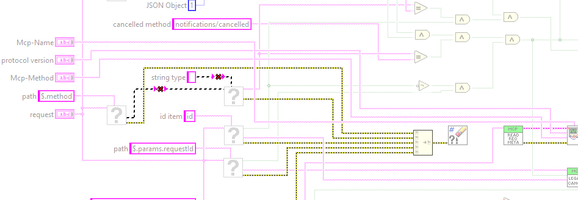 | 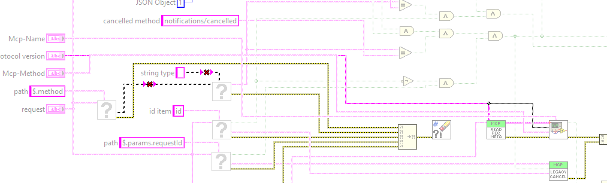 |

**2. VI Attribute - Documentation (VI Properties)**

- **2A** description text : changed from "Decides, in Process HTTP Request.vi and before Handle MCP Request.vi, how an accepted HTTP POST is answered.  LEGACY CANCELLATION: a single JSON-RPC notification {"method":"notifications/cancelled","params":{"requestId":..}} (MCP 2025-06-18 and older) is recorded in Legacy Cancellations.vi and answered with 202 at once; Handle MCP Request.vi is not called. The running tools/call sees it through Report Progress.vi and Cancel Requested.vi. While a STREAMED tools/call runs this works at once, because Process HTTP Request.vi returns as soon as the stream is set up. While a non-streamed tools/call runs, the notification waits behind it (Process HTTP Request.vi handles one request at a time) and has no effect. Every dispatched request first clears its own id from Legacy Cancellations.vi, so a notification that arrived too late never cancels a later request that reuses the id.  STREAMING: stream? is TRUE for a tools/call with an id whose params._meta.progressToken is a string or a number, when the Accept header contains text/event-stream and Check Modern MCP Request.vi would not refuse it. Both eras. Then accepted out is FALSE so that the request is not handled synchronously; Start Streamed Request.vi handles it instead.  Everything else passes through unchanged." to "Decides, in Process HTTP Request.vi and before Handle MCP Request.vi, how an accepted HTTP POST is answered.  LEGACY CANCELLATION: a single JSON-RPC notification {"method":"notifications/cancelled","params":{"requestId":..}} (MCP 2025-06-18 and older) is recorded in Legacy Cancellations.vi and answered with 202 at once; Handle MCP Request.vi is not called. The running tools/call sees it through Report Progress.vi and Cancel Requested.vi. While a STREAMED tools/call runs this works at once, because Process HTTP Request.vi returns as soon as the stream is set up. While a non-streamed tools/call runs, the notification waits behind it (Process HTTP Request.vi handles one request at a time) and has no effect. Every dispatched request first clears its own id from Legacy Cancellations.vi, so a notification that arrived too late never cancels a later request that reuses the id.  STREAMING: stream? is TRUE for a tools/call with an id whose params._meta.progressToken is a string or a number, when the Accept header contains text/event-stream and Check Modern MCP Request.vi would not refuse it. Both eras; the era is decided by Read MCP Request Metadata.vi from the body and the MCP-Protocol-Version header (protocol version). Then accepted out is FALSE so that the request is not handled synchronously; Start Streamed Request.vi handles it instead.  Everything else passes through unchanged."

Whole block diagram and front panel

| Before | After |
|---|---|
| 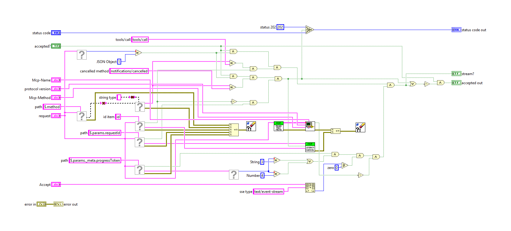 |  |

| Before | After |
|---|---|
| 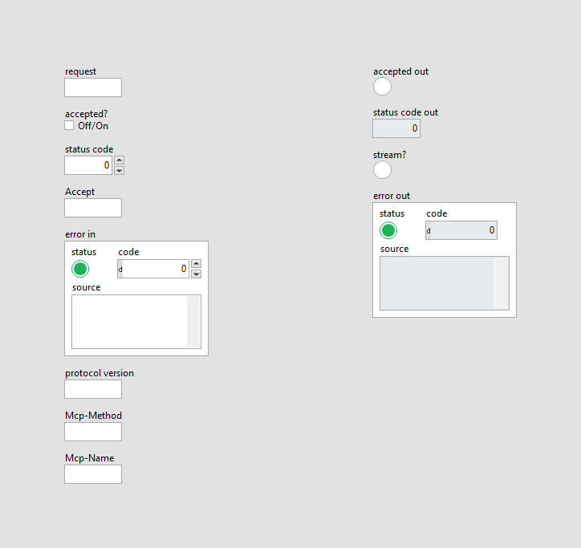 |  |

### `src/MCP Server/Process HTTP Request.vi` (modified)

**1. Block Diagram objects**

- **1A** SubVI "MCP Server.lvlib:Restore Request ID.vi" - added at (620,25)
- **1B** wiring changes

| Before | After |
|---|---|
| 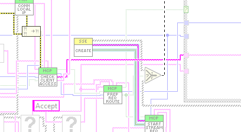 | 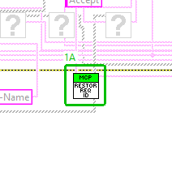 |

**2. Block Diagram objects**

- **2A** String Constant "Header" - added at (1576,-351)
- **2B** String Constant "Value" - added at (1671,-343)
- **2C** SubVI "Set Header.vi" - added at (1715,-354)
- **2D** wiring changes

| Before | After |
|---|---|
| 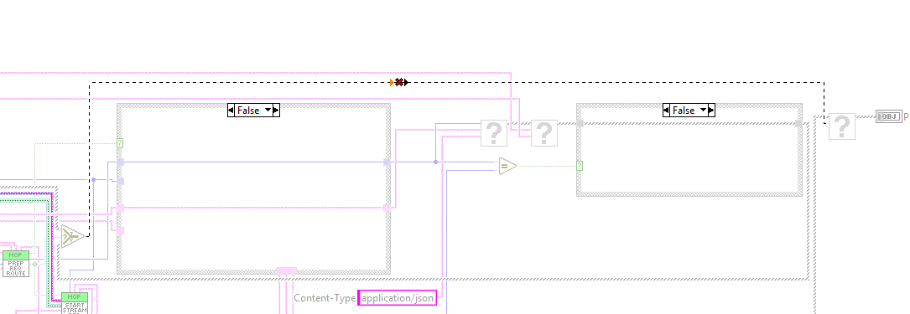 | 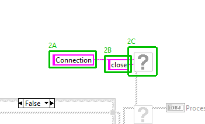 |

**3. VI Attribute - Documentation (VI Properties)**

- **3A** description text : changed from "Answers one HTTP request on the MCP endpoint following the MCP Streamable HTTP transport rules, and stores the response in the Processing object.  1. ACCESS: reads the client host (Get Request, Get Client URI, Get Host: the name from a reverse DNS lookup of the client address), the local address of the connection the request arrived on (Connection Local IP.vi, no DNS) and the Authorization header, and passes them to Check Client Access.vi with the access settings Start.vi stored for this server. "This computer only" is decided by that local address; an error reading it only leaves it empty, which Check Client Access.vi refuses in that mode, and never turns into a 500. A client that is not allowed gets 403, a missing or wrong bearer token 401 with WWW-Authenticate: Bearer. These checks win over every later one. 2. Reads the HTTP method and the Origin and MCP-Protocol-Version request headers and passes them to Validate HTTP Request.vi. Also reads the Mcp-Method and Mcp-Name headers (MCP 2026-07-28). 3. Rejected request (403, 401, 405 or 400): the MCP server is NOT called. The response carries the status code and the JSON-RPC error payload with Content-Type application/json. A 405 additionally carries the header Allow: POST. 4. Accepted request: Prepare Request Dispatch.vi answers a legacy notifications/cancelled itself and decides whether a tools/call is streamed (Start Streamed Request.vi). Otherwise the request body, one message or a batch of messages, is passed with the three MCP headers to Handle MCP Request.vi, which decides the era (legacy or modern) per request, makes the modern header checks and answers; its errors are cleared. Its status code is used: 202 with an empty body for a notification, 200 with Content-Type application/json, or 400/404 for a refused modern request.  error out reports only errors of the first two header reads. It is informational: a response is always set." to "Answers one HTTP request on the MCP endpoint following the MCP Streamable HTTP transport rules, and stores the response in the Processing object.  1. ACCESS: reads the client host (Get Request, Get Client URI, Get Host: the name from a reverse DNS lookup of the client address), the local address of the connection the request arrived on (Connection Local IP.vi, no DNS) and the Authorization header, and passes them to Check Client Access.vi with the access settings Start.vi stored for this server. "This computer only" is decided by that local address; an error reading it only leaves it empty, which Check Client Access.vi refuses in that mode, and never turns into a 500. A client that is not allowed gets 403, a missing or wrong bearer token 401 with WWW-Authenticate: Bearer. These checks win over every later one. 2. Reads the HTTP method and the Origin and MCP-Protocol-Version request headers and passes them to Validate HTTP Request.vi. Also reads the Mcp-Method and Mcp-Name headers (MCP 2026-07-28). 3. Rejected request (403, 401, 405 or 400): the MCP server is NOT called. The response carries the status code and the JSON-RPC error payload with Content-Type application/json. The payload goes through Restore Request ID.vi with the request body first, so a refused request that has an id gets that id back exactly as sent (a string stays a string) instead of null, and a refused notification gets an empty body. A 405 additionally carries the header Allow: POST. 4. Accepted request: Prepare Request Dispatch.vi answers a legacy notifications/cancelled itself and decides whether a tools/call is streamed (Start Streamed Request.vi). Otherwise the request body, one message or a batch of messages, is passed with the three MCP headers to Handle MCP Request.vi, which decides the era (legacy or modern) per request, makes the modern header checks and answers; its errors are cleared. Its status code is used: 202 with an empty body for a notification, 200 with Content-Type application/json, or 400/404 for a refused modern request. 5. Every response, the Server-Sent Events stream of a streamed tools/call included, carries the header Connection: close: the HTTP server closes the TCP connection after each response, and the header tells HTTP/1.1 clients not to reuse it.  error out reports only errors of the first two header reads. It is informational: a response is always set."

Whole block diagram and front panel

| Before | After |
|---|---|
| 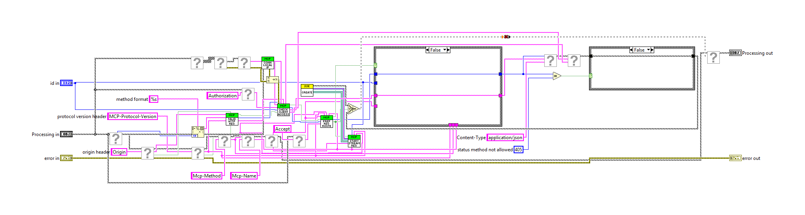 | 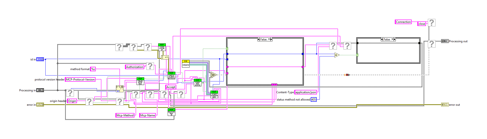 |

| Before | After |
|---|---|
|  | 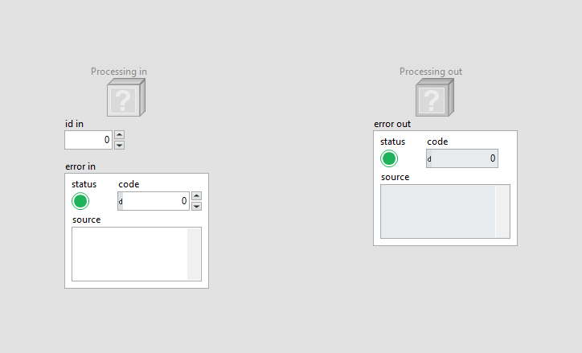 |

All case frames (2 hidden frames)

| Frame | Picture |
|---|---|
| Whole diagram, visible frames: Case structure 1: False; Case structure 2: False | 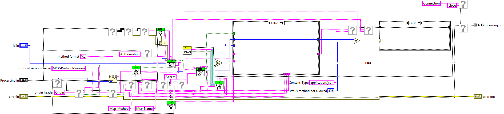 |
| Case structure 1: True | 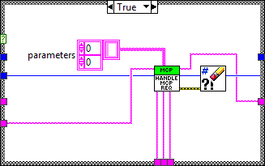 |
| Case structure 2: True | 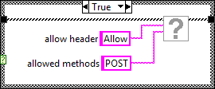 |

### `src/MCP Server/Read MCP Request Metadata.vi` (modified)

**1. Block Diagram objects**

- **1A** Front Panel Terminal "protocol version header" - added at (40,125)
- **1B** SubVI "MCP Server.lvlib:Supported Protocol Versions.vi" - added at (466,96)
- **1C** Search 1D Array  - added at (562,117)
- **1D** Greater Or Equal To 0?  - added at (719,409)
- **1E** Or  - added at (794,415)
- **1F** Or  - added at (884,415)
- **1G** String Constant "initialize" - deleted at (898,645)
- **1H** Equal?  - deleted at (1326,445)
- **1I** Not  - deleted at (1417,447)
- **1J** And  - deleted at (1472,443)
- **1K** wiring changes

| Before | After |
|---|---|
| 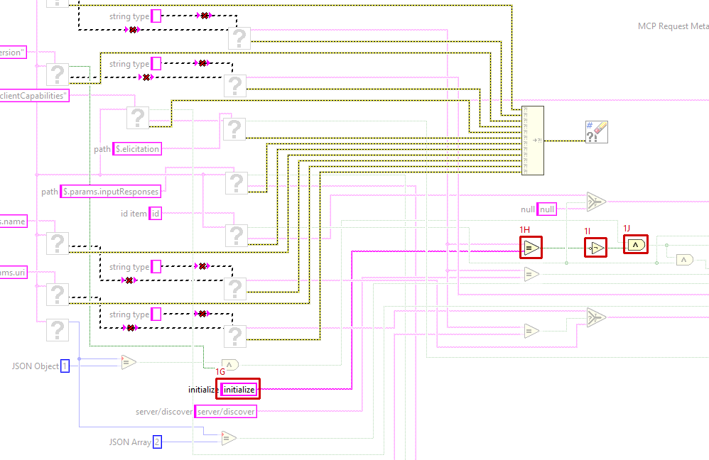 |  |

**2. Front Panel - Panel**

- **2A** Connector Pane  - control/indicator assignment : changed

| Before | After |
|---|---|
|  |  |

**4. Front Panel - Cluster**

- **4A** String - dropping allowed

| Before | After |
|---|---|
|  |  |

**7. Front Panel objects**

- **7A** String "protocol version header" - added at (16,101)

| Before | After |
|---|---|
|  |  |

**8. VI Attribute - Documentation (VI Properties)**

- **8A** description text : changed from "Reads what Handle MCP Request.vi needs to know about one request body and returns it as MCP Request Metadata.ctl: the method, the id as JSON text (null when missing), the io.modelcontextprotocol/protocolVersion and clientCapabilities of params._meta, params.uri for resources/read and params.name otherwise, the elicitation capability, and params.inputResponses ({} when missing).  It also decides the era, per request and without session state: a JSON object whose params._meta carries io.modelcontextprotocol/protocolVersion is MODERN (MCP 2026-07-28), unless its method is initialize. Everything else is LEGACY. A modern server/discover request with an id is marked discover, a JSON array is marked batch.  A missing item is not an error of the request: the JSONtext errors are merged and cleared here. error in is passed through unchanged and does not stop the reading." to "Reads what Handle MCP Request.vi needs to know about one request body and returns it as MCP Request Metadata.ctl: the method, the id as JSON text (null when missing), the io.modelcontextprotocol/protocolVersion (empty when missing) and clientCapabilities of params._meta, params.uri for resources/read and params.name otherwise, the elicitation capability, and params.inputResponses ({} when missing).  It also decides the era, per request and without session state. A JSON object is MODERN (MCP 2026-07-28) when any of these holds: params._meta carries io.modelcontextprotocol/protocolVersion; the MCP-Protocol-Version request header (protocol version header) is one of the modern versions of Supported Protocol Versions.vi; the method is server/discover. initialize is not excluded: a modern initialize is refused by Check Modern MCP Request.vi with 404. Everything else is LEGACY, so a legacy client, which sends no MCP-Protocol-Version header or a legacy one, stays legacy. A modern server/discover request with an id is marked discover, a JSON array is marked batch.  A missing item is not an error of the request: the JSONtext errors are merged and cleared here. error in is passed through unchanged and does not stop the reading."

**9. VI Attribute - Editor Options (VI Properties)**

- **9A** default control style

Whole block diagram and front panel

| Before | After |
|---|---|
|  |  |

| Before | After |
|---|---|
|  |  |

### `src/MCP Server/Remap Resource Not Found.vi` (modified)

**1. Block Diagram objects**

- **1A** Front Panel Terminal "uri" - added at (40,39)
- **1B** SubVI "To JSON Text.vim" - added at (229,43)
- **1C** String Constant "data a" - added at (306,132)
- **1D** String Constant "data b" - added at (333,169)
- **1E** Concatenate Strings  - added at (356,110)
- **1F** String Constant "data path" - added at (422,138)
- **1G** SubVI "Set Item.vi" - added at (501,163)
- **1H** wiring changes

| Before | After |
|---|---|
|  |  |

**2. Front Panel - Panel**

- **2A** Connector Pane  - control/indicator assignment : changed

| Before | After |
|---|---|
|  |  |

**3. Front Panel objects**

- **3A** String "uri" - added at (16,171)

| Before | After |
|---|---|
|  |  |

**4. VI Attribute - Documentation (VI Properties)**

- **4A** description text : changed from "MCP 2026-07-28 answers a resources/read for an unknown resource with error -32602 (invalid params) instead of -32002. When method is resources/read and response carries error.code -32002, response out is response with the code replaced; otherwise response out is response unchanged. Used by Complete Handler Result.vi.  Runs regardless of error in, which is passed through unchanged; the JSONtext errors are not passed on." to "MCP 2026-07-28 answers a resources/read for an unknown resource with error -32602 (invalid params) instead of -32002, and its error.data names the resource: {"uri":}. When method is resources/read and response carries error.code -32002, response out is response with the code replaced and error.data set to {"uri": uri} (uri as a JSON string); otherwise response out is response unchanged. Used by Complete Handler Result.vi.  Runs regardless of error in, which is passed through unchanged; the JSONtext errors are not passed on."

Whole block diagram and front panel

| Before | After |
|---|---|
|  |  |

| Before | After |
|---|---|
|  |  |

### `tests/Test_MCP_Server.vi` (modified)

**1. Block Diagram objects**

- **1A** SubVI "MCP Server tests.lvlib:test modern missing meta.vi" - added at (5216,285)
- **1B** SubVI "MCP Server tests.lvlib:test modern initialize.vi" - added at (5316,285)
- **1C** SubVI "MCP Server tests.lvlib:test unsupported version id.vi" - added at (5416,285)
- **1D** SubVI "MCP Server tests.lvlib:test resource not found uri.vi" - added at (5516,285)
- **1E** wiring changes

| Before | After |
|---|---|
|  |  |

Whole block diagram and front panel

| Before | After |
|---|---|
|  |  |

| Before | After |
|---|---|
|  |  |

### `tests/test access allowed clients.vi` (modified)

**1. Block Diagram objects**

- **1A** String Constant "expected" - data value : changed from ""null"" to ""611""

| Before | After |
|---|---|
|  |  |

**2. Block Diagram objects**

- **2A** String Constant "Label" - data value : changed from ""the 403 body is the JSON-RPC error -32600 "Forbidden: client not allowed." with id null"" to ""the 403 body is the JSON-RPC error -32600 "Forbidden: client not allowed." with the request id 611""

| Before | After |
|---|---|
|  |  |

**3. VI Attribute - Documentation (VI Properties)**

- **3A** description text : changed from "Client allow-list. A second MCP server is started on port 37061 with Allowed clients = ["192.0.2.1"] (TEST-NET-1, never this computer). A tools/list from this computer is refused before any MCP handling: HTTP 403, Content-Type application/json and the JSON-RPC error {"jsonrpc":"2.0","id":null,"error":{"code":-32600,"message":"Forbidden: client not allowed."}}. The server is stopped afterwards. That the default (empty Allowed clients) still lets this computer in is shown by every other test." to "Client allow-list. A second MCP server is started on port 37061 with Allowed clients = ["192.0.2.1"] (TEST-NET-1, never this computer). A tools/list from this computer is refused before any MCP handling: HTTP 403, Content-Type application/json and the JSON-RPC error {"jsonrpc":"2.0","id":611,"error":{"code":-32600,"message":"Forbidden: client not allowed."}}. The server is stopped afterwards. That the default (empty Allowed clients) still lets this computer in is shown by every other test."

Whole block diagram and front panel

| Before | After |
|---|---|
|  |  |

| Before | After |
|---|---|
|  |  |

All case frames (1 hidden frames)

| Frame | Picture |
|---|---|
| Whole diagram, visible frames: Case structure 1: False |  |
| Case structure 1: True |  |

### `tests/test access bearer token.vi` (modified)

**1. Block Diagram objects**

- **1A** String Constant "expected" - data value : changed from ""null"" to ""611""

| Before | After |
|---|---|
|  |  |

**2. Block Diagram objects**

- **2A** String Constant "Label" - data value : changed from ""the 401 body is the JSON-RPC error -32600 "Unauthorized: missing or invalid bearer token." with id null"" to ""the 401 body is the JSON-RPC error -32600 "Unauthorized: missing or invalid bearer token." with the request id 611""

| Before | After |
|---|---|
|  |  |

**3. VI Attribute - Documentation (VI Properties)**

- **3A** description text : changed from "Bearer token. A second MCP server is started on port 37062 with Access token = "test-token-62". tools/list without an Authorization header and with a wrong token is answered with HTTP 401, WWW-Authenticate: Bearer and the JSON-RPC error {"jsonrpc":"2.0","id":null,"error":{"code":-32600,"message":"Unauthorized: missing or invalid bearer token."}}; with "Authorization: bearer test-token-62" (lower-case scheme) and with the header name in lower case it is answered normally (200 and a result). The token never appears in any response. The server is stopped afterwards." to "Bearer token. A second MCP server is started on port 37062 with Access token = "test-token-62". tools/list without an Authorization header and with a wrong token is answered with HTTP 401, WWW-Authenticate: Bearer and the JSON-RPC error {"jsonrpc":"2.0","id":611,"error":{"code":-32600,"message":"Unauthorized: missing or invalid bearer token."}}; with "Authorization: bearer test-token-62" (lower-case scheme) and with the header name in lower case it is answered normally (200 and a result). The token never appears in any response. The server is stopped afterwards."

Whole block diagram and front panel

| Before | After |
|---|---|
|  |  |

| Before | After |
|---|---|
|  |  |

All case frames (1 hidden frames)

| Frame | Picture |
|---|---|
| Whole diagram, visible frames: Case structure 1: False |  |
| Case structure 1: True |  |

### `tests/test modern initialize.vi` (added)

Block diagram (case structures show their visible frame only):

Front panel

### `tests/test modern missing meta.vi` (added)

Block diagram (case structures show their visible frame only):

Front panel

### `tests/test resource not found uri.vi` (added)

Block diagram (case structures show their visible frame only):

Front panel

### `tests/test unsupported version id.vi` (added)

Block diagram (case structures show their visible frame only):

Front panel

