## VI diff report

11 modified, 9 added, 0 deleted. Generated by LabVIEW's VI comparison; position and size changes are not shown.

### `src/MCP Server/Ask User.vi` (modified)

**1. VI Attribute - Documentation (VI Properties)**

- **1A** description text : changed from "Asks the user of the MCP client a question while a tool runs (MCP elicitation, form mode), using the multi round-trip pattern of MCP 2026-07-28: the tool VI runs twice. On the first run the question is only registered and action is "pending"; tools/call then answers the client with resultType "input_required". The client shows the question and calls the tool again with the user's answer, and on that second run action is accept, decline or cancel and content holds the answer.  HOW TO USE IT IN A TOOL VI: call Ask User.vi before doing anything that has side effects. When action is "pending", return at once and do NOTHING else (no hardware access, no file writes): the run is thrown away and the tool runs again with the answer. Do the real work only on the run that has the answer (accept), and handle decline and cancel. When action is "not supported", the client cannot be asked (a legacy client, or a client without the elicitation capability): fall back to a safe default or refuse, and say so in the tool's outputs.  key identifies the question and must be unique within the tool (use a fixed text such as "confirm_delete"); several questions need several keys.  requestedSchema is passed to the client as given. MCP restricts it to a flat object whose properties are primitives only: string (minLength, maxLength, format email/uri/date/date-time, default), number or integer (minimum, maximum, default), boolean (default) and enums of strings, each with optional title and description. Empty means a plain confirmation, {"type":"object","properties":{}}; anything that is not a JSON object is replaced by that too. Form mode MUST NOT be used to ask for passwords, API keys, tokens or other secrets.  Only works inside tools/call of a modern request (params._meta with io.modelcontextprotocol/protocolVersion) whose client declared the elicitation capability ({} counts as form mode). The request context comes from Handle MCP Request.vi through the named queues "MCP Request Context" and "MCP Input Requests". Legacy requests always get "not supported": legacy elicitation needs a server-to-client stream, which this server does not have." to "Asks the user of the MCP client a question while a tool runs (MCP elicitation, form mode), using the multi round-trip pattern of MCP 2026-07-28: the tool VI runs twice. On the first run the question is only registered and action is "pending"; tools/call (or prompts/get) then answers the client with resultType "input_required" and a requestState. The client shows the question and calls the tool again with the user's answer, and on that second run action is accept, decline or cancel and content holds the answer.  HOW TO USE IT IN A TOOL VI: call Ask User.vi before doing anything that has side effects. When action is "pending", return at once and do NOTHING else (no hardware access, no file writes): the run is thrown away and the tool runs again with the answer. Do the real work only on the run that has the answer (accept), and handle decline and cancel. When action is "not supported", the client cannot be asked (a legacy client, or a client without the elicitation capability): fall back to a safe default or refuse, and say so in the tool's outputs.  key identifies the question and must be unique within the tool (use a fixed text such as "confirm_delete"); several questions need several keys.  requestedSchema is passed to the client as given. MCP restricts it to a flat object whose properties are primitives only: string (minLength, maxLength, format email/uri/date/date-time, default), number or integer (minimum, maximum, default), boolean (default) and enums of strings, each with optional title and description. Empty means a plain confirmation, {"type":"object","properties":{}}; anything that is not a JSON object is replaced by that too. Form mode MUST NOT be used to ask for passwords, API keys, tokens or other secrets.  SEVERAL QUESTIONS: a tool may ask several questions, in one run or in several rounds (ask key "first"; once it is answered, ask key "second"). The server keeps the answers of the earlier rounds itself (requestState, Request State Store.vi) and hands every answer given so far to each run, although the client sends back only the answers to the latest questions. When the client retries without the answer to a question, action is "pending" again and the question is asked again.  Only works inside tools/call or prompts/get (in a prompt VI) of a modern request (params._meta with io.modelcontextprotocol/protocolVersion) whose client declared the elicitation capability ({} counts as form mode). The request context comes from Handle MCP Request.vi through the named queues "MCP Request Context" and "MCP Input Requests". Legacy requests always get "not supported": legacy elicitation needs a server-to-client stream, which this server does not have."

Whole block diagram and front panel

| Before | After |
|---|---|
| 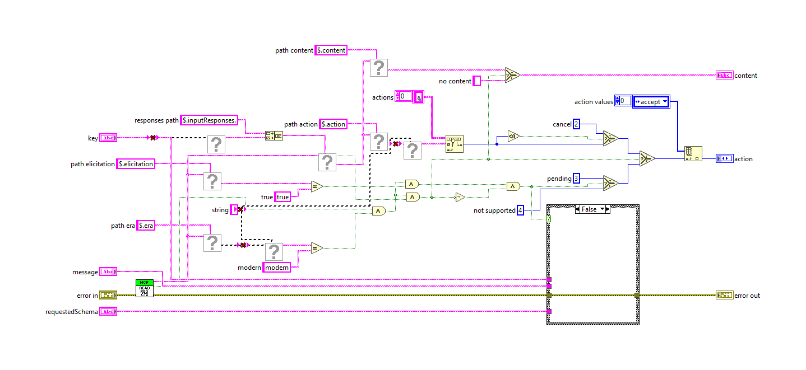 |  |

| Before | After |
|---|---|
|  |  |

All case frames (1 hidden frames)

| Frame | Picture |
|---|---|
| Whole diagram, visible frames: Case structure 1: False | 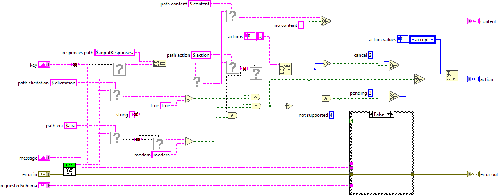 |
| Case structure 1: True | 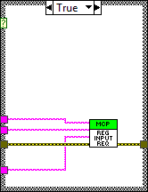 |

### `src/MCP Server/Check Modern MCP Request.vi` (modified)

**1. Block Diagram objects**

- **1A** Front Panel Terminal "MCP Request Metadata" - data type : changed
- **1B** Front Panel Terminal "MCP Request Metadata" - numeric representation : changed from "'MCP Request Metadata': cluster of 11 elements \r\n    'method': string \r\n    'id': string \r\n    'has id': boolean (TRUE or FALSE) \r\n    'modern': boolean (TRUE or FALSE) \r\n    'discover': boolean (TRUE or FALSE) \r\n    'batch': boolean (TRUE or FALSE) \r\n " to "'MCP Request Metadata': typedef 'MCP Server.lvlib:MCP Request Metadata.ctl'\r\ncluster of 13 elements \r\n    'method': string \r\n    'id': string \r\n    'has id': boolean (TRUE or FALSE) \r\n    'modern': boolean (TRUE or FALSE) \r\n    'discover': boolean (TRUE"

| Before | After |
|---|---|
| 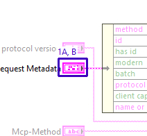 | 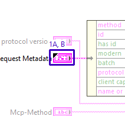 |

**3. VI Attribute - Documentation (VI Properties)**

- **3A** description text : changed from "Checks a request against the rules of MCP 2026-07-28 before it is handled, and says whether it is refused, with which HTTP status and which JSON-RPC error body. Only a MODERN request is refused (Read MCP Request Metadata.vi decides the era: params._meta protocolVersion, a modern MCP-Protocol-Version header or the method server/discover). A legacy request is never refused here, except a JSON array that comes with modern headers.  Checked in this order, the first failing check wins: - params._meta missing, or io.modelcontextprotocol/protocolVersion missing in it: 400, -32602 (Invalid params). - MCP-Protocol-Version header missing or different from the _meta protocolVersion: 400, -32020 (header mismatch). - protocolVersion not one of the modern versions of Supported Protocol Versions.vi: 400, -32022 with data.supported and data.requested. - Mcp-Method header missing or different from method: 400, -32020. - tools/call and prompts/get: Mcp-Name must equal params.name; resources/read: params.uri. A value =?base64?...?= is decoded first. Missing or different: 400, -32020. - io.modelcontextprotocol/clientCapabilities missing in params._meta: 400, -32602. - A method the modern era does not have (it has server/discover, tools/list, tools/call, prompts/list, prompts/get, resources/list, resources/read and resources/templates/list; so initialize and ping are refused): 404, -32601. Notifications (no id) are not refused for this. A JSON array (batch) that comes with modern headers (an Mcp-Method header, or a modern MCP-Protocol-Version) is refused with 400, -32600.  The JSONtext errors are merged and cleared here. error in is passed through unchanged and does not stop the checks." to "Checks a request against the rules of MCP 2026-07-28 before it is handled, and says whether it is refused, with which HTTP status and which JSON-RPC error body. Only a MODERN request is refused (Read MCP Request Metadata.vi decides the era: params._meta protocolVersion, a modern MCP-Protocol-Version header or the method server/discover). A legacy request is never refused here, except a JSON array that comes with modern headers.  Checked in this order, the first failing check wins: - params._meta missing, or io.modelcontextprotocol/protocolVersion missing in it: 400, -32602 (Invalid params). - MCP-Protocol-Version header missing or different from the _meta protocolVersion: 400, -32020 (header mismatch). - protocolVersion not one of the modern versions of Supported Protocol Versions.vi: 400, -32022 with data.supported and data.requested. - Mcp-Method header missing or different from method: 400, -32020. - tools/call and prompts/get: Mcp-Name must equal params.name; resources/read: params.uri. A value =?base64?...?= is decoded first. Missing or different: 400, -32020. - io.modelcontextprotocol/clientCapabilities missing in params._meta: 400, -32602. - A method the modern era does not have (it has server/discover, tools/list, tools/call, prompts/list, prompts/get, resources/list, resources/read and resources/templates/list; so initialize and ping are refused): 404, -32601. Notifications (no id) are not refused for this. A JSON array (batch) that comes with modern headers (an Mcp-Method header, or a modern MCP-Protocol-Version) is refused with 400, -32600.  A requestState is not checked here but by Resolve Request State.vi, which runs after this VI and only when it did not refuse.  The JSONtext errors are merged and cleared here. error in is passed through unchanged and does not stop the checks."

Whole block diagram and front panel

| Before | After |
|---|---|
| 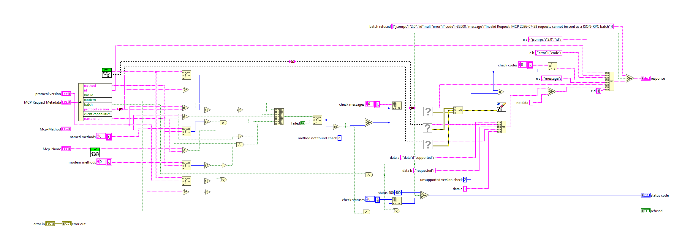 |  |

| Before | After |
|---|---|
| 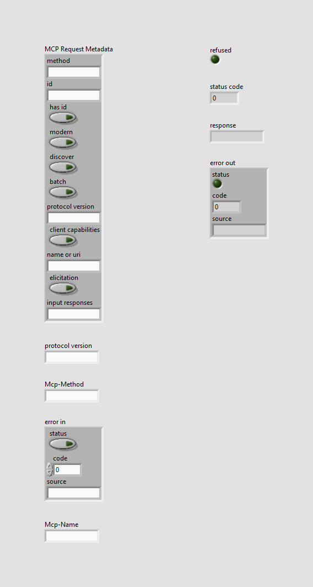 | 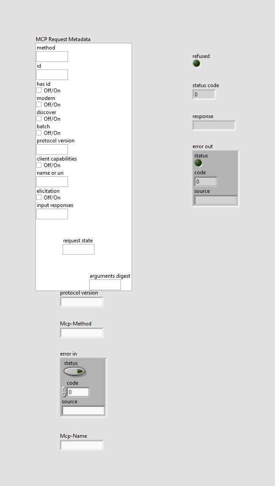 |

### `src/MCP Server/Complete Modern MCP Result.vi` (modified)

**1. Block Diagram objects**

- **1A** Front Panel Terminal "MCP Request Metadata" - data type : changed
- **1B** Front Panel Terminal "MCP Request Metadata" - numeric representation : changed from "'MCP Request Metadata': cluster of 11 elements \r\n    'method': string \r\n    'id': string \r\n    'has id': boolean (TRUE or FALSE) \r\n    'modern': boolean (TRUE or FALSE) \r\n    'discover': boolean (TRUE or FALSE) \r\n    'batch': boolean (TRUE or FALSE) \r\n " to "'MCP Request Metadata': typedef 'MCP Server.lvlib:MCP Request Metadata.ctl'\r\ncluster of 13 elements \r\n    'method': string \r\n    'id': string \r\n    'has id': boolean (TRUE or FALSE) \r\n    'modern': boolean (TRUE or FALSE) \r\n    'discover': boolean (TRUE"
- **1C** wiring changes

| Before | After |
|---|---|
| 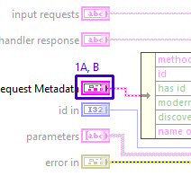 | 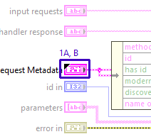 |

**3. VI Attribute - Documentation (VI Properties)**

- **3A** description text : changed from "Turns what the request handler answered into the HTTP response body and status of a request that was not refused.  LEGACY requests: the handler's answer is returned unchanged.  MODERN requests (MCP 2026-07-28): - server/discover is answered here (supportedVersions = all versions, capabilities and serverInfo as initialize reports them, and the cache hints of Cache Hints.vi). - A tools/call for which a tool registered questions is answered with {"resultType":"input_required","inputRequests":{...}} instead of the tool result (no requestState: the retry carries the original params with inputResponses). - Every other result gets "resultType":"complete" and _meta io.modelcontextprotocol/serverInfo; the methods named in Cache Hints.vi also get ttlMs and cacheScope. - resources/read errors -32002 (resource not found) become -32602 with data {"uri":} (Complete Handler Result.vi gets name or uri of MCP Request Metadata.ctl).  serverInfo is taken from initialize.vi (called with a synthetic initialize request, only for modern requests), so name and version always match what initialize reports.  status code is 202 when there is nothing to answer (empty response to a notification), otherwise 200.  The JSONtext errors are merged and cleared here. error in is passed through unchanged and does not stop the completion." to "Turns what the request handler answered into the HTTP response body and status of a request that was not refused.  LEGACY requests: the handler's answer is returned unchanged.  MODERN requests (MCP 2026-07-28): - server/discover is answered here (supportedVersions = all versions, capabilities and serverInfo as initialize reports them, and the cache hints of Cache Hints.vi). - A tools/call or prompts/get for which the tool or prompt VI registered questions is answered with {"resultType":"input_required","inputRequests":{...},"requestState":""} instead of its result (Input Required Response.vi). The answers given so far (input responses of MCP Request Metadata, merged by Resolve Request State.vi) are kept in Request State Store.vi under that token, so the retry gets them back. - Every other result gets "resultType":"complete" and _meta io.modelcontextprotocol/serverInfo; the methods named in Cache Hints.vi also get ttlMs and cacheScope. - resources/read errors -32002 (resource not found) become -32602 with data {"uri":} (Complete Handler Result.vi gets name or uri of MCP Request Metadata.ctl).  serverInfo is taken from initialize.vi (called with a synthetic initialize request, only for modern requests), so name and version always match what initialize reports.  status code is 202 when there is nothing to answer (empty response to a notification), otherwise 200.  The JSONtext errors are merged and cleared here. error in is passed through unchanged and does not stop the completion."

Whole block diagram and front panel

| Before | After |
|---|---|
|  | 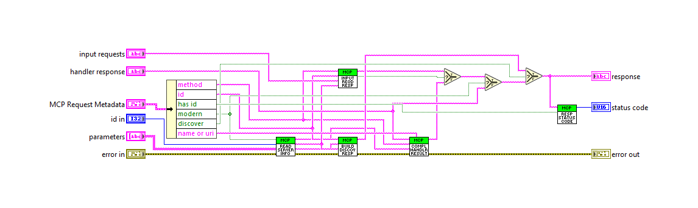 |

| Before | After |
|---|---|
| 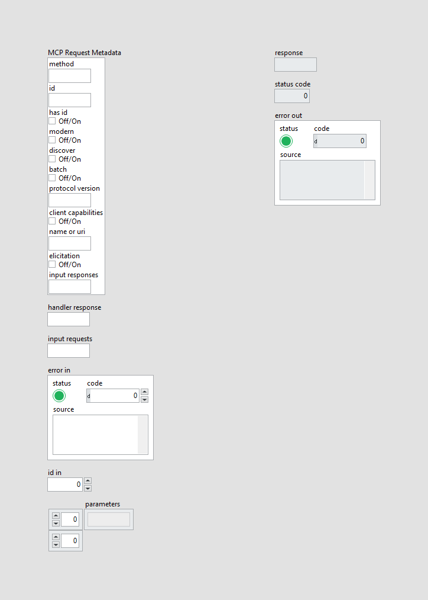 | 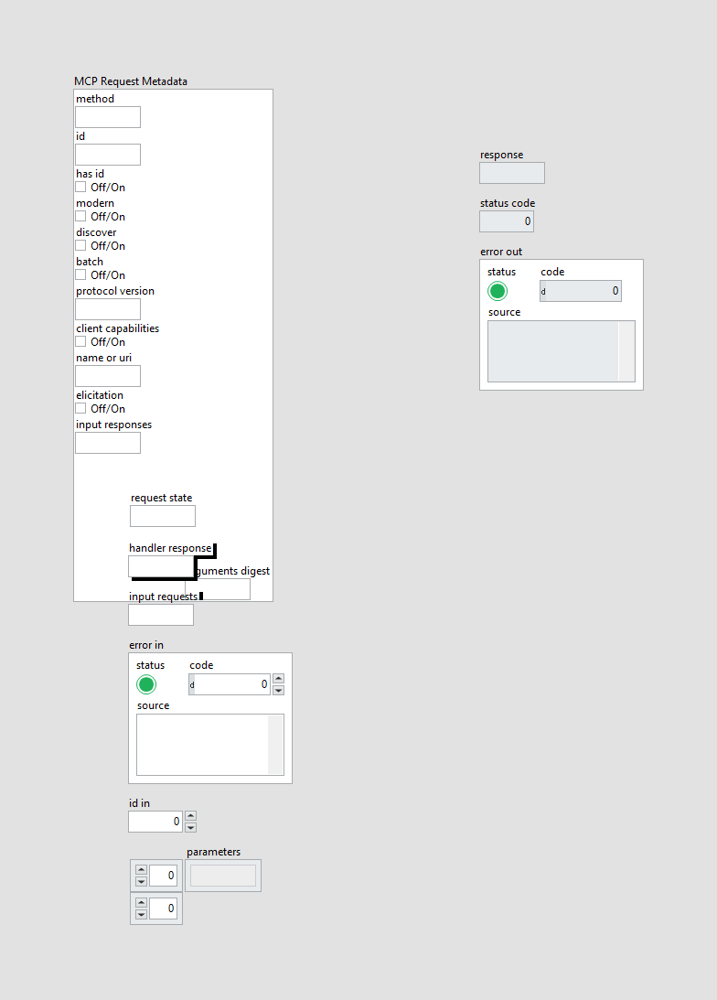 |

### `src/MCP Server/Confirm With User.vi` (modified)

**1. VI Attribute - Documentation (VI Properties)**

- **1A** description text : changed from "Asks the user of the MCP client to confirm something (MCP elicitation without fields), for example before a tool deletes data or moves hardware. A wrapper around Ask User.vi with an empty requestedSchema.  The tool VI runs twice: on the first run pending? is TRUE - return at once and do NOTHING else, no side effects. On the second run confirmed? is TRUE when the user accepted; when it is FALSE (and pending? and not supported? are FALSE) the user declined or cancelled. not supported? is TRUE when the client cannot be asked (a legacy client, or no elicitation capability): fall back to a safe default or refuse.  key must be unique within the tool. See Ask User.vi for the details and the restrictions of form mode (never ask for passwords or keys)." to "Asks the user of the MCP client to confirm something (MCP elicitation without fields), for example before a tool deletes data or moves hardware. A wrapper around Ask User.vi with an empty requestedSchema.  The tool VI runs twice: on the first run pending? is TRUE - return at once and do NOTHING else, no side effects. On the second run confirmed? is TRUE when the user accepted; when it is FALSE (and pending? and not supported? are FALSE) the user declined or cancelled. not supported? is TRUE when the client cannot be asked (a legacy client, or no elicitation capability): fall back to a safe default or refuse.  Works in tools/call and in prompts/get (in a prompt VI) of a modern request. A tool may ask several questions in several rounds; the server carries the earlier answers across the rounds (requestState). key must be unique within the tool. See Ask User.vi for the details and the restrictions of form mode (never ask for passwords or keys)."

Whole block diagram and front panel

| Before | After |
|---|---|
|  |  |

| Before | After |
|---|---|
|  | 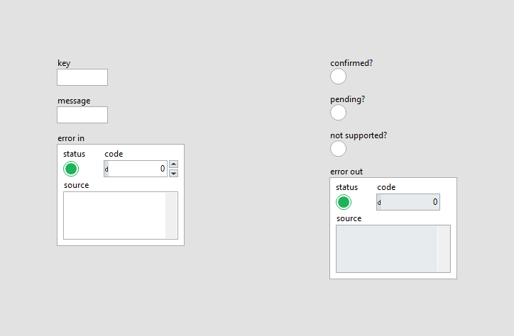 |

### `src/MCP Server/Handle MCP Request.vi` (modified)

**1. Block Diagram objects**

- **1A** SubVI "MCP Server.lvlib:Resolve Request State.vi" - added at (431,119)
- **1B** wiring changes

| Before | After |
|---|---|
| 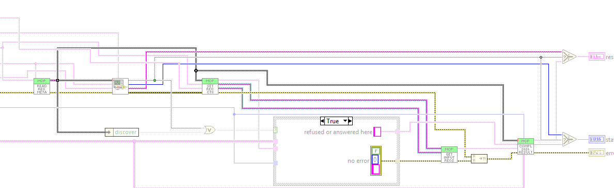 | 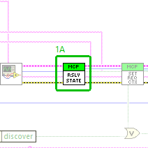 |

**2. VI Attribute - Documentation (VI Properties)**

- **2A** description text : changed from "Handles the body of one HTTP POST in either MCP era and returns the HTTP status code and the response body. Replaces the direct call of Handle Server Request Batch.vi in Process HTTP Request.vi.  ERA, per request, without session state (Read MCP Request Metadata.vi): a JSON object is MODERN (MCP 2026-07-28) when its params._meta carries io.modelcontextprotocol/protocolVersion, when the MCP-Protocol-Version header (protocol version) is one of the modern versions of Supported Protocol Versions.vi, or when its method is server/discover. Everything else is LEGACY and is passed to Handle Server Request Batch.vi unchanged, so legacy answers stay exactly as they were.  MODERN requests are checked first, in this order, and refused without being handled: - params._meta missing, or io.modelcontextprotocol/protocolVersion missing in it: 400, -32602. - MCP-Protocol-Version header missing or different from the _meta protocolVersion: 400, -32020 (header mismatch). - protocolVersion not one of the modern versions of Supported Protocol Versions.vi: 400, -32022 with data.supported and data.requested. - Mcp-Method header missing or different from method: 400, -32020. - tools/call and prompts/get: Mcp-Name must equal params.name; resources/read: params.uri. A value =?base64?...?= is decoded first. Missing or different: 400, -32020. - io.modelcontextprotocol/clientCapabilities missing in params._meta: 400, -32602. - A method the modern era does not have (it has server/discover, tools/list, tools/call, prompts/list, prompts/get, resources/list, resources/read and resources/templates/list; no initialize, ping, logging/setLevel or notifications/initialized): 404, -32601. Notifications (no id) are answered with 202 as before. A JSON array (batch) that comes with modern headers (an Mcp-Method header, or a modern MCP-Protocol-Version) is refused with 400, -32600.  MODERN results: server/discover is answered here (supportedVersions = all versions, capabilities and serverInfo as initialize reports them). Every other result is handled as before and then gets "resultType":"complete" and _meta io.modelcontextprotocol/serverInfo; the methods named in Cache Hints.vi also get ttlMs and cacheScope. resources/read errors -32002 (resource not found) become -32602 with data {"uri":}.  REQUEST CONTEXT: while a request is handled, its context ({"era","elicitation","inputResponses","id","progressToken","stream"}) is the only element of the named queue "MCP Request Context" (size 1, which also serialises request handling), and questions that Ask User.vi registers are collected from the named queue "MCP Input Requests". When a modern tools/call registered questions, the result is {"resultType":"input_required","inputRequests":{...}} instead of the tool result (no requestState: the retry carries the original params with inputResponses).  serverInfo is taken from initialize.vi (called with a synthetic initialize request), so name and version always match what initialize reports.  STREAMING: stream is empty for a normal request. For a streamed tools/call Run Streamed Request.vi passes the stream object {"events":..,"cancelled":..} (the queues of the MCP SSE Response, as numbers); it goes into the request context, where Report Progress.vi and Cancel Requested.vi find it. id and progressToken in the context are the JSON text of the request id and of params._meta.progressToken." to "Handles the body of one HTTP POST in either MCP era and returns the HTTP status code and the response body. Replaces the direct call of Handle Server Request Batch.vi in Process HTTP Request.vi.  ERA, per request, without session state (Read MCP Request Metadata.vi): a JSON object is MODERN (MCP 2026-07-28) when its params._meta carries io.modelcontextprotocol/protocolVersion, when the MCP-Protocol-Version header (protocol version) is one of the modern versions of Supported Protocol Versions.vi, or when its method is server/discover. Everything else is LEGACY and is passed to Handle Server Request Batch.vi unchanged, so legacy answers stay exactly as they were.  MODERN requests are checked first, in this order, and refused without being handled: - params._meta missing, or io.modelcontextprotocol/protocolVersion missing in it: 400, -32602. - MCP-Protocol-Version header missing or different from the _meta protocolVersion: 400, -32020 (header mismatch). - protocolVersion not one of the modern versions of Supported Protocol Versions.vi: 400, -32022 with data.supported and data.requested. - Mcp-Method header missing or different from method: 400, -32020. - tools/call and prompts/get: Mcp-Name must equal params.name; resources/read: params.uri. A value =?base64?...?= is decoded first. Missing or different: 400, -32020. - io.modelcontextprotocol/clientCapabilities missing in params._meta: 400, -32602. - requestState given (params.requestState) but unknown, expired, or issued for another method, params.name or params.arguments (Resolve Request State.vi): 400, -32602. - A method the modern era does not have (it has server/discover, tools/list, tools/call, prompts/list, prompts/get, resources/list, resources/read and resources/templates/list; no initialize, ping, logging/setLevel or notifications/initialized): 404, -32601. Notifications (no id) are answered with 202 as before. A JSON array (batch) that comes with modern headers (an Mcp-Method header, or a modern MCP-Protocol-Version) is refused with 400, -32600.  MODERN results: server/discover is answered here (supportedVersions = all versions, capabilities and serverInfo as initialize reports them). Every other result is handled as before and then gets "resultType":"complete" and _meta io.modelcontextprotocol/serverInfo; the methods named in Cache Hints.vi also get ttlMs and cacheScope. resources/read errors -32002 (resource not found) become -32602 with data {"uri":}.  REQUEST CONTEXT: while a request is handled, its context ({"era","elicitation","inputResponses","id","progressToken","stream"}) is the only element of the named queue "MCP Request Context" (size 1, which also serialises request handling), and questions that Ask User.vi registers are collected from the named queue "MCP Input Requests". When a modern tools/call or prompts/get registered questions, the result is {"resultType":"input_required","inputRequests":{...},"requestState":""} instead of the tool or prompt result.  MULTI ROUND-TRIP REQUESTS (requestState): the answers of every round so far are kept in the server (Request State Store.vi, 10 minutes) and only an opaque token goes to the client as requestState. On the retry Resolve Request State.vi, called after Check Modern MCP Request.vi, checks the token against method, params.name and the digest of params.arguments and merges the kept answers into inputResponses, so a tool that asks in several rounds (Ask User.vi) gets every earlier answer; a refused token is answered as above.  serverInfo is taken from initialize.vi (called with a synthetic initialize request), so name and version always match what initialize reports.  STREAMING: stream is empty for a normal request. For a streamed tools/call Run Streamed Request.vi passes the stream object {"events":..,"cancelled":..} (the queues of the MCP SSE Response, as numbers); it goes into the request context, where Report Progress.vi and Cancel Requested.vi find it. id and progressToken in the context are the JSON text of the request id and of params._meta.progressToken."

Whole block diagram and front panel

| Before | After |
|---|---|
| 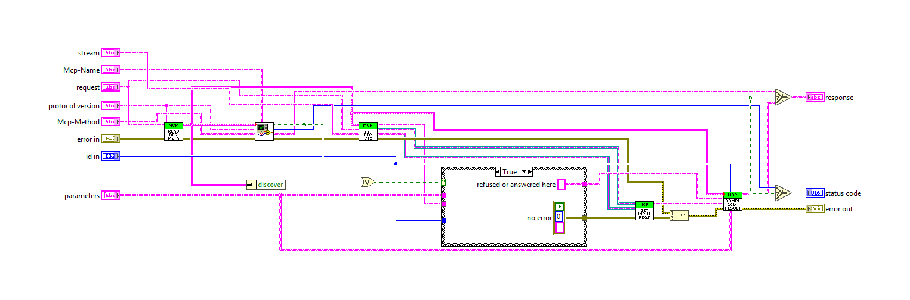 | 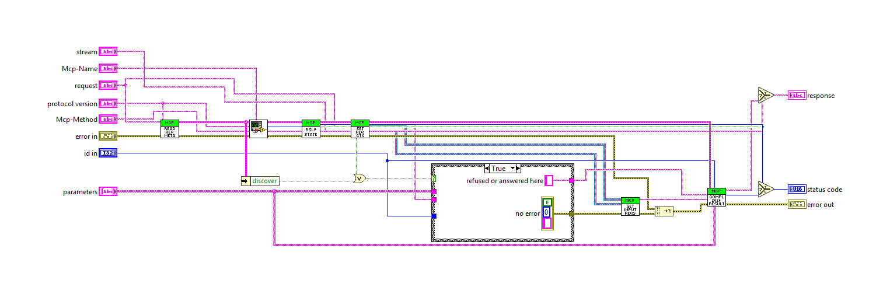 |

| Before | After |
|---|---|
|  |  |

All case frames (1 hidden frames)

| Frame | Picture |
|---|---|
| Whole diagram, visible frames: Case structure 1: True | 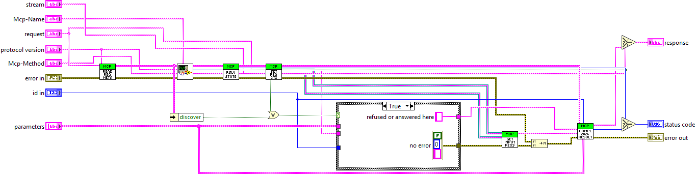 |
| Case structure 1: False |  |

### `src/MCP Server/Input Required Response.vi` (modified)

**1. Block Diagram objects**

- **1A** Front Panel Terminal "MCP Request Metadata" - added at (40,288)
- **1B** String Constant "prompts/get" - added at (105,411)
- **1C** Unbundle By Name  - added at (240,226)
- **1D** Equal?  - added at (246,108)
- **1E** Or  - added at (420,48)
- **1F** Case Structure  - added at (598,40)
- **1G** String Constant "no requestState" - added at (713,69)
- **1H** String Constant "answers a" - added at (680,69)
- **1I** String Constant "answers b" - added at (684,131)
- **1J** Cluster Constant "no error" - added at (807,132)
- **1K** Concatenate Strings  - added at (807,194)
- **1L** Enum Constant "store" - added at (885,69)
- **1M** SubVI "MCP Server.lvlib:Request State Store.vi" - added at (998,194)
- **1N** String Constant "rs a" - added at (1018,69)
- **1O** String Constant "rs b" - added at (1020,131)
- **1P** Concatenate Strings  - added at (1171,70)
- **1Q** Tunnel  - added at (598,70)
- **1R** Tunnel  - added at (598,94)
- **1S** Tunnel  - added at (598,118)
- **1T** Tunnel  - added at (598,142)
- **1U** Tunnel  - added at (1234,70)
- **1V** Concatenate Strings  - number of terminals : changed from "8" to "9"
- **1W** wiring changes

| Before | After |
|---|---|
| 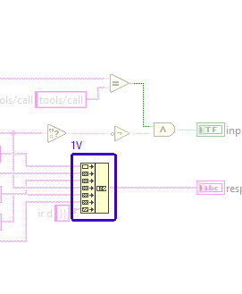 | 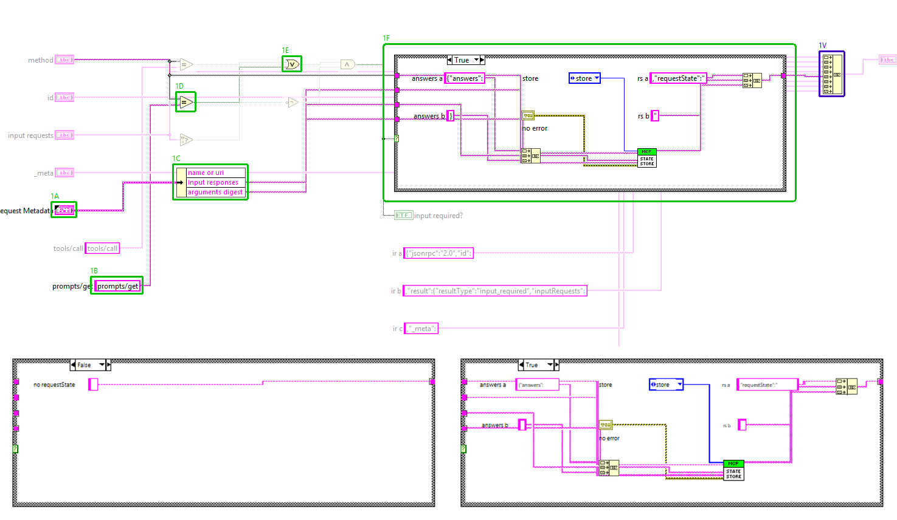 |

**2. Front Panel - Panel**

- **2A** Connector Pane  - control/indicator assignment : changed

| Before | After |
|---|---|
| 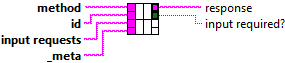 | 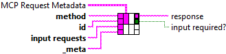 |

**3. Front Panel objects**

- **3A** Type Definition "MCP Request Metadata" - added at (-39,315)

| Before | After |
|---|---|
|  | 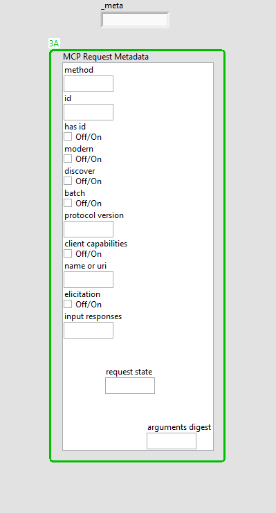 |

**4. VI Attribute - Documentation (VI Properties)**

- **4A** description text : changed from "Builds the answer to a modern tools/call for which the tool registered questions (Ask User.vi): {"jsonrpc":"2.0","id":,"result":{"resultType":"input_required","inputRequests":,"_meta":}}. input required? is TRUE when method is tools/call and input requests is not empty. Used by Complete Modern MCP Result.vi." to "Builds the answer to a modern tools/call or prompts/get for which the tool or prompt VI registered questions (Ask User.vi, Confirm With User.vi): {"jsonrpc":"2.0","id":,"result":{"resultType":"input_required","inputRequests":,"requestState":"","_meta":}}. input required? is TRUE when method is tools/call or prompts/get and input requests is not empty. Used by Complete Modern MCP Result.vi.  requestState (MCP 2026-07-28 multi round-trip requests): when input is required, {"answers":} - the answers of this and every earlier round, already merged by Resolve Request State.vi - is kept in Request State Store.vi together with method, name or uri and arguments digest, and the token it returns is sent as requestState. The client sends it back with the answers to the new inputRequests, and Resolve Request State.vi merges the kept answers in again, so a tool that asks in several rounds finds every answer. The token is opaque; the state never leaves the server. Nothing is stored when no input is required."

Whole block diagram and front panel

| Before | After |
|---|---|
| 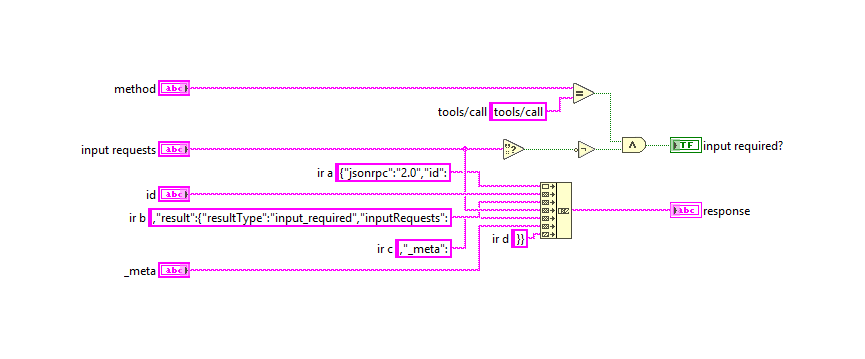 | 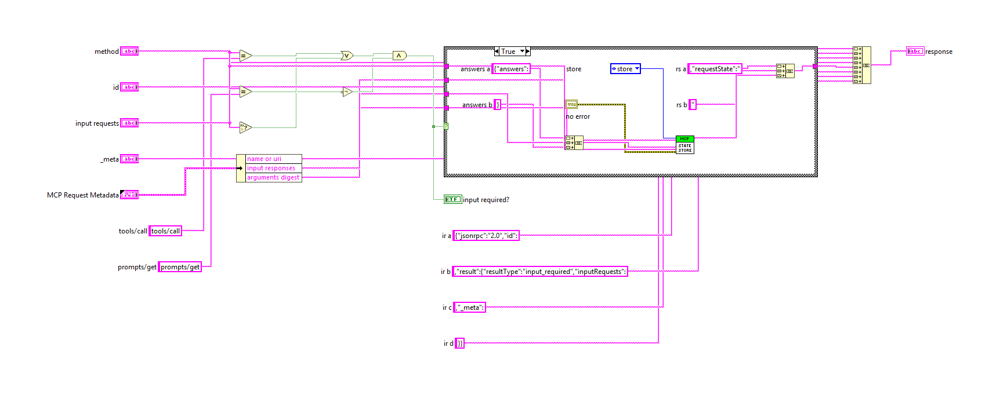 |

| Before | After |
|---|---|
| 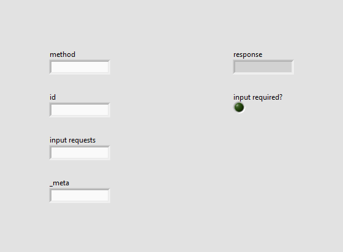 | 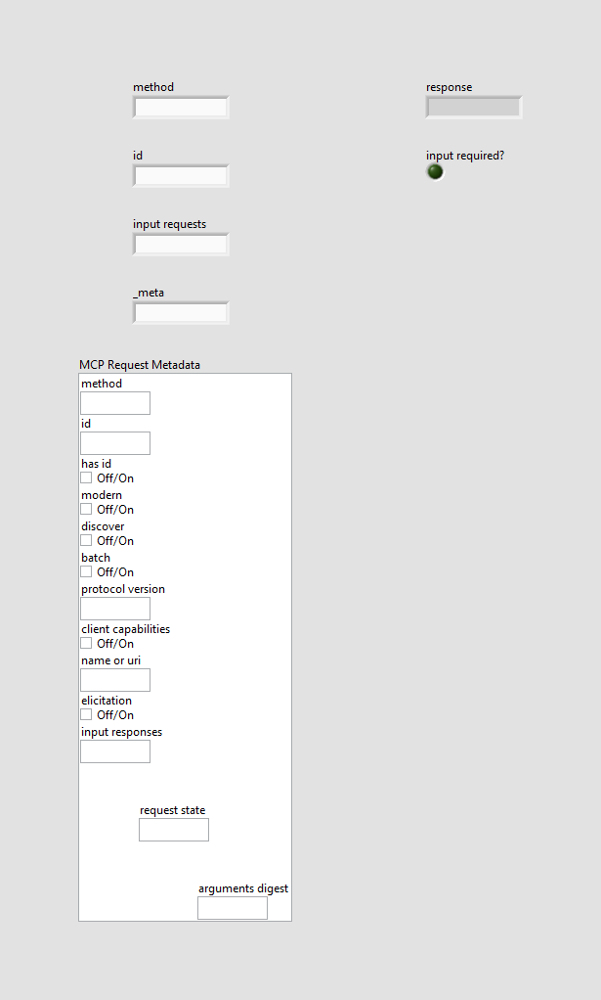 |

All case frames (1 hidden frames)

| Frame | Picture |
|---|---|
| Whole diagram, visible frames: Case structure 1: True | 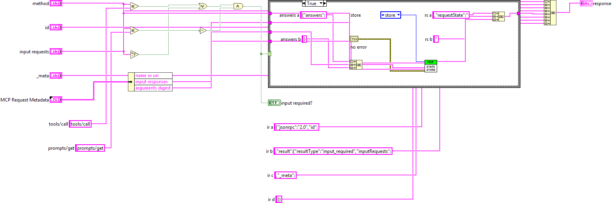 |
| Case structure 1: False | 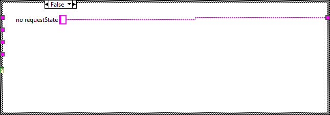 |

### `src/MCP Server/MCP Request Metadata.ctl` (modified)

**1. Front Panel - Cluster**

- **1A** Cluster "MCP Request Metadata" - cluster elements added/deleted : changed from "" to "arguments digest request state"

| Before | After |
|---|---|
| 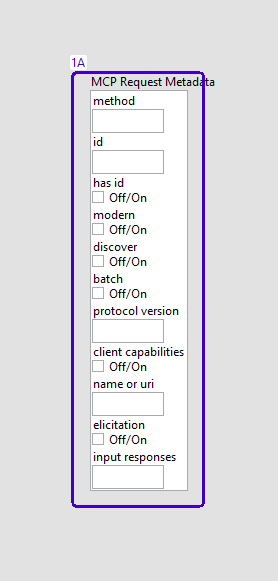 | 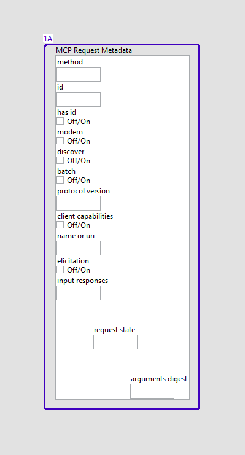 |

Whole block diagram and front panel

| Before | After |
|---|---|
|  |  |

| Before | After |
|---|---|
| 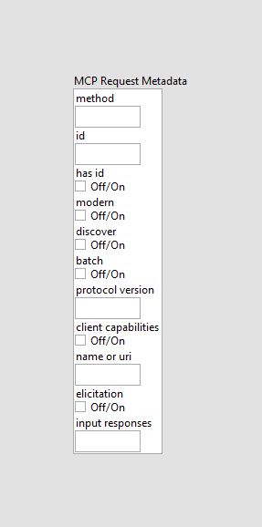 | 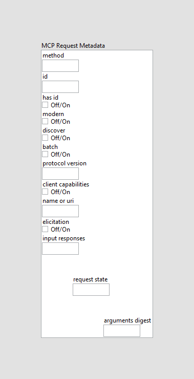 |

### `src/MCP Server/Prepare Request Dispatch.vi` (modified)

**1. Block Diagram objects**

- **1A** SubVI "MCP Server.lvlib:Resolve Request State.vi" - added at (1175,391)
- **1B** wiring changes

| Before | After |
|---|---|
| 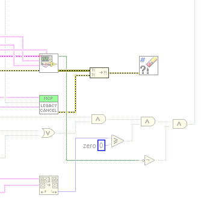 | 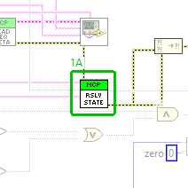 |

**2. VI Attribute - Documentation (VI Properties)**

- **2A** description text : changed from "Decides, in Process HTTP Request.vi and before Handle MCP Request.vi, how an accepted HTTP POST is answered.  LEGACY CANCELLATION: a single JSON-RPC notification {"method":"notifications/cancelled","params":{"requestId":..}} (MCP 2025-06-18 and older) is recorded in Legacy Cancellations.vi and answered with 202 at once; Handle MCP Request.vi is not called. The running tools/call sees it through Report Progress.vi and Cancel Requested.vi. While a STREAMED tools/call runs this works at once, because Process HTTP Request.vi returns as soon as the stream is set up. While a non-streamed tools/call runs, the notification waits behind it (Process HTTP Request.vi handles one request at a time) and has no effect. Every dispatched request first clears its own id from Legacy Cancellations.vi, so a notification that arrived too late never cancels a later request that reuses the id.  STREAMING: stream? is TRUE for a tools/call with an id whose params._meta.progressToken is a string or a number, when the Accept header contains text/event-stream and Check Modern MCP Request.vi would not refuse it. Both eras; the era is decided by Read MCP Request Metadata.vi from the body and the MCP-Protocol-Version header (protocol version). Then accepted out is FALSE so that the request is not handled synchronously; Start Streamed Request.vi handles it instead.  Everything else passes through unchanged." to "Decides, in Process HTTP Request.vi and before Handle MCP Request.vi, how an accepted HTTP POST is answered.  LEGACY CANCELLATION: a single JSON-RPC notification {"method":"notifications/cancelled","params":{"requestId":..}} (MCP 2025-06-18 and older) is recorded in Legacy Cancellations.vi and answered with 202 at once; Handle MCP Request.vi is not called. The running tools/call sees it through Report Progress.vi and Cancel Requested.vi. While a STREAMED tools/call runs this works at once, because Process HTTP Request.vi returns as soon as the stream is set up. While a non-streamed tools/call runs, the notification waits behind it (Process HTTP Request.vi handles one request at a time) and has no effect. Every dispatched request first clears its own id from Legacy Cancellations.vi, so a notification that arrived too late never cancels a later request that reuses the id.  STREAMING: stream? is TRUE for a tools/call with an id whose params._meta.progressToken is a string or a number, when the Accept header contains text/event-stream and neither Check Modern MCP Request.vi nor Resolve Request State.vi (an unknown, expired or mis-bound requestState) would refuse it, so that a refusal is always a plain HTTP error and never a stream. Both eras; the era is decided by Read MCP Request Metadata.vi from the body and the MCP-Protocol-Version header (protocol version). Then accepted out is FALSE so that the request is not handled synchronously; Start Streamed Request.vi handles it instead.  Everything else passes through unchanged."

Whole block diagram and front panel

| Before | After |
|---|---|
| 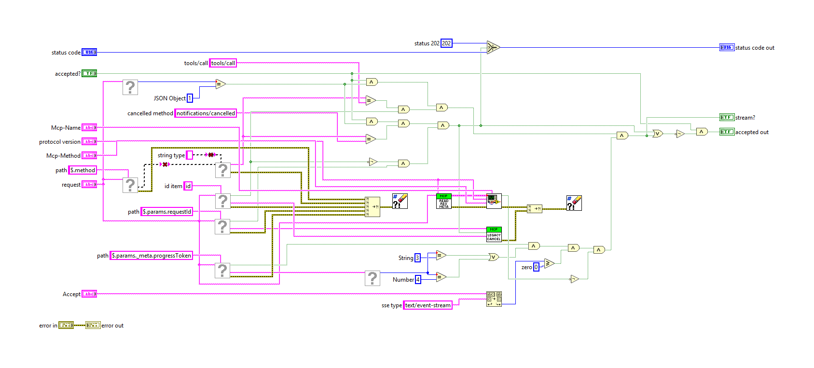 | 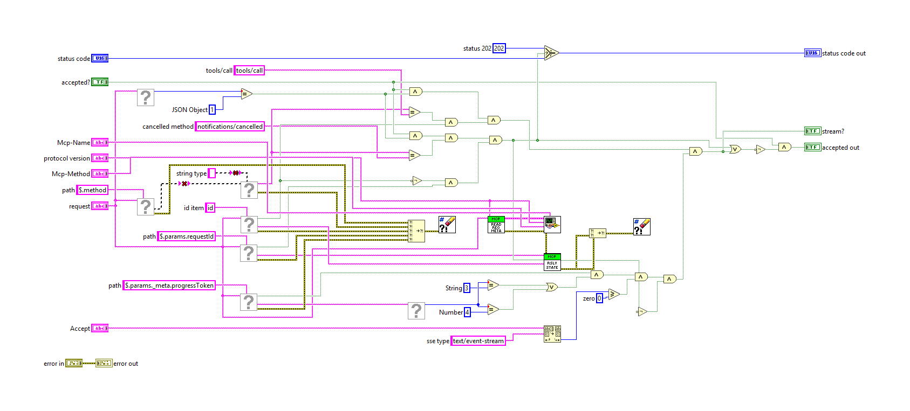 |

| Before | After |
|---|---|
|  |  |

### `src/MCP Server/Read MCP Request Metadata.vi` (modified)

**1. Block Diagram objects**

- **1A** String Constant "path" - data type name : changed from "resources/read" to "path"
- **1B** String Constant "path" - data value : changed from ""resources/read"" to ""$.params._meta."io.modelcontextprotocol/protocolVersion"""
- **1C** String Constant "path" - data type name : changed from "string type" to "path"
- **1D** String Constant "path" - data value : changed from """" to ""$.params._meta."io.modelcontextprotocol/clientCapabilities"""
- **1E** String Constant "path" - data value : changed from ""$.params._meta."io.modelcontextprotocol/clientCapabilities""" to ""$.params.name""
- **1F** String Constant "path" - data value : changed from ""$.elicitation"" to ""$.params.arguments""
- **1G** String Constant "path" - data type name : changed from "id item" to "path"
- **1H** String Constant "path" - data value : changed from ""id"" to ""$.method""
- **1I** String Constant "path" - data value : changed from """" to ""$.params.inputResponses""
- **1J** String Constant "path" - data value : changed from ""$.params._meta."io.modelcontextprotocol/protocolVersion""" to ""$.params.uri""
- **1K** String Constant "path" - data value : changed from ""$.method"" to ""$.params.requestState""
- **1L** String Constant "id item" - added at (78,473)
- **1M** String Constant "null" - added at (468,473)
- **1N** String Constant "path" - data value : changed from ""$.params.uri"" to ""$.elicitation""
- **1O** String Constant "string type" - data type name : changed from "null" to "string type"
- **1P** String Constant "string type" - data value : changed from ""null"" to """"
- **1Q** String Constant "string type" - data type name : changed from "path" to "string type"
- **1R** String Constant "string type" - data value : changed from ""$.params.name"" to """"
- **1S** String Constant "string type" - added at (503,659)
- **1T** String Constant "no responses" - data type name : changed from "server/discover" to "no responses"
- **1U** String Constant "no responses" - data value : changed from ""server/discover"" to ""{}""
- **1V** SubVI "Find Item.vi" - added at (601,350)
- **1W** SubVI "Find Item.vi" - added at (601,412)
- **1X** SubVI "From JSON Text.vim" - added at (693,350)
- **1Y** String Constant "server/discover" - data type name : changed from "no responses" to "server/discover"
- **1Z** String Constant "server/discover" - data value : changed from ""{}"" to ""server/discover""
- **127** String Constant "resources/read" - data type name : changed from "path" to "resources/read"
- **128** String Constant "resources/read" - data value : changed from ""$.params.inputResponses"" to ""resources/read""
- **129** And  - added at (1197,110)
- **130** Case Structure  - added at (1285,40)
- **131** Cluster Constant "no error" - added at (1315,132)
- **132** String Constant "no digest" - added at (1367,69)
- **133** SubVI "Minify.vi" - added at (1315,70)
- **134** String To Byte Array  - added at (1410,81)
- **135** SubVI "NI_Message Digest API.lvlib:SHA-256 Byte Array Checksum.vi" - added at (1499,70)
- **136** Tunnel  - added at (1285,70)
- **137** Tunnel  - added at (1562,70)
- **138** Tunnel  - added at (1562,94)
- **139** Merge Errors  - number of terminals : changed from "13" to "17"
- **140** Bundle By Name  - number of elements : changed from "11" to "13"
- **141** Bundle By Name  - element 11 added : "request state"
- **142** Bundle By Name  - element 12 added : "arguments digest"
- **143** Front Panel Terminal "MCP Request Metadata" - data type : changed
- **144** wiring changes

| Before | After |
|---|---|
| 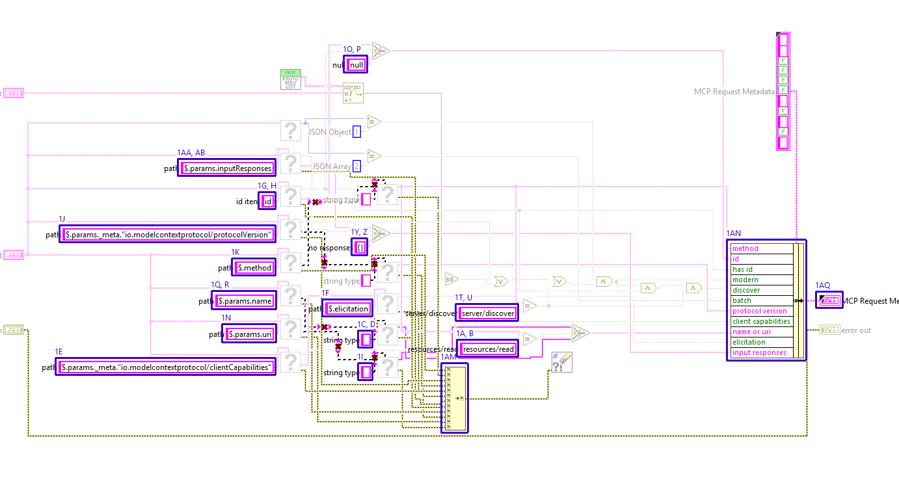 | 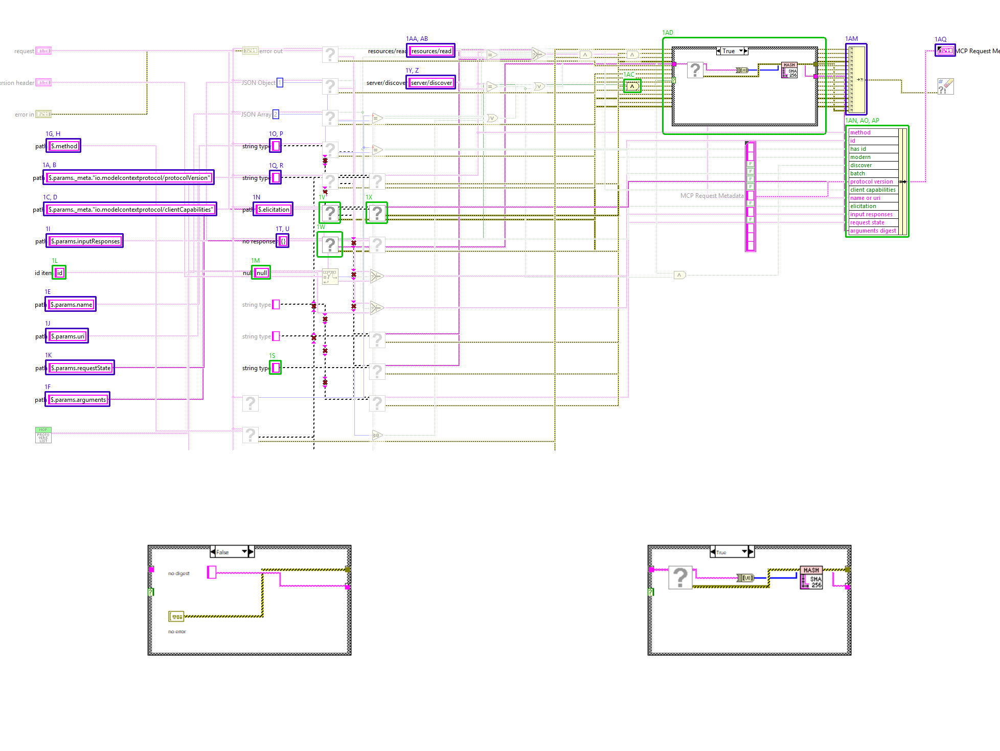 |

**2. VI Attribute - Documentation (VI Properties)**

- **2A** description text : changed from "Reads what Handle MCP Request.vi needs to know about one request body and returns it as MCP Request Metadata.ctl: the method, the id as JSON text (null when missing), the io.modelcontextprotocol/protocolVersion (empty when missing) and clientCapabilities of params._meta, params.uri for resources/read and params.name otherwise, the elicitation capability, and params.inputResponses ({} when missing).  It also decides the era, per request and without session state. A JSON object is MODERN (MCP 2026-07-28) when any of these holds: params._meta carries io.modelcontextprotocol/protocolVersion; the MCP-Protocol-Version request header (protocol version header) is one of the modern versions of Supported Protocol Versions.vi; the method is server/discover. initialize is not excluded: a modern initialize is refused by Check Modern MCP Request.vi with 404. Everything else is LEGACY, so a legacy client, which sends no MCP-Protocol-Version header or a legacy one, stays legacy. A modern server/discover request with an id is marked discover, a JSON array is marked batch.  A missing item is not an error of the request: the JSONtext errors are merged and cleared here. error in is passed through unchanged and does not stop the reading." to "Reads what Handle MCP Request.vi needs to know about one request body and returns it as MCP Request Metadata.ctl: the method, the id as JSON text (null when missing), the io.modelcontextprotocol/protocolVersion (empty when missing) and clientCapabilities of params._meta, params.uri for resources/read and params.name otherwise, the elicitation capability, params.inputResponses ({} when missing), params.requestState as request state (empty when missing) and, for a modern request, the arguments digest: the SHA-256 (SHA-256 Byte Array Checksum.vi) of params.arguments as 64 hex characters, after the arguments were re-serialised with Minify.vi so that whitespace does not matter (empty when there are no arguments, and for a legacy request). Resolve Request State.vi and Input Required Response.vi use request state and arguments digest to bind a requestState to the request it was issued for.  It also decides the era, per request and without session state. A JSON object is MODERN (MCP 2026-07-28) when any of these holds: params._meta carries io.modelcontextprotocol/protocolVersion; the MCP-Protocol-Version request header (protocol version header) is one of the modern versions of Supported Protocol Versions.vi; the method is server/discover. initialize is not excluded: a modern initialize is refused by Check Modern MCP Request.vi with 404. Everything else is LEGACY, so a legacy client, which sends no MCP-Protocol-Version header or a legacy one, stays legacy. A modern server/discover request with an id is marked discover, a JSON array is marked batch.  A missing item is not an error of the request: the JSONtext errors are merged and cleared here. error in is passed through unchanged and does not stop the reading."

Whole block diagram and front panel

| Before | After |
|---|---|
|  | 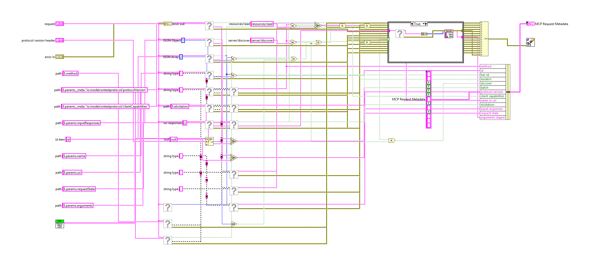 |

| Before | After |
|---|---|
| 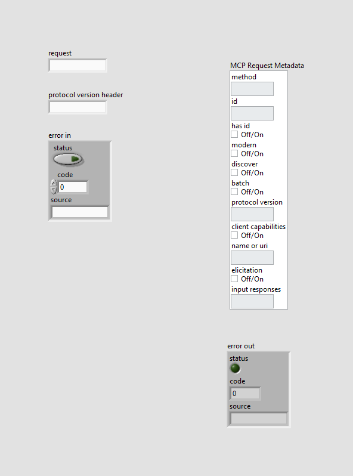 | 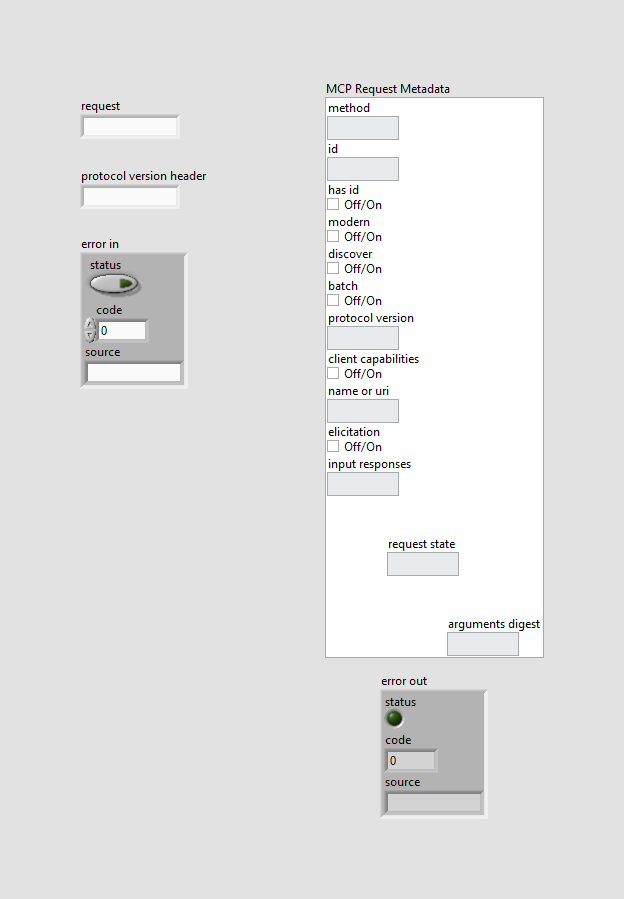 |

All case frames (1 hidden frames)

| Frame | Picture |
|---|---|
| Whole diagram, visible frames: Case structure 1: True | 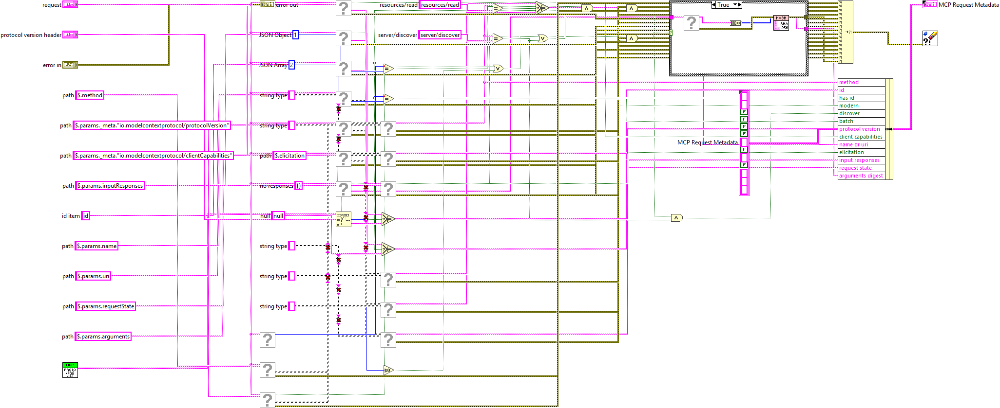 |
| Case structure 1: False | 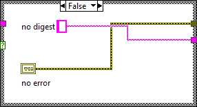 |

### `src/MCP Server/Set MCP Request Context.vi` (modified)

**1. Block Diagram objects**

- **1A** Front Panel Terminal "MCP Request Metadata" - data type : changed

| Before | After |
|---|---|
| 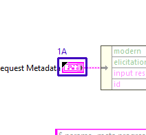 |  |

**2. VI Attribute - Documentation (VI Properties)**

- **2A** description text : changed from "Publishes the context of the request about to be handled, so that Ask User.vi can read it while a tool runs: {"era","elicitation","inputResponses","id","progressToken","stream"} becomes the only element of the named queue "MCP Request Context". The queue has size 1, which also serialises request handling: the enqueue waits while another request still holds the context. Questions left over in the named queue "MCP Input Requests" are discarded.  era is "modern" or "legacy"; elicitation is true only for a modern request whose clientCapabilities carry elicitation. id is the id of MCP Request Metadata (the JSON text of the request id, null when missing). progressToken is params._meta.progressToken of the request as JSON text, null when missing. stream is the stream input, null when it is empty. Report Progress.vi and Cancel Requested.vi read id, progressToken and stream from the context.  Both queue references stay open and go to Collect MCP Input Requests.vi, which takes the context out again and releases them. request out is request, passed on only once the context is in place, so that the request handler that consumes it runs after this.  Queue errors do not stop the request and are discarded, as before the split; so is the error of looking up progressToken. error in is passed through unchanged." to "Publishes the context of the request about to be handled, so that Ask User.vi can read it while a tool runs: {"era","elicitation","inputResponses","id","progressToken","stream"} becomes the only element of the named queue "MCP Request Context". The queue has size 1, which also serialises request handling: the enqueue waits while another request still holds the context. Questions left over in the named queue "MCP Input Requests" are discarded.  era is "modern" or "legacy"; elicitation is true only for a modern request whose clientCapabilities carry elicitation. inputResponses is input responses of MCP Request Metadata: params.inputResponses of the request, merged by Resolve Request State.vi with the answers of the earlier rounds that the requestState stands for. id is the id of MCP Request Metadata (the JSON text of the request id, null when missing). progressToken is params._meta.progressToken of the request as JSON text, null when missing. stream is the stream input, null when it is empty. Report Progress.vi and Cancel Requested.vi read id, progressToken and stream from the context.  Both queue references stay open and go to Collect MCP Input Requests.vi, which takes the context out again and releases them. request out is request, passed on only once the context is in place, so that the request handler that consumes it runs after this.  Queue errors do not stop the request and are discarded, as before the split; so is the error of looking up progressToken. error in is passed through unchanged."

Whole block diagram and front panel

| Before | After |
|---|---|
| 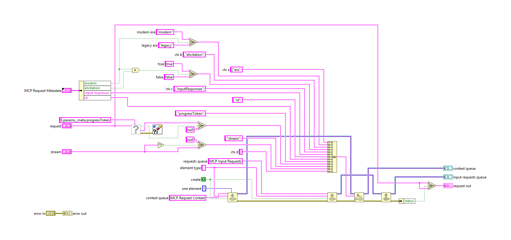 |  |

| Before | After |
|---|---|
| 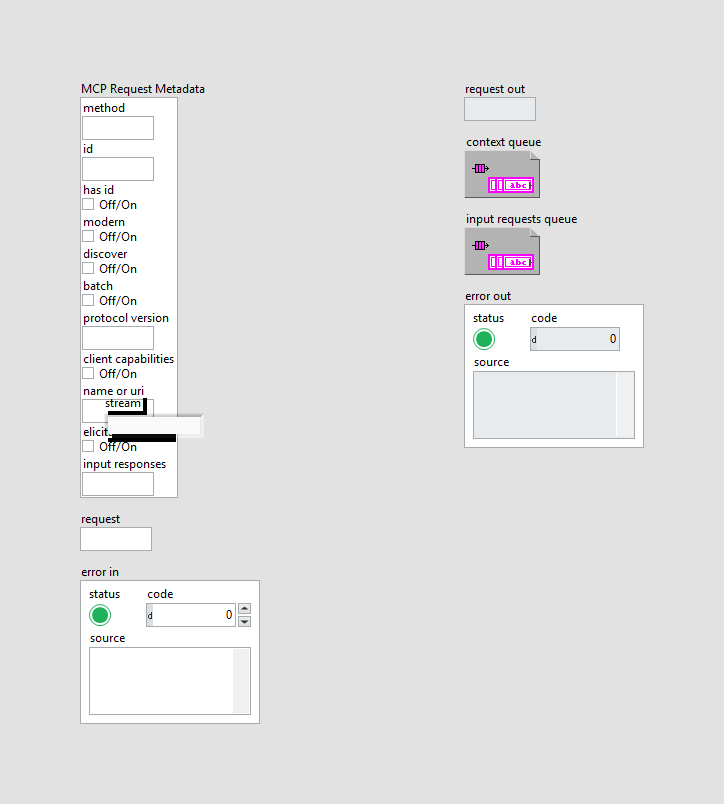 | 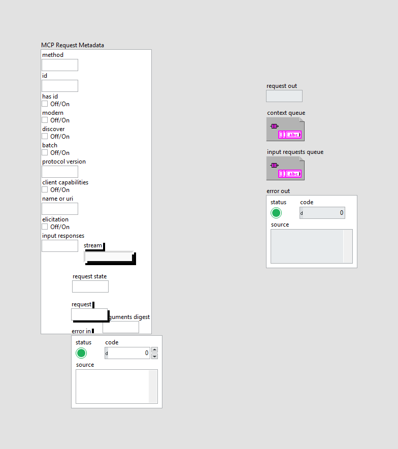 |

### `tests/Test_MCP_Server.vi` (modified)

**1. Block Diagram objects**

- **1A** SubVI "MCP Server tests.lvlib:Add Fixture Two Questions Tool.vi" - added at (2146,429)
- **1B** SubVI "MCP Server tests.lvlib:Add Fixture Ask User Prompt.vi" - added at (2146,489)
- **1C** wiring changes

| Before | After |
|---|---|
| 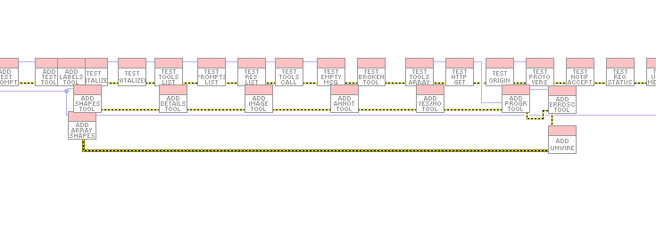 |  |

**2. Block Diagram objects**

- **2A** SubVI "MCP Server tests.lvlib:test request state rounds.vi" - added at (5516,345)
- **2B** SubVI "MCP Server tests.lvlib:test request state refused.vi" - added at (5516,405)
- **2C** SubVI "MCP Server tests.lvlib:test prompt elicitation.vi" - added at (5516,465)
- **2D** wiring changes

| Before | After |
|---|---|
|  |  |

Whole block diagram and front panel

| Before | After |
|---|---|
|  |  |

| Before | After |
|---|---|
|  |  |

### `src/MCP Server/Request State Store.vi` (added)

Block diagram (case structures show their visible frame only):

Front panel

All case frames (2 hidden frames)

| Frame | Picture |
|---|---|
| Whole diagram, visible frames: Case structure 1: "store" |  |
| Case structure 1: "take" |  |
| Case structure 1: "clear" |  |

### `src/MCP Server/Resolve Request State.vi` (added)

Block diagram (case structures show their visible frame only):

Front panel

All case frames (1 hidden frames)

| Frame | Picture |
|---|---|
| Whole diagram, visible frames: Case structure 1: True |  |
| Case structure 1: False |  |

### `tests/Add Fixture Ask User Prompt.vi` (added)

Block diagram (case structures show their visible frame only):

Front panel

### `tests/Add Fixture Two Questions Tool.vi` (added)

Block diagram (case structures show their visible frame only):

Front panel

### `tests/fake prompt ask user.vi` (added)

Block diagram (case structures show their visible frame only):

Front panel

All case frames (1 hidden frames)

| Frame | Picture |
|---|---|
| Whole diagram, visible frames: Case structure 1: True |  |
| Case structure 1: False |  |

### `tests/fake tool two questions.vi` (added)

Block diagram (case structures show their visible frame only):

Front panel

All case frames (1 hidden frames)

| Frame | Picture |
|---|---|
| Whole diagram, visible frames: Case structure 1: True |  |
| Case structure 1: False |  |

### `tests/test prompt elicitation.vi` (added)

Block diagram (case structures show their visible frame only):

Front panel

### `tests/test request state refused.vi` (added)

Block diagram (case structures show their visible frame only):

Front panel

### `tests/test request state rounds.vi` (added)

Block diagram (case structures show their visible frame only):

Front panel

